# 컴퓨터는 다음 낱말을 어떻게 맞힐까요?

## 자판과 챗봇은 같은 일을 해요

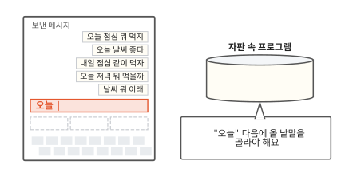

휴대폰으로 메시지를 쓰면 자판 위에 다음 낱말 후보가 떠요. 그림의 휴대폰으로는 지금까지 메시지를 다섯 개 보냈어요. 이번에는 새 메시지 칸에 "오늘"을 쳤어요. 오른쪽 원통은 자판 속에서 후보를 고르는 프로그램이에요.

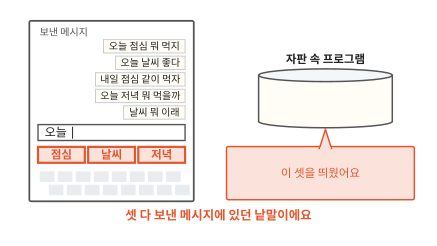

자판 위에 [점심] [날씨] [저녁]이 떴어요. 아직 치지 않은 낱말을 프로그램이 미리 맞혀 본 거예요. 마음에 드는 후보를 누르면 그 낱말이 메시지에 붙어요.

이번엔 챗봇을 떠올려 봐요. 챗봇은 질문을 받으면 후보 대신 긴 답을 써 줘요. 자판과는 전혀 다른 일을 하는 것처럼 보여요.

챗봇에게 "점심 뭐 먹지?"라고 물었어요. 답은 한꺼번에 나오지 않아요. 챗봇 속 프로그램은 첫 낱말로 "따뜻한"을 맞혀 답에 붙였어요. 지금은 질문과 "따뜻한"을 보고 다음 낱말 하나를 맞히는 중이에요.

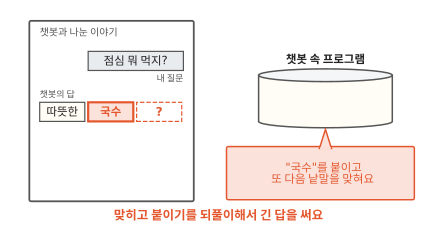

맞힌 낱말 "국수"가 답에 붙었어요. 프로그램은 늘어난 답을 다시 보고 그다음 낱말을 또 맞혀요. 답이 끝날 때까지 이 일을 되풀이하면 긴 답 하나가 돼요.

자판과 챗봇이 하는 일은 하나예요. 둘 다 앞 말을 보고 다음 낱말 하나를 맞혀요. 다른 점은 챗봇이 맞힌 낱말을 답에 붙여 가며 또 맞힌다는 것뿐이에요.

그럼 다음 낱말은 어떻게 맞힐까요? 가장 쉬운 방법은 지난 글에서 무엇이 왔는지 세어 두는 거예요. 세어서 맞히는 방법을 메시지 다섯 개로 직접 해 볼게요. 어디서 엉키고 막히는지도 함께 봐요.

## 가장 쉬운 방법은 세어 두는 거예요

자판 속 프로그램이 가진 것은 보낸 메시지 다섯 개뿐이에요. 그 안에서 "오늘"을 찾아 바로 다음에 무엇이 왔는지 보면 돼요.

보낸 메시지를 띄어쓰기로 잘라서 낱말 칸으로 늘어놓았어요. 메시지는 위에서부터 1번, 2번처럼 번호로 부를게요. "오늘"은 1번, 2번, 4번 메시지에 있어요. 바로 다음 낱말은 점심, 날씨, 저녁이에요. 자판에 뜬 셋이 모두 여기 있어요.

오른쪽은 찾은 것을 적어 두는 횟수표예요. 왼쪽 칸에 앞 낱말을 적고 그 옆에 다음 낱말과 나온 횟수를 적어요. 그래서 "오늘" 줄에는 "점심 1, 날씨 1, 저녁 1"이 들어가요.

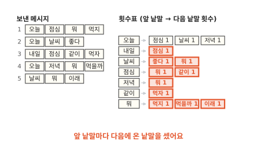

다른 낱말도 같은 방법으로 세요. "점심" 다음에는 뭐와 같이가 한 번씩 왔어요. "뭐" 다음에는 먹지, 먹을까, 이래가 한 번씩 왔어요.

표를 미리 만들어 두면 낱말을 칠 때마다 메시지를 다시 읽지 않아도 돼요. "오늘"을 치면 표에서 "오늘" 줄을 펼쳐요. 그 줄에 적힌 낱말을 띄우면 끝이에요.

이렇게 앞 낱말을 보고 다음 낱말을 맞히는 프로그램을 **언어 모델**(language model)이라고 해요.

자판 속 프로그램도 챗봇 속 프로그램도 언어 모델이에요. 자판은 맞힌 낱말을 띄우기만 했어요. 횟수표만 가지고도 챗봇처럼 이어 쓸 수 있을까요?

## 세어서 이어 뽑으면 글이 돼요

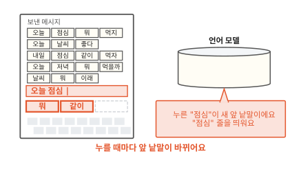

자판에서 "오늘"을 치고 [점심]을 눌러 볼게요. 메시지 칸은 "오늘 점심"이 돼요. 이제 맨 끝 낱말은 "점심"이에요. 언어 모델은 "점심"을 새 앞 낱말로 보고 표의 "점심" 줄에서 [뭐] [같이]를 띄워요.

후보를 누를 때마다 이 일이 되풀이돼요. 그래서 누르기만 해도 문장이 하나 생겨요. 챗봇이 맞힌 낱말을 붙이던 일과 같아요.

이 일을 빈 메시지 칸에서 시작해 끝까지 해 보려면 두 가지가 더 있어야 해요. 첫 낱말은 무엇 다음에서 고를까요? 언제 멈출까요?

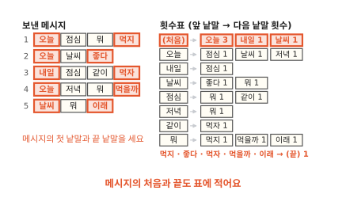

메시지의 첫 낱말 앞에는 "(처음)"이 있다고 치고 세요. 다섯 메시지 가운데 셋이 "오늘"로 시작해요. 그래서 "(처음)" 줄에는 "오늘 3, 내일 1, 날씨 1"이 적혀요. 끝 낱말 다음에는 "(끝)"이 왔다고 적어요. 다음 낱말로 "(끝)"이 나오면 문장을 멈춰요.

남은 것은 후보가 여럿일 때 무엇을 고르느냐예요. 늘 1등만 고르면 몇 번을 해도 같은 문장만 나와요. "오늘" 줄처럼 셋 다 1번이면 1등이 없기도 해요.

그래서 횟수만큼 제비뽑기 쪽지를 만들어 통에 넣고 한 장을 뽑아요. "(처음)" 줄이면 오늘 3장, 내일 1장, 날씨 1장이에요. 다섯 번 뽑으면 세 번쯤은 "오늘"이 나와요. 적게 나온 낱말에도 차례가 와요. 그림에서는 "내일"이 뽑혔어요.

"내일" 다음 낱말은 "내일" 줄에서 뽑아요. 그 줄에는 "점심"뿐이라 "점심"이 붙어요. "점심" 줄에서는 "뭐"가 뽑혔어요. 그림은 "뭐" 줄의 제비 석 장 가운데 "먹지"를 뽑는 장면이에요.

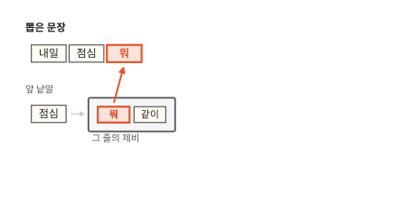

"먹지" 다음에는 늘 "(끝)"이 왔어요. 그래서 문장이 여기서 멈춰요. 뽑은 문장은 "내일 점심 뭐 먹지"예요.

보낸 메시지 다섯 개에는 이 문장이 없어요. 3번 메시지의 "내일 점심"과 1번 메시지의 "점심 뭐 먹지"가 "점심"에서 이어졌어요. 세기만 했는데도 보낸 적 없는 새 문장을 지었어요.

앞 낱말을 보고 뽑고 붙이기를 "(끝)"까지 되풀이했어요. 챗봇이 글을 쓰는 방식을 가장 작게 줄인 모형이에요.

??? info "심화: 섀넌은 1948년에 같은 실험을 했어요"
    세어서 이어 붙이는 생각이 언제부터 있었는지 궁금할 때 보는 칸이에요.

    클로드 섀넌은 1948년 논문에서 영어로 비슷한 실험을 했어요.[^shannon] 먼저 앞 글자 하나를 보고 다음 글자를 골랐어요. 그다음엔 앞 글자 둘을 보고 골랐어요. 앞을 많이 볼수록 늘어놓은 글자가 영어 낱말처럼 보였어요. 앞 낱말 하나를 보고 다음 낱말을 고른 글도 실었어요.

    섀넌은 횟수표 대신 책을 썼어요. 책을 아무 데나 펴서 앞 글자를 만날 때까지 읽고 바로 다음 글자를 적었어요. 자주 나오는 짝일수록 자주 걸리니 횟수만큼 뽑는 것과 같아요.

## 앞을 하나만 보면 엉켜요

같은 방법으로 한 번 더 뽑아 볼게요.

이번에도 "내일", "점심", "뭐"까지 왔어요. 그런데 "뭐" 줄에서 "이래"가 나왔어요. 문장은 "내일 점심 뭐 이래"예요. 말이 안 되죠.

표에 적힌 대로 뽑았는데 왜 이런 문장이 나왔을까요? 횟수표를 만들던 때로 돌아가서 "뭐" 줄이 어떻게 생겼는지 볼게요.

"뭐"는 1번, 4번, 5번 메시지에 있어요. 횟수표의 줄에는 앞 낱말 하나만 적어요. 그래서 세 메시지의 "뭐"가 모두 "뭐" 한 줄로 모여요. 이때 "뭐" 바로 앞에 있던 낱말은 표에 남지 않아요. 그림에서 흐려진 칸이에요.

"뭐" 줄에는 먹지, 먹을까, 이래가 한 번씩 적혀요. 줄만 봐서는 "이래"가 어느 메시지에서 왔는지 알 수 없어요. 뽑을 때도 언어 모델은 맨 끝 낱말 "뭐"의 줄만 봐요. 앞에 "점심"이 있었다는 건 보지 않아요. 그래서 날씨 메시지에서 온 "이래"도 뽑혀요.

사람은 "내일 점심 뭐" 다음에 "이래"가 어색하다는 걸 바로 알아요. 1번과 4번은 "점심 뭐", "저녁 뭐" 다음에 먹지와 먹을까가 왔어요. 밥 이야기예요. 5번은 "날씨 뭐" 다음에 이래가 온 날씨 이야기예요. 무슨 이야기인지는 "뭐" 바로 앞 낱말에 남아 있어요. 횟수표는 줄을 모으면서 그 낱말을 버렸어요.

## 앞을 더 보면 막혀요

버린 낱말을 남기는 방법은 앞 낱말을 둘씩 묶어 세는 거예요. 그러면 "뭐" 앞 낱말이 표에 남아요. "뭐" 줄은 "점심 뭐", "저녁 뭐", "날씨 뭐" 세 줄로 갈라져요. 아까는 세 메시지가 한 줄로 모였어요. 이번에는 메시지마다 다른 줄로 들어가요.

"내일 점심 뭐" 다음 낱말은 맨 끝 두 낱말인 "점심 뭐" 줄에서 골라요. 그 줄에는 "먹지"뿐이에요. 이제 "내일 점심 뭐 이래"는 나오지 않아요.

다른 줄도 모두 앞 낱말 둘로 세어 표를 다시 만들어요. 이 표를 앞 낱말 2개 표라고 할게요. 지금까지 쓴 표는 앞 낱말 1개 표예요. 엉킴은 풀렸어요. 그런데 자판 속 언어 모델을 앞 낱말 2개 표로 바꾸면 새로 막히는 곳이 생겨요.

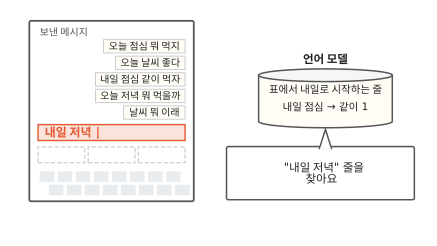

새 메시지 칸에 "내일 저녁"을 쳤어요. 언어 모델은 "내일 저녁" 줄을 찾아요. 그런데 표에서 "내일"로 시작하는 줄은 "내일 점심" 하나뿐이에요. 띄울 낱말이 하나도 없어요. 앞 낱말 1개 표였다면 "저녁" 줄에서 [뭐]를 띄웠을 거예요.

"내일"도 "저녁"도 아는 낱말이에요. 그런데 왜 막혔을까요? 표에 줄이 몇 개까지 생길 수 있는지 세어 보면 보여요.

보낸 메시지에 나온 낱말은 모두 12개예요. 앞 낱말 1개 표는 낱말마다 줄이 하나예요. 아는 낱말을 치면 거의 늘 줄이 있어요.

앞 낱말 2개 표는 두 낱말 짝마다 줄이 하나예요. 첫 낱말 자리에는 12가지가 올 수 있어요. 첫 낱말을 하나 정해도 둘째 자리에 다시 12가지가 올 수 있어요. 그래서 짝은 12에 12를 곱한 144가지예요. 그림의 칸 하나가 짝 하나예요.

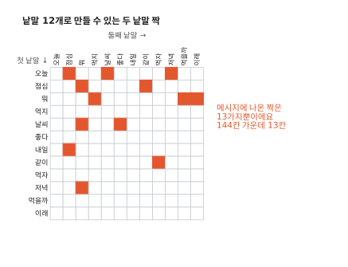

메시지 안에서 이웃한 두 낱말을 모두 찾아 칠했어요. 1번 메시지에는 오늘 점심, 점심 뭐, 뭐 먹지가 있어요. 메시지마다 낱말 수보다 하나 적게 짝이 나와요. 겹치는 짝이 없어서 다섯 메시지를 더하면 3 + 2 + 3 + 3 + 2 = 13가지예요. 144칸 가운데 13칸만 칠해졌어요.

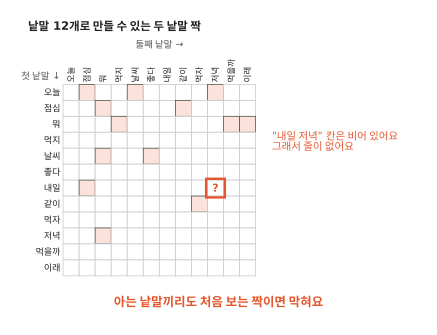

"내일 저녁"은 칠해지지 않은 칸이에요. 그래서 앞 낱말 2개 표에 그 줄이 없어요. 두 낱말은 따로따로는 아는 말이에요. 그래도 둘이 붙어 나온 적이 없어서 막혀요.

앞 낱말을 셋으로 늘리면 더 심해져요. 세 낱말 묶음은 12 × 12 × 12 = 1,728가지예요. 메시지 다섯 개에 나온 세 낱말 묶음은 2 + 1 + 2 + 2 + 1 = 8가지예요. 1,728가지 가운데 8가지뿐이에요. 앞을 길게 볼수록 빈칸이 훨씬 많아져요.

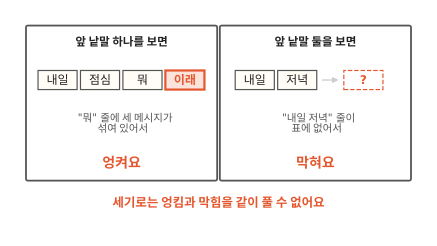

두 표를 나란히 놓으면 한쪽을 풀 때 다른 쪽이 커지는 게 보여요.

??? info "심화: 처음 보는 짝에 작은 몫을 나눠 주기"
    앞 낱말을 늘리면서도 덜 막히게 하는 방법이 궁금할 때 보는 칸이에요.

    한 번도 안 나온 낱말에도 작은 몫을 주면 덜 막혀요. 가장 단순한 방법은 모든 횟수에 1을 더하는 거예요. "날씨" 줄에는 좋다 1, 뭐 1뿐이었어요. 메시지에 나온 낱말 12가지와 "(끝)"까지 13가지 모두에 1을 더해요. 좋다와 뭐는 2가 되고 나머지 11가지는 1이 돼요. 제비가 모두 15장이니 한 번도 안 나온 "점심"도 15번 중 1번 뽑혀요. 이렇게 처음 보는 일에 몫을 나눠 주는 방법을 평활화(smoothing)라고 해요.

    몫을 나눠 주면 막힘은 풀려요. 다만 몫은 고르게 나눠 준 것뿐이라서 "날씨 점심"이 말이 되는지는 여전히 몰라요. 실제로 쓰인 방법은 이보다 정교해요.

## 다시 "오늘"을 쳐 볼게요

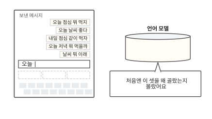

처음 장면의 휴대폰으로 돌아와 다시 "오늘"을 쳤어요. 후보 몇 개를 띄우는 자판은 앞 낱말 하나만 보면 되니 세어 둔 횟수표로 충분해요. 챗봇은 사정이 달라요. 긴 답을 이어 쓰려면 앞을 길게 봐야 해요. 거기서 세기는 엉키거나 막혀요. 챗봇이 세기 대신 무엇을 하는지는 이어지는 편들에서 하나씩 봐요.

### 이 편에서 줄여 그린 것

그림을 쉽게 하려고 실제와 다르게 줄인 곳이 두 군데 있어요.

1. 이 편은 언어 모델을 만드는 가장 단순한 방법을 그렸어요. 실제 휴대폰 자판이 어떤 방법을 쓰는지는 제품마다 달라요. 세기 대신 신경망을 쓰는 자판도 있어요. 신경망은 이어지는 편들에서 봐요.
2. 글을 띄어쓰기로 잘랐어요. 그래서 "먹지", "먹자", "먹을까"가 서로 다른 낱말이 됐어요. 챗봇이 한 번에 맞히는 것도 낱말보다 작은 조각이에요([2편](02-tokens.md)).

### 이 편에서 새로 나온 말

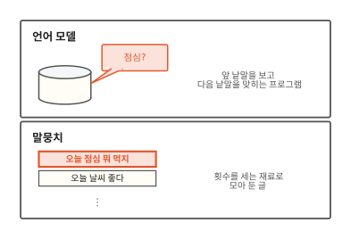

다음 편은 "글을 어떤 조각으로 자를까요?"예요.

[^shannon]: C. E. Shannon, "A Mathematical Theory of Communication", Bell System Technical Journal 27권(1948). 3절 "The Series of Approximations to English"에 글자와 낱말을 늘어놓은 예가 실려 있어요.
