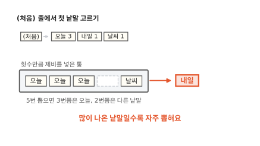
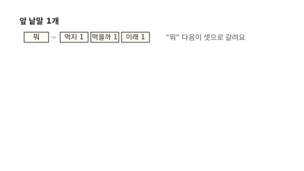
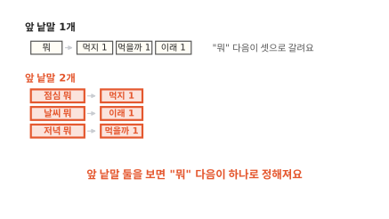
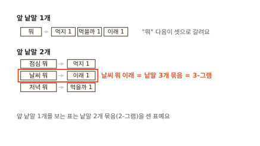
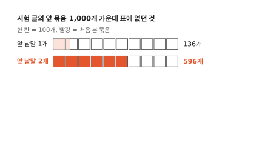
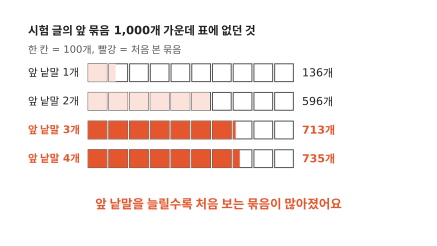
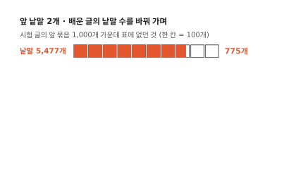
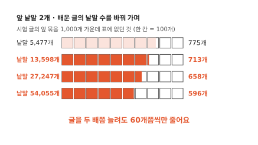
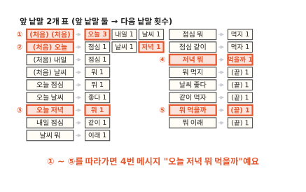

# 자판은 다음 낱말을 어떻게 미리 띄울까요?

## "오늘"을 치면 [점심] [날씨] [저녁]이 떠요

휴대폰으로 메시지를 쓰면 자판 위에 다음 낱말 후보가 떠요. 그림의 휴대폰에서는 지금까지 메시지를 다섯 개 보냈어요. 새 메시지 칸에 "오늘"을 쳤어요. 오른쪽 원통은 자판 속에서 후보를 고르는 프로그램이에요. 이 프로그램은 "오늘" 다음에 올 낱말을 골라야 해요.

자판 위에 [점심] [날씨] [저녁]이 떴어요. 셋 다 보낸 메시지에 있던 낱말이에요. 프로그램은 무엇을 보고 이 셋을 골랐을까요?

프로그램이 한 일은 앞 낱말 "오늘"을 보고 다음 낱말을 맞히는 거예요. 이렇게 앞 낱말을 보고 다음 낱말을 맞히는 자판 속 프로그램을 **언어 모델**(language model)이라고 불러요. 이 편은 언어 모델을 만드는 가장 단순한 방법을 따라가요. 맞히는 재료는 보낸 메시지 다섯 개뿐이에요. 이 다섯 개에서 무엇을 꺼내면 될까요?

## 앞 낱말 다음에 무엇이 왔는지 세어요

보낸 메시지를 띄어쓰기로 잘라 낱말 칸으로 늘어놓고 "오늘"을 찾아봐요. "오늘"은 1번, 2번, 4번 메시지에 있어요. 바로 다음 낱말은 점심, 날씨, 저녁이에요. 각각 한 번씩 왔으니 횟수표의 "오늘" 줄에 "점심 1, 날씨 1, 저녁 1"을 적어요.

다른 낱말도 같은 방법으로 세면 그림의 횟수표가 돼요. "뭐" 다음에는 먹지, 먹을까, 이래가 한 번씩 왔어요. 메시지의 첫 낱말은 앞에 낱말이 없어요. 그래서 맨 앞에 "(처음)"이 있다고 치고 세요. 다섯 메시지 가운데 셋이 "오늘"로 시작해서 (처음) 줄에는 "오늘 3"이 적혀요. 메시지의 마지막 낱말 다음에는 "(끝)"이 왔다고 적어요.

이렇게 맞히는 재료로 모아 둔 글을 **말뭉치**(corpus)라고 해요. 여기서는 보낸 메시지 다섯 개가 말뭉치예요. 말뭉치가 커지면 횟수표도 길어져요. 긴 표에서 줄을 바로 찾을 때는 낱말을 칸 번호로 바로 바꾸는 해시를 써요([알고리즘 9편](../algorithms/09-hash.md)).

자판은 표의 "오늘" 줄에 적힌 낱말을 띄우면 돼요. 후보 하나를 누르면 그 낱말이 새 앞 낱말이 되고 다시 후보가 떠요. 이걸 이어 가면 언어 모델이 혼자 문장을 쓸 수 있어요. 그러려면 후보 가운데 하나를 골라야 해요. 어느 것을 고를까요?

## 많이 나온 낱말을 그만큼 자주 뽑아요

첫 낱말부터 골라 볼게요. (처음) 줄에는 오늘 3, 내일 1, 날씨 1이 있어요. 가장 많이 나온 1등만 고르면 첫 낱말은 언제나 "오늘"이에요. 보낸 메시지 다섯 개 가운데 둘은 다른 낱말로 시작했어요. 그런데 "내일"이나 "날씨"로 여는 문장은 한 번도 나오지 않아요.

그래서 횟수만큼 제비를 만들어 통에 넣어요. 오늘 3장, 내일 1장, 날씨 1장이에요.

통에서 한 장을 뽑아요. 그림에서는 "내일"이 나왔어요. 다섯 장 가운데 "오늘"이 석 장이니 다섯 번 뽑으면 세 번쯤은 "오늘"이 나와요. 나머지 두 번쯤은 다른 낱말이에요. 많이 나온 낱말일수록 자주 뽑히고 적게 나온 낱말에도 차례가 와요. 횟수가 같은 낱말은 제비도 같은 수라서 뽑힐 기회가 똑같아요.

"내일"을 뽑았으니 다음 낱말은 "내일" 줄에서 뽑아요. 이렇게 이어 가면 어떤 문장이 나올까요?

## 뽑은 낱말을 이어 붙이면 문장이 돼요

"내일" 줄에는 "점심 1"뿐이라 제비도 한 장이에요. "점심"이 뽑혀 문장에 붙어요. 이제 앞 낱말은 "점심"이에요.

"점심" 줄에는 뭐 1, 같이 1이 있어요. 제비 두 장 가운데 "뭐"가 나왔어요.

"뭐" 줄의 제비는 먹지, 먹을까, 이래 석 장이에요. 이번에는 "먹지"가 나왔어요.

"먹지" 다음에는 늘 "(끝)"이 왔어요. 그래서 문장이 여기서 끝나요. 뽑은 문장은 "내일 점심 뭐 먹지"예요. 보낸 메시지 다섯 개에는 이 문장이 없어요. 3번 메시지의 "내일 점심"과 1번 메시지의 "점심 뭐 먹지"가 "점심"에서 이어졌어요. 언어 모델이 보낸 적 없는 새 문장을 지어낸 거예요.

??? info "심화: 섀넌은 1948년에 글자로 같은 실험을 했어요"
    세어서 이어 붙이는 생각이 언제부터 있었는지 궁금할 때 보는 칸이에요.

    클로드 섀넌은 1948년 논문 「통신의 수학적 이론」에서 영어로 비슷한 실험을 했어요.[^shannon] 처음에는 글자를 아무렇게나 늘어놓았어요. 다음에는 영어 글에 자주 나오는 글자일수록 자주 나오게 했어요. 그다음에는 앞 글자 하나, 이어서 앞 글자 둘을 보고 다음 글자를 골랐어요. 앞을 많이 볼수록 늘어놓은 글자가 영어 낱말처럼 보였어요. 낱말 단위로도 해서 앞 낱말 하나를 보고 다음 낱말을 고른 글도 실었어요.

    섀넌은 횟수표를 미리 다 만들지 않았어요. 먼저 책을 아무 데나 펴서 글자 하나를 적어요. 다른 쪽을 펴서는 그 글자가 나올 때까지 읽어요. 그 글자를 만나면 바로 다음 글자를 적어요. 책에 자주 나오는 짝일수록 자주 걸려요. 횟수만큼 뽑는 일을 책장 넘기기로 한 거예요.

## 앞 낱말 하나만 보면 문장이 엉켜요

같은 방법으로 다시 뽑아 볼게요. 이번에도 "내일", "점심", "뭐"까지 왔어요. "뭐" 줄에서 이번엔 "이래"가 나왔어요.

"내일 점심 뭐 이래"가 됐어요. 말이 안 되죠. "이래"는 5번 메시지 "날씨 뭐 이래"에서 온 낱말이에요. 언어 모델은 "뭐" 하나만 보고 골랐어요. 앞에 "점심"이 있었다는 건 표에 없어서 몰랐어요. "오늘 날씨 뭐 먹지"도 같은 길로 나와요.

말뭉치가 커도 마찬가지였어요. 이 사이트의 본문 문장 7,537개로 횟수표를 만들어 문장을 뽑아 봤어요.[^lab] 이 실험에서는 "택배 기사는 물건을 절대 멈추지 않고 여러 번 비교할까요?"라는 문장이 나왔어요. 이웃한 두 낱말만 보면 어색하지 않은데 문장 전체는 엉켜 있어요. 앞쪽을 잊지 않게 하려면 어떻게 해야 할까요?

## 앞 낱말을 둘로 늘리면 엉킴이 줄어요

엉킴은 "뭐" 줄에서 생겼어요. "뭐" 다음이 먹지, 먹을까, 이래 셋으로 갈려요. 셋 가운데 어느 것이 맞는지는 "뭐" 앞에 있는 낱말이 정해요.

그래서 앞 낱말을 둘씩 묶어 세요. "점심 뭐" 다음은 먹지, "날씨 뭐" 다음은 이래, "저녁 뭐" 다음은 먹을까예요. "뭐" 한 줄이 세 줄로 나뉘었고 줄마다 다음 낱말이 하나로 정해져요. 이 표로는 "내일 점심 뭐 이래" 같은 문장이 나오지 않아요.

이 표의 한 줄은 "날씨 뭐 이래"처럼 낱말 세 개가 이어진 묶음을 센 거예요. 낱말 n개가 이어진 묶음을 **n-그램**(n-gram)이라고 해요. 앞 낱말 2개를 보는 표는 3-그램을 세요. 앞 낱말 1개를 보는 표는 2-그램을 세요.

앞 낱말을 둘로 늘렸더니 엉킴이 줄었어요. 셋, 넷으로 더 늘리면 문장이 점점 더 좋아질까요?

## 앞 낱말을 늘린 대신 치르는 값

앞 낱말 둘을 보는 언어 모델로 자판을 바꿨어요. "오늘 저녁"을 치면 "오늘 저녁" 줄을 찾아 [뭐]를 띄워요. 엉킨 문장도 더는 나오지 않아요.

늘린 데는 값이 따라요. 처음 보는 묶음 앞에서는 아무것도 못 띄워요. 그리고 뽑은 문장은 보낸 문장을 그대로 베껴요. 첫째 값부터 볼게요.

### 첫째, 처음 보는 묶음에서 막혀요

새 메시지 칸에 "내일 저녁"을 쳤어요. 언어 모델은 앞 낱말 둘인 "내일 저녁" 줄을 찾아요. 표에서 "내일"로 시작하는 줄은 "내일 점심" 하나뿐이에요.

"내일 저녁" 줄이 없으니 띄울 낱말이 없어요. 보낸 메시지에 "내일 저녁"을 쓴 적이 한 번도 없거든요. 앞 낱말 하나만 보던 표라면 "저녁" 줄에서 [뭐]를 띄웠을 거예요. 앞 낱말 하나만 볼 때도 표에 없는 줄을 만나는 일은 있어요. 앞 낱말을 늘리면 그런 일이 크게 늘어요.

메시지가 다섯 개뿐이라서 그런 걸까요? 이 사이트 본문 문장 7,537개로 다시 재 봤어요. 문장 열 개 중 아홉 개로 횟수표를 만들고 남은 한 개를 시험 글로 썼어요. 시험 글에서 앞 낱말 묶음을 하나씩 꺼내 표에 그 줄이 있는지 봤어요.

이 실험에서는 앞 낱말 1개를 볼 때 묶음 1,000개 가운데 136개가 표에 없었어요. 앞 낱말 2개로 늘리자 596개로 뛰었어요. 시험 글에 나온 두 낱말 묶음의 절반 넘게 처음 보는 묶음이었어요.

앞 낱말 3개면 713개, 4개면 735개였어요. 늘릴수록 표에 없는 줄을 만나는 일이 많아졌어요. 그때마다 자판은 아무 후보도 띄우지 못해요.

글을 더 모으면 나아질까요? 같은 시험 글을 두고 횟수표를 만드는 글의 양만 바꿔 다시 쟀어요. 앞 낱말은 2개예요.

이 실험에서는 배운 글의 낱말이 5,477개일 때 묶음 1,000개 가운데 775개가 표에 없었어요.

낱말을 13,598개로 늘리자 713개, 27,247개면 658개, 54,055개면 596개였어요. 글을 두 배쯤 늘릴 때마다 1,000개 가운데 60개쯤씩만 줄었어요. 글을 모을수록 처음 보는 묶음은 줄지만 0이 되지는 않아요.

??? info "심화: 묶음 가짓수는 왜 그렇게 빨리 늘까요?"
    글을 두 배로 늘려도 처음 보는 묶음이 조금씩만 주는 이유가 궁금할 때 보는 칸이에요.

    이 실험에서 횟수표를 만든 글에는 서로 다른 낱말이 14,117가지 있었어요. 첫 자리에 올 수 있는 낱말이 14,117가지예요. 첫 낱말을 하나 정해도 둘째 자리에 다시 14,117가지가 올 수 있어요. 그래서 두 낱말 묶음은 14,117을 두 번 곱한 199,289,689가지예요. 셋째 자리까지 늘리면 한 번 더 곱해서 2조 8천억 가지가 넘어요. 앞 낱말을 하나 늘릴 때마다 가짓수가 1만 4천 배씩 늘어요.

    횟수표를 만든 글은 낱말 54,055개짜리였어요. 낱말마다 그 앞 낱말과 묶음 하나를 이루니 두 낱말 묶음도 5만 개 남짓 담겨요. 2억 칸짜리 표에서 3,700칸에 하나꼴로만 채워지는 거예요. 실제 글에서는 말이 되는 묶음만 나오니 2억 가지가 다 쓰이지는 않아요. 그래도 시험 글의 두 낱말 묶음 가운데 절반 넘게 처음 보는 묶음이었어요. 앞 낱말이 셋, 넷이면 빈 칸은 훨씬 더 많아요.

### 둘째, 보낸 문장만 베껴요

앞 낱말 2개 표 전체를 그려 보면 이래요. 문장 첫머리는 앞 낱말이 없어서 (처음)을 두 번 채워 둔 맨 위 줄에서 첫 낱말을 뽑아요. 둘째 낱말은 (처음)과 첫 낱말로 된 줄에서 뽑아요. 그다음부터는 바로 앞 두 낱말의 줄에서 뽑아요.

첫 낱말로 "오늘", 둘째로 "저녁"이 뽑혔다고 해 볼게요. "오늘 저녁" 줄에는 "뭐"뿐이고 "저녁 뭐" 줄에는 "먹을까"뿐이에요. "뭐 먹을까" 다음은 "(끝)"이에요.

뽑은 문장은 "오늘 저녁 뭐 먹을까"로 4번 메시지와 똑같아요.

"내일"로 시작하면 "내일 점심" 다음은 "같이"뿐이에요. 뽑은 문장은 3번 메시지 "내일 점심 같이 먹자" 그대로예요. 앞 낱말 하나만 볼 때 지어낸 "내일 점심 뭐 먹지"는 이제 못 만들어요. 이 표로는 어떻게 뽑아도 보낸 메시지 다섯 개 가운데 하나가 그대로 나와요.

이 사이트 문장으로 한 실험에서도 같았어요. 앞 낱말 2개 표로 문장 200개를 뽑았더니 109개가 배운 글의 문장과 똑같았어요. 앞 낱말 1개일 때는 5개였어요. 3개로 늘리자 182개, 4개면 192개였어요. 앞 낱말을 늘릴수록 언어 모델은 배운 글을 그대로 따라 썼어요.

??? info "심화: 처음 보는 묶음에 작은 몫을 나눠 주기"
    앞 낱말을 늘리면서도 막히지 않게 하는 방법이 궁금할 때 보는 칸이에요.

    한 가지는 물러서기예요. "내일 저녁" 줄이 표에 없으면 앞 낱말을 하나 줄여 "저녁" 줄을 봐요. 거기서 [뭐]를 띄워요. 긴 묶음이 표에 있으면 그걸 써요. 없으면 짧은 묶음으로 내려가요. 이 방법을 백오프(back-off)라고 불러요.

    또 한 가지는 한 번도 안 나온 낱말에도 작은 몫을 주는 거예요. 가장 단순한 방법은 모든 횟수에 1을 더하는 거예요. "날씨" 줄에는 좋다 1, 뭐 1뿐이었어요. 메시지에 나온 낱말 12가지와 "(끝)"까지 13가지 모두에 1을 더해요. 좋다와 뭐는 2가 되고 나머지 11가지는 1이 돼요. 제비가 모두 15장이니 "좋다"는 15번 중 2번 뽑혀요. 한 번도 안 나온 "점심"도 15번 중 1번 뽑혀요. 이렇게 처음 보는 일에 몫을 나눠 주는 방법을 평활화(smoothing)라고 해요.

    몫을 나눠 주면 막힘이 풀려요. 처음 보는 이음도 가끔 나와서 베낌도 줄어요. 다만 몫은 고르게 나눠 준 것뿐이라 "날씨 점심"이 말이 되는지는 여전히 몰라요. 실제로 쓰인 방법은 이보다 정교해요. 1987년 Katz의 백오프와 1995년 Kneser와 Ney의 평활화가 널리 알려져 있어요.

그렇다면 세어서 맞히는 언어 모델은 쓸모가 없을까요?

## 세기 모델은 언제 쓸모 있을까요?

지금까지 본 언어 모델은 횟수를 세기만 했어요. 이런 세기 모델은 앞의 한두 낱말만 보고 맞혀도 되는 일에 쓸 수 있어요. 검색창에 낱말 하나를 치면 그 뒤에 자주 붙여 친 낱말을 추천하는 일이 그래요. 표 하나만 있으면 되니 작은 기기에서도 빨리 돌아요.

어느 나라 말인지 알아맞히는 일에도 세기 방식을 쓸 수 있어요. 이때는 낱말 대신 글자 묶음을 세요. 한국어 글에는 "니다", "어요" 같은 글자 묶음이 자주 나와요. 영어 글에는 "th", "ing"가 자주 나와요. 나라말마다 글자 묶음 횟수표를 만들어 두고 새 글이 어느 표와 가장 닮았는지 보면 돼요. 맞춤법 후보를 고를 때도 앞 낱말 다음에 어느 후보가 더 자주 왔는지 세어 보면 도움이 돼요.

앞의 문장 전체를 보고 맞혀야 하는 일은 세기만으로는 어려워요. 앞을 더 볼수록 처음 보는 묶음이 늘고 배운 문장을 베끼게 돼요. 이 벽을 넘는 방법은 이어지는 편들에서 하나씩 봐요.

## 다시 "오늘"을 쳐 볼게요

처음 장면의 휴대폰으로 돌아왔어요. 후보 몇 개를 띄우는 일은 앞 낱말 하나만 봐도 되고 그래야 덜 막혀요. 그래서 앞 낱말 1개 횟수표로 돌아와요. "오늘"을 치자 자판 위에 [점심] [날씨] [저녁]이 떴었죠. 그때는 언어 모델이 왜 이 셋을 골랐는지 몰랐어요.

이제 알아요. 언어 모델은 보낸 메시지로 센 횟수표에서 "오늘" 줄을 펼쳐요. 그 줄에는 점심 1, 날씨 1, 저녁 1이 적혀 있어요.

그 줄에 있는 낱말을 띄우면 끝이에요. 셋 다 "오늘" 바로 다음에 왔던 낱말이에요.

보낸 메시지가 다섯 개든 오천 개든 이 편의 모델은 앞 낱말의 줄을 찾아 거기 적힌 낱말을 띄워요.

### 이 편에서 줄여 그린 것

그림을 쉽게 하려고 실제와 다르게 줄인 곳이 네 군데 있어요.

1. 이 편은 언어 모델을 만드는 가장 단순한 방법을 그렸어요. 실제 휴대폰 자판이 어떤 방법을 쓰는지는 제품마다 달라요. 세기 대신 신경망을 쓰는 자판도 있어요. 신경망은 이어지는 편들에서 봐요.
2. 낱말을 띄어쓰기로 잘랐어요. 그래서 "먹지", "먹자", "먹을까"가 서로 다른 낱말이 됐어요. 실제 언어 모델은 글을 더 작은 조각으로 잘라요. 어떻게 자르는지는 다음 편에서 봐요.
3. 처음 보는 묶음에 작은 몫을 나눠 주는 방법을 빼고 그렸어요. 실제 세기 모델은 이 방법을 함께 써요. 둘째 값 절의 심화 칸에서 다뤄요.
4. 실험에는 휴대폰 메시지 대신 이 사이트의 본문 문장을 썼어요. 메시지보다 문장이 길어서 숫자는 메시지로 잴 때와 다를 수 있어요.

### 이 편에서 새로 나온 말

다음 편은 "글을 어떤 조각으로 자를까요?"예요.

[^lab]: 실험 글은 이 사이트의 2026-11-03 본문 문장 7,537개예요. 문장 열 개 중 아홉 개로 횟수표를 만들고 남은 한 개로 시험했어요. 낱말은 띄어쓰기로 잘랐어요. 횟수표를 만든 쪽의 낱말은 54,055개, 서로 다른 낱말은 14,117가지였어요. 처음 보는 비율은 시험 글의 낱말마다 그 앞 묶음이 표에 있는지 보고 쟀어요. 뽑은 문장은 앞 낱말 수마다 200개씩 뽑아 배운 글의 문장과 글자 하나까지 같은지 봤어요. 글의 양을 바꾼 실험은 시험 글은 그대로 두고 횟수표를 만드는 글의 양만 바꿔 쟀어요.
[^shannon]: C. E. Shannon, "A Mathematical Theory of Communication", Bell System Technical Journal 27권(1948). 3절 "The Series of Approximations to English"에 글자와 낱말을 늘어놓은 예가 실려 있어요.
