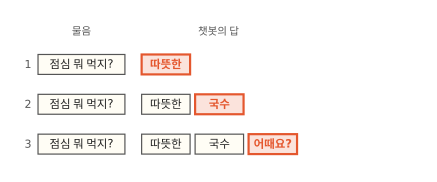
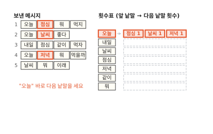
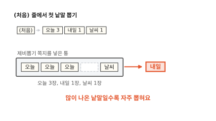
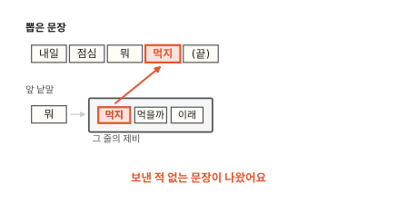
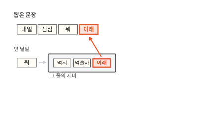
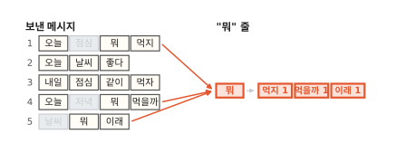
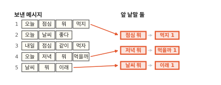
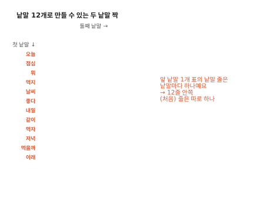

# 다음 낱말 맞히기: 휴대폰 자판과 챗봇이 하는 일

휴대폰으로 메시지를 쓰다 보면 자판 위에 낱말 몇 개가 떠요. "오늘"까지 치면 [점심] [날씨] [저녁]이 뜨는 식이죠. 이 글을 읽고 나면 자판이 그 낱말을 고르는 일과 챗봇이 긴 답을 쓰는 일이 같은 일이라는 걸 알게 돼요. 이 원리를 알면 챗봇이 그럴듯한 말과 엉뚱한 말을 둘 다 하는 까닭이 보여요.

!!! abstract "이 글에서 알게 되는 것"
    1. 챗봇도 휴대폰 자판처럼 앞 말을 보고 다음 낱말 하나를 골라요. 그걸 되풀이해서 긴 답을 써요.
    2. 어떤 낱말 다음에 무엇이 몇 번 왔는지 세어 두기만 해도 다음 말을 맞힐 수 있어요. 이렇게 다음 말을 맞히는 프로그램을 언어 모델이라고 해요.
    3. 센 대로 이어 뽑으면 보낸 적 없는 새 문장도 지어져요. 하지만 앞 낱말 하나만 보면 엉뚱한 말로 새고 더 많이 보면 처음 보는 말에서 막혀요.

## 1. 자판도 챗봇도 다음 낱말 하나를 맞혀요

새 메시지 칸에 "오늘"을 쳐요. 자판 위에 [점심] [날씨] [저녁]이 떠요. [점심]을 누르면 칸에 "오늘 점심"이 들어가고 자판 위에는 새 후보가 떠요. 이번엔 [뭐] [같이]예요.

자판이 하는 일은 하나예요. 지금까지 친 말을 보고 그다음에 올 낱말을 맞혀서 몇 개 보여 줘요. 그중에 하나를 누르는 건 나예요.

챗봇은 자판보다 훨씬 똑똑해 보이죠. 그런데 하는 일을 들여다보면 같아요. 챗봇에게 "점심 뭐 먹지?"라고 물으면 챗봇은 답의 첫 낱말로 "따뜻한"을 골라요. 그다음에는 "점심 뭐 먹지? 따뜻한"까지 보고 다음 낱말을 또 골라요. 이번엔 "국수". 한 낱말씩 붙이고 다시 고르기를 되풀이하다 보면 "따뜻한 국수 어때요?" 같은 답이 돼요.

아래 그림에서 줄마다 끝에 붙는 빨간 낱말을 보세요.

**그림 1.** 챗봇이 낱말을 하나씩 골라 붙여서 줄마다 답이 한 낱말씩 길어져요.
{ .fig-cap }

자판과 다른 점은 누가 고르느냐예요. 자판은 후보를 띄워 놓고 내가 누르기를 기다려요. 챗봇은 스스로 하나를 골라 붙이고 다음으로 넘어가요. 챗봇이 쓴 긴 답도 이렇게 한 낱말씩 쌓은 거예요. 한 번에 하는 일은 다음 낱말 하나를 고르는 것뿐이에요.

그럼 다음 낱말은 어떻게 맞힐까요? 가장 쉬운 방법부터 해 볼게요.

## 2. 지난 메시지를 세면 다음 낱말 후보가 나와요

앞에서 자판은 "오늘" 다음에 [점심] [날씨] [저녁]을 띄웠어요. 이 셋은 어디서 왔을까요? 내가 전에 보낸 메시지에서 왔어요.

내가 휴대폰으로 보낸 메시지가 이 다섯 개뿐이라고 해 볼게요.

1. 오늘 점심 뭐 먹지
2. 오늘 날씨 좋다
3. 내일 점심 같이 먹자
4. 오늘 저녁 뭐 먹을까
5. 날씨 뭐 이래

"오늘"이 들어간 메시지를 찾아보세요. 1번, 2번, 4번이에요. "오늘" 바로 다음에 온 낱말은 차례로 점심, 날씨, 저녁이고요. 자판에 뜬 세 낱말과 같죠.

가장 쉬운 방법은 이렇게 세어 두는 거예요. 메시지가 많아지면 눈으로 찾기 힘드니까 표에 적어 둬요. 표의 줄마다 앞 낱말을 하나 쓰고 그 뒤에 다음에 온 낱말과 횟수를 적어요.

메시지를 하나씩 읽으면서 두 낱말이 붙어 나올 때마다 횟수에 1을 더해요. 1번 "오늘 점심 뭐 먹지"를 읽으면 "오늘" 줄에 점심 1, "점심" 줄에 뭐 1, "뭐" 줄에 먹지 1이 적혀요. 메시지가 끝난 것도 적어 둬요. 1번은 "먹지"에서 끝났으니 "먹지" 줄에 (끝) 1을 적어요. 다섯 메시지를 다 읽으면 표가 채워져요. 앞 낱말 다음에 어떤 낱말이 몇 번 왔는지 적은 표라서 이걸 횟수표라고 부를게요.

아래 표에서 "오늘" 줄을 보세요.

**그림 2.** "오늘" 줄에는 점심, 날씨, 저녁이 한 번씩 적혀 있어요.
{ .fig-cap }

"오늘" 줄에 적힌 낱말은 셋이에요. 셋 다 한 번씩 왔으니까 자판은 셋을 모두 후보로 띄워요. 숫자가 다르면요? 큰 것부터 띄워요. 내가 "오늘 점심 뭐 먹지"를 한 번 더 보냈다면 "오늘" 줄의 점심이 2가 돼요. 그러면 [점심]이 맨 앞에 와요.

1절에서 [점심]을 누른 다음 [뭐] [같이]가 뜬 것도 같은 방법이에요. "점심" 줄을 보면 뭐 1, 같이 1이 적혀 있거든요.

이렇게 앞 말을 보고 다음 말을 맞히는 프로그램을 **언어 모델**이라고 해요. 횟수표를 보고 다음 낱말을 고르는 것도 언어 모델이에요. 챗봇 안에 든 것도 언어 모델이고요.

그런데 자판은 후보를 띄우고 멈춰요. 챗봇처럼 맞힌 낱말을 붙이고 또 맞히면 횟수표만으로 문장을 지을 수 있을까요? 다음 절에서 해 볼게요.

## 3. 센 대로 이어 뽑으면 새 문장이 돼요

앞에서 만든 횟수표는 후보를 띄우는 데까지만 썼어요. 이번에는 챗봇처럼 낱말 하나를 골라 붙이고 또 맞혀 볼게요.

첫 낱말은 내가 정해요. "오늘"로 시작할게요. 횟수표 "오늘" 줄에는 점심, 날씨, 저녁이 한 번씩 있어요. 이 가운데 하나를 골라야 해요. 늘 같은 걸 고르면 늘 같은 문장만 나오겠죠. 그래서 제비를 뽑아요. 줄에 적힌 횟수만큼 쪽지를 써서 제비 통에 넣고 하나를 꺼내는 거예요. "오늘" 줄은 셋 다 1이니까 점심, 날씨, 저녁 쪽지가 한 장씩 들어가요.

아래 그림에서 제비 통에서 꺼낸 빨간 쪽지를 보세요.

**그림 3.** "오늘" 줄의 쪽지 세 장 가운데 "점심"이 뽑혀서 문장에 붙었어요.
{ .fig-cap }

횟수가 다르면 쪽지 수도 달라요. 2절에서처럼 "오늘 점심 뭐 먹지"를 한 번 더 보냈다면 점심 쪽지가 두 장이 돼요. 제비 통에는 쪽지가 네 장 들어 있고 그중 두 장이 점심이니까 점심이 더 잘 뽑혀요. 많이 온 낱말일수록 자주 나오는 거예요.

이제 "점심"이 앞 낱말이 돼요. "점심" 줄에는 뭐와 같이가 있어요. 쪽지를 꺼냈더니 "같이"가 나왔어요. "같이" 줄에는 먹자 하나뿐이라서 그다음은 "먹자"예요.

아래 그림에서 문장 끝에 빨갛게 붙은 "먹자"를 보세요.

**그림 4.** 두 번 더 뽑아서 "오늘 점심 같이 먹자"가 됐어요.
{ .fig-cap }

"먹자" 다음은 어떻게 될까요? 그림 2의 횟수표에서 "먹자" 줄을 보면 (끝) 1만 있어요. 보낸 메시지에서 "먹자"는 늘 맨 끝에 왔거든요. (끝)이 뽑히면 거기서 문장을 마쳐요. 그래서 이 문장은 여기서 끝나요.

이렇게 나온 "오늘 점심 같이 먹자"를 다섯 메시지에서 찾아보세요. 없어요. 3번 "내일 점심 같이 먹자"의 앞만 "오늘"로 바뀐 문장이에요. 첫 낱말을 "내일"로 하면 "내일 점심 뭐 먹지"도 나올 수 있어요. 이것도 보낸 적 없는 문장이에요. 횟수표 한 장으로 새 문장을 지은 거예요.

## 4. 앞 낱말 하나만 보면 이야기가 엉켜요

새 문장이 늘 그럴듯하게 나오지는 않아요. 다시 "내일"로 시작해 볼게요. "내일 점심 뭐"까지는 앞에서와 같아요. 그런데 "뭐" 줄에는 먹지, 먹을까, 이래 쪽지가 한 장씩 있어요. 이번에는 "이래"가 뽑혔어요.

아래 그림에서 "뭐" 다음에 빨갛게 붙은 낱말을 보세요.

**그림 5.** "뭐" 줄에서 "이래"가 뽑혀 "내일 점심 뭐 이래"가 됐어요.
{ .fig-cap }

"내일 점심 뭐 이래"는 말이 안 돼요. 점심 이야기가 엉뚱하게 끝나요. 왜 이렇게 됐을까요?

"뭐" 줄이 어디서 왔는지 보면 알 수 있어요. 아래 그림에서 "뭐" 줄로 모이는 화살표를 보세요.

**그림 6.** 1번, 4번, 5번 메시지의 "뭐"가 모두 "뭐" 줄 하나에 모여요.
{ .fig-cap }

먹지는 점심 이야기에서 왔어요. 먹을까는 저녁 이야기, 이래는 날씨 이야기에서 왔고요. 그런데 "뭐" 줄에는 "뭐" 앞에 무슨 낱말이 있었는지 적혀 있지 않아요. 그림에서 흐리게 칠한 점심, 저녁, 날씨가 "뭐" 앞에 있던 낱말이에요. 이 낱말들은 "뭐" 줄에 남지 않아요. 그래서 "뭐" 줄만 보고는 지금 무슨 이야기를 하던 중인지 알 수 없어요. 앞 낱말 하나만 보는 언어 모델은 그보다 앞에 있던 말을 모두 잊어버려요.

## 5. 앞 낱말 둘을 보면 처음 보는 짝에서 막혀요

그럼 앞 낱말을 하나 더 보면 어떨까요? 표의 줄을 낱말 하나 대신 두 낱말 짝으로 만들어요. 그러면 "뭐" 줄이 "점심 뭐", "저녁 뭐", "날씨 뭐" 세 줄로 나뉘어요.

아래 그림에서 화살표 셋이 어느 줄로 가는지 보세요.

**그림 7.** "뭐" 한 줄이 앞 낱말 둘을 보는 세 줄로 갈라져요.
{ .fig-cap }

이제 "내일 점심 뭐" 다음을 고를 때는 "점심 뭐" 줄을 봐요. 그 줄에는 먹지밖에 없어요. "내일 점심 뭐 먹지"만 나오고 "이래"는 뽑히지 않아요. 엉킴이 풀렸어요.

대신 새 문제가 생겨요. 새 메시지 칸에 "내일 저녁"을 쳐 볼게요. 다음 낱말을 띄우려면 "내일 저녁" 줄을 찾아야 해요. 그런데 다섯 메시지 어디에도 "내일 저녁"이 붙어 나온 적이 없어서 그 줄이 없어요. 자판은 후보를 하나도 띄우지 못해요. "내일"도 "저녁"도 아는 낱말인데 막힌 거예요.

3절의 "먹자"와는 달라요. "먹자"는 메시지 끝에 온 걸 본 적이 있어서 표에 (끝)이 적혀 있었어요. "내일 저녁"은 본 적이 아예 없어서 다음에 무엇이 올지는커녕 끝인지조차 몰라요.

이런 일이 얼마나 자주 생길지 세어 볼게요. 다섯 메시지에 나온 낱말은 오늘, 점심, 뭐, 먹지, 날씨, 좋다, 내일, 같이, 먹자, 저녁, 먹을까, 이래로 모두 12개예요. 짝의 첫 자리에 12개, 둘째 자리에 12개가 올 수 있으니까 두 낱말 짝은 12 × 12 = 144가지예요. 아래 그림은 그 144가지를 한 칸씩 그린 거예요. 메시지에서 붙어 나온 짝만 빨갛게 칠했어요. 빨간 칸이 몇 개인지 세어 보세요. "내일" 줄의 "저녁" 칸이 어떤지도 보세요.

**그림 8.** 144칸 가운데 메시지에 나온 짝은 빨간 13칸뿐이고 "내일 저녁" 칸은 비어 있어요.
{ .fig-cap }

빨간 칸을 세어 보면 13개예요. 나머지 131칸은 한 번도 못 본 짝이라서 그 짝을 치면 자판은 막혀요. 앞 낱말을 셋으로 늘리면 더 심해져요.

- 앞 낱말 둘: 12 × 12 = 144칸 가운데 메시지에 나온 짝 13칸
- 앞 낱말 셋: 12 × 12 × 12 = 1,728칸 가운데 메시지에 나온 짝 8칸

메시지를 더 모으면 빈칸이 채워지지 않을까 싶을 거예요. 조금은 채워져요. 하지만 앞에서 보는 낱말이 하나 늘면 가짓수가 12배가 돼요. 메시지가 느는 속도로는 따라잡지 못해요.

앞을 짧게 보면 이야기가 엉키고 길게 보면 처음 보는 짝에서 막혀요. 세기만으로는 둘을 함께 풀 수 없어요. 챗봇은 앞의 긴 글을 보면서도 막히지 않고 다음 낱말을 골라요. 세기와는 다른 방법을 쓰기 때문이에요. 이 방법은 다음 편들에서 차례로 봐요.

## 정리

휴대폰 자판도 챗봇도 앞 말을 보고 다음 낱말을 맞혀요. 자판은 맞힌 낱말을 후보로 띄우고 내가 고르기를 기다려요. 챗봇은 하나를 골라 붙이고 다시 고르기를 되풀이해서 "따뜻한 국수 어때요?" 같은 긴 답을 써요.

다음 낱말을 맞히는 가장 쉬운 방법은 세기예요. 보낸 메시지에서 "오늘" 다음에 점심, 날씨, 저녁이 한 번씩 왔다고 횟수표에 적어 두면 그 셋을 후보로 띄울 수 있어요. 이렇게 앞 말을 보고 다음 말을 맞히는 프로그램을 언어 모델이라고 해요.

횟수표대로 제비를 뽑아 이으면 "오늘 점심 같이 먹자"처럼 보낸 적 없는 문장도 나와요. 하지만 앞 낱말 하나만 보면 "내일 점심 뭐 이래"처럼 엉뚱한 말로 새요. 앞 낱말 둘을 보면 "내일 저녁"처럼 처음 보는 짝에서 막혀요. 그래서 세기만으로는 모자라요.

이 글에서는 띄어쓰기로 글을 잘라서 낱말 하나를 한 칸으로 셌어요. 챗봇은 글을 낱말보다 작은 조각으로 잘라서 다뤄요. 그 조각을 토큰이라고 해요. 글을 어떻게 토큰으로 자르는지는 [2편](02-tokens.md)에서 볼게요.

### 새로 나온 말

- **언어 모델**: 앞 말을 보고 다음 말을 맞히는 프로그램. 이 글에서는 횟수표 한 장이 언어 모델이었어요.
- **횟수표**: 앞 낱말마다 다음에 어떤 낱말이 몇 번 왔는지 적은 표. "오늘" 줄에는 점심 1, 날씨 1, 저녁 1이 적혀 있어요.
