# 자판은 다음 낱말을 어떻게 미리 띄울까요?

## "오늘"을 치면 [점심] [날씨] [저녁]이 떠요

휴대폰으로 메시지를 쓰면 자판 위에 다음 낱말 후보가 떠요. 그림의 휴대폰으로는 지금까지 메시지를 다섯 개 보냈어요. 이번에는 새 메시지 칸에 "오늘"을 쳤어요. 오른쪽 원통은 자판 속에서 후보를 고르는 프로그램이에요.

자판 위에 [점심] [날씨] [저녁]이 떴어요. 프로그램은 무엇을 보고 이 셋을 골랐을까요?

내가 자판 속 프로그램이라고 생각해 봐요. 가진 것은 보낸 메시지 다섯 개뿐이에요. 메시지에서 "오늘"을 찾아서 바로 다음에 무엇이 왔는지 보면 어떨까요?

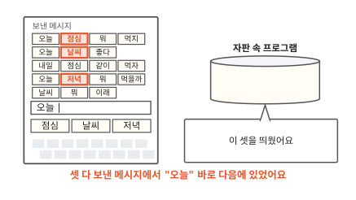

"오늘"은 위에서 첫째, 둘째, 넷째 메시지에 있어요. 바로 다음 낱말은 점심, 날씨, 저녁이에요. 자판에 뜬 셋이 모두 여기 있어요.

그런데 낱말을 칠 때마다 메시지를 처음부터 다 읽으면 일이 많아요. 메시지가 천 개면 낱말 하나를 칠 때마다 천 개를 읽어야 해요. 미리 정리해 두는 방법은 없을까요?

## "오늘" 다음에 무엇이 왔는지 세어요

보낸 메시지를 띄어쓰기로 잘라서 낱말 칸으로 늘어놓았어요. 이제부터 메시지는 위에서부터 1번, 2번처럼 번호로 부를게요. 오른쪽은 횟수표예요. 왼쪽 칸에 앞 낱말을 적고 그 옆에 다음 낱말과 나온 횟수를 적어요. "오늘" 다음에는 점심, 날씨, 저녁이 한 번씩 왔어요. 그래서 "오늘" 줄에 "점심 1, 날씨 1, 저녁 1"을 적어요.

다른 낱말도 같은 방법으로 세요. "점심" 다음에는 뭐와 같이가 한 번씩 왔어요. "뭐" 다음에는 먹지, 먹을까, 이래가 한 번씩 왔어요. 이 표가 있으면 메시지를 다시 읽지 않아도 돼요. "오늘"을 치면 표에서 "오늘" 줄을 펼쳐요. 그 줄에 적힌 낱말을 띄우면 끝이에요.

이렇게 앞 낱말을 보고 다음 낱말을 맞히는 프로그램을 **언어 모델**(language model)이라고 해요.

횟수표를 만들 때 센 글은 보낸 메시지 다섯 개예요. 언어 모델이 횟수를 세는 재료로 모아 둔 글을 **말뭉치**(corpus)라고 해요.

자판은 후보를 띄우기만 해요. 그런데 후보를 누르면 무슨 일이 생길까요?

## 후보를 계속 누르면 문장이 돼요

"오늘"을 치고 [점심]을 눌렀어요. 메시지 칸은 "오늘 점심"이 돼요.

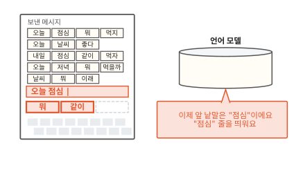

이제 맨 끝 낱말은 "점심"이에요. 언어 모델은 "점심"을 새 앞 낱말로 봐요. 표의 "점심" 줄에는 뭐와 같이가 있어요. 그래서 자판에 [뭐] [같이]가 떠요.

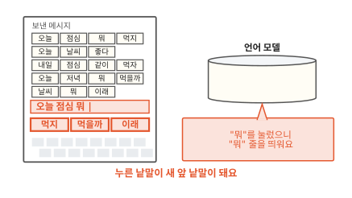

[뭐]를 누르면 앞 낱말이 "뭐"로 바뀌어요. 자판에는 "뭐" 줄의 [먹지] [먹을까] [이래]가 떠요. 후보만 계속 눌러도 문장이 하나 생겨요. 자판이 문장을 대신 써 주는 놀이예요.

이 놀이를 빈 메시지 칸에서 시작해 볼게요. 그런데 빈 칸에는 앞 낱말이 없어요. 첫 낱말은 무엇 다음에 올까요?

메시지의 첫 낱말 앞에는 아무것도 없어요. 그래서 맨 앞에 "(처음)"이 있다고 치고 세요. 다섯 메시지 가운데 셋이 "오늘"로 시작해요. "내일"과 "날씨"로 시작한 메시지는 하나씩이에요. 표 맨 위에 "(처음)" 줄을 더하고 "오늘 3, 내일 1, 날씨 1"을 적어요. 빈 칸에서는 이 줄의 낱말을 띄우면 돼요.

멈출 때도 문제가 있어요. "먹지"를 누르면 앞 낱말은 "먹지"가 돼요. 그런데 표에는 "먹지" 줄이 없어요. "먹지"는 늘 메시지 맨 끝에 왔거든요. 언제 멈춰야 할까요?

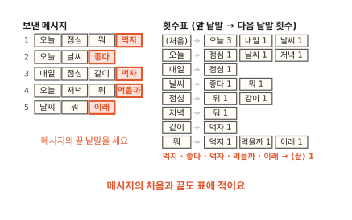

메시지의 끝 낱말 다음에는 "(끝)"이 왔다고 적어요. 먹지, 좋다, 먹자, 먹을까, 이래 다음은 모두 "(끝)"이에요. 다음 낱말로 "(끝)"이 나오면 문장을 멈춰요.

이제 빈 칸에서 시작해 "(끝)"까지 후보를 누르면 문장 하나가 돼요. 그런데 후보가 여럿이면 어느 것을 누를까요?

## 늘 1등만 누르면 같은 문장만 나와요

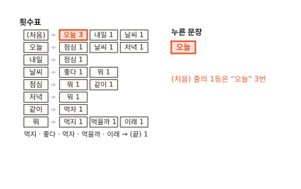

가장 쉬운 방법은 늘 가장 많이 나온 낱말을 누르는 거예요. 줄마다 1등만 누르는 거죠. 빈 칸에서 시작하니 "(처음)" 줄을 봐요. 1등은 3번 나온 "오늘"이에요.

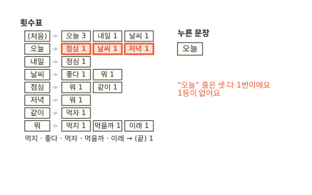

다음은 "오늘" 줄이에요. 그런데 점심, 날씨, 저녁이 모두 1번이에요. 1등이 없어요.

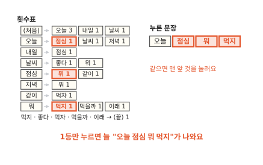

횟수가 같으면 표에서 맨 앞에 적힌 낱말을 누른다고 정해 볼게요. "오늘" 줄에서 점심을 누르고 "점심" 줄에서 뭐를 눌러요. "뭐" 줄에서는 먹지를 눌러요. 문장은 "오늘 점심 뭐 먹지"예요.

몇 번을 다시 해도 똑같은 길로 가요. 그래서 늘 이 문장만 나와요. "내일"이나 "날씨"로 여는 문장은 한 번도 안 나와요. 보낸 메시지 다섯 개 가운데 둘은 그렇게 시작했는데도요.

다른 낱말에도 차례가 오게 하려면 횟수만큼 제비를 만들어 통에 넣어요. "(처음)" 줄이면 오늘 3장, 내일 1장, 날씨 1장이에요.

통에서 한 장을 뽑아요. 그림에서는 "내일"이 나왔어요. 다섯 장 가운데 석 장이 "오늘"이에요. 그래서 다섯 번 뽑으면 세 번쯤은 "오늘"이 나와요. 나머지 두 번쯤은 다른 낱말이에요.

많이 나온 낱말일수록 자주 뽑혀요. 적게 나온 낱말에도 차례가 와요. "오늘" 줄처럼 횟수가 같으면 제비도 한 장씩이에요. 셋이 똑같이 뽑힐 수 있어요.

"내일"이 뽑혔으니 다음 낱말은 "내일" 줄에서 뽑아요. 이렇게 이어 뽑으면 어떤 문장이 나올까요?

## 이어 뽑으면 보낸 적 없는 문장도 나와요

"내일" 줄에는 "점심 1"뿐이라 제비도 한 장이에요. "점심"이 뽑혀 문장에 붙어요. 이제 앞 낱말은 "점심"이에요.

"점심" 줄에는 뭐 1, 같이 1이 있어요. 제비 두 장 가운데 "뭐"가 나왔어요.

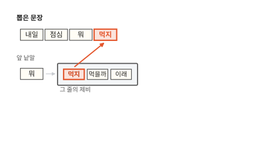

"뭐" 줄의 제비는 먹지, 먹을까, 이래 석 장이에요. 이번에는 "먹지"가 나왔어요.

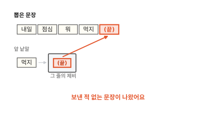

"먹지" 다음에는 늘 "(끝)"이 왔어요. 그래서 문장이 여기서 끝나요. 뽑은 문장은 "내일 점심 뭐 먹지"예요.

보낸 메시지 다섯 개에는 이 문장이 없어요. 3번 메시지의 "내일 점심"과 1번 메시지의 "점심 뭐 먹지"가 "점심"에서 이어졌어요. 언어 모델이 보낸 적 없는 새 문장을 지어냈어요. 그런데 이어 뽑기가 늘 이렇게 그럴듯할까요?

??? info "심화: 섀넌은 1948년에 글자로 같은 실험을 했어요"
    세어서 이어 붙이는 생각이 언제부터 있었는지 궁금할 때 보는 칸이에요.

    클로드 섀넌은 1948년 논문 「통신의 수학적 이론」에서 영어로 비슷한 실험을 했어요.[^shannon] 처음에는 글자를 아무렇게나 늘어놓았어요. 다음에는 영어 글에 자주 나오는 글자일수록 자주 나오게 했어요. 그다음에는 앞 글자 하나를 보고 다음 글자를 골랐어요. 이어서 앞 글자 둘을 보고 골랐어요. 앞을 많이 볼수록 늘어놓은 글자가 영어 낱말처럼 보였어요. 낱말 단위로도 해서 앞 낱말 하나를 보고 다음 낱말을 고른 글도 실었어요.

    섀넌은 횟수표를 미리 다 만들지 않았어요. 먼저 책을 아무 데나 펴서 글자 하나를 적어요. 다른 쪽을 펴서는 그 글자가 나올 때까지 읽어요. 그 글자를 만나면 바로 다음 글자를 적어요. 책에 자주 나오는 짝일수록 자주 걸려요. 횟수만큼 뽑는 일을 책장 넘기기로 한 거예요.

## "내일 점심 뭐 이래"는 왜 나왔을까요?

같은 방법으로 다시 뽑아 볼게요. 이번에도 "내일", "점심", "뭐"까지 왔어요. "뭐" 줄에서 이번엔 "이래"가 나왔어요. 문장은 "내일 점심 뭐 이래"예요. 말이 안 되죠.

왜 이런 문장이 나왔을까요? 횟수표를 만들던 때로 돌아가서 "뭐" 줄이 어떻게 생겼는지 볼게요.

"뭐"는 1번, 4번, 5번 메시지에 있어요. 바로 앞 낱말은 각각 점심, 저녁, 날씨예요. 세 메시지에서 "뭐" 앞이 모두 달라요.

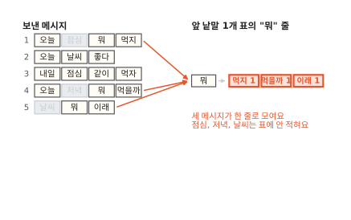

횟수표의 줄에는 앞 낱말 하나만 적어요. 그래서 세 메시지의 "뭐"가 모두 "뭐" 한 줄로 모여요. 이때 "뭐" 앞에 있던 점심, 저녁, 날씨는 표에 남지 않아요. 그림에서 흐려진 칸이 표에 안 남는 낱말이에요.

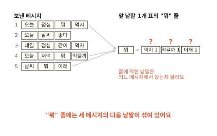

"뭐" 줄에는 먹지, 먹을까, 이래가 한 번씩 적혀 있어요. 줄만 봐서는 "이래"가 어느 메시지에서 왔는지 알 수 없어요. 세 메시지의 다음 낱말이 한 줄에 섞여 있어요.

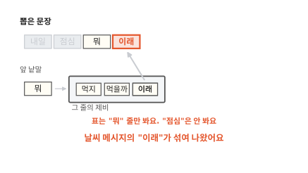

뽑던 장면으로 돌아가 볼게요. 문장은 "내일 점심 뭐"까지 왔어요. 언어 모델은 맨 끝 낱말 "뭐"의 줄만 봐요. 앞에 "점심"이 있었다는 것은 보지 않아요. 그래서 5번 날씨 메시지에서 온 "이래"도 뽑힐 수 있어요. "오늘 날씨 뭐 먹지"도 같은 길로 나와요.

사람은 "내일 점심 뭐" 다음에 "이래"가 어색하다는 걸 바로 알아요. 무엇을 보고 알까요? 메시지를 다시 읽어 봐요.

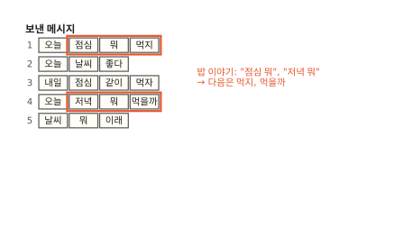

1번은 "점심 뭐" 다음에 먹지가 왔어요. 4번은 "저녁 뭐" 다음에 먹을까가 왔어요. 둘 다 밥 이야기예요. 밥 이야기에서는 "뭐" 다음에 먹는 말이 와요.

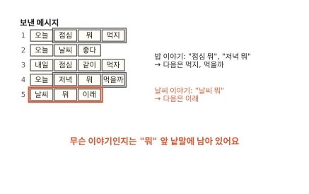

5번은 "날씨 뭐" 다음에 이래가 왔어요. 날씨 이야기예요. 무슨 이야기인지는 "뭐" 바로 앞 낱말에 남아 있어요. 그런데 횟수표는 그 낱말을 버렸어요. 버린 낱말을 표에 남기려면 어떻게 해야 할까요?

## "뭐" 줄을 앞 낱말로 나눠요

앞 낱말을 둘씩 묶어서 세면 돼요. 그러면 "뭐" 줄은 "점심 뭐", "저녁 뭐", "날씨 뭐" 세 줄로 갈라져요. 아까는 세 메시지가 "뭐" 한 줄로 모였어요. 이번에는 메시지마다 다른 줄로 들어가요.

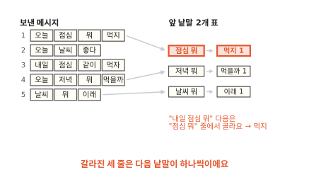

갈라진 세 줄은 다음 낱말이 하나씩뿐이에요. "내일 점심 뭐" 다음 낱말은 맨 끝 두 낱말인 "점심 뭐" 줄에서 골라요. 그 줄에는 먹지뿐이에요. 이제 "내일 점심 뭐 이래"는 나오지 않아요.

다른 줄도 모두 앞 낱말을 둘씩 묶어서 세면 그림의 앞 낱말 2개 표가 돼요. 지금까지 쓴 표는 앞 낱말 1개 표예요. 앞 낱말 2개 표의 줄은 "오늘 저녁"처럼 두 낱말 짝마다 하나씩 있어요. 그림의 표는 17줄이에요. 맨 앞에 "(처음)"이 든 4줄은 문장 첫머리에서만 쓰는 줄이에요. 나머지 13줄이 메시지 안에서 이웃한 두 낱말 짝이에요.

문장 맨 앞에서는 앞 낱말이 둘이 되지 않아요. 그래서 모자란 자리를 "(처음)"으로 채워요. 첫 낱말은 "(처음)"을 두 번 채운 맨 위 줄에서 뽑아요. 둘째 낱말은 "(처음)"과 첫 낱말로 된 줄에서 뽑아요.

앞 낱말 2개 표로 바꾸자 엉킨 문장이 사라졌어요. 그런데 줄을 나눠서 잃은 것은 없을까요?

## 줄을 나눈 대신 치르는 값

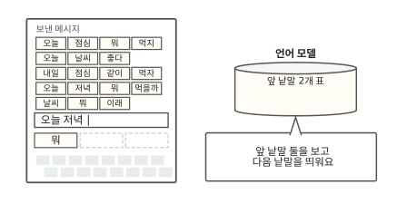

자판 속 언어 모델을 앞 낱말 2개 표로 바꿨어요. "오늘 저녁"을 치면 "오늘 저녁" 줄을 찾아서 [뭐]를 띄워요.

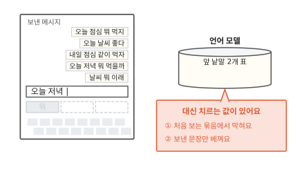

줄을 나눠서 달라진 것을 두 장면으로 볼게요. 먼저 보낸 적 없는 낱말 짝을 쳐 봐요.

### 첫째, 처음 보는 짝에서 막혀요

새 메시지 칸에 "내일 저녁"을 쳤어요. 언어 모델은 "내일 저녁" 줄을 찾아요. 표에서 "내일"로 시작하는 줄은 "내일 점심" 하나뿐이에요.

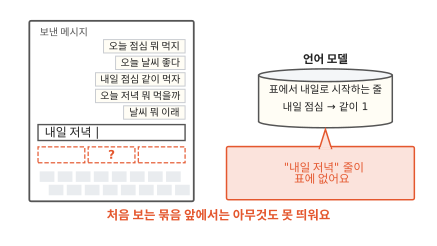

"내일 저녁" 줄이 없으니 띄울 낱말이 없어요. 보낸 메시지에 "내일 저녁"은 한 번도 없었거든요. 앞 낱말 1개 표였다면 "저녁" 줄에서 [뭐]를 띄웠을 거예요.

"내일"도 "저녁"도 아는 낱말이에요. 그런데 왜 막혔을까요? 두 표에 줄이 몇 개까지 생길 수 있는지 세어 보면 보여요.

보낸 메시지에 나온 낱말은 모두 12개예요. 그림 왼쪽에 12개를 세로로 적었어요. 앞 낱말 1개 표의 줄은 앞 낱말마다 하나예요. 그래서 낱말 줄은 12개를 넘지 않아요. 여기에 문장 첫머리용 "(처음)" 줄이 하나 더 있어요. 끝 낱말 다음에는 "(끝)"을 적어 두었어요. 그래서 보낸 메시지에 나온 낱말이면 그 낱말 다음에 띄울 것이 표에 있어요.

앞 낱말 2개 표의 줄은 두 낱말 짝마다 하나예요. 12개 낱말로 짝을 만들어 볼게요. 첫 낱말 자리에는 12가지가 올 수 있어요. 첫 낱말을 하나 정해도 둘째 자리에 다시 12가지가 올 수 있어요. 그래서 짝은 12에 12를 곱한 144가지예요. 그림의 칸 하나가 짝 하나예요.

메시지 안에서 이웃한 두 낱말을 모두 찾아 칠했어요. 1번 메시지에는 오늘 점심, 점심 뭐, 뭐 먹지가 있어요. 메시지마다 낱말 수보다 하나 적게 짝이 나와요. 다섯 메시지를 더하면 3 + 2 + 3 + 3 + 2 = 13가지예요. 144칸 가운데 13칸만 칠해졌어요.

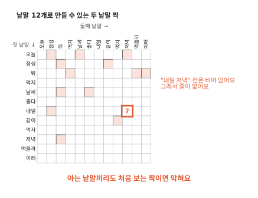

"내일 저녁"은 칠해지지 않은 칸이에요. 그래서 앞 낱말 2개 표에 그 줄이 없어요. 두 낱말은 따로따로는 아는 말이에요. 그래도 둘이 붙어 나온 적이 없어서 막혀요.

앞 낱말을 셋으로 늘리면 더 심해져요. 세 낱말 묶음은 12를 세 번 곱한 1,728가지예요. 메시지 다섯 개에 나온 세 낱말 묶음은 2 + 1 + 2 + 2 + 1 = 8가지예요. 1,728가지 가운데 8가지뿐이에요. 144가지 가운데 13가지보다 훨씬 드물어요.

말뭉치를 늘리면 빈칸이 채워질까요? "내일 비 온대"를 하나 더 보냈다고 해 봐요. 새로 칠해지는 짝은 "내일 비"와 "비 온대" 둘이에요. 그런데 새 낱말 "비"와 "온대"가 생겨서 낱말은 14개가 돼요. 짝은 14에 14를 곱한 196가지가 되어 52칸이 늘어요. 칠한 칸은 둘 늘었는데 빈칸은 50칸 늘었어요. 메시지에는 친구 이름, 가게 이름, 새로 생긴 말처럼 처음 쓰는 낱말이 자주 끼어들어요. 그런 낱말이 하나 생길 때마다 짝의 가짓수가 크게 늘어요. 그래서 메시지를 모아도 빈칸은 쉽게 줄지 않아요.

### 둘째, 보낸 문장만 베껴요

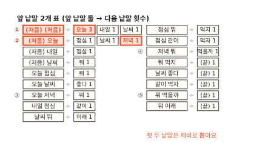

이번에는 막히지 않는 곳에서 뽑아 볼게요. 빈 칸에서 시작하면 첫 낱말은 맨 위 ① 줄에서 뽑아요. "오늘"이 나왔다고 해 봐요. 둘째 낱말은 ② 줄에서 뽑아요. 여기서는 "저녁"이 나왔어요.

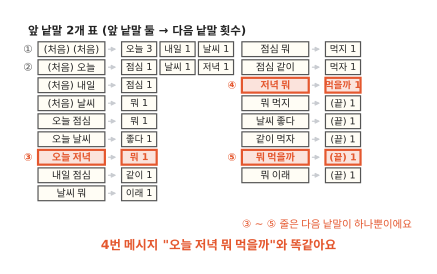

그다음부터는 고를 것이 없어요. "오늘 저녁" 줄에는 "뭐"뿐이에요. "저녁 뭐" 줄에는 "먹을까"뿐이고 "뭐 먹을까" 다음은 "(끝)"이에요.

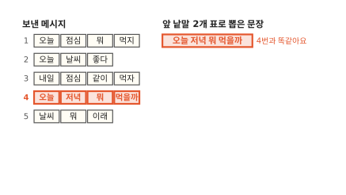

뽑은 문장은 "오늘 저녁 뭐 먹을까"예요. 4번 메시지와 똑같아요.

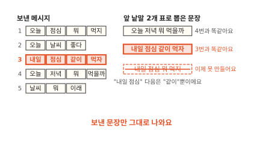

"내일"로 시작해도 같아요. "내일 점심" 다음은 "같이"뿐이에요. 그래서 3번 메시지 "내일 점심 같이 먹자"가 그대로 나와요. 앞 낱말 1개 표가 지어낸 "내일 점심 뭐 먹지"는 이제 못 만들어요. 어떻게 뽑아도 보낸 메시지 다섯 개 가운데 하나가 그대로 나와요.

왜 새 문장을 못 만들게 됐을까요? 새 문장이 어디서 생겼는지부터 다시 볼게요.

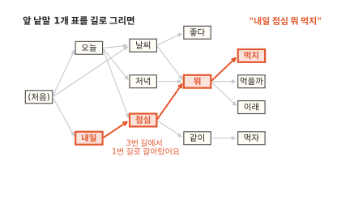

앞 낱말 1개 표를 길 지도로 그렸어요. 낱말이 칸이고 표에 적힌 다음 낱말로 화살표가 가요. "내일 점심 뭐 먹지"는 "내일"에서 "점심"까지 3번 메시지의 길로 왔어요. "점심"에서는 1번 메시지의 길로 갈아탔어요. 두 메시지에 "점심"이 같이 있어서 그 자리에서 갈아탈 수 있었어요.

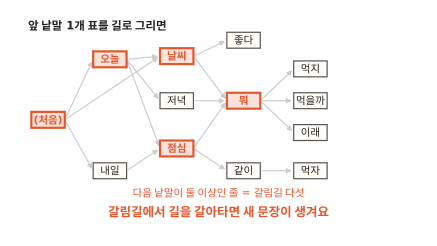

다음 낱말이 둘 이상인 줄에서는 길이 갈라져요. 이 지도에는 (처음), 오늘, 날씨, 점심, 뭐, 이렇게 갈림길이 다섯 곳 있어요. 새 문장은 갈림길에서 다른 메시지의 길로 갈아탈 때 생겨요.

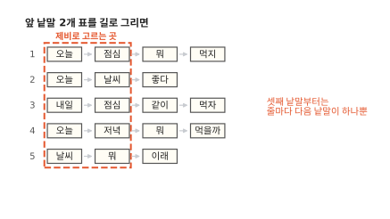

앞 낱말 2개 표도 길로 그려 볼게요. 첫 두 낱말은 "(처음)"이 든 줄에서 제비로 골라요. 그다음 줄은 모두 다음 낱말이 하나뿐이에요. 셋째 낱말부터는 갈림길이 하나도 없어요.

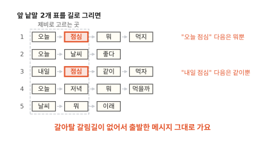

1번과 3번의 "점심"을 봐요. 앞 낱말 1개 표에서는 둘 다 같은 "점심" 줄이었어요. 앞 낱말 2개 표에서는 "오늘 점심" 줄과 "내일 점심" 줄로 갈렸어요. "오늘 점심" 다음은 뭐뿐이고 "내일 점심" 다음은 같이뿐이에요. 갈아탈 데가 없으니 출발한 메시지 그대로 끝까지 가요.

"뭐" 줄을 나누자 "내일 점심 뭐 이래"가 사라졌어요. 같은 방법으로 "점심" 줄이 나뉘자 "내일 점심 뭐 먹지"도 사라졌어요. 메시지가 섞이던 자리가 바로 길을 갈아타던 자리였어요. 엉킴을 없앤 일과 갈림길을 없앤 일은 같은 일이었어요. 그래서 엉킴은 막으면서 새 문장은 지어내게 하기가 어려워요.

??? info "심화: 처음 보는 짝에 작은 몫을 나눠 주기"
    앞 낱말을 늘리면서도 막히지 않게 하는 방법이 궁금할 때 보는 칸이에요.

    한 가지는 물러서기예요. "내일 저녁" 줄이 표에 없으면 앞 낱말을 하나 줄여 "저녁" 줄을 봐요. 거기서 [뭐]를 띄워요. 긴 짝이 표에 있으면 그걸 써요. 없으면 짧은 쪽으로 내려가요. 이 방법을 백오프(back-off)라고 불러요.

    또 한 가지는 한 번도 안 나온 낱말에도 작은 몫을 주는 거예요. 가장 단순한 방법은 모든 횟수에 1을 더하는 거예요. "날씨" 줄에는 좋다 1, 뭐 1뿐이었어요. 메시지에 나온 낱말 12가지와 "(끝)"까지 13가지 모두에 1을 더해요. 좋다와 뭐는 2가 되고 나머지 11가지는 1이 돼요. 제비가 모두 15장이니 "좋다"는 15번 중 2번 뽑혀요. 한 번도 안 나온 "점심"도 15번 중 1번 뽑혀요. 이렇게 처음 보는 일에 몫을 나눠 주는 방법을 평활화(smoothing)라고 해요.

    몫을 나눠 주면 막힘이 풀려요. 처음 보는 이음도 가끔 나와서 베낌도 줄어요. 다만 몫은 고르게 나눠 준 것뿐이라 "날씨 점심"이 말이 되는지는 여전히 몰라요. 실제로 쓰인 방법은 이보다 정교해요. 1987년 Katz의 백오프와 1995년 Kneser와 Ney의 평활화가 널리 알려져 있어요.

그렇다면 세어서 맞히는 언어 모델은 쓸모가 없을까요?

## 세기 모델은 언제 쓸모 있을까요?

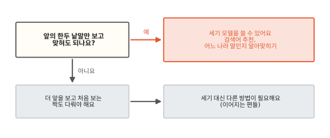

지금까지 본 언어 모델은 횟수를 세기만 했어요. 이런 세기 모델은 앞의 한두 낱말만 보고 맞혀도 되는 일에 쓸 수 있어요. 검색창에 낱말 하나를 치면 그 뒤에 자주 붙여 친 낱말을 추천하는 일이 그래요. 표 하나만 있으면 되니 작은 기기에서도 빨리 돌아요.

어느 나라 말인지 알아맞히는 일에도 세기 방식을 쓸 수 있어요. 이때는 낱말 대신 글자 묶음을 세요. 한국어 글에는 "니다", "어요" 같은 글자 묶음이 자주 나와요. 영어 글에는 "the"가 자주 나와요. 나라말마다 글자 묶음 횟수표를 만들어 둬요. 새 글이 어느 표와 가장 닮았는지 보면 돼요.

앞의 문장 전체를 보고 맞혀야 하는 일은 세기만으로는 어려워요. 앞을 더 볼수록 처음 보는 짝과 묶음이 늘어요. 막히지 않는 곳에서는 배운 문장을 베끼게 돼요. 이 벽을 넘는 방법은 이어지는 편들에서 하나씩 봐요.

## 다시 "오늘"을 쳐 볼게요

처음 장면의 휴대폰으로 돌아왔어요. 새 메시지 칸에 다시 "오늘"을 쳤어요. 이번에는 자판 속에서 무슨 일이 일어나는지 알고 봐요.

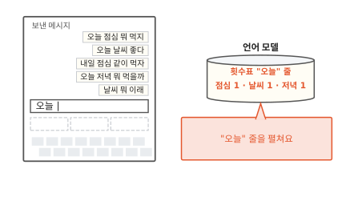

언어 모델은 횟수표에서 "오늘" 줄을 펼쳐요. 그 줄에는 점심 1, 날씨 1, 저녁 1이 적혀 있어요.

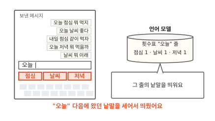

그 줄의 낱말을 띄우면 끝이에요. 처음에 메시지를 하나씩 뒤져서 찾은 세 낱말과 같아요.

보낸 메시지가 다섯 개든 오천 개든 이 언어 모델은 앞 낱말의 줄을 찾아 거기 적힌 낱말을 띄워요.

### 이 편에서 줄여 그린 것

그림을 쉽게 하려고 실제와 다르게 줄인 곳이 세 군데 있어요.

1. 이 편은 언어 모델을 만드는 가장 단순한 방법을 그렸어요. 실제 휴대폰 자판이 어떤 방법을 쓰는지는 제품마다 달라요. 세기 대신 신경망을 쓰는 자판도 있어요. 신경망은 이어지는 편들에서 봐요.
2. 낱말을 띄어쓰기로 잘랐어요. 그래서 "먹지", "먹자", "먹을까"가 서로 다른 낱말이 됐어요. 실제 언어 모델은 글을 더 작은 조각으로 잘라요([2편](02-tokens.md)).
3. 처음 보는 짝에 작은 몫을 나눠 주는 방법을 빼고 그렸어요. 실제 세기 모델은 이 방법을 함께 써요. 둘째 값 절의 심화 칸에서 다뤄요.

### 이 편에서 새로 나온 말

다음 편은 "글을 어떤 조각으로 자를까요?"예요.

[^shannon]: C. E. Shannon, "A Mathematical Theory of Communication", Bell System Technical Journal 27권(1948). 3절 "The Series of Approximations to English"에 글자와 낱말을 늘어놓은 예가 실려 있어요.
