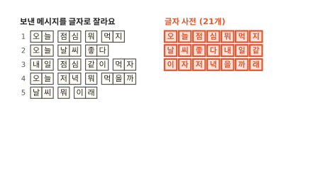
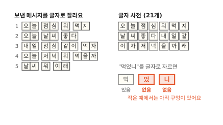
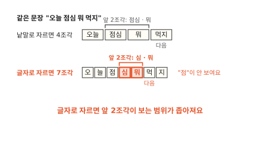
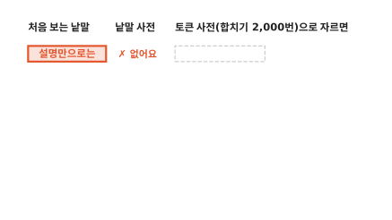
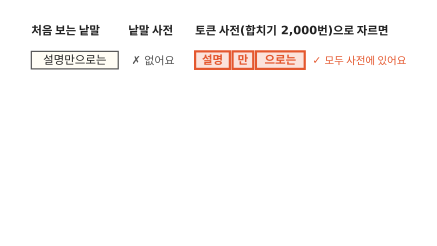
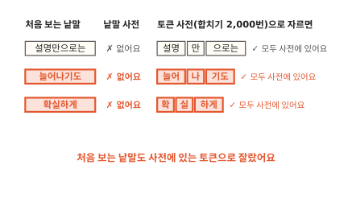
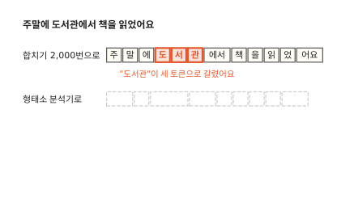
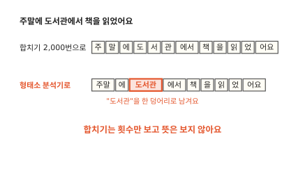

# 글을 어떤 조각으로 자를까요?

## "먹었니"는 낱말 사전에 없어요

[1편](01-next-word.md)의 휴대폰으로 돌아왔어요. 보낸 메시지는 그대로 다섯 개예요. 이번에는 친구에게 "내일 저녁 뭐 먹었니"를 치고 있어요. 오른쪽 원통은 1편에서 만든 언어 모델이에요. 앞 낱말을 보고 다음 낱말을 맞히는 프로그램이었죠. 이 언어 모델은 메시지를 띄어쓰기로 잘라 낱말 12개를 알고 있어요. 그 12개가 언어 모델의 낱말 사전이에요.

"내일", "저녁", "뭐"는 사전에 있어요. "먹었니"는 없어요. 보낸 메시지에 이 낱말을 쓴 적이 없거든요. 사전에 없는 낱말은 1편의 횟수표에 줄도 칸도 만들 수 없어요.

1편에서는 "내일 저녁" 앞에서 막혔어요. 그때는 낱말 둘은 다 알았고 그 둘이 이어진 묶음을 처음 봤어요. 이번에는 낱말 자체를 처음 봐요.

메시지가 다섯 개뿐이라서 생긴 일일까요? 1편처럼 이 사이트 본문 문장 7,537개로 재 봤어요.[^lab] 문장 열 개 중 아홉 개로 낱말 사전을 만들었더니 낱말이 14,117가지였어요. 남은 한 개를 시험 글로 썼어요. 이 실험에서는 시험 글 낱말 5,935개 가운데 908개가 사전에 없었어요. 1,000개로 치면 153개쯤이에요. 낱말은 끝이 "먹었니", "먹었어요", "먹었대"처럼 계속 바뀌어서 사전을 아무리 키워도 다 담기 어려워요. 낱말보다 작게 자르면 어떨까요?

## 글자로 자르면 구멍이 거의 없어요

이번에는 메시지를 글자 하나하나로 잘라요. 같은 글자는 한 번만 적으면 글자 사전이 돼요. 다섯 메시지에서 나온 글자는 21개예요.

"먹었니"를 글자로 자르면 먹, 었, 니예요. "먹"은 글자 사전에 있어요. "었"과 "니"는 없어요. 메시지가 다섯 개뿐이라 이 작은 예에서는 아직 구멍이 남아요.

글이 많으면 달라요. 같은 실험 글로 글자 사전을 만들었더니 글자는 1,071가지였어요. 이 실험에서는 시험 글의 글자 18,007개 가운데 사전에 없는 글자가 19개였어요. 낱말로 잘랐을 때는 1,000개 중 153개쯤이 없었어요. 글자로 자르니 1,000개 중 1개도 안 됐어요. 한국어 글에 실제로 쓰이는 글자는 몇천 가지뿐이라서 글을 조금만 모아도 거의 다 나와요.

구멍이 거의 사라졌어요. 대신 잃는 것은 없을까요?

1편의 언어 모델은 앞 낱말 2개를 보고 다음을 맞혔어요. "오늘 점심 뭐 먹지"를 낱말로 자르면 4조각이에요. "먹지"를 맞힐 때 앞 2조각 "점심 뭐"를 봐요.

같은 문장을 글자로 자르면 7조각이에요. "먹"을 맞힐 때 앞 2조각은 "심 뭐"예요. "점"조차 안 보여서 점심인지도 몰라요. 실험 글에서도 같았어요. 시험 문장 하나는 평균 낱말 7.9개였는데 글자로는 23.9조각이었어요. 세 배쯤 길어졌어요. 같은 뜻을 보려면 앞 조각을 세 배쯤 더 봐야 해요. 1편에서 본 것처럼 앞을 많이 볼수록 처음 보는 묶음도 늘어요.

낱말은 구멍이 많고 글자는 문장이 길어요. 그 사이 크기로 자를 수는 없을까요?

## 자주 붙어 나오는 둘을 하나로 합쳐요

글자에서 시작해요. 두 글자가 나란히 붙어 나온 횟수를 세요. 띄어쓰기로 나눈 낱말 안에서만 세요. "뭐 먹지"의 "뭐"와 "먹"처럼 띄어 쓴 두 글자는 짝으로 치지 않아요. "오" 다음에 "늘"이 붙은 곳은 1번, 2번, 4번 메시지로 3번이에요. "점심"과 "날씨"는 2번씩이고 나머지 짝은 모두 1번씩이에요.

가장 많이 붙어 나온 "오"와 "늘"을 한 칸 "오늘"로 합쳐요. 합친 일은 합친 순서 목록에 ①로 적어요. 이제 "오늘"은 한 조각이에요. 그다음엔 무엇을 합칠까요?

남은 짝 가운데 가장 많은 것은 2번씩 나온 "점심"과 "날씨"예요. "점심"을 먼저 합쳐 ②로 적었어요.

"날씨"를 ③으로 합쳤어요. 남은 짝은 모두 1번씩이라 이 작은 예에서는 여기서 멈춰요. 글이 많으면 다시 세고 가장 많은 짝을 합치는 일을 원하는 횟수만큼 되풀이해요.

자주 붙어 나오는 두 조각을 하나로 합치기를 되풀이하는 이 방법을 **BPE**라고 불러요. 영어 이름 Byte Pair Encoding의 머리글자예요. 처음엔 글을 줄여 담는 데 쓰던 방법이라서 이런 이름이 붙었어요.

BPE로 만든 조각은 글자일 수도, "오늘"처럼 낱말일 수도, 그 중간일 수도 있어요. 이렇게 글을 잘라 낸 조각 하나하나를 **토큰**(token)이라고 불러요. 언어 모델이 다음에 무엇이 올지 맞히는 단위가 토큰이에요. 1편의 낱말 사전 자리에는 이제 토큰 사전이 들어가요.

## 합치기를 많이 할수록 사전은 커지고 문장은 짧아져요

합치기를 몇 번 할지는 정하기 나름이에요. 실험 글로 합치기를 0번, 500번, 2,000번, 8,000번 해 봤어요.

합치기 0번은 글자로만 자른 것이에요. 토큰 사전은 글자 1,071개이고 시험 문장 하나는 23.9토큰이었어요. 아직 바이트(첫째 문제 절)는 넣지 않은 수예요. 합치기를 한 번 할 때마다 합친 토큰이 사전에 하나씩 더해져요. 그래서 500번 합치면 1,071에 500을 더해 1,571개가 돼요. 이 실험에서는 그때 문장 하나가 16.1토큰으로 줄었어요. 8,000번 합치면 사전은 9,071개로 커졌고 문장은 10.3토큰으로 짧아졌어요.

합치기 횟수는 사전 크기와 문장 길이를 맞바꾸는 손잡이예요. 사전이 크면 언어 모델이 기억할 토큰이 많아져요. 문장이 길면 같은 뜻을 보려고 앞 토큰을 더 많이 봐야 해요. 쓰는 곳에 맞게 그 사이 어딘가를 골라요.

??? info "심화: 합치기 8,000번은 어떻게 돌아갔을까요?"
    합치기를 수천 번 하는 데 시간이 얼마나 드는지 궁금할 때 보는 칸이에요.

    한 번 합칠 때마다 하는 일은 메시지 다섯 개로 한 것과 같아요. 사전을 만들 글의 낱말을 모두 지금 토큰으로 자른 뒤 나란히 붙은 두 토큰의 횟수를 세요. 가장 많은 짝 하나를 합치고 합친 결과로 다시 세요. 같은 낱말이 여러 번 나와도 자르기는 한 번만 해요. 대신 그 낱말이 나온 횟수를 곱해서 세요.

    이 실험에서는 낱말 14,117가지로 이 일을 8,000번 되풀이했어요. 노트북에서 2분쯤 걸렸어요.[^lab] 쓰는 쪽은 훨씬 가벼워요. 새 글을 자를 때는 합친 순서 목록을 처음부터 따라가요. 목록에 있는 짝을 만나면 합치기만 하면 돼요.

합친 순서 목록이 있으면 사전에 없던 낱말은 어떻게 될까요?

## 처음 보는 낱말도 아는 토큰으로 잘라요

시험 글에 "설명만으로는"이라는 낱말이 나왔어요. 낱말 사전에는 없는 낱말이에요.

합치기 2,000번으로 만든 순서 목록을 따라 합치면 "설명", "만", "으로는" 세 토큰이 나와요. 셋 다 토큰 사전에 있어요. "설명"과 "으로는"은 다른 낱말 속에서 자주 붙어 나와서 하나로 합쳐져 있었어요.

"늘어나기도"는 늘어, 나, 기도로 잘렸어요. "확실하게"는 확, 실, 하게로 잘렸어요. 낱말 사전에 없던 낱말도 토큰 사전의 토큰으로는 잘렸어요. 언어 모델은 이 토큰들로 횟수를 셀 수 있어요.

그럼 BPE로 자르기만 하면 막히는 일은 다 사라질까요?

## 합쳐서 자를 때 남는 문제

BPE로 자르면 막히는 일이 얼마나 사라지는지 처음 장면에서 다시 볼게요. 실험 글로 만든 토큰 사전은 "먹었니"를 먹, 었, 니로 잘라요. 처음 장면에서 막혔던 낱말이 이제 잘렸어요.

그래도 막히는 일이 다 사라지지는 않아요. 문제가 세 가지 남아요. 사전에 없는 글자가 나오면 못 잘라요. 같은 뜻이라도 언어에 따라 토큰 수가 달라요. 그리고 뜻과 상관없이 잘라요. 첫째 문제부터 볼게요.

### 첫째, 사전에 없는 글자는 못 잘라요

BPE는 글자에서 시작해요. 토큰 사전에 없는 글자는 잘라도 아는 토큰이 되지 않아요. 메시지 다섯 개로 만든 사전에는 "었"과 "니"가 없었어요. 실험 글에서도 시험 글자 19개가 사전에 없었어요. 글자를 더 잘게 나눌 수는 없을까요?

"었"이 사전에 없는 글자라고 해 볼게요.

컴퓨터는 글자마다 정해 둔 번호로 글자를 기억해요([컴퓨터 3편](../computer/03-how-computers-keep-letters.md)). "었"의 번호는 50,632예요.

컴퓨터는 이 번호를 작은 칸 여러 개에 나눠 적어요. 한 칸에는 0과 1을 여덟 자리 적을 수 있어요. 그래서 한 칸이 담는 숫자는 0부터 255까지 256가지예요. 이렇게 0~255 숫자 하나를 담는 칸을 **바이트**(byte)라고 불러요. 50,632는 255보다 커서 바이트 하나에 다 담기지 않아요. 한글 한 글자는 흔히 바이트 3개에 나눠 적어요.[^utf8] "었"은 236, 151, 136이에요. 번호를 바이트에 나눠 적는 규칙이 따로 있어서 50,632를 그냥 셋으로 나눈 숫자는 아니에요.

바이트는 256가지뿐이에요. 그래서 토큰 사전에 바이트 256개를 처음부터 다 넣어 둬요. 그러면 사전은 256개 늘어요. 사전에 없는 글자가 나오면 그 글자를 바이트로 잘라요. "었"은 바이트 토큰 3개가 돼요. 어떤 글자든 바이트로는 적혀 있으니 못 자르는 글자가 없어요. 대신 그 글자 하나가 토큰 3개를 차지해요.

토큰이 많아지는 일은 사전에 없는 글자에서만 생길까요?

??? info "심화: BPE는 원래 파일을 줄이는 방법이었어요"
    언어 모델과 상관없어 보이는 이름이 왜 붙었는지 궁금할 때 보는 칸이에요.

    1994년 필립 게이지(Philip Gage)는 파일 크기를 줄이는 방법을 잡지에 실었어요.[^gage] 파일 속 바이트 가운데 가장 자주 나란히 나오는 두 바이트를 찾아요. 그 둘을 파일에 한 번도 안 쓰인 바이트 하나로 바꿔요. 바꾼 짝은 표에 적어 둬요. 이걸 되풀이하면 파일이 짧아져요. 표를 거꾸로 따라가면 원래 파일로 돌아와요. 바이트 짝을 부호 하나로 바꾸니 영어로 Byte Pair Encoding, 바이트 짝 부호화예요.

    2016년 센리히(Sennrich) 등은 이 생각을 번역 프로그램의 낱말 자르기에 썼어요.[^sennrich] 번역 프로그램도 사전에 없는 낱말에서 막혔거든요. 바이트 대신 글자에서 시작해 자주 붙어 나오는 짝을 합쳤어요. 파일을 줄이려는 게 목적이 아니었어요. 그래서 합친 조각을 새 부호로 바꾸지 않고 그대로 토큰 사전에 올렸어요.

### 둘째, 언어마다 토큰 수가 달라요

글을 토큰으로 자르는 프로그램을 토크나이저(tokenizer)라고 해요. 언어 모델을 만드는 곳들은 자기 토크나이저를 만들어 쓰고 몇몇은 공개해 둬요. 공개 토크나이저 둘로 같은 뜻의 한국어 문장과 영어 문장을 잘라 봤어요.[^tok] 둘 다 BPE로 만든 토큰 사전을 쓰고 바이트 256개도 사전에 들어 있어요.

옛 공개 토크나이저는 "오늘 점심 뭐 먹지?"를 14토큰으로 잘랐어요. "오"와 "지"는 한 토큰인데 "늘", "점", "심", "뭐"는 바이트 조각 두 토큰씩, "먹"은 세 토큰으로 갈렸어요. 이 토크나이저의 사전에는 이 글자들이 통째로 들어 있지 않았어요. 그래서 바이트로 잘렸는데 바이트 3개가 꼭 3토큰은 아니에요. 바이트끼리도 BPE로 합쳐져서 바이트 두 개가 이미 한 토큰이 된 것도 있어요. "늘"은 두 바이트짜리 토큰 하나와 한 바이트짜리 토큰 하나로 잘렸어요.

같은 뜻의 영어 문장 "What should I eat for lunch today?"는 8토큰이었어요. 영어는 낱말마다 한 토큰으로 남았어요.

새 공개 토크나이저는 같은 한국어 문장을 7토큰으로 잘랐어요. "오늘"은 한 토큰이고 나머지 글자도 바이트로 쪼개지지 않았어요. 문장 다섯 쌍으로 세어 보니 옛 것은 한국어 82토큰, 영어 42토큰이었어요. 새 것은 한국어 46토큰, 영어 41토큰이었어요.

차이는 토큰 사전을 만들 때 생겨요. BPE는 사전을 만들 때 본 글에서 자주 붙어 나온 짝만 합쳐요. 그 글에 한국어가 적으면 한국어 짝은 덜 합쳐지고 한국어 글자는 바이트로 남아요. 두 토크나이저의 사전을 세어 봤어요.[^tok] 옛 것은 토큰 100,277개 가운데 한글이 든 토큰이 281개였어요. 새 것은 사전이 200,019개로 두 배쯤 컸어요. 한글이 든 토큰은 2,352개로 281개의 여덟 배 남짓이었어요.

토큰이 많으면 1편의 언어 모델은 더 힘들어져요. 옛 토크나이저로 자른 문장에서 앞 토큰 2개를 보면 "늘"의 바이트 반쪽 같은 조각만 보여요. 글자로 잘랐을 때처럼 문장이 길어진 거예요. 같은 뜻을 보려면 앞을 훨씬 많이 봐야 해요. 그러면 1편에서 본 것처럼 처음 보는 묶음이 늘어요.

??? info "심화: 공개 토크나이저는 띄어쓰기를 토큰에 붙여요"
    그림의 토큰에 띄어쓰기가 안 보이는데 어디로 갔는지 궁금할 때 보는 칸이에요.

    이 편의 실험은 띄어쓰기에서 먼저 낱말을 나누고 낱말 안에서만 합쳤어요. 띄어쓰기는 토큰으로 세지 않았어요. 공개 토크나이저 둘은 띄어쓰기를 다음 낱말의 앞에 붙여 한 토큰으로 만들어요. 새 공개 토크나이저의 "점" 토큰은 사실 띄어쓰기와 "점"이 붙은 " 점"이에요. 영어의 " should"도 마찬가지예요.

    이렇게 하면 토큰만 보고도 띄어쓰기를 되살릴 수 있어요. 토큰을 차례로 이어 붙이면 원래 문장이 그대로 나와요. 같은 "점"이라도 문장 맨 앞의 "점"과 띄어 쓴 " 점"은 사전에서 다른 토큰이에요.

토큰 수가 적당해도 남는 문제가 하나 더 있어요. 토큰이 뜻에 맞게 잘렸을까요?

### 셋째, 뜻과 상관없이 잘라요

"주말에 도서관에서 책을 읽었어요"를 합치기 2,000번 사전으로 잘랐어요. "도서관"이 도, 서, 관 세 토큰으로 갈렸어요. "주말"도 주, 말로 갈렸어요. 실험 글에 "도서관"이 드물어서 도와 서가 합쳐질 만큼 자주 붙어 나오지 않았어요.

같은 문장을 공개 형태소 분석기로 잘라 봤어요.[^kiwi] 형태소는 뜻을 가진 가장 작은 말 단위예요. 형태소 분석기는 낱말 목록과 많은 글에서 센 통계로 글을 형태소로 나눠요. 이 분석기는 "도서관"과 "주말"을 한 덩어리로 남기고 "에서", "어요"를 떼어 냈어요.

BPE는 자주 붙어 나왔는지만 봐요. 그 짝이 뜻이 있는 말인지는 따지지 않아요. 그래서 자주 나오는 "에서"는 한 토큰으로 맞게 남았지만 드문 "도서관"은 쪼개졌어요. 언어 모델 쪽에서는 이게 큰 흠이 아니에요. 도, 서, 관이 늘 이 순서로 붙어 나오는 것을 많은 글에서 배우면 돼요. 하지만 사람이 뜻으로 찾아야 하는 곳에서는 문제가 돼요.

## 어떤 자르기를 언제 쓸까요?

언어 모델처럼 기계가 다음 토큰을 맞혀야 하면 BPE로 잘라요. 어떤 글이 들어와도 막히지 않고 합치기 횟수로 사전 크기와 문장 길이를 고를 수 있어요. 뜻에 맞지 않게 잘려도 기계는 많은 글에서 그 이음을 배워요.

사람이 뜻으로 찾거나 고쳐야 하면 형태소 분석기로 잘라요. 검색 엔진은 글을 찾기 쉽게 미리 잘라서 정리해 둬요. 검색창에 "도서관"을 쳤는데 "도서관에서"가 든 글을 찾아야 한다면 "도서관"이 한 덩어리로 남아 있어야 해요. 검색 엔진이 글을 형태소로 자르는 방법은 ES 갈래의 분석기 편([ES 2편](../elasticsearch/02-analyzer.md))에서 볼 수 있어요. 맞춤법 검사도 낱말 끝의 "에서", "었", "어요"를 따로 봐야 틀린 곳을 찾아요.

## 다시 "먹었니"를 쳐 볼게요

처음 장면의 휴대폰으로 돌아왔어요. 보낸 메시지 다섯 개로 만든 낱말 사전 12개에는 "먹었니"가 없어서 막혔어요.

이번에는 같은 메시지 다섯 개로 토큰 사전을 만들어요. 글자 21개에 합친 토큰 "오늘", "점심", "날씨"를 더하고 바이트 256개도 넣어요.

"먹었니"는 먹, 었, 니로 잘려요. "먹"은 글자 사전에 있어요. "었"과 "니"는 바이트 3개씩으로 잘려요. 막힌 곳 없이 토큰 7개가 됐어요.

보낸 메시지가 다섯 개든 오천 개든 바이트 256개가 든 토큰 사전은 어떤 글이든 잘라요.

### 이 편에서 줄여 그린 것

그림을 쉽게 하려고 실제와 다르게 줄인 곳이 네 군데 있어요.

1. 이 편의 BPE는 글자에서 시작하고 사전에 없는 글자만 바이트로 잘랐어요. 실제 토크나이저는 처음부터 바이트에서 시작해 바이트 짝을 합쳐 가는 경우가 많아요. 그림의 옛 공개 토크나이저에서 글자가 바이트 조각으로 갈린 것도 그래서예요.
2. 띄어쓰기 경계를 넘어서는 합치지 않았어요. 공개 토크나이저는 띄어쓰기를 다음 낱말 앞에 붙여 " 점" 같은 토큰을 만들어요. 둘째 문제 절의 심화 칸에서 다뤄요.
3. 합치기를 몇 번 할지 고르는 기준은 다루지 않았어요. 사전 크기와 문장 길이를 맞바꾼다는 것까지만 봤어요.
4. 횟수가 같은 짝이 여럿일 때 어느 것을 먼저 합치는지는 그리지 않았어요. 메시지 다섯 개에서 "점심"과 "날씨"는 2번씩으로 같았어요. 두 짝은 글자가 겹치지 않아서 어느 쪽을 먼저 합쳐도 결과가 같아요.

### 이 편에서 새로 나온 말

다음 편은 "낱말을 숫자 목록으로 바꾸면 무엇이 좋을까요?"예요.

[^lab]: 실험 글은 1편과 같은 이 사이트의 2026-11-03 본문 문장 7,537개예요. 문장 열 개 중 아홉 개로 사전을 만들고 남은 한 개로 시험했어요. 낱말은 띄어쓰기로 잘랐고 합치기도 띄어쓰기로 나눈 낱말 안에서만 했어요. 시험 글은 문장 754개, 낱말 5,935개, 글자 18,007개였어요. 합치기 8,000번을 배우는 데 걸린 2분쯤은 노트북 한 대에서 잰 시간이에요.
[^gage]: Philip Gage, "A New Algorithm for Data Compression", The C Users Journal 12권 2호(1994년 2월).
[^sennrich]: Rico Sennrich, Barry Haddow, Alexandra Birch, "Neural Machine Translation of Rare Words with Subword Units", ACL 2016.
[^utf8]: 오늘날 가장 널리 쓰는 적는 방식 UTF-8에서 그래요. UTF-8은 번호를 그냥 쪼개지 않고 각 바이트 앞자리에 "몇 바이트짜리 글자인지"를 알리는 표시를 붙여 적어요. 그래서 236, 151, 136을 그대로 이어 읽어도 50,632가 나오지는 않아요. 영어 알파벳은 바이트 1개, 한글은 3개, 웃는 얼굴 같은 이모지는 4개예요.
[^tok]: 옛 공개 토크나이저는 tiktoken 0.14.0의 `cl100k_base`, 새 공개 토크나이저는 `o200k_base`예요. 문장 다섯 쌍은 "오늘 점심 뭐 먹지?", "내일 같이 저녁 먹자.", "오늘 날씨가 정말 좋다.", "어제 산 신발이 너무 작아요.", "주말에 도서관에서 책을 읽었어요."와 같은 뜻의 영어 문장이에요. 사전 크기는 토크나이저마다 정해진 토큰 번호 개수(`n_vocab`)예요. 한글이 든 토큰은 사전의 토큰을 하나씩 UTF-8 글자로 풀어 보고 한글 음절(가~힣)이 하나라도 든 것을 셌어요. 글자로 풀리지 않는 바이트 조각 토큰은 세지 않았어요.
[^kiwi]: 공개 형태소 분석기는 kiwipiepy 0.24.1(Kiwi)이에요. "읽었어요"를 읽, 었, 어요로 나눴어요.
