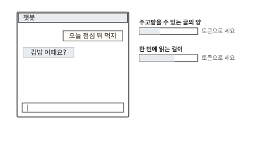
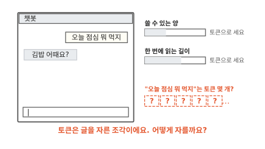
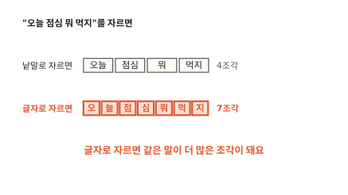
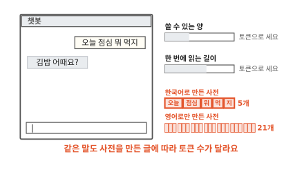

# 글을 어떤 조각으로 자를까요?

## 챗봇은 글을 "토큰"으로 세요

챗봇에게 "오늘 점심 뭐 먹지"라고 물어볼 수 있어요. 챗봇을 쓰다 보면 "토큰"이라는 말을 자주 만나요. 챗봇은 내가 쓸 수 있는 양을 토큰으로 세요. 한 번에 읽을 수 있는 글의 길이도 토큰으로 세요.

챗봇 안에는 글을 읽고 다음 말을 고르는 언어 모델이 있어요. [1편](01-next-word.md)에서 메시지 다섯 개로 만든 것과 같은 일을 하는 프로그램이에요. 언어 모델은 글을 조각으로 잘라서 읽어요. 그 조각 하나를 **토큰**이라고 해요.

1편의 언어 모델은 낱말 하나를 조각 하나로 썼어요. "오늘 점심 뭐 먹지"는 낱말이 4개라서 4조각이었어요. 그런데 챗봇이 세는 토큰은 낱말과 다르게 잘려요. "오늘 점심 뭐 먹지"는 토큰 몇 개일까요? 답은 하나가 아니에요. 사전을 어떤 글로 만들었느냐에 따라 달라져요. 왜 그런지 1편의 휴대폰에서부터 따라가 볼게요.

1편의 휴대폰은 보낸 메시지 다섯 개로 횟수표를 만들었어요. 횟수표는 앞 낱말마다 다음에 온 낱말과 그 횟수를 적은 표예요. 그사이 메시지를 두 개 더 보냈어요. "어제 뭐 먹었어"와 "점심 먹었지"예요. 언어 모델은 메시지 일곱 개로 횟수표를 다시 셌어요.

이번에는 친구에게 "내일 저녁 뭐 먹었니"를 쳐요. "먹었니"까지 치자 후보 칸 셋이 텅 비었어요. 왜 그럴까요?

횟수표의 줄마다 맨 앞 칸에는 앞 낱말이 있어요. 이 칸만 모으면 낱말 15개가 나와요. 맨 위 (처음) 줄은 메시지가 시작하는 자리라서 빼요. 언어 모델이 아는 낱말은 이 15개가 전부예요. 이 목록을 낱말 사전이라고 할게요.

언어 모델은 "먹었니" 줄을 찾아요. 그런 줄은 없어요. 메시지에 "먹었니"를 한 번도 쓴 적이 없거든요. 줄이 없으니 다음에 올 낱말도 적혀 있지 않아요.

메시지를 더 보내도 새 낱말은 또 나와요. 왜 그런지 "먹"으로 시작하는 낱말을 모아 볼게요.

## 낱말로 자르면 사전이 끝이 없어요

메시지 일곱 개에는 "먹"으로 시작하는 낱말이 다섯 개 있어요. 먹지, 먹자, 먹을까, 먹었어, 먹었지예요. 앞은 "먹"으로 같고 끝만 달라요. 먹었어와 먹었지는 "먹" 뒤에 "었"이 붙고 그 뒤에 또 끝이 붙었어요.

띄어쓰기로 자르면 끝이 다른 낱말은 모두 다른 낱말이에요. 다섯 낱말이 사전에서 칸을 다섯 개 차지해요.

끝은 여기서 멈추지 않아요. 먹었니, 먹었대, 먹어요, 먹는다처럼 얼마든지 더 붙어요. 끝이 하나 바뀔 때마다 사전에 없는 낱말이 하나 생겨요.

가다, 보다, 좋다 같은 말도 끝이 똑같이 바뀌어요. 메시지를 아무리 모아도 낱말 사전은 새 낱말을 다 따라가지 못해요. 낱말보다 작게 자르면 어떨까요?

## 글자로 자르면 너무 잘게 잘려요

이번에는 메시지를 글자 하나하나로 잘라요. 같은 글자는 한 번만 적으면 글자 사전이 돼요. 그림은 메시지 다섯 개로 만든 사전에 6번과 7번 메시지를 더한 모습이에요.

7번 "점심 먹었지"를 봐요. 낱말 사전에는 먹었지가 새로 들어왔어요. 글자 사전에는 새로 들어온 글자가 하나도 없어요. 점, 심, 먹, 었, 지가 모두 앞 메시지에 있었어요.

낱말은 끝이 바뀔 때마다 새로 생겨서 끝이 없어요. 한글 글자는 가짓수가 정해져 있어요. 메시지를 모을수록 7번처럼 새 글자를 하나도 보태지 않는 메시지가 늘어요. 처음 보는 낱말도 이미 본 글자로 잘려요.

대신 조각이 많아져요. "오늘 점심 뭐 먹지"는 낱말로 자르면 4조각이에요. 글자로 자르면 7조각이에요. 맨 처음 챗봇 장면에서 챗봇은 쓸 수 있는 양을 토큰으로 센다고 했어요. 조각이 많으면 같은 말을 해도 그 양을 더 빨리 써요. 언어 모델이 다음 말을 고를 때 봐야 할 앞도 길어져요.

낱말은 사전이 새 낱말을 따라가지 못하고 글자는 너무 잘게 잘려요. 둘 사이 크기의 조각은 어떻게 만들까요?

## 자주 붙어 나오는 둘을 합쳐요

글자에서 출발해 조각을 조금씩 키워 볼게요. 메시지 일곱 개를 모두 글자로 자르면 45칸이에요. 이제 나란히 붙어 나온 두 글자를 세요. 띄어쓰기는 이미 낱말 사이 경계라서 띄어 쓴 두 글자는 세지 않아요.

"오" 다음 "늘"은 1번, 2번, 4번 메시지에 있어서 3번이에요. "점심"도 3번이고 "먹었"과 "날씨"는 2번씩이에요. 나머지 짝은 모두 1번씩이에요.

가장 많이 나온 "오"와 "늘"부터 한 칸 "오늘"로 합쳐요. 세 군데에서 두 칸이 한 칸이 되니 45칸이 42칸이 돼요. 합친 일은 합친 순서 목록에 ①로 적어 둬요.

다음은 "점"과 "심"이에요. 이것도 3번이라 3칸이 줄어 39칸이에요.

"먹"과 "었"을 합치면 2칸이 줄어 37칸이에요.

"날"과 "씨"를 합치면 다시 2칸이 줄어 35칸이에요. 합칠 때마다 줄어든 칸 수는 3, 3, 2, 2였어요. 그 짝이 나온 횟수와 같아요. 짝이 나온 곳마다 두 칸이 한 칸이 되니까요. 가장 많이 나온 짝부터 합치면 한 번에 칸이 가장 많이 줄어요.

남은 짝은 모두 1번씩이라 이 작은 예에서는 여기서 멈춰요. 그사이 사전에는 오늘, 점심, 먹었, 날씨가 하나씩 더해져서 글자 24개가 28개로 늘었어요. "오"와 "늘"은 지우지 않아요. "늘 먹어"의 "늘"처럼 혼자 쓰일 수도 있어요.

이렇게 자주 붙어 나오는 두 조각을 하나로 합치기를 되풀이하는 방법을 **BPE**라고 해요.

합친 사전으로 자른 조각은 "오늘"처럼 낱말이기도 해요. "먹었"처럼 낱말의 한 부분이기도 하고 "뭐"처럼 글자 하나이기도 해요. 맨 처음 챗봇 장면에서 본 토큰이 이런 조각이에요.

??? info "심화: BPE라는 이름은 파일을 줄이는 방법에서 왔어요"
    합치기 방법에 왜 바이트라는 말이 든 이름이 붙었는지 궁금할 때 보는 칸이에요.

    BPE는 영어 Byte Pair Encoding의 머리글자예요. 우리말로 옮기면 바이트 짝 부호화예요. 1994년 필립 게이지(Philip Gage)는 파일 크기를 줄이는 방법을 잡지에 실었어요.[^gage] 파일 속에서 가장 자주 나란히 나오는 두 바이트를 찾아요. 그 둘을 파일에 한 번도 안 쓰인 바이트 하나로 바꿔요. 바꾼 짝은 표에 적어 둬요. 이걸 되풀이하면 파일이 짧아져요. 표를 거꾸로 따라가면 원래 파일로 돌아와요.

    2016년 센리히(Sennrich)를 비롯한 연구자 세 명은 이 생각을 번역 프로그램의 낱말 자르기에 썼어요.[^sennrich] 번역 프로그램도 사전에 없는 낱말에서 막혔어요. 바이트 대신 글자에서 시작해 자주 붙어 나오는 짝을 합쳤어요. 합친 조각은 새 부호로 바꾸지 않고 그대로 사전에 올렸어요. 이 편에서 메시지 일곱 개로 한 합치기가 이 방법이에요. 지금 쓰이는 여러 언어 모델이 이 방법이나 이를 고친 방법을 써요.

합친 순서 목록으로 처음 보는 "먹었니"를 잘라 볼게요.

## 처음 보는 낱말도 잘려요

"먹었니"를 먼저 글자로 잘라요. 먹, 었, 니 세 조각이에요. 그다음 합친 순서 목록을 ①부터 차례로 따라가요.

①의 "오늘"과 ②의 "점심"은 "먹었니"에 없어요. ③의 "먹"과 "었"은 나란히 있어서 "먹었"으로 합쳐요. ④의 "날씨"도 없어요. 그래서 "먹었니"는 먹었 | 니가 돼요.

그런데 남은 "니"는 글자 사전에도 없어요. 한글 글자는 가짓수가 정해져 있어도 메시지 일곱 개에 아직 안 나온 글자는 있어요. 글자보다 작은 조각이 있어야 해요.

컴퓨터는 글자를 번호로 기억해요([컴퓨터 3편](../computer/03-how-computers-keep-letters.md)). "니"의 번호는 45768이에요. 컴퓨터는 이 번호를 작은 칸 몇 개에 나눠 담아요. 한 칸에는 0부터 255까지 가운데 숫자 하나만 들어가요.

이 칸 하나를 **바이트**라고 해요.

45768은 한 칸에 들어가지 않아요. 한글은 사람들이 정해 둔 약속에 따라 세 칸을 써요. "니"는 바이트 3개 235, 139, 136에 나눠 담겨요.

바이트 한 칸에 담기는 숫자는 0부터 255까지 256가지뿐이에요. 바이트 256개를 처음부터 사전에 다 넣어 둬요. 사전에 없는 글자가 나오면 그 글자를 바이트로 잘라요. 어떤 글자든 번호가 있고 그 번호는 바이트에 담겨요. 못 자르는 글자가 없어요.

"먹었니"는 "먹었" 한 조각과 바이트 조각 3개로 토큰 4개가 됐어요.

이렇게 합친 순서와 바이트로 글을 토큰으로 자르는 도구를 토크나이저라고 해요.

이 사전은 메시지 일곱 개로 만들었어요. 다른 글로 사전을 만들어도 같은 조각이 나올까요?

## 사전을 만든 글이 조각 수를 정해요

메시지 일곱 개로 합치기를 했더니 사전에 오늘, 점심, 먹었, 날씨가 생겼어요. 모두 한국어 메시지에서 자주 붙어 나온 짝이에요.

이번에는 영어 메시지만으로 같은 합치기를 했다고 해 볼게요. 사전에는 영어 글자와 영어에서 자주 붙어 나온 짝만 생겨요. 영어 메시지에 한글이 없었으니 한글 글자는 하나도 없어요. 바이트 256개는 이 사전에도 있어요.

두 사전으로 "오늘 점심 뭐 먹지"를 잘라 봐요. 한국어 사전으로는 오늘 | 점심 | 뭐 | 먹 | 지로 5조각이에요. 영어 사전에는 한글 글자가 없어서 글자마다 바이트 3개로 잘려요. 7글자에 3개씩이니 21조각이에요. 같은 문장이 네 배 넘게 길어졌어요.

사전은 그 사전을 만들 때 본 글에서만 짝을 합쳐요. 그 글에 없던 말은 합쳐진 조각이 없어서 잘게 잘려요.

챗봇의 토크나이저도 많은 글로 사전을 만들어요. 그 글에 많이 나온 말은 큰 조각으로 잘리고 드물게 나온 말은 잘게 잘려요. 같은 뜻이라도 어느 나라 말로 쓰느냐에 따라 토큰 수가 달라요.

챗봇이 쓴 양과 읽는 길이를 토큰으로 센다는 걸 떠올려 봐요. 토큰이 많이 나오는 글은 같은 뜻이라도 더 많이 쓴 것으로 세요. 한 번에 읽을 수 있는 글도 그만큼 짧아져요.

## 다시 "먹었니"를 쳐 볼게요

처음 장면의 휴대폰으로 돌아왔어요. 처음에는 낱말 사전 15개에 "먹었니"가 없어서 막혔어요.

이번에는 같은 메시지 일곱 개로 만든 토큰 사전을 써요. 글자 24개, 합친 조각 4개, 바이트 256개가 들어 있어요. "먹었니"는 합친 순서대로 먹었 | 니로 잘리고 "니"는 바이트 3개로 잘려요.

다만 자를 수 있다고 다음을 바로 맞힐 수 있는 건 아니에요. 후보를 띄우려면 "먹었니" 다음에 무엇이 왔는지 횟수표에 적혀 있어야 해요. 메시지 일곱 개로 센 횟수표에는 아직 없어요.

맨 처음 챗봇 장면으로 돌아가 볼게요. "오늘 점심 뭐 먹지"는 토큰 몇 개였을까요? 한국어 메시지로 만든 사전이면 5개예요. 영어 메시지로만 만든 사전이면 21개예요. 챗봇에 글을 넣을 때마다 이런 자르기가 먼저 일어나고 그 조각 수로 양을 세요.

### 이 편에서 줄여 그린 것

그림을 쉽게 하려고 실제와 다르게 줄인 곳이 네 군데 있어요.

1. 이 편의 합치기는 글자에서 시작하고 사전에 없는 글자만 바이트로 잘랐어요. 실제 토크나이저 가운데는 처음부터 바이트에서 시작하는 것도 있어요.
2. 이 편은 짝이 모두 1번씩만 남았을 때 멈췄어요. 실제 토크나이저는 아주 많은 글로 훨씬 여러 번 합쳐요. 몇 번 합칠지 고르는 일은 그리지 않았어요.
3. 합치기는 몇 번 나왔는지만 보고 뜻은 보지 않아요. "점심"은 합쳐졌지만 한 번만 나온 "저녁"은 저 | 녁으로 남았어요. 뜻을 가진 조각으로 자르는 형태소 분석기라는 도구도 따로 있어요.
4. 글자 번호를 바이트 3개로 나누는 약속은 자세히 그리지 않았어요. "니"가 235, 139, 136이 되는 까닭은 그 약속에 있어요.

### 이 편에서 새로 나온 말

토큰에 번호만 붙여서는 "개"와 "강아지"가 가까운 말인 줄 몰라요. 다음 편은 "낱말을 숫자 목록으로 바꾸면 무엇이 좋을까요?"예요.

[^gage]: Philip Gage, "A New Algorithm for Data Compression", The C Users Journal 12권 2호(1994년 2월).
[^sennrich]: Rico Sennrich, Barry Haddow, Alexandra Birch, "Neural Machine Translation of Rare Words with Subword Units", ACL 2016.
