# 글을 어떤 조각으로 자를까요?

## "먹었니"를 치면 후보가 안 떠요

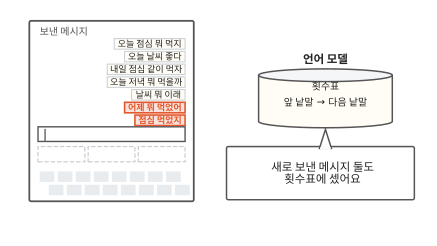

[1편](01-next-word.md)의 휴대폰으로 돌아왔어요. 1편에서는 보낸 메시지 다섯 개로 횟수표를 만들었어요. 횟수표는 앞 낱말마다 그다음에 온 낱말과 횟수를 적은 표예요. 그사이 두 개를 더 보냈어요. "어제 뭐 먹었어"와 "점심 먹었지"예요. 오른쪽 원통은 이 횟수표로 다음 낱말을 맞히는 언어 모델이에요. 언어 모델은 일곱 메시지로 횟수표를 다시 셌어요.

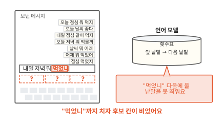

이번에는 친구에게 "내일 저녁 뭐 먹었니"를 쳐요. "먹었니"까지 치자 후보 칸 셋이 비었어요. "오늘"을 쳤을 때는 후보가 떴어요. 이번엔 왜 안 뜰까요? 횟수표를 펼쳐 볼게요.

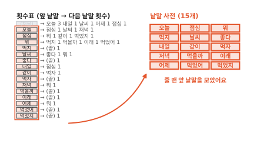

일곱 메시지로 센 횟수표예요. 줄마다 맨 앞 칸에 앞 낱말이 있어요. 그 옆에 다음에 온 낱말과 횟수가 적혀 있어요. "뭐" 줄에는 먹지, 먹을까, 이래, 먹었어가 한 번씩 적혀 있어요.

줄 맨 앞 칸만 뽑아 모아 볼게요. 맨 위 (처음) 줄은 메시지가 시작하는 자리를 적은 줄이라서 빼요. 남은 낱말은 15개예요. 언어 모델이 아는 낱말은 이 15개가 전부예요. 이 목록이 언어 모델의 낱말 사전이에요.

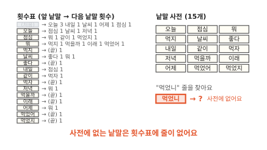

언어 모델은 "먹었니" 줄을 찾아요. 그런 줄은 없어요. "먹었니"는 보낸 메시지에 한 번도 쓴 적이 없는 낱말이거든요. 줄이 없으니 "먹었니" 다음에 올 낱말도 적혀 있지 않아요. 그래서 후보 칸이 비었어요.

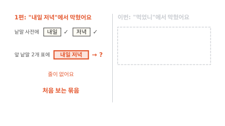

1편에서도 막힌 적이 있어요. 앞 낱말 둘을 보는 표에서 "내일 저녁"을 쳤을 때예요. 그때 "내일"과 "저녁"은 둘 다 사전에 있었어요. 두 낱말이 붙은 묶음을 처음 봐서 막혔어요.

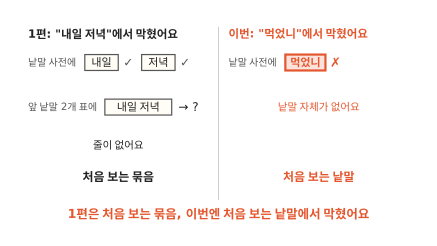

이번에는 낱말 하나를 통째로 처음 봤어요. 메시지를 더 보내다 보면 "먹었니"도 언젠가 사전에 들어가겠죠. 그런데 그사이 또 다른 새 낱말이 나와요. 왜 그런지 "먹"으로 시작하는 낱말을 모아 볼게요.

## 낱말은 끝이 계속 바뀌어요

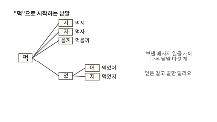

보낸 메시지 다섯 개에는 "먹"으로 시작하는 낱말이 셋 있었어요. 먹지, 먹자, 먹을까예요. 앞은 "먹"으로 같고 끝만 달라요.

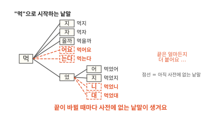

메시지 두 개를 더 보내자 먹었어와 먹었지가 생겼어요. "먹" 뒤에 "었"이 붙고 그 뒤에 또 끝이 붙었어요. 띄어쓰기로 자르면 끝이 다른 낱말은 모두 다른 낱말이에요.

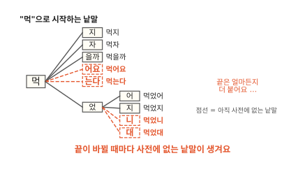

끝은 여기서 멈추지 않아요. 먹었니, 먹었대, 먹어요, 먹는다처럼 얼마든지 더 붙어요. 끝이 하나 바뀔 때마다 사전에 없는 낱말이 하나 생겨요. 메시지를 아무리 더 모아도 낱말 사전은 새 낱말을 다 따라가지 못해요. 낱말보다 작게 자르면 어떨까요?

## 글자로 자르면 새 낱말도 아는 글자로 잘려요

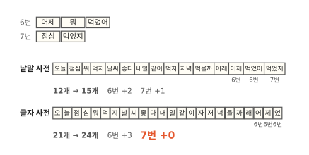

이번에는 메시지를 글자 하나하나로 잘라요. 같은 글자는 한 번만 적으면 글자 사전이 돼요. 처음 메시지 다섯 개로는 낱말 사전이 12개, 글자 사전이 21개였어요.

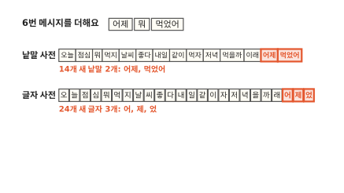

6번 메시지 "어제 뭐 먹었어"를 더해요. 새 낱말은 어제와 먹었어 2개예요. 새 글자는 어, 제, 었 3개예요.

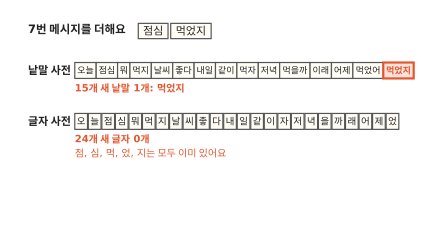

7번 메시지 "점심 먹었지"를 더해요. 새 낱말은 먹었지 1개예요. 새 글자는 하나도 없어요. 점, 심, 먹, 었, 지가 모두 앞 메시지에 이미 나왔거든요. 새 낱말은 끝이 달라도 이미 본 글자를 다시 써서 만들어져요. 그래서 낱말 사전은 15개로 늘었고 글자 사전은 24개 그대로예요.

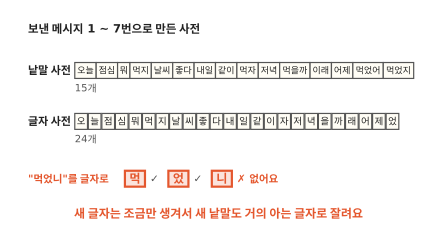

"먹었니"도 글자로 잘라 볼게요. 먹, 었, 니예요. "먹"과 "었"은 글자 사전에 있어요. 낱말 사전에는 통째로 없던 낱말이 글자로는 거의 다 아는 조각이 됐어요. "니"만 남았어요. 이 "니"는 조금 있다 다시 볼게요. 그 전에 글자로 자르면 잃는 것이 없는지부터 볼게요.

## 대신 문장이 길어져요

"오늘 점심 뭐 먹지"를 낱말로 자르면 4조각이에요. 글자로 자르면 7조각이에요. 같은 문장이 더 많은 조각으로 늘어났어요.

조각이 늘면 언어 모델이 봐야 할 앞도 늘어요. 낱말로 자르면 앞 두 조각 "점심 뭐"만 봐도 다음이 "먹지"인 줄 알아요. 1편에서 앞 낱말 둘을 보던 표가 그랬어요. 글자로 자르면 같은 "점심 뭐"를 보려고 점, 심, 뭐 세 조각을 봐야 해요. 앞을 더 많이 보면 무엇이 힘든지 1편의 "내일 저녁"으로 볼게요.

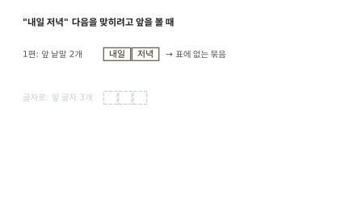

1편에서는 앞 낱말 둘 "내일 저녁"을 보자 막혔어요. 메시지에 "내일" 다음에 "저녁"이 온 곳이 없었거든요.

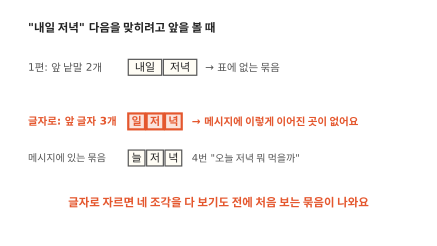

글자로 자르면 "내일 저녁"은 내, 일, 저, 녁 네 조각이에요. 그런데 앞 세 글자 "일 저 녁"에서 벌써 막혀요. 메시지에는 "늘 저 녁"만 있고 "일 저 녁"은 없거든요. 글자로 자르면 이렇게 처음 보는 묶음을 더 자주 만나요.

글자는 너무 잘고 낱말은 사전이 따라가지 못해요. 조각 크기는 잠시 두고 남겨 둔 "니"부터 볼게요.

## 글자보다 작게 자를 수 있을까요?

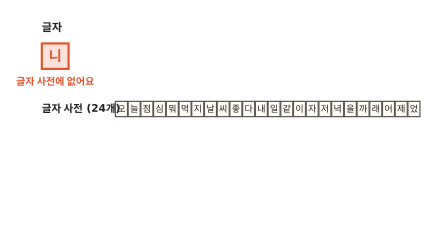

"니"는 글자 사전 24개에 없어요. 보낸 메시지 일곱 개에 한 번도 안 나왔거든요. 메시지를 더 모으면 "니"는 곧 들어오겠죠. 그래도 아직 못 본 글자는 늘 남아요. 세상 글자를 모두 담은 글자 번호표는 아주 큰 표거든요([컴퓨터 3편](../computer/03-how-computers-keep-letters.md)). 이 번호표를 통째로 사전에 넣으면 사전이 아주 커져요. 사전이 크면 1편의 횟수표도 커져요. 사전 낱말마다 표에 줄이 하나씩 생기니까요. 글자보다 더 작게 자르면 사전을 작게 둘 수 있을까요?

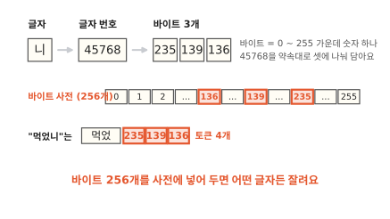

컴퓨터는 글자마다 정해 둔 번호로 글자를 기억해요. "니"의 번호는 45768이에요. 컴퓨터는 이 번호를 0과 1만 적는 칸에 담아요([컴퓨터 4편](../computer/04-what-numbers-look-like.md)). 칸 몇 개면 이 번호를 담을 수 있을까요?

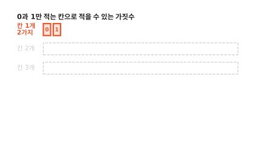

0과 1을 적는 칸이 하나면 적을 수 있는 것은 0과 1로 두 가지예요.

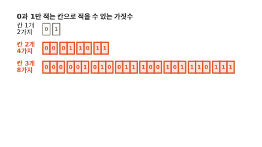

칸이 둘이면 00, 01, 10, 11로 네 가지예요. 칸 셋으로 적은 여덟 가지를 보면 앞 네 개는 0으로, 뒤 네 개는 1로 시작해요. 첫 칸이 0일 때 남은 두 칸으로 네 가지, 1일 때 또 네 가지예요. 그래서 칸이 하나 늘 때마다 가짓수가 두 배가 돼요.

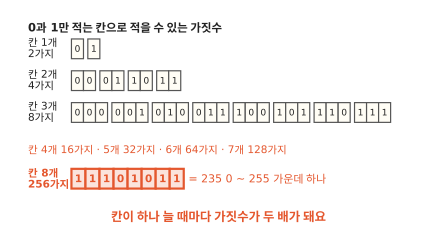

두 배씩 늘려 가면 칸 4개는 16가지, 5개는 32가지, 6개는 64가지, 7개는 128가지예요. 칸 8개면 256가지예요. 0부터 세어 0에서 255까지 적을 수 있어요. 컴퓨터는 0과 1 칸 8개를 한 묶음으로 써요.

이 칸 8개 묶음을 **바이트**(byte)라고 불러요.

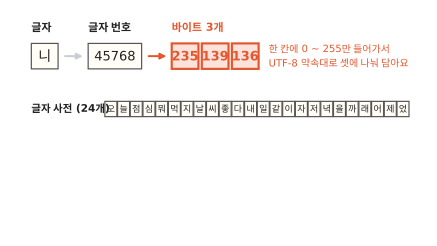

"니"의 번호 45768은 255보다 훨씬 커요. 바이트 하나에는 담기지 않아서 여러 바이트에 나눠 담아요. 나누는 방법은 사람들이 정해 둔 약속을 따라요. 이 약속을 UTF-8이라고 해요. 바이트 2개는 256 × 256으로 65,536가지예요. 둘이면 될 것 같죠. 그런데 UTF-8은 바이트마다 앞 몇 칸에 표시를 넣어요. 이 바이트가 글자의 첫 바이트인지 이어지는 바이트인지 알리는 표시예요. 그만큼 번호를 담을 0과 1 칸이 줄어서 한글은 바이트 3개가 필요해요. UTF-8대로 나누면 "니"는 235, 139, 136이 돼요.

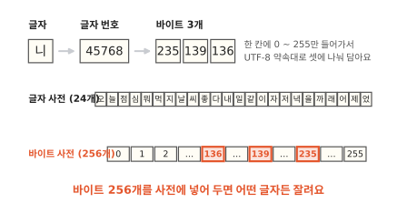

바이트에 담기는 숫자는 0부터 255까지 256가지뿐이에요. 그래서 바이트 256개를 처음부터 사전에 다 넣어 둬요. 사전에 없는 글자가 나오면 그 글자를 바이트로 잘라요. "니"는 바이트 조각 3개가 돼요. 어떤 글자든 번호가 있고 그 번호는 바이트에 담겨요. 그래서 못 자르는 글자가 없어요.

이제 어떤 글자든 자를 수 있어요. 남은 것은 글자로 자르면 문장이 길어지는 문제예요. 낱말과 글자 사이 크기로 자를 수는 없을까요?

## 자주 붙어 나오는 둘을 합쳐요

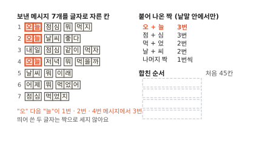

메시지 일곱 개를 모두 글자로 자르면 45칸이에요. 메시지마다 7, 6, 8, 8, 5, 6, 5칸이에요. 이 칸 수를 줄이려고 나란히 붙어 나온 두 글자를 세요. 띄어쓰기는 이미 낱말 사이의 경계라서 그 사이는 세지 않아요. "오" 다음 "늘"은 1번, 2번, 4번 메시지에 있어서 3번이에요. "점심"도 3번이고 "먹었"과 "날씨"는 2번씩이에요. 나머지 짝은 모두 1번씩이에요.

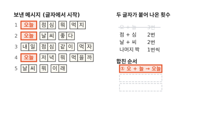

가장 많이 나온 "오"와 "늘"부터 한 칸 "오늘"로 합쳐요. 세 군데에서 두 칸이 한 칸이 돼요. 그래서 45칸이 42칸이 됐어요. 합친 일은 합친 순서 목록에 ①로 적어요.

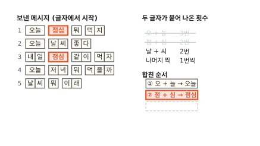

다음은 "점"과 "심"이에요. 이것도 3번 나와서 3칸이 줄어 39칸이에요. "오늘"과 "점심"은 3번으로 같았어요. 두 짝은 겹치는 글자가 없어서 어느 쪽을 먼저 합쳐도 결과가 같아요.

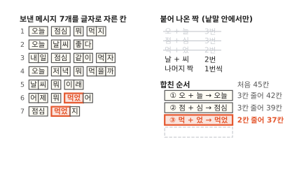

"먹"과 "었"을 합치면 2칸이 줄어 37칸이에요.

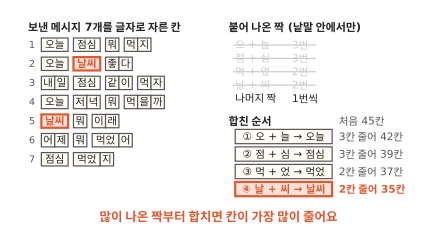

"날"과 "씨"를 합치면 다시 2칸이 줄어 35칸이에요. 합칠 때마다 줄어든 칸 수는 3, 3, 2, 2였어요. 그 짝이 나온 횟수와 같아요. 짝이 나온 곳마다 두 칸이 한 칸이 되니까요. 그래서 가장 많이 나온 짝부터 합쳐요. 한 번 합칠 때 칸이 가장 많이 줄거든요. 남은 짝은 1번씩이라 이 작은 예에서는 여기서 멈춰요.

자주 붙어 나오는 두 조각을 하나로 합치기를 되풀이하는 이 방법을 **BPE**라고 불러요.

합치기를 마친 조각은 "오늘"처럼 낱말이기도 해요. "먹었"처럼 낱말의 한 부분이기도 하고 "뭐"처럼 글자 하나이기도 해요. 언어 모델은 이 조각 하나하나를 보고 다음 조각을 맞혀요.

이렇게 글을 잘라 낸 조각 하나하나를 **토큰**(token)이라고 불러요. 1편의 낱말 사전 자리에는 이제 토큰 사전이 들어가요. 합친 순서 목록으로 처음 보는 "먹었니"를 잘라 볼게요.

??? info "심화: BPE라는 이름은 파일을 줄이는 방법에서 왔어요"
    합치기 방법에 왜 바이트라는 말이 든 이름이 붙었는지 궁금할 때 보는 칸이에요.

    BPE는 영어 Byte Pair Encoding의 머리글자예요. 우리말로 옮기면 바이트 짝 부호화예요. 1994년 필립 게이지(Philip Gage)는 파일 크기를 줄이는 방법을 잡지에 실었어요.[^gage] 파일 속에서 가장 자주 나란히 나오는 두 바이트를 찾아요. 그 둘을 파일에 한 번도 안 쓰인 바이트 하나로 바꿔요. 바꾼 짝은 표에 적어 둬요. 이걸 되풀이하면 파일이 짧아져요. 표를 거꾸로 따라가면 원래 파일로 돌아와요.

    2016년 센리히(Sennrich)를 비롯한 연구자 세 명은 이 생각을 번역 프로그램의 낱말 자르기에 썼어요.[^sennrich] 번역 프로그램도 사전에 없는 낱말에서 막혔거든요. 바이트 대신 글자에서 시작해 자주 붙어 나오는 짝을 합쳤어요. 합친 조각은 새 부호로 바꾸지 않고 그대로 사전에 올렸어요. 이 편에서 메시지 일곱 개로 한 합치기가 이 방법이에요.

## 새 낱말은 합친 순서대로 잘라요

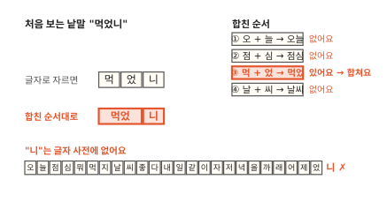

"먹었니"를 먼저 글자로 잘라요. 먹, 었, 니 세 조각이에요. 그다음 합친 순서 목록을 ①부터 차례로 따라가요.

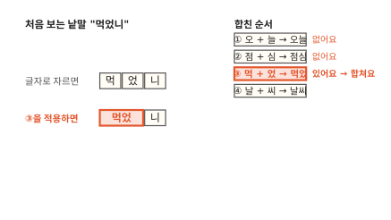

①의 "오"와 "늘", ②의 "점"과 "심"은 "먹었니"에 없어요. ③의 "먹"과 "었"은 나란히 있어요. 그래서 둘을 합쳐 "먹었"으로 만들어요.

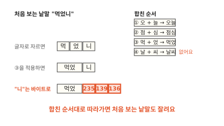

④의 "날"과 "씨"도 없어요. 목록이 끝났는데 "니"가 남았어요. "니"는 글자 사전에 없어서 바이트 3개 235, 139, 136으로 잘라요. "먹었니"는 "먹었" 한 조각과 바이트 조각 3개가 됐어요. 모두 사전에 있는 토큰이에요.

같은 규칙으로 "먹었어"는 먹었 | 어로 잘려요. "먹지"는 목록에 맞는 짝이 없어서 먹 | 지 그대로예요. 이 작은 예에서는 합치기를 네 번 하고 멈췄어요. 더 많이 합치면 무엇이 달라질까요?

## 몇 번 합칠까요?

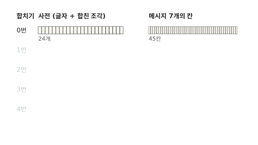

합치기를 한 번도 안 하면 사전에는 글자 24개가 있어요. 메시지 일곱 개는 45칸이에요. 바이트 256개는 늘 같으니 여기서는 빼고 세요.

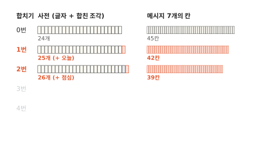

합칠 때마다 합친 조각이 사전에 하나씩 더해져요. "오늘"을 합치면 25개, "점심"까지 합치면 26개예요. "오늘"을 넣어도 "오"와 "늘"은 지우지 않아요. "늘 먹어"의 "늘"처럼 혼자 쓰일 수도 있거든요. 그동안 메시지는 45칸에서 42칸, 39칸으로 줄었어요.

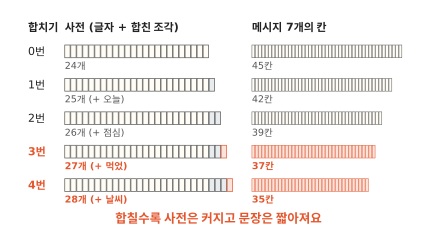

네 번 합치면 사전은 28개, 메시지는 35칸이에요. 사전이 하나 커질 때마다 메시지는 짧아졌어요. 문장이 짧으면 언어 모델이 앞을 덜 봐도 돼요. 사전이 크면 무엇이 힘들까요?

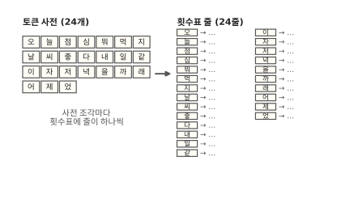

1편의 횟수표를 떠올려 봐요. 횟수표에는 사전의 조각마다 줄이 하나씩 있어요. 사전이 24개면 횟수표도 24줄이에요.

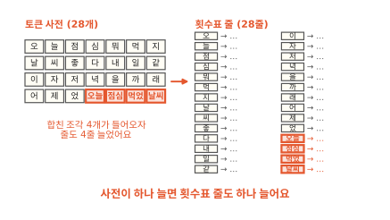

사전이 28개가 되자 횟수표도 28줄로 늘었어요. 합치기를 많이 할수록 언어 모델이 기억할 표가 그만큼 커져요. 줄이 늘면 셀 일도 늘어요. 메시지 양이 같으면 줄마다 쌓이는 횟수는 적어져요. 그러면 1편처럼 다음에 온 것이 비어 있는 줄이 많아져요. 사전을 키우면 표가 커져요. 사전을 줄이면 문장이 길어져요. 쓰는 곳에 맞게 그 사이를 골라요.

합쳐서 자르면 이제 막히는 일은 다 사라질까요?

## 합쳐서 자를 때 남는 것

합쳐서 자르면 막히는 일이 다 사라지는지 처음 장면에서 다시 볼게요.

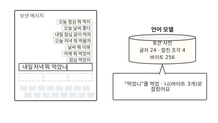

언어 모델의 사전을 토큰 사전으로 바꿨어요. 글자 24개, 합친 조각 4개, 바이트 256개가 들어 있어요. "먹었니"는 먹었 한 조각과 바이트 3개로 잘렸어요.

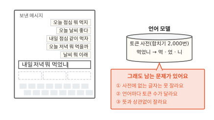

그래도 남는 것이 두 가지 있어요. 하나는 사전을 만든 글에 따라 잘린 조각 수가 달라지는 일이에요. 다른 하나는 자주 나오는지만 보고 뜻은 안 보는 일이에요. 첫째부터 볼게요.

### 첫째, 사전을 만든 글이 잘린 조각 수를 정해요

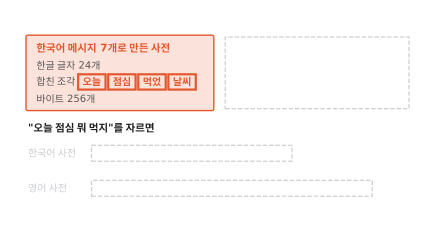

메시지 일곱 개로 합치기를 했더니 사전에 오늘, 점심, 먹었, 날씨가 생겼어요. 모두 한국어 메시지에서 자주 붙어 나온 짝이에요.

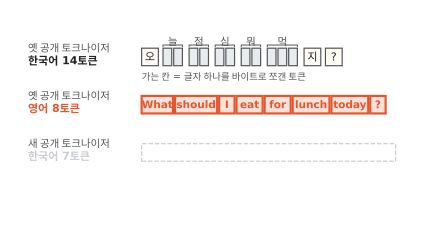

이번에는 영어 메시지만으로 같은 합치기를 했다고 해 볼게요. 사전에는 영어 글자와 영어에서 자주 붙어 나온 짝만 생겨요. 한글 글자는 하나도 없어요. 영어 메시지에 한글이 없었으니까요. 바이트 256개는 이 사전에도 있어요.

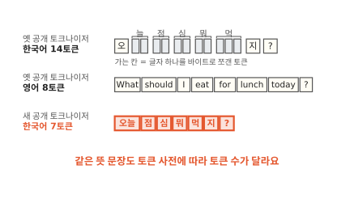

두 사전으로 "오늘 점심 뭐 먹지"를 잘라 봐요. 한국어 사전으로는 오늘 | 점심 | 뭐 | 먹 | 지로 5조각이에요. 영어 사전에는 한글 글자가 없어요. 그래서 글자마다 바이트 3개로 잘려요. 7글자에 3을 곱해 21조각이에요. 같은 문장이 네 배 넘게 길어졌어요.

사전은 그 사전을 만들 때 본 글에서만 합쳐요. 그 글에 드물던 말은 잘게 잘려요. 잘게 잘리면 문장이 길어져요. 그러면 같은 뜻을 보려고 언어 모델이 앞을 더 많이 봐야 해요.

글을 토큰으로 자르는 도구를 토크나이저(tokenizer)라고 해요. 실제로 쓰이는 토크나이저도 만들 때 본 글에 따라 한국어를 더 잘게 자르기도 해요.

### 둘째, 자주 나오는지만 보고 뜻은 안 봐요

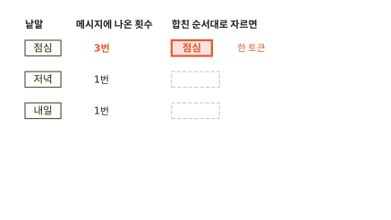

합친 순서대로 자르면 "점심"은 한 토큰이에요. 메시지에 3번 나와서 합쳐졌어요.

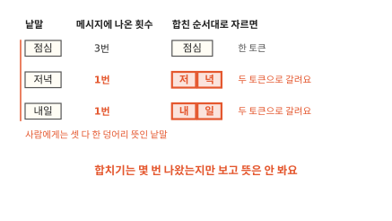

"저녁"은 저 | 녁, "내일"은 내 | 일로 갈려요. 둘 다 메시지에 1번씩만 나왔거든요. 사람에게는 점심, 저녁, 내일 모두 한 덩어리로 뜻이 통하는 낱말이에요. 합치기는 그 짝이 몇 번 나왔는지만 봐요. 뜻이 있는 말인지는 따지지 않아요.

뜻에 맞춰 자르는 방법도 있어요. 낱말 안에서 뜻을 가진 가장 작은 조각을 형태소라고 해요.

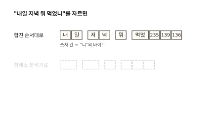

합친 순서대로 자르면 "내일 저녁 뭐 먹었니"는 그림처럼 갈려요. 내일과 저녁이 둘로 쪼개지고 "니"는 바이트가 돼요.

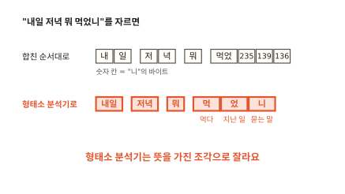

글을 형태소로 잘라 주는 프로그램을 형태소 분석기라고 해요.[^kiwi] 형태소 분석기는 "내일"과 "저녁"을 한 덩어리로 남겨요. "먹었니"는 먹 | 었 | 니로 잘라요. "먹"은 먹다라는 뜻이에요. "었"은 지난 일이라는 표시이고 "니"는 묻는 말이라는 표시예요. 두 가지 자르기 가운데 무엇을 써야 할까요?

## 어떤 자르기를 언제 쓸까요?

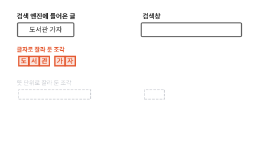

자르기를 고르려면 자른 조각을 어디에 쓰는지부터 봐야 해요. 검색 엔진부터 볼게요. 메시지 일곱 개에는 이 이야기에 맞는 낱말이 없어서 짧은 글 하나를 새로 들여요. 검색 엔진은 글이 들어오면 미리 잘라서 조각마다 어느 글에 있는지 적어 둬요([ES 2편](../elasticsearch/02-analyzer.md)). "도서관 가자"를 글자로 잘라 두면 도, 서, 관, 가, 자예요.

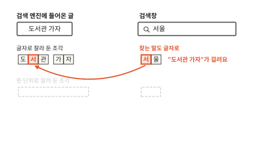

누군가 "서울"을 찾아요. 검색 엔진은 찾는 말도 같은 방법으로 잘라요. 서 | 울이 돼요. "서" 조각이 "도서관 가자"에도 있어서 이 글이 걸려요. 서울과 아무 상관 없는 글이에요.

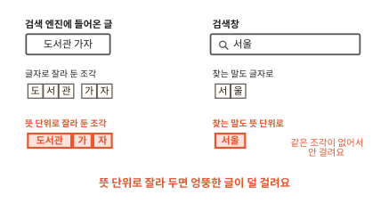

뜻 단위로 잘라 두면 도서관 | 가 | 자예요. "서울"은 서울 한 조각이고 이 글에는 그 조각이 없어요. 그래서 이 글은 걸리지 않아요. 검색에서는 뜻 단위로 잘라 두면 엉뚱한 글이 덜 걸려요. 다만 형태소 분석기도 처음 보는 낱말은 틀리게 자를 수 있어요.

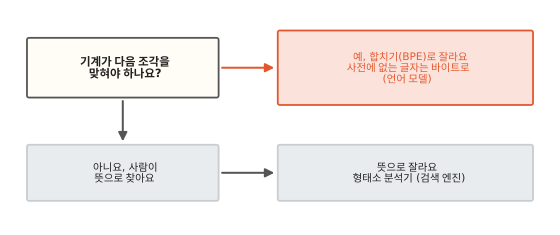

언어 모델은 사정이 달라요. 언어 모델은 어떤 글이 들어와도 다음 조각을 맞혀야 해요. 합치기 방식은 사전에 없는 글자를 바이트로 잘라요. 그래서 어떤 글이든 막힘없이 잘라요. 다음 조각을 맞히는 언어 모델에는 이 합치기 방식이 잘 맞아요.

## 다시 "먹었니"를 쳐 볼게요

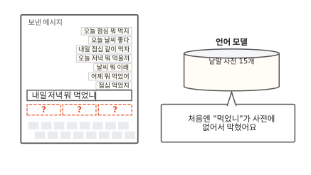

처음 장면의 휴대폰으로 돌아왔어요. 처음에는 낱말 사전 15개에 "먹었니"가 없어서 막혔어요.

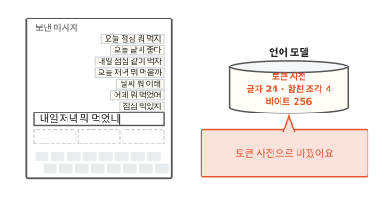

이번에는 같은 메시지 일곱 개로 만든 토큰 사전을 써요. 글자 24개, 합친 조각 4개, 바이트 256개가 들어 있어요.

"먹었니"는 합친 순서대로 먹었 | 니로 잘리고 "니"는 다시 바이트 3개로 잘려요. 막힌 곳 없이 모두 사전에 있는 토큰이 됐어요.

보낸 메시지가 일곱 개든 칠만 개든 바이트 256개가 든 토큰 사전은 어떤 글이든 잘라요.

자를 수 있다고 바로 다음을 맞힐 수 있는 것은 아니에요. 횟수표에 그 토큰 다음에 온 것이 적혀 있어야 후보를 띄워요. 메시지 일곱 개에는 "니" 다음에 온 토큰이 아직 없어요. 1편에서 본 처음 보는 묶음 문제는 여기서도 남아요.

### 이 편에서 줄여 그린 것

그림을 쉽게 하려고 실제와 다르게 줄인 곳이 두 군데 있어요.

1. 이 편의 합치기는 글자에서 시작하고 사전에 없는 글자만 바이트로 잘랐어요. 실제 토크나이저 가운데는 처음부터 바이트에서 시작하는 것도 있어요.
2. 글자 번호를 바이트 3개로 나누는 UTF-8 규칙은 자세히 그리지 않았어요. "니"가 235, 139, 136이 되는 까닭은 이 규칙에 있어요.

### 이 편에서 새로 나온 말

다음 편은 "낱말을 숫자 목록으로 바꾸면 무엇이 좋을까요?"예요.

[^gage]: Philip Gage, "A New Algorithm for Data Compression", The C Users Journal 12권 2호(1994년 2월).
[^sennrich]: Rico Sennrich, Barry Haddow, Alexandra Birch, "Neural Machine Translation of Rare Words with Subword Units", ACL 2016.
[^kiwi]: 공개 형태소 분석기 Kiwi로 이 편의 예를 잘라 봤어요.
