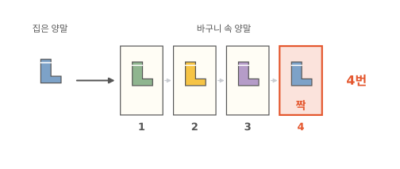
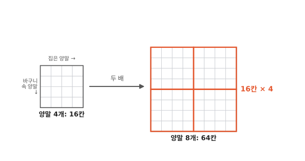
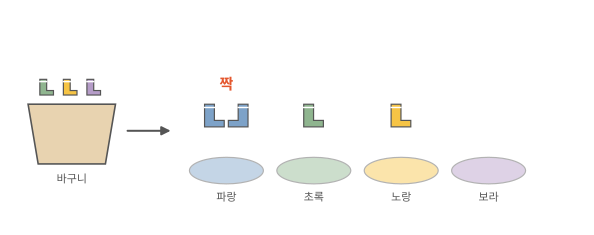
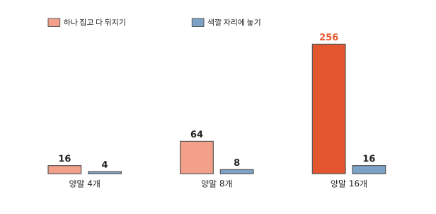
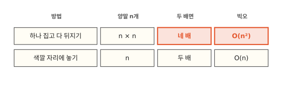
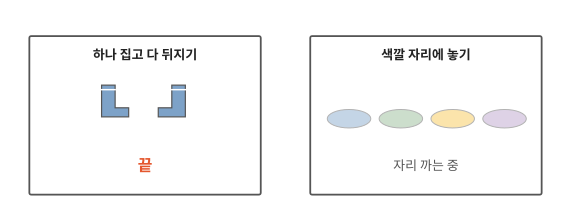

# 빅오: 양말이 두 배가 되면 늘어나는 일

빨래 바구니에 내 양말 몇 짝만 있을 땐 짝을 금방 맞춰요. 온 식구 양말이 섞이면 한참 걸려요. 이 글을 읽고 나면 양말이 두 배로 늘 때 짝 맞추는 일이 몇 배로 느는지 세는 법을 알게 돼요. 컴퓨터가 다루는 것도 이렇게 불어나서 어떤 방법을 고르느냐에 따라 느려지는 정도가 크게 달라져요.

!!! abstract "이 글에서 알게 되는 것"
    1. 일을 하는 순서와 방법을 알고리즘이라고 해요. 양말 짝 맞추기에도 알고리즘이 여럿 있어요.
    2. 양말이 두 배가 되면 하나 집고 다 뒤지는 방법은 일이 네 배로, 색깔 자리에 놓는 방법은 두 배로 늘어요. 이렇게 두 배면 몇 배가 되는지 말하는 이름이 빅오예요.
    3. 빅오는 양말이 많을 때 이야기예요. 양말이 2개뿐이면 준비할 것 없는 느린 방법이 먼저 끝나요.

## 1. 하나 집고 다 뒤지면 양말마다 바구니를 다 봐요

먼저 떠올리기 쉬운 방법부터 해 볼게요. 양말 하나를 집어요. 그리고 바구니 속 양말을 처음부터 하나씩 보며 짝을 찾아요. 이 방법을 "하나 집고 다 뒤지기"라고 부를게요.

세는 것은 양말을 보는 횟수예요. 일부러 운이 제일 나쁜 때로 셀게요. 짝이 늘 바구니 맨 끝에 있다고 해요. 그러면 바구니에 양말이 4개 있을 때 짝 하나를 찾으려고 4개를 다 봐요. 아래 그림에서 맨 끝 빨간 칸을 보세요.

**그림 1.** 파란 양말의 짝이 맨 끝에 있어서 바구니 양말 4개를 다 봐요.
{ .fig-cap }

양말 하나를 집을 때마다 이만큼 봐요. 양말 4개를 하나씩 다 집으면 4번씩 네 번이니까 모두 16번이에요.

이렇게 일을 하는 순서와 방법을 **알고리즘**이라고 해요. [컴퓨터 6편](../computer/06-how-to-tell-computers.md)에서 컴퓨터에게 시킬 일을 순서대로 적어 줬죠? 거기 적은 것도 알고리즘이에요. 같은 짝 맞추기도 알고리즘이 여럿 있어요. 하나 집고 다 뒤지기는 그 가운데 하나예요.

## 2. 양말이 두 배면 다 뒤지는 일은 네 배가 돼요

앞에서 양말 4개일 때 16번을 봤어요. 이번엔 양말을 8개로 늘려 볼게요.

세기 쉽게 칸으로 그려요. 가로에는 집은 양말을, 세로에는 바구니 속 양말을 놓아요. 칸 하나가 양말 하나를 한 번 보는 일이에요. 아래 그림에서 오른쪽 큰 네모를 나눈 빨간 선을 보세요.

**그림 2.** 양말 8개의 64칸을 나누면 16칸 네모가 네 개 나와요.
{ .fig-cap }

양말 8개는 8개를 8번씩 보니까 64칸이에요. 64칸 안에 16칸 네모가 네 개 들어가요. 양말은 두 배가 됐는데 할 일은 네 배가 됐어요.

왜 네 배일까요? 양말이 두 배가 되면 집는 양말도 두 배이고 한 번 집을 때 보는 양말도 두 배예요. 가로도 두 배, 세로도 두 배라서 칸은 2 × 2 = 4배가 돼요.

여기서 짝을 찾으면 그만 보지 않느냐는 생각이 들 거예요. 맞아요. 실제로는 바구니를 절반쯤만 봐요. 그래도 양말이 두 배면 일이 네 배쯤 되는 건 같아요.

## 3. 색깔 자리에 놓으면 양말마다 한 번만 봐요

네 배는 너무 많아요. 양말을 덜 보고 짝을 찾는 방법이 있어요.

바닥에 색깔별 자리를 먼저 정해요. 바구니에서 양말을 하나 꺼내 그 색 자리에 놓아요. 그 자리에 같은 색 양말이 벌써 있으면 둘이 한 쌍이에요. 이 방법은 "색깔 자리에 놓기"라고 부를게요. 아래 그림에서 파랑 자리 위 빨간 글씨를 보세요.

**그림 3.** 파란 양말 두 짝이 파랑 자리에서 만나 짝이 됐어요.
{ .fig-cap }

이 방법은 바구니를 뒤지지 않아요. 꺼낸 양말의 색만 보고 그 자리로 가요. 그래서 양말 하나를 한 번씩만 봐요. 양말이 4개면 4번, 8개면 8번이에요. 양말이 두 배가 되면 할 일도 두 배예요.

이 방법은 색이 같으면 짝인 양말에서 잘 돼요. 색은 같고 무늬가 다른 양말이 섞여 있으면 그 자리에서 한 번 더 찾아야 해요.

## 4. 두 배면 몇 배인지 말하는 이름이 빅오예요

두 방법을 나란히 놓고 양말을 4개, 8개, 16개로 두 배씩 늘려 볼게요. 아래 막대에서 양말 16개의 빨간 막대를 보세요.

**그림 4.** 양말이 16개면 하나 집고 다 뒤지기는 256번, 색깔 자리에 놓기는 16번 봐요.
{ .fig-cap }

하나 집고 다 뒤지기는 16, 64, 256번이에요. 한 단계 갈 때마다 네 배씩 커져요. 색깔 자리에 놓기는 4, 8, 16번으로 두 배씩 커져요. 양말 4개일 때는 12번 차이였는데 16개가 되니 240번 차이가 나요.

양말이 두 배가 될 때 일이 몇 배가 되는지 말하는 이름을 **빅오**(Big O)라고 해요. 양말 개수를 n이라고 써 볼게요. 하나 집고 다 뒤지기는 n개를 n번씩 보니까 n × n번이에요. 이걸 O(n²)이라고 적고 "오 엔 제곱"이라고 읽어요. 색깔 자리에 놓기는 n번이라서 O(n)이에요. 아래 표에서 빨간 칸을 보세요.

**그림 5.** 하나 집고 다 뒤지기는 O(n²)이라서 양말이 두 배면 일이 네 배가 돼요.
{ .fig-cap }

컴퓨터도 짝 찾기를 해요. 메시지 가운데 똑같은 메시지 짝을 찾을 때 하나 집고 다 뒤지면 메시지가 두 배가 될 때 일이 네 배가 돼요. [컴퓨터 12편](../computer/12-how-search-works.md)의 색인처럼 미리 나눠 적어 두면 두 배로 끝나요.

## 5. 양말이 적으면 느린 방법이 먼저 끝나요

앞에서는 양말을 보는 횟수만 셌어요. 그런데 색깔 자리에 놓기에는 세지 않은 일이 하나 있어요. 바닥에 자리를 까는 일이에요.

양말이 2개뿐이라고 해 볼게요. 아래 그림에서 두 방법이 어디까지 갔는지 보세요.

**그림 6.** 양말이 2개면 자리를 다 깔기도 전에 하나 집고 다 뒤지기가 끝나요.
{ .fig-cap }

하나 집고 다 뒤지기는 한 짝을 집고 바구니에 남은 한 짝을 보면 끝이에요. 그동안 색깔 자리에 놓기는 아직 자리를 깔고 있어요. 양말이 적을 땐 빅오로 빠른 방법이 오히려 늦을 수 있어요.

빅오는 양말이 많아질 때 어느 쪽이 덜 느려지는지 알려 줘요. 양말이 몇 개 안 되거나 더 늘 일이 없으면 단순한 방법으로 충분해요.

## 정리

같은 짝 맞추기도 하는 순서와 방법, 곧 알고리즘이 여럿 있어요. 하나 집고 다 뒤지기는 양말마다 바구니를 다 봐서 양말이 4개면 16번, 8개면 64번 봐요. 색깔 자리에 놓기는 양말마다 한 번만 봐서 4번, 8번이에요.

양말이 두 배가 될 때 일이 몇 배가 되는지 말하는 이름이 빅오예요. 하나 집고 다 뒤지기는 네 배라서 O(n²), 색깔 자리에 놓기는 두 배라서 O(n)이에요. 다만 빅오는 양말이 많을 때 이야기예요. 양말이 2개뿐이면 자리를 까는 동안 하나 집고 다 뒤지기가 먼저 끝나요.

[2편](02-why-arrays-are-fast.md)에서는 사물함을 보면서 칸이 아무리 늘어도 찾는 일은 늘지 않는 방법을 만나요.

### 새로 나온 말

- **알고리즘**: 일을 하는 순서와 방법. 짝 맞추기에서는 하나 집고 다 뒤지기와 색깔 자리에 놓기가 알고리즘이었어요.
- **빅오**: 양이 두 배가 될 때 일이 몇 배가 되는지 말하는 이름. 양말 개수를 n이라 하면 하나 집고 다 뒤지기는 O(n²), 색깔 자리에 놓기는 O(n)이에요.
