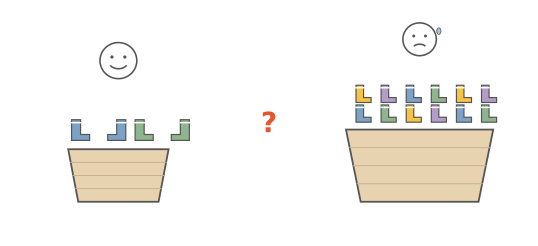
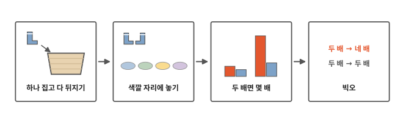
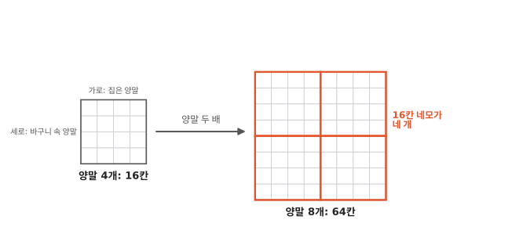
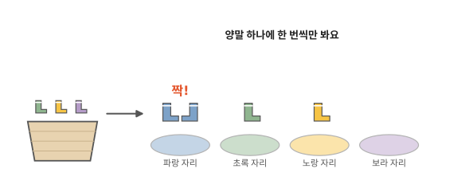
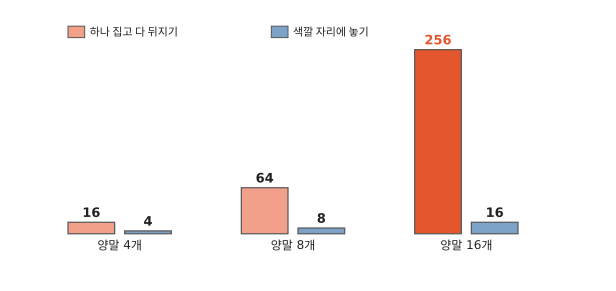
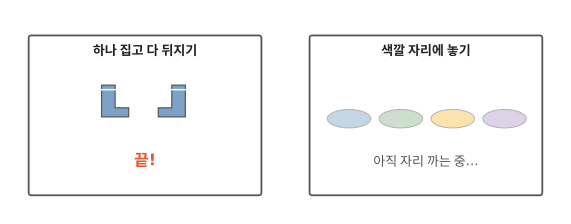

# 양말이 두 배면 일은 몇 배가 될까요?

## 빨래 바구니 속 양말

빨래를 개는 날, 바구니에 양말이 가득해요. 내 양말 몇 개만 있을 땐 짝을 금방 맞췄어요. 그런데 온 식구 양말이 섞이니 한참 걸려요.

양말이 두 배로 늘면, 짝 맞추는 일도 두 배만 늘까요?

## 짝 맞추기 두 가지 방법

알고리즘 주제의 첫 편이에요. 그림 네 칸을 왼쪽부터 차례로 따라가요. 짝을 맞추는 방법 두 가지를 해 보고, 양말이 두 배가 될 때 일이 얼마나 많아지는지 비교해 봐요.

## 하나 집고 다 뒤지기

먼저 떠올리기 쉬운 방법인데, 느린 방법이에요. 양말 하나를 집어요. 그리고 바구니 속 양말을 처음부터 하나씩 보며 짝을 찾아요. 이 방법을 "하나 집고 다 뒤지기"라고 부를게요.

이렇게 일을 하는 순서와 방법을 **알고리즘**이라고 해요. 컴퓨터 6편에서 명령어를 순서대로 적은 코드를 봤지요? 코드에는 이런 순서와 방법이 담겨 있어요.

일부러 운이 제일 나쁜 때로 세어 볼게요. 짝이 늘 바구니 맨 끝에 있다고 해요. 이때는 양말 하나를 집을 때마다 바구니 양말을 다 봐요.

양말이 4개면 4개를 4번씩 봐요. 그림의 칸으로 세어 봐요. 가로는 내가 집는 양말, 세로는 바구니 속 양말이에요. 칸 하나가 양말 하나를 한 번 보는 일이에요. 그러면 16칸이에요. 양말이 8개일 때도 그림에서 세어 보면 64칸이에요.

64칸 네모 안에는 16칸 네모가 네 개 들어가요. 16을 네 번 더하면 64예요. 이렇게 같은 크기가 네 개 모인 걸 네 배라고 해요. 양말은 두 배가 됐는데, 할 일은 네 배가 됐어요.

네 배는 너무 많아요. 양말을 덜 보고 짝을 찾을 수는 없을까요?

## 색깔 자리에 놓기

바닥에 색깔별 자리를 먼저 정해요. 바구니에서 양말을 하나 꺼내 그 색 자리에 놓아요. 그 자리에 같은 색 양말이 벌써 있으면, 둘이 한 쌍이에요. 이 방법은 "색깔 자리에 놓기"라고 부를게요.

색깔 자리에 놓기는 양말 하나를 한 번씩만 봐요. 양말이 4개면 4번, 8개면 8번이에요. 양말이 두 배가 되면 할 일도 두 배예요.

이 방법은 색이 같으면 짝인 양말에 잘 맞아요. 색은 같고 무늬가 다른 양말이 있으면, 그 자리에서 한 번 더 찾아야 해요.

## 두 배면 몇 배

양말을 4개, 8개, 16개로 두 배씩 늘려 봐요. 하나 집고 다 뒤지기는 16, 64, 256번이에요. 색깔 자리에 놓기는 4, 8, 16번이에요.

막대가 한 번 오를 때마다 빨간 막대는 네 배, 파란 막대는 두 배씩 커져요.

양말이 두 배가 될 때 일이 몇 배가 되는지 말하는 이름이 **빅오**(Big O)예요. 여기서는 이렇게 알아 두면 돼요.

컴퓨터도 짝 찾기를 해요. 메시지 가운데 똑같은 메시지 짝을 찾을 때, 하나 집고 다 뒤지면 메시지가 두 배가 될 때 일이 네 배가 돼요. 컴퓨터 12편의 색인처럼 미리 나눠 적어 두면 두 배가 돼요.

## 빅오만 믿으면 안 될 때

자리를 까는 일도 일이에요. 앞에서는 이 일을 세지 않았어요.

양말이 2개뿐이면 어떨까요? 색깔 자리를 까는 동안, 하나 집고 다 뒤지는 쪽은 벌써 끝났어요. 양말이 적을 땐 빠른 방법이 오히려 늦을 수도 있어요.

## 정리

- **알고리즘**: 일을 하는 순서와 방법이에요. 같은 일도 여러 알고리즘으로 할 수 있어요.
- **빅오**: 양말이나 메시지가 두 배가 될 때 일이 몇 배가 되는지 말하는 이름이에요.

## 해 보기: 양말 짝 맞추기 시합

친구와 둘이서 해요. 진짜 양말 대신 색종이 카드로 해도 돼요.

1. 같은 색 카드를 두 장씩, 세 가지 색으로 여섯 장 만들어요.
2. 카드를 섞어서 상자에 넣어요.
3. 한 사람이 "하나 집고 다 뒤지기"로 짝을 맞춰요. 다른 사람은 카드를 하나 볼 때마다 바둑돌을 하나씩 놓아요.
4. 이번에는 바닥에 색종이를 한 장씩 깔아 색깔 자리를 만들고, "색깔 자리에 놓기"로 해요. 똑같이 바둑돌을 놓아요.
5. 색을 세 가지 더해서, 여섯 가지 색 열두 장으로 다시 해 봐요. 바둑돌이 어느 쪽에서 더 많이 늘었나요?
6. 책의 숫자와 달라도 괜찮아요. 짝을 찾으면 그만 보니까요.

## 확인 문제

??? question "1. 색깔 자리로 10개"
    색깔 자리에 놓는 방법으로 양말 10개의 짝을 맞춰요. 양말을 몇 번 볼까요?

    **풀이**: 10번이에요. 양말 하나를 한 번씩만 봐요.

??? question "2. 두 배가 되면"
    양말이 4개에서 8개로 두 배가 되면, 하나 집고 다 뒤지기는 할 일이 몇 배가 될까요?

    **풀이**: 네 배가 돼요. 16칸에서 64칸이 되니까요. 64칸 네모 안에 16칸 네모가 네 개 들어가요.

??? question "3. 양말 2개"
    양말이 2개뿐일 때도 색깔 자리를 먼저 깔아야 할까요?

    **풀이**: 아니요. 둘 다 금방 끝나요. 자리를 까는 데 시간이 더 걸려요.

!!! abstract "어른을 위한 정리 (건너뛰어도 돼요)"
    - 하나 집고 다 뒤지기는 이중 반복, 색깔 자리에 놓기는 해시 표(파이썬의 set·dict)와 같은 생각이에요. 빅오로는 O(n²)과 O(n)이에요. n이 두 배면 O(n²)은 네 배, n이 10배면 100배가 돼요. 같은 모양의 파이썬 코드(회원 n명 가운데 탈퇴한 10분의 1을 이중 반복으로 고르기)를 재 보니, 회원 1,000명일 때 1밀리초쯤이었어요. 이걸로 어림하면 100만 명일 때는 15분쯤 걸려요.[^lab]
    - 빅오는 n이 클 때의 이야기예요. n이 작거나 늘지 않으면 단순한 방법으로 충분하고, 디스크나 네트워크처럼 한 번에 오래 걸리는 일이 섞이면 빅오보다 그 일을 몇 번 하는지 세는 게 먼저예요.
    - "두 배면 몇 배"는 n, n²처럼 단순하게 느는 경우를 아이 눈높이로 옮긴 설명이에요. 빅오는 원래 n이 커질 때 일이 늘어나는 모양의 위쪽 한계를 말해요.

## 더 깊이

??? info "O 기호는 어디서 왔을까"
    O는 컴퓨터보다 먼저 나왔어요. 130년쯤 전에 독일 수학자 파울 바흐만이 책에서 처음 썼고, 에드문트 란다우가 받아 쓰며 널리 퍼졌어요.[^history] 50년쯤 전에는 도널드 크누스가 알고리즘을 견줄 때 쓰는 방법을 정리했어요.[^knuth]

??? info "악수하기도 같은 모양이에요"
    반 친구 모두가 서로 한 번씩 악수한다고 해 봐요. 친구가 두 배가 되면 악수는 네 배쯤으로 늘어요. 하나 집고 다 뒤지는 방법과 같은 모양이에요.

??? info "짝을 찾자마자 멈추면 어떨까"
    실제로는 짝을 찾으면 그만 보니까, 바구니를 절반쯤만 보게 돼요. 그래도 양말이 두 배면 일이 네 배쯤 되는 건 같아요.

[^lab]: [`lab/01_big_o.py`](https://github.com/oya150/bedrock/blob/main/lab/01_big_o.py)로 잰 값이에요(CPython 3.12.7, Apple Silicon 노트북). 다시 재면 숫자는 조금씩 달라져요.
[^history]: [Big O notation (Wikipedia)](https://en.wikipedia.org/wiki/Big_O_notation), [O-notation in algorithm analysis (arXiv:1309.3210)](https://arxiv.org/abs/1309.3210).
[^knuth]: D. E. Knuth, "Big Omicron and Big Omega and Big Theta", *SIGACT News* 8(2) (1976), 18–24. [NIST 알고리즘 사전 항목](https://xlinux.nist.gov/dads/HTML/omegaCapital.html).
