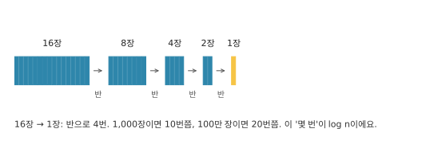
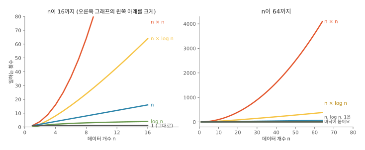
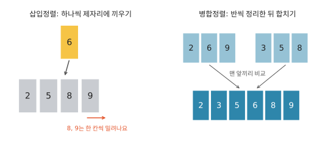
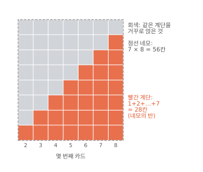
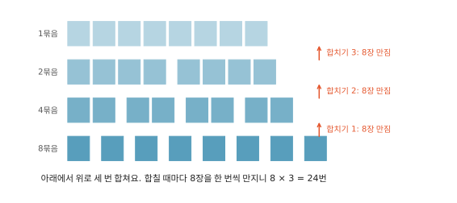
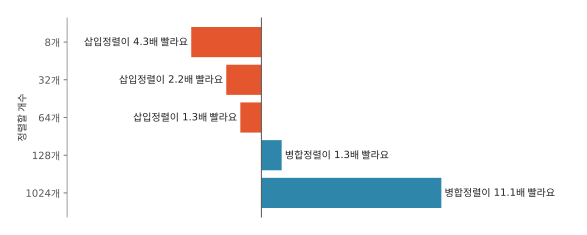

# 빅오는 왜 필요할까요

## 테스트할 땐 눈 깜짝할 새였어요

휴대폰 앱에는 회원 명단이 있어요. 그중에는 앱을 그만 쓰겠다고 탈퇴한 사람도 있어요. 앱을 만드는 사람은 가끔 "탈퇴한 사람만 골라내라"는 일을 컴퓨터에게 시켜요. 컴퓨터에게 일을 시키려고 쓰는 글을 코드라고 해요.

반에서 결석한 친구를 찾는 일과 닮았어요. 반 친구 명단과 결석한 친구 명단이 따로 있을 때, 가장 먼저 떠오르는 방법은 반 친구 한 명마다 결석 명단을 처음부터 끝까지 읽어 보는 거예요. 탈퇴 회원을 골라내는 코드도 처음엔 대개 이렇게 짜요. 아래는 파이썬이라는 코드 언어로 쓴 거예요. 코드는 건너뛰고 오른쪽 설명만 읽어도 돼요.

```python
for m in members:          # 회원 한 명씩 차례로
    for w in withdrawn:    # 탈퇴 명단을 처음부터 끝까지 보면서
        if m == w:         # 이름이 같으면
            out.append(m)  # 골라낸다
```

회원 1,000명, 탈퇴자 100명으로 시험하면 1밀리초도 안 걸려요. 1밀리초는 1초를 천 개로 나눈 것 중 하나라, 눈 깜짝할 새보다 짧아요.

그런데 진짜 서비스에는 회원이 100만 명, 탈퇴자도 똑같이 10명 중 1명꼴이라 10만 명이에요. 그러면 같은 코드가 **14분**쯤 걸려요. 1,000명에서 1밀리초가 안 걸리던 코드가 어떻게 14분이 됐을까요?

## 시계로 재 보면 안 될까요

먼저 시계로 재 봤어요. 숫자 백만 개를 더하는 일을 같은 컴퓨터에서 다섯 번 재면 이렇게 나와요.[^lab] ms는 밀리초를 줄인 말이에요.

| 1번째 | 2번째 | 3번째 | 4번째 | 5번째 |
|---|---|---|---|---|
| 17.2 ms | 17.1 ms | 17.4 ms | 17.0 ms | 17.3 ms |

한 컴퓨터 안에서는 꽤 고르니 시계도 쓸모가 있어요. 하지만 다른 컴퓨터로 재면 숫자가 달라지고, 처음 이야기의 회원이 늘면 몇 초가 될지도 숫자 하나로는 알 수 없어요.

그래서 회원 수를 두 배씩 늘려 가며 쟀어요. 탈퇴자는 늘 회원 10명 중 1명꼴로 맞췄어요. 그림의 "빠른 방법"은 탈퇴자 이름을 뒤에서 설명할 상자에 미리 넣어 두는 방법이에요.


왼쪽에서 느린 방법은 위로 확 솟고, 빠른 방법은 바닥에 붙어 있어요. 오른쪽 막대에 규칙이 보여요. 회원이 두 배가 될 때마다 느린 방법은 **4배**, 빠른 방법은 2배쯤 늘어요.

이 규칙은 컴퓨터를 바꿔도 남아요. 예를 들어 두 배 빠른 컴퓨터라면 13.3ms가 6.6ms로, 53ms가 26.5ms로 모두 반이 되지만, 6.6에서 26.5도 여전히 4배예요.

## 시간 대신 몇 번 하는지 세요

매번 데이터(여기서는 회원 명단처럼 프로그램이 다루는 자료)를 만들어 잴 수는 없으니, 코드만 보고 이 규칙을 알아내는 방법이 필요해요. 시간 대신 **같은 일을 몇 번 하는지**를 세면 돼요. 횟수는 어느 컴퓨터에서 돌려도 똑같거든요.

느린 방법에서 가장 많이 하는 일은 회원 한 명과 탈퇴자 한 명의 이름을 맞대 보는 일이에요. 한 번을 한 칸으로 그리면 이래요.


회원 8명, 탈퇴자 2명이면 8 × 2 = 16번이에요. 둘 다 두 배로 늘리면 16 × 4 = 64번이 돼요. 세로도 두 배, 가로도 두 배라 칸은 네 배, 아까 시계로 잰 그 4배예요.

| | 회원 | 탈퇴자 | 맞대 보는 횟수 | 걸린 시간 |
|---|---|---|---|---|
| 시험 | 8,000명 | 800명 | 640만 번 | 53 ms (잰 값) |
| 진짜 서비스 | 100만 명 | 10만 명 | 1,000억 번 | ? |

8,000명이 100만 명이 되면 125배죠. 탈퇴자도 125배니까 칸은 125 × 125 = 15,625배가 돼요. 53ms에 15,625를 곱하면 약 828,000ms, 1초가 1,000ms이니 828초예요. 60으로 나누면 14분쯤 나오네요.

거꾸로 53ms를 640만 번으로 나누면 맞대 보기 한 번에 드는 시간이 나와요. 나노초는 10억분의 1초라서 1밀리초는 100만 나노초예요. 5,300만 나노초 ÷ 640만 ≈ 8나노초예요. ≈는 "거의 같다"는 뜻이에요.

빠른 방법은 탈퇴자 이름을 먼저 `set`이라는 상자에 넣어 둬요. 이 상자는 이름을 넣을 때 이름 글자로 계산을 해서 칸 번호를 정해요. 예를 들어 칸이 10개라면, 글자마다 번호를 정해 두고(가=1, 나=2, 다=3…) 이름의 글자 번호를 다 더한 뒤 10으로 나눈 나머지를 칸 번호로 쓰는 식이에요. "가나"는 1 + 2 = 3이고, 3을 10으로 나누면 몫은 0, 나머지는 3이라 3번 칸이에요. "라마바사"는 4 + 5 + 6 + 7 = 22이고, 22 ÷ 10은 몫 2에 나머지 2라서 2번 칸이에요. 합이 아무리 커져도 나머지는 0부터 9까지라, 칸 10개 중 하나로 꼭 떨어져요. 실제 파이썬은 더 복잡하게 섞지만 생각은 같아요.

같은 이름은 계산하면 늘 같은 칸 번호가 나오니, 나중에 물을 때도 그 칸 하나만 열어 보면 돼요.[^set] 다만 칸이 10개뿐이면 탈퇴자 10만 명이 한 칸에 1만 명씩 몰리겠죠. 진짜 상자는 넣는 이름보다 칸을 더 많이 만들고, 칸이 꽉 차 가면 칸을 늘려요. 그러면 한 칸에는 보통 한 명뿐이에요. 가끔 두 이름이 같은 칸 번호를 받으면 나중 이름은 정해진 순서대로 다른 빈칸을 찾아 들어가요. 찾을 때도 그 칸에 없으면 같은 순서로 칸 몇 개만 더 보면 돼요.

이렇게 상자를 채운 다음 회원마다 상자에 "나 탈퇴했어?" 하고 한 번씩만 물어요.


처음에 탈퇴자를 상자에 넣는 일도 탈퇴자 수만큼 해야 하지만, 그것도 사람이 두 배면 두 배예요. 그래서 둘을 합쳐도 횟수는 딱 두 배예요. 시계로 잰 값은 앞 그림처럼 2배 근처에서 조금씩 흔들려요. 8,000명일 때 0.14ms였으니 125배인 100만 명이면 0.14ms × 125 = 18ms쯤이에요.

!!! tip "코드를 쓰는 사람이라면"
    탈퇴자를 `set`이 아니라 그냥 리스트에 넣고 `m in withdrawn`으로 물으면 느린 방법과 똑같아져요. 한 줄이지만 그 안에서 리스트를 처음부터 끝까지 훑거든요. 겉으로 드러난 반복문보다 눈에 덜 띄어서 리뷰에서 자주 놓쳐요.

## 자세한 셈은 버리고 모양만 남겨요

진짜 코드를 세면 셈이 이렇게 깔끔하지 않아요. 준비하는 일, 마무리하는 일이 조금씩 붙거든요. 데이터 개수를 n이라고 하고, 어떤 코드를 셌더니 이렇게 나왔다고 해 봐요.

> 3 × n × n + 5 × n + 2 번

n을 키우면서 앞부분(3 × n × n)과 뒷부분(5 × n + 2)을 견줘 봤어요. 막대 길이는 모두 똑같이 맞추고, 그 안을 두 부분이 얼마씩 나눠 갖는지 칠했어요. 실제 횟수는 오른쪽에 적었어요.


n이 10일 땐 뒷부분도 52번으로 꽤 보여요. 그런데 n이 1,000이면 300만 번 옆의 5,002번, 100만이면 3조 번 옆의 500만 번이라 막대에서 보이지도 않아요.

남은 3도 뗄 수 있어요. 궁금한 건 "두 배면 몇 배?"인데, n이 두 배면 3 × n × n은 네 배가 되고, 앞에 붙은 숫자가 3이든 30이든 네 배인 건 같아요.

이렇게 가장 빨리 커지는 부분만 남기고 앞의 숫자를 뗀 것을 **빅오**라고 해요. 글자 O를 써서 적어요.

| 남은 모양 | 적는 법 | 읽는 법 | n이 두 배가 되면 |
|---|---|---|---|
| n × n | O(n²) | 오 엔 제곱 | 4배 |
| n | O(n) | 오 엔 | 2배 |
| n이 안 남음 | O(1) | 오 일 | 그대로 |

n²은 n × n을 줄여 쓴 거예요. 느린 방법에서 회원을 n명이라 하면 탈퇴자는 n ÷ 10명이에요. 맞대 보는 횟수는 n × n ÷ 10번이고, 나누는 숫자(÷ 10)를 떼면 n × n, 곧 O(n²)이에요. 빠른 방법은 O(n)이에요. 상자에 한 번 묻는 일처럼 데이터가 늘어도 횟수가 그대로인 일은 n이 하나도 안 남으니 그냥 1을 써서 O(1)이라고 해요.

### 반으로 몇 번 나누나: log n

빅오에는 log n("로그 엔"이라고 읽어요)이라는 모양도 자주 나와요. "반으로 몇 번 나눠야 한 장이 남나"를 센 값이에요.



16장은 반으로 4번 나누면 한 장이 돼요. 큰 수는 거꾸로 두 배씩 세면 쉬워요.

| 두 배 한 횟수 | 0 | 1 | 2 | 3 | … | 10 | … | 20 |
|---|---|---|---|---|---|---|---|---|
| 장 수 | 1 | 2 | 4 | 8 | … | 1,024 | … | 약 100만 |

1에서 두 배씩 10번이면 1,024장이니 1,000장은 반으로 10번쯤이에요. 1,024장에서 또 두 배를 10번 하면 1,024배, 즉 1,024 × 1,024 ≈ 100만 장이 돼요. 그래서 100만 장은 10 + 10 = 20번쯤이에요. 데이터가 1,000배 늘어도 log n은 10에서 20으로 두 배밖에 안 돼요.

### 자주 만나는 모양들



위에 있는 선일수록 데이터가 늘 때 일이 빨리 불어나요. n × n은 금방 하늘로 솟아요. n × log n은 n보다는 위에 있지만 n × n에 비하면 한참 아래예요. n이 1,000에서 2,000으로 두 배가 되면 log n은 어떻게 될까요? 2,000장은 반으로 한 번 나누면 1,000장이 되니, 1,000장보다 딱 한 번만 더 나누면 돼요. 그래서 log n은 10에서 11로 1.1배가 돼요. n × log n은 칸 그림에서 세로가 n, 가로가 log n인 네모와 같아서, 세로 2배에 가로 1.1배면 칸은 2 × 1.1 = 2.2배가 돼요.

## 빅오를 믿으면 안 될 때

빅오는 작은 부분과 앞의 숫자를 버린 모양이에요. 버려도 되는 건 n이 충분히 클 때뿐이라, 버린 것이 사실은 작지 않을 때를 조심해야 해요.

### 한 번에 드는 시간이 다를 때

숫자를 더하는 두 방법을 나란히 재 봐요. 하나는 코드로 하나씩 더하고, 하나는 파이썬에 원래 들어 있는 `sum`이라는 도구를 써요. 둘 다 숫자를 하나씩 한 번 보니 O(n)이에요.

| 숫자 개수 | 하나씩 더하기 | `sum` 도구 | 차이 |
|---|---|---|---|
| 10만 개 | 1.60 ms | 0.32 ms | 5.0배 |
| 100만 개 | 17.64 ms | 3.83 ms | 4.6배 |

빅오가 같은데 다섯 배 차이가 나요. 종이에 하나씩 더하는 것과 계산기로 더하는 것처럼, 둘 다 숫자를 하나씩 보지만 한 번에 드는 시간이 달라요.

### 64장까지는 삽입정렬이 이겨요

숫자를 작은 것부터 늘어놓는 일을 정렬이라고 해요. 카드를 정리하는 모습으로 두 방법을 볼게요.



**삽입정렬**은 카드를 한 장씩 집어 이미 정리한 줄의 제자리에 끼워요. 끼울 때 뒤 카드들을 한 칸씩 밀어야 하는데, 두 번째 카드는 많아야 1장, 세 번째는 2장, 마지막 카드는 n − 1장을 밀어요. 미는 장수를 칸으로 쌓아 보면 계단이 돼요.



빨간 계단 위에 똑같은 계단을 거꾸로 얹으면(회색) 7 × 8 = 56칸 네모가 꽉 차요. 빨간 계단은 그 반인 28칸이에요. 카드가 n장이면 (n − 1) × n 네모의 반인데, n이 크면 n × n의 반과 거의 같아요. 999 × 1,000과 1,000 × 1,000은 1,000번째 줄 하나 차이니까요. 그래서 미는 횟수는 n × n의 절반쯤이고, 앞의 숫자(절반)를 떼면 O(n²)이에요.

**병합정렬**은 카드를 반, 또 반으로 나눠 한 장씩 만든 다음, 두 묶음의 맨 앞끼리 비교하며 합쳐 올라가요. 한 장짜리 묶음은 그 자체로 정리된 것이고, 합친 묶음도 작은 것부터 놓이니, 늘 맨 앞이 그 묶음에서 가장 작아요. 그림의 [2, 6, 9]와 [3, 5, 8]을 합친다면, 맨 앞 2와 3을 비교해 작은 2를 내려놓고, 이번엔 6과 3을 비교해 3을 내려놓는 식이에요. 한 번 내려놓은 카드는 다시 보지 않으니, 합칠 때 카드마다 한 번씩만 만져요. 여기서 세는 건 카드를 내려놓는 횟수예요. 내려놓을 때마다 비교를 한 번 하니 비교 횟수도 거의 같아요.



그림 맨 위는 8장이 한 묶음으로 있고, 맨 아래는 한 장짜리 묶음 8개예요. 카드 8장은 반으로 3번 나뉘어요(log 8 = 3). 아래 층에서 위로 세 번 합치는데, 합칠 때마다 카드 8장을 모두 한 번씩 만지니 8 × 3번이에요. n장이면 n × log n번이라 O(n log n)이에요.

빅오로 보면 병합정렬이 훨씬 빨라야 해요. 그런데 카드 수를 바꿔 가며 재 보니 이랬어요.



64개까지는 삽입정렬이 이겨요. 64장을 정렬하는 데 삽입정렬은 34.2µs, 병합정렬은 44.5µs 걸렸어요. µs는 마이크로초로, 1µs가 1,000나노초예요.

그런데 64장으로 횟수를 세어 보면 이상하죠. 삽입정렬은 많아야 1+2+…+63번 밀어요. 이 합은 63 × 64 ÷ 2 = 2,016이에요(계단 그림처럼 같은 계단 두 개를 맞붙이면 63 × 64 네모가 되니까요). 카드가 뒤섞여 있으면 새 카드는 보통 이미 정리한 줄의 가운데쯤에 끼워져서 뒤의 절반만 밀면 되니, 실제로는 그 절반인 1,008번쯤 밀어요. 병합정렬은 64장을 반으로 6번 나누니 64 × 6 = 384번이에요. 횟수는 병합정렬이 훨씬 적어요.

답은 앞에서 본 계산기 이야기와 같아요. 한 번에 드는 시간이 달라요. 잰 시간을 횟수로 나눠 보면, 삽입정렬은 34,200나노초 ÷ 1,008 ≈ 한 번에 34나노초, 병합정렬은 44,500나노초 ÷ 384 ≈ 한 번에 116나노초예요. 병합정렬은 카드를 만질 때마다 새 줄을 만들고 옮겨 담는 일을 같이 해서, 한 번이 세 배 넘게 무거워요. 그러니 승부는 횟수 차이가 무게 차이 3.4배(116 ÷ 34)보다 큰지로 갈려요.

64장에서는 횟수 차이가 1,008 ÷ 384 ≈ 2.6배라 3.4배보다 작아서 병합정렬이 져요. 128장이면 삽입정렬은 127 × 128 ÷ 4 ≈ 4,064번, 병합정렬은 반으로 7번 나누니 128 × 7 = 896번이라 횟수 차이가 4.5배예요. 이번엔 3.4배보다 커서 병합정렬이 이겨요. 곱해 보면 삽입정렬은 4,064 × 34 ≈ 13만 8천 나노초, 병합정렬은 896 × 116 ≈ 10만 4천 나노초로, 그림의 1.3배와 맞아요. 1,024개에서는 잰 값으로 11배나 빨라요. 같은 식으로 계산하면 7.5배쯤 나오는데, 한 번의 무게가 개수마다 조금씩 달라서 대강의 계산은 잰 값과 딱 맞지는 않아요. 파이썬의 정렬도 이 차이를 알고, 64개보다 적으면 삽입정렬을 써요.[^listsort]

### 데이터베이스에 다녀오는 시간

앱이 주문 목록을 보여 주면서, 주문마다 회원 정보를 데이터베이스에 가서 물어 온다고 해 봐요. 데이터베이스는 정보를 모아 두는 컴퓨터인데, 보통 멀리 따로 있어서 한 번 다녀오는 데 몇 밀리초가 걸려요. 2밀리초면 200만 나노초이니, 이름 맞대 보기 한 번(약 8나노초)보다 25만 배쯤 길어요.


그림은 6건이지만, 주문 1,000건을 하나씩 물으면 왕복이 1,000번이고, 한 번에 모아서 물으면 1번이에요. 모아서 물어도 데이터베이스가 1,000건을 다 찾아 줘야 하니 빅오로는 둘 다 O(n)이에요. 그래도 하나씩 물으면 왕복만 1,000번이라, 한 번에 2밀리초면 그것만으로 2초예요.

## 직접 판단해 보기

??? question "1. 시험에선 2밀리초, 진짜 서비스에선?"
    상품 1,000개로 시험했더니 세 방법이 모두 2밀리초였어요. 진짜 서비스엔 상품이 100만 개예요. A는 O(n), B는 O(n log n), C는 O(n²)이에요. 각각 얼마쯤 걸릴까요?

    **풀이**
    상품이 1,000배 늘었어요.

    - A는 1,000배라 2초쯤.
    - B는 1,000배에, log n이 10에서 20으로 두 배가 되니 2,000배라 4초쯤.
    - C는 1,000 × 1,000 = 100만 배라 2,000초, 약 33분.

    1,000개가 이미 "충분히 큰 n"인지 의심되면 크기를 두세 번 바꿔 가며 더 재 봐요.

??? question "2. 설정 항목 30개, 고쳐야 할까?"
    앱 설정 항목은 30개쯤이고 앞으로도 거의 안 늘어나요. 겹치는 이름을 찾는 코드가 느린 방법(O(n²))으로 되어 있어요. 고쳐야 할까요?

    **풀이**
    30 × 30 = 900번이에요. 한 번에 8나노초쯤이니 900번이면 7,200나노초예요. 1,000나노초가 1마이크로초이니 7마이크로초 남짓이에요. 데이터가 커지지 않으니 지금 코드가 읽기 쉽다면 그대로 둬도 돼요. 사용자가 항목을 마음대로 늘릴 수 있다면 이야기가 달라요. 1만 개만 돼도 1만 × 1만 = 1억 번, 0.8초라 그땐 고쳐야 해요.

??? question "3. 주문마다 데이터베이스에 다녀오는 코드"
    주문 목록을 보여 줄 때 주문마다 데이터베이스에 다녀오는 코드가 있어요. 한 번에 모아서 묻게 바꾸자고 했더니 "어차피 둘 다 O(n)인데 왜 바꿔?"라는 말이 나왔어요. 어떻게 답할까요?

    **풀이**
    여기서 셀 건 왕복이에요. 하나씩 물으면 1,000번, 모아서 물으면 1번이에요. 왕복 한 번이 2밀리초면 1,000번은 2초예요. 모아서 물을 때 데이터베이스가 1,000건을 찾는 건 오가는 길 없이 안에서만 하는 일이라, 대개 왕복 한 번보다 짧아요.

??? question "4. 너무 복잡해서 셀 수가 없을 때"
    여러 단계를 거치는 코드라 몇 번 하는지 세기 어려워요. 빅오를 어떻게 짐작할까요?

    **풀이**
    데이터를 두 배씩 늘려 가며 재요. 두 배마다 2배면 O(n), 4배면 O(n²)이에요. O(n log n)은 n이 1,000쯤일 때 2.2배라 O(n)과 구별하기 어려워요. 앞의 빠른 방법도 O(n)인데 1.9배에서 2.3배 사이를 오갔어요. 실제로 둘을 가려야 할 때는 드물고, 정말 잡아야 하는 O(n²)은 4배씩 늘어서 잘 보여요.

    잴 때는 같은 크기에서 여러 번 재 가장 작은 값을 쓰면 좋아요. 컴퓨터는 이 프로그램만 돌리는 게 아니라 다른 일도 같이 하느라 가끔 잠깐씩 멈춰요. 그러니 잰 시간은 느려질 수는 있어도 빨라질 수는 없어요.

## 더 깊이

??? info "빅오의 정확한 정의"
    수학에서는 이렇게 적어요. f(n) = O(g(n))은 어떤 양수 c와 n₀가 있어서, n이 n₀ 이상이면 언제나 f(n) ≤ c × g(n)이라는 뜻이에요. "n이 어느 크기를 넘으면 f는 g의 c배를 넘지 않는다"는 말이에요.

    3n² + 5n + 2라면 c = 4로 잡아요. 그러면 5n + 2 ≤ n²이어야 하는데, n = 5에서는 27 > 25라 안 되고 n = 6에서 32 ≤ 36으로 처음 맞아요. n이 1 늘 때 n²은 2n + 1만큼, 5n + 2는 5만큼 느니 n ≥ 6이면 n²이 계속 앞서요. 그래서 n₀ = 6이에요.

??? info "O, Ω, Θ는 어떻게 다를까"
    - O(g): 많아 봐야 g의 몇 배 (위쪽 한계)
    - Ω(g): 적어도 g의 몇 배 (아래쪽 한계)
    - Θ(g): 둘 다. g와 같은 빠르기로 커져요

    엄밀히 따지면 O(n)인 코드는 O(n²)이기도 해요. 개발자들이 "이 코드는 O(n)"이라고 할 때는 대개 Θ(n), 딱 n의 빠르기로 커진다는 뜻으로 써요. 이 글도 그렇게 썼어요.

??? info "최악의 경우와 평균, 나눠 내기"
    찾는 이름이 맨 앞에 있으면 한 번에 끝나고 맨 끝에 있으면 끝까지 봐요. 그래서 빅오는 보통 가장 오래 걸리는 경우, 최악의 경우로 말해요. "최악이냐 평균이냐"는 어떤 경우를 셀지 고르는 거고, O나 Θ는 그렇게 센 횟수가 커지는 모양을 적는 거라 둘은 따로예요.

    어떤 일은 가끔 한 번씩 크게 오래 걸려요. 그래도 여러 번에 걸쳐 나눠 보면 한 번에 드는 몫은 작아요. 파이썬 리스트에 하나씩 붙이는 일(`append`)이 그래요. 자리가 다 차면 더 큰 자리를 잡아 전부 옮기느라 그때만 비싸지만, 넉넉하게 늘려 두니 그런 일은 드물어요. [^append]

??? info "빅오는 어디서 왔을까"
    O는 컴퓨터보다 먼저 나왔어요. 독일 수학자 파울 바흐만이 1894년 수학책에서 처음 썼고, 에드문트 란다우가 1909년 책에서 받아 쓰면서 "훨씬 작다"를 뜻하는 작은 o를 더해 널리 퍼뜨렸어요.[^history] 처음 쓰임새는 1 + 2 + … + n = n²/2 + O(n)처럼, 어림한 값 뒤에 남는 나머지가 많아 봐야 어느 정도라고 적는 거였어요. O는 독일어로 차수를 뜻하는 Ordnung의 첫 글자예요.

    계산에 드는 시간을 데이터 크기로 따지는 연구는 1960년대에 자리를 잡았어요. 유리스 하르트마니스와 리처드 스턴스가 1965년에 낸 논문이 이 분야의 시작으로 꼽히고, 두 사람은 이 일로 1993년 튜링상을 받았어요.[^hs] 1976년에는 도널드 크누스가 사람들이 O를 아래쪽 한계에도 섞어 쓰는 문제를 짚고, Ω와 Θ를 알고리즘 분석에 맞게 정리했어요.[^knuth]

??? info "직접 재 보기"
    이 글의 숫자는 모두 [`lab/01_big_o.py`](https://github.com/oya150/bedrock/blob/main/lab/01_big_o.py)로 쟀고, 그림은 [`lab/fig_01.py`](https://github.com/oya150/bedrock/blob/main/lab/fig_01.py)로 그렸어요. 파이썬만 있으면 돌려 볼 수 있어요. 숫자는 컴퓨터마다 달라도 "두 배면 몇 배" 규칙은 비슷하게 나올 거예요.

## 출처와 사용 근거

| 항목 | 출처 | 쓴 방식 |
|---|---|---|
| 측정값 전부 | 직접 쓴 `lab/01_big_o.py`, CPython 3.12.7, Apple Silicon(arm64)에서 실행 | 직접 측정 |
| 그림 전부 | 직접 쓴 `lab/fig_01.py`로 그림 | 직접 제작, 글꼴은 파일에 넣지 않음 |
| 코드 예시 전부 | 직접 작성 | 저장소와 같은 조건으로 공개 |
| 파이썬 정렬이 64개 미만이면 이진 삽입정렬로 정렬한다는 사실 | CPython `Objects/listsort.txt`(3.12.7) | 사실만 요약, 원문 인용 없음 |
| 바흐만 1894, 란다우 1909, Ordnung | Wikipedia "Big O notation", arXiv 1309.3210 | 사실만 요약 |
| 하르트마니스·스턴스 1965 논문과 1993 튜링상 | 원 논문 DOI, ACM 추모 기사 | 서지 사항과 사실만 |
| 크누스 1976 | SIGACT News 8(2), NIST 알고리즘 사전 항목 | 서지 사항과 사실만 |

[^lab]: 측정 환경은 CPython 3.12.7, Apple Silicon 노트북이에요. 다시 재면 숫자는 조금씩 달라져요.
[^set]: 어떻게 한 번에 찾는지는 해시 테이블을 다루는 편에서 봐요.
[^listsort]: 정확히는 끼울 자리를 반씩 좁혀 찾는 "이진 삽입정렬"을 써요. CPython 소스의 [`Objects/listsort.txt`](https://github.com/python/cpython/blob/v3.12.7/Objects/listsort.txt)에 설명이 있어요.
[^append]: 자세한 건 리스트를 다루는 편에서 봐요.
[^history]: [Big O notation (Wikipedia)](https://en.wikipedia.org/wiki/Big_O_notation), [O-notation in algorithm analysis (arXiv:1309.3210)](https://arxiv.org/abs/1309.3210).
[^hs]: J. Hartmanis, R. E. Stearns, "On the Computational Complexity of Algorithms", *Transactions of the American Mathematical Society* 117 (1965), 285–306. [doi:10.1090/S0002-9947-1965-0170805-7](https://doi.org/10.1090/S0002-9947-1965-0170805-7). 튜링상: [ACM 추모 기사](https://cacm.acm.org/news/in-memoriam-juris-hartmanis-1928-2022).
[^knuth]: D. E. Knuth, "Big Omicron and Big Omega and Big Theta", *SIGACT News* 8(2) (1976), 18–24. [NIST 알고리즘 사전 항목](https://xlinux.nist.gov/dads/HTML/omegaCapital.html).
