# 빅오는 왜 필요할까요

## 연습할 땐 눈 깜짝할 새였어요

휴대폰 앱에는 가입한 사람들의 명단이 있어요. 이 사람들을 **회원**이라고 해요. 그중에는 앱을 그만 쓰겠다고 나간 **탈퇴자**도 있어요. 앱을 만드는 사람은 컴퓨터에게 "탈퇴자만 골라내"라고 시켜요. 컴퓨터에게 일을 시키는 글을 **코드**라고 해요.

이 일은 반에서 결석한 친구를 찾는 일과 닮았어요.

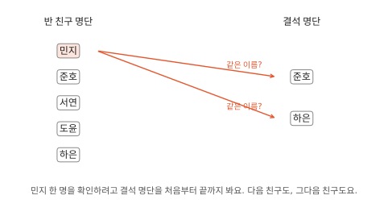

반 친구 명단이 회원 명단, 결석 명단이 탈퇴자 명단이라고 생각하면 돼요. 반 친구 한 명마다 결석 명단을 처음부터 끝까지 봐요. 가장 쉬운 방법이라 코드도 처음엔 대개 이렇게 짜요. 아래 코드는 영어라 건너뛰어도 돼요.

```python
for m in members:          # 회원 한 명씩 차례로
    for w in withdrawn:    # 탈퇴 명단을 처음부터 끝까지 보면서
        if m == w:         # 이름이 같으면
            out.append(m)  # 골라낸다
```

그런데 이 코드에 이상한 일이 생겼어요.

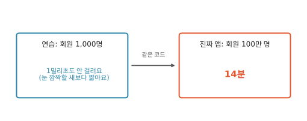

1밀리초는 1초를 1,000조각으로 나눈 것 중 하나예요. 연습할 땐 눈 깜짝할 새였던 코드가 진짜 앱에서는 14분이나 걸렸어요. 왜 그럴까요? 그 까닭을 설명하는 말이 제목의 **빅오**예요.

## 시계로 재 볼까요

회원을 두 배씩 늘려 가며 시계로 재 봤어요. 탈퇴자는 늘 회원 10명 중 1명으로 맞췄어요(이건 조금 뒤에 쓰여요).[^lab]

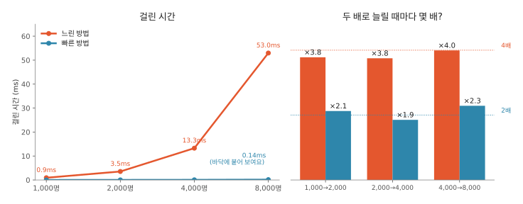

빨간 선이 지금 코드예요. 이제부터 **느린 방법**이라고 부를게요. 회원이 두 배가 될 때마다 시간이 **4배**씩 늘었어요. 파란 선은 **빠른 방법**인데, 이따 볼게요.

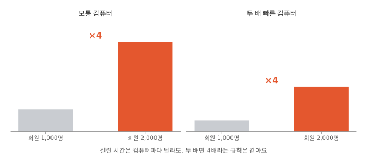

컴퓨터가 빠르면 걸린 시간은 줄어요. 그래도 "두 배면 4배"라는 규칙은 똑같아요.

## 시간 대신 몇 번 하는지 세요

시계로도 "두 배면 몇 배"는 알 수 있어요. 하지만 그러려면 1,000명, 2,000명, 4,000명짜리 명단을 하나하나 만들고, 매번 코드를 돌려 기다려야 해요. 번거롭죠. 코드를 볼 수 있다면 **같은 일을 몇 번 하는지** 세는 게 더 쉬워요. 몇 번인지는 어느 컴퓨터에서나 똑같거든요.

느린 방법이 하는 일은 이름 두 개를 맞대 보는 거예요. 한 번을 칸 하나로 그려 볼게요.

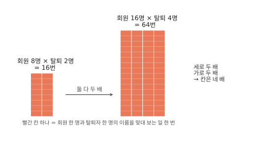

회원이 두 배면 탈퇴자도 두 배예요. 탈퇴자를 늘 회원 10명 중 1명으로 맞췄으니까요. 그래서 칸은 세로로 두 배, 가로로 두 배, 모두 **네 배**가 돼요. 시계로 잰 4배가 바로 이거예요.

??? note "계산해 보기: 14분은 어떻게 나왔을까"
    8,000명(탈퇴자 800명)일 때 53밀리초가 걸렸어요. 100만 명은 8,000명의 125배이고, 탈퇴자도 125배라 칸은 125 × 125 = 15,625배예요. 53밀리초 × 15,625 ≈ 828,000밀리초 = 828초, 60으로 나누면 14분쯤이에요.

    칸 하나에 드는 시간도 구할 수 있어요. 8,000 × 800 = 640만 칸에 53밀리초였으니, 칸 하나는 약 8나노초예요. 나노초는 1초를 10억 조각으로 나눈 것 중 하나예요.

이번엔 빠른 방법이에요. 빠른 방법은 탈퇴자 이름을 번호가 붙은 **사물함**에 넣어 둬요. 이 사물함은 이름만 보면 몇 번인지 바로 정해져요. 이름 글자로 간단한 셈을 해서 번호를 정하거든요. 예를 들어 가=1, 나=2로 정하면 "가나"는 1 + 2 = 3번 사물함이에요.

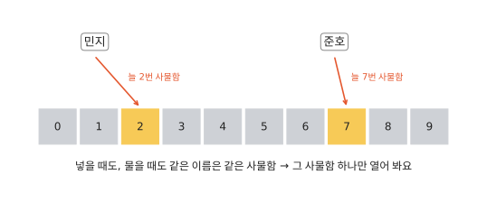

"민지 탈퇴했어?"라고 물으면 2번 사물함 하나만 열어 보면 돼요.[^set] 명단을 처음부터 끝까지 읽을 필요가 없어요.

??? note "더 알아보기: 사물함 번호는 어떻게 정할까"
    예를 들어 글자마다 번호를 정해 두고(가=1, 나=2, 다=3…) 이름의 글자 번호를 다 더한 뒤 10으로 나눈 나머지를 사물함 번호로 쓸 수 있어요. 글자가 많아 합이 10을 넘으면 나머지를 써요. "라마바사"는 4 + 5 + 6 + 7 = 22, 10으로 나눈 나머지가 2라 2번 사물함이에요. 코드에서는 이런 사물함 묶음을 `set`이라고 부르고, 실제로는 이보다 복잡하게 계산하지만 생각은 같아요.

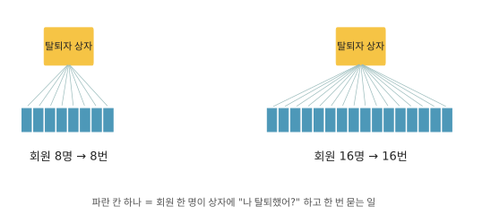

회원 한 명마다 사물함에 한 번씩만 물어봐요. 회원이 두 배면 묻는 것도 **두 배**예요.

!!! tip "코드를 쓰는 사람이라면"
    탈퇴자를 `set`이 아니라 그냥 리스트에 넣고 `m in withdrawn`으로 물으면 느린 방법과 똑같아져요. 한 줄이지만 그 안에서 리스트를 처음부터 끝까지 훑거든요. 겉으로 드러난 반복문보다 눈에 덜 띄어서 리뷰에서 자주 놓쳐요.

## "두 배면 몇 배"에 붙인 이름, 빅오

두 방법에 이름표를 붙여 볼게요.

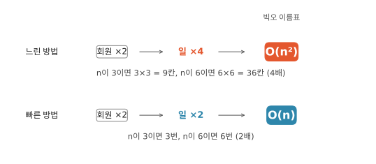

이 이름표가 **빅오**예요.

- **n**은 "몇 명"을 넣는 빈칸이에요. 회원이 10명이면 n에 10을 넣어요.
- **n²**은 n × n이에요. 느린 방법의 칸이 n × n 네모였죠?
- **O**는 "이건 빅오 이름표예요" 하고 앞에 씌우는 알파벳이에요. O(n²)은 "오 엔 제곱", O(n)은 "오 엔"이라고 읽어요.

빅오를 알면 "회원이 1,000배 늘면?"에 바로 답할 수 있어요. O(n)이면 일도 1,000배예요. O(n²)이면 칸 그림의 네모가 세로로 1,000배, 가로로 1,000배 커지니까 1,000 × 1,000 = **100만 배**예요. 처음 이야기에서 1밀리초도 안 걸리던 코드가 14분 걸린 것도 이 100만 배 때문이에요.

반대로 개수가 적고 앞으로도 늘지 않는다면, O(n²)이어도 괜찮을 때가 많아요. 작은 네모는 네 배가 돼도 작거든요.

??? note "더 알아보기: 자잘한 일은 왜 세지 않을까"
    진짜 코드에는 맞대 보는 일 말고도 회원마다 결과를 정리하는 일, 처음에 준비하는 일이 조금씩 붙어요. 예를 들어 "맞대 보기 n × n번 + 정리 5 × n번 + 준비 2번"이라고 해 봐요. n이 커질수록 둘을 막대로 견주면 이래요.

    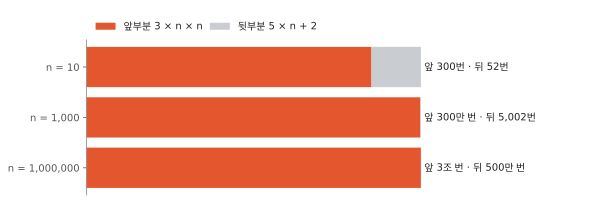

    n이 1,000밖에 안 돼도 자잘한 일은 막대에서 거의 안 보여요. 그래서 가장 빨리 커지는 부분 하나만 남겨요.

    회원이 늘어도 일이 그대로인 것도 있어요. 사물함 하나를 열어 보는 일이 그래요. 이건 O(1)(오 일)이라고 적어요.

    곱하는 숫자도 떼요. 느린 방법은 탈퇴자가 회원의 10분의 1이라 정확히는 n × n ÷ 10번이지만, ÷ 10이 붙어 있어도 두 배면 4배인 건 같으니 O(n²)이라고 적어요.

## 빅오를 믿으면 안 될 때

빅오는 일을 **몇 번** 하는지만 세요. 한 번 하는 데 **얼마나 걸리는지**는 세지 않아요.

### 빅오가 같아도 빠르기는 다를 수 있어요

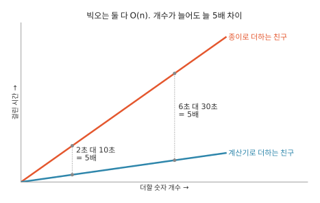

두 친구가 숫자를 더해요. 한 친구는 종이에, 한 친구는 계산기로요. 둘 다 숫자를 하나씩 한 번 보니까 빅오는 둘 다 O(n)이에요. 그래도 계산기 친구가 훨씬 빨라요.

누가 빠른지는 재 봐야 알아요. 컴퓨터에서도 그랬어요. 컴퓨터에 들어 있는 계산기 같은 더하기 방법이 하나씩 더하는 코드보다 다섯 배쯤 빨랐어요. 숫자가 많아지면 두 선 사이는 벌어지지만, 몇 배인지는 늘 5배예요.

### 한 번 하는 시간이 아주 길 때

이번엔 쇼핑 앱이에요. 앱은 정보를 모아 둔 먼 컴퓨터에 물어보러 가요. 이 컴퓨터를 **데이터베이스**라고 해요. 한 번 갔다 오는 걸 **왕복**이라고 하는데, 왕복 한 번에 2밀리초쯤 걸려요. 그동안 이름 맞대 보기를 수십만 번 할 수 있어요.

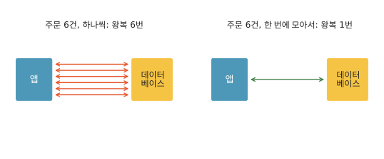

여기서 n은 주문 수예요. 빅오는 데이터베이스 안에서 주문을 찾는 일만 세요. 오가는 길은 세지 않아요. 찾는 일은 둘 다 6번이라 빅오는 둘 다 O(n)이에요. 다른 건 왕복 횟수예요. 주문이 1,000개면 하나씩 물을 때 왕복 1,000번, 2밀리초 × 1,000 = 2초가 왕복에만 들어요. 이럴 땐 빅오보다 **왕복 횟수**를 세야 해요.

!!! abstract "어른을 위한 정리: 앱 만드는 사람에게 이렇게 물어보세요 (건너뛰어도 돼요)"
    코드를 몰라도 이 세 가지는 물어볼 수 있어요.

    1. **n이 뭐예요? 앞으로 몇 배까지 늘 수 있어요?** n이 늘지 않으면 빅오는 크게 중요하지 않아요.
    2. **이 부분 빅오가 뭐예요?** n이 크게 늘 수 있는데 O(n²)이면 먼저 고칠 후보예요.
    3. **데이터베이스나 다른 컴퓨터에 n번 왕복해요?** 그렇다면 빅오보다 왕복 횟수가 시간을 정해요.

    느린 방법(O(n²))은 회원이 10배 늘 때마다 시간이 100배씩 늘었어요.

    | 회원 수 | 느린 방법 |
    |---|---|
    | 1,000명 | 0.001초 (잰 값) |
    | 1만 명 | 0.08초쯤 |
    | 10만 명 | 8초쯤 |
    | 100만 명 | 14분쯤 |

    얼마부터 문제인지는 쓰임새에 달렸어요. 사람이 화면 앞에서 기다리는 기능이라면 1초가 넘으면 생각의 흐름이 끊기고, 10초가 넘으면 다른 곳으로 눈을 돌린다고 해요.[^nielsen] 아무도 기다리지 않는 밤 작업이라면 몇 분도 괜찮을 수 있어요.

## 직접 판단해 보기

??? question "1. 연습할 땐 2밀리초, 진짜 앱에선?"
    상품 1,000개로 연습했더니 두 방법이 모두 2밀리초였어요. 진짜 앱엔 상품이 100만 개, 1,000배예요. A는 O(n), B는 O(n²)이에요. 각각 얼마쯤 걸릴까요?

    **풀이**

    - A(O(n))는 일이 1,000배예요. 2밀리초 × 1,000 = 2,000밀리초 = 2초쯤.
    - B(O(n²))는 일이 100만 배예요. 2밀리초 × 100만 = 200만 밀리초예요. 1초가 1,000밀리초이니 2,000초, 1분이 60초이니 약 33분이에요.

??? question "2. 설정 항목 30개, 고쳐야 할까?"
    앱의 설정 화면에 고를 수 있는 항목이 30개쯤 있고, 이 수는 앞으로도 거의 안 늘어나요. 겹치는 이름을 찾는 코드가 느린 방법(O(n²))으로 되어 있어요. 고쳐야 할까요?

    **풀이**
    30 × 30 = 900번이에요. 칸 하나는 아주 빨리 채우니까 900번쯤은 눈 깜짝할 새보다 훨씬 짧아요. 항목이 늘지 않으니 그대로 둬도 돼요. 그런데 사용자가 항목을 마음대로 늘릴 수 있다면 고쳐야 해요. 1만 개만 돼도 1만 × 1만 = 1억 번, 900번보다 10만 배 넘게 많아요.

??? question "3. 주문마다 데이터베이스에 다녀오는 코드"
    주문 목록을 보여 줄 때 주문마다 데이터베이스에 다녀오는 코드가 있어요. 한 번에 모아서 묻게 바꾸자고 했더니 "어차피 둘 다 O(n)인데 왜 바꿔?"라는 말이 나왔어요. 어떻게 답할까요?

    **풀이**
    여기서 셀 건 왕복 횟수예요. 하나씩 물으면 1,000번, 모아서 물으면 1번이에요. 왕복 한 번에 2밀리초면 1,000번은 2초예요. 데이터베이스 안에서 찾는 일은 둘 다 같아요. 찾는 일에는 오가는 길이 없어서, 대개 왕복 한 번보다 짧아요.

??? question "4. 너무 복잡해서 셀 수가 없을 때"
    여러 단계를 거치는 코드라 몇 번 하는지 세기 어려워요. 빅오를 어떻게 짐작할까요?

    **풀이**
    이럴 땐 시계를 다시 꺼내요. 다루는 개수를 두 배씩 늘려 가며 재요. 두 배마다 시간이 2배쯤이면 O(n), 4배쯤이면 O(n²)이에요.

## 더 깊이

??? info "빅오의 정확한 정의"
    수학에서는 이렇게 적어요. f(n) = O(g(n))은 어떤 양수 c와 n₀가 있어서, n이 n₀ 이상이면 언제나 f(n) ≤ c × g(n)이라는 뜻이에요. "n이 어느 크기를 넘으면 f는 g의 c배를 넘지 않는다"는 말이에요.

    3n² + 5n + 2라면 c = 4로 잡아요. 그러면 5n + 2 ≤ n²이어야 하는데, n = 5에서는 27 > 25라 안 되고 n = 6에서 32 ≤ 36으로 처음 맞아요. n이 1 늘 때 n²은 2n + 1만큼, 5n + 2는 5만큼 느니 n ≥ 6이면 n²이 계속 앞서요. 그래서 n₀ = 6이에요.

??? info "다른 모양: log n과 n log n"
    빅오에는 O(n²)과 O(n) 말고도 자주 나오는 모양이 있어요. log n(로그 엔)은 "반으로 몇 번 나눠야 하나만 남나"를 센 수예요. 1,000개는 10번쯤, 100만 개도 20번쯤이라, 데이터가 1,000배 늘어도 두 배밖에 안 늘어요. 정렬된 명단에서 반씩 좁혀 가며 찾는 일이 O(log n)이에요. n log n은 n × log n으로, 데이터가 1,000배 늘면 2,000배쯤 늘어요. 좋은 정렬 방법들이 이 모양이에요. 두 모양은 찾기와 정렬을 다루는 편에서 자세히 봐요.

??? info "O, Ω, Θ는 어떻게 다를까"
    - O(g): 많아 봐야 g의 몇 배 (위쪽 한계)
    - Ω(g): 적어도 g의 몇 배 (아래쪽 한계)
    - Θ(g): 둘 다. g와 같은 빠르기로 커져요

    엄밀히 따지면 O(n)인 코드는 O(n²)이기도 해요. 개발자들이 "이 코드는 O(n)"이라고 할 때는 대개 Θ(n), 딱 n의 빠르기로 커진다는 뜻으로 써요. 이 글도 그렇게 썼어요.

??? info "최악의 경우와 평균, 나눠 내기"
    찾는 이름이 맨 앞에 있으면 한 번에 끝나고 맨 끝에 있으면 끝까지 봐요. 그래서 빅오는 보통 가장 오래 걸리는 경우, 최악의 경우로 말해요. "최악이냐 평균이냐"는 어떤 경우를 셀지 고르는 거고, O나 Θ는 그렇게 센 횟수가 커지는 모양을 적는 거라 둘은 따로예요.

    어떤 일은 가끔 한 번씩 크게 오래 걸려요. 그래도 여러 번에 걸쳐 나눠 보면 한 번에 드는 몫은 작아요. 파이썬 리스트에 하나씩 붙이는 일(`append`)이 그래요. 자리가 다 차면 더 큰 자리를 잡아 전부 옮기느라 그때만 비싸지만, 넉넉하게 늘려 두니 그런 일은 드물어요. [^append]

??? info "빅오는 어디서 왔을까"
    O는 컴퓨터보다 먼저 나왔어요. 독일 수학자 파울 바흐만이 1894년 수학책에서 처음 썼고, 에드문트 란다우가 1909년 책에서 받아 쓰면서 "훨씬 작다"를 뜻하는 작은 o를 더해 널리 퍼뜨렸어요.[^history] 처음 쓰임새는 1 + 2 + … + n = n²/2 + O(n)처럼, 어림한 값 뒤에 남는 나머지가 많아 봐야 어느 정도라고 적는 거였어요. O는 독일어로 차수를 뜻하는 Ordnung의 첫 글자예요.

    계산에 드는 시간을 데이터 크기로 따지는 연구는 1960년대에 자리를 잡았어요. 유리스 하르트마니스와 리처드 스턴스가 1965년에 낸 논문이 이 분야의 시작으로 꼽히고, 두 사람은 이 일로 1993년 튜링상을 받았어요.[^hs] 1976년에는 도널드 크누스가 사람들이 O를 아래쪽 한계에도 섞어 쓰는 문제를 짚고, Ω와 Θ를 알고리즘 분석에 맞게 정리했어요.[^knuth]

??? info "직접 재 보기"
    이 글의 숫자는 모두 [`lab/01_big_o.py`](https://github.com/oya150/bedrock/blob/main/lab/01_big_o.py)로 쟀고, 그림은 [`lab/fig_01.py`](https://github.com/oya150/bedrock/blob/main/lab/fig_01.py)로 그렸어요. 파이썬만 있으면 돌려 볼 수 있어요. 숫자는 컴퓨터마다 달라도 "두 배면 몇 배" 규칙은 비슷하게 나올 거예요.

[^lab]: 측정 환경은 CPython 3.12.7, Apple Silicon 노트북이에요. 다시 재면 숫자는 조금씩 달라져요.
[^set]: 어떻게 한 번에 찾는지는 해시 테이블을 다루는 편에서 봐요.
[^append]: 자세한 건 리스트를 다루는 편에서 봐요.
[^history]: [Big O notation (Wikipedia)](https://en.wikipedia.org/wiki/Big_O_notation), [O-notation in algorithm analysis (arXiv:1309.3210)](https://arxiv.org/abs/1309.3210).
[^hs]: J. Hartmanis, R. E. Stearns, "On the Computational Complexity of Algorithms", *Transactions of the American Mathematical Society* 117 (1965), 285–306. [doi:10.1090/S0002-9947-1965-0170805-7](https://doi.org/10.1090/S0002-9947-1965-0170805-7). 튜링상: [ACM 추모 기사](https://cacm.acm.org/news/in-memoriam-juris-hartmanis-1928-2022).
[^knuth]: D. E. Knuth, "Big Omicron and Big Omega and Big Theta", *SIGACT News* 8(2) (1976), 18–24. [NIST 알고리즘 사전 항목](https://xlinux.nist.gov/dads/HTML/omegaCapital.html).
[^nielsen]: [Response Times: The 3 Important Limits (Nielsen Norman Group)](https://www.nngroup.com/articles/response-times-3-important-limits/). 원전은 J. Nielsen, *Usability Engineering* (1993).
