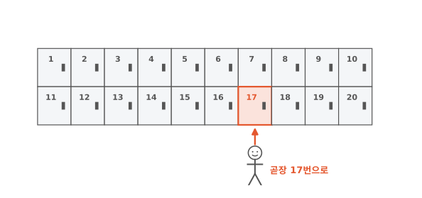
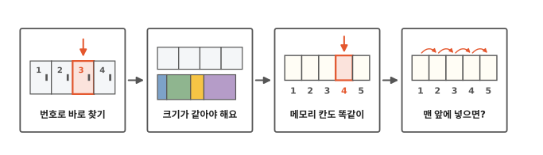
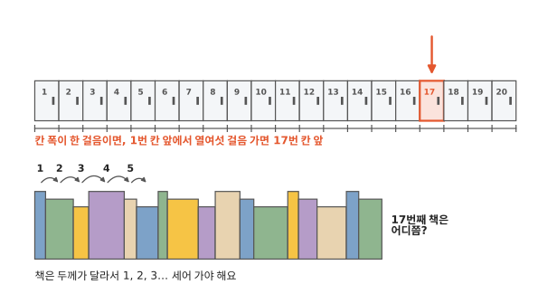
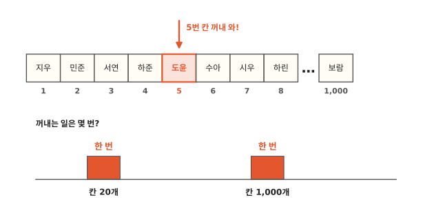
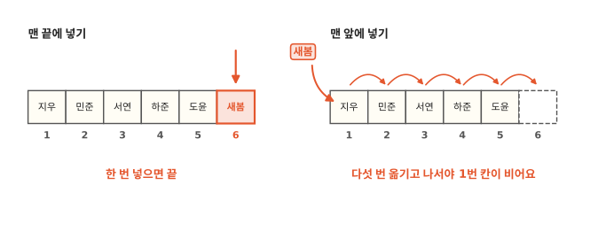

# 사물함은 왜 몇 번 칸이든 바로 찾을까요?

## 내 사물함 17번

아침에 교실에 들어오면 내 사물함 17번으로 곧장 가요. 1번부터 하나씩 열어 보는 친구는 없어요.

1편에서 양말 짝을 찾을 때는 바구니를 다 뒤졌어요. 사물함은 왜 바로 찾을 수 있을까요?

## 사물함에서 메모리 칸까지

알고리즘 두 번째 편이에요. 그림 네 칸을 왼쪽부터 따라가요. 사물함에서 시작해요. 칸 크기가 왜 같아야 하는지 보고 나면 컴퓨터의 메모리 칸이 나와요. 마지막 칸에서는 배열이 오래 걸리는 일도 하나 만나요.

## 크기가 같으면 눈 감고도 찾아요

우리는 사물함 문에 적힌 번호를 눈으로 읽고 17번을 찾아요. 그럼 눈을 감고도 17번 앞에 갈 수 있을까요?

사물함 칸은 모두 크기가 같고, 빈 곳 없이 딱 붙어서 한 줄로 서 있어요. 칸 폭이 딱 한 걸음이라고 해 봐요. 1번 칸 앞에 서서 옆으로 열여섯 걸음 가면 17번 칸 앞이에요. 눈을 감고도 갈 수 있어요.

책장은 어떨까요? 책은 얇은 것도 있고 두꺼운 것도 있어요. 그래서 걸음으로는 17번째 책이 어디쯤인지 알 수 없어요. 눈을 뜨고 첫 번째 책부터 하나, 둘, 셋… 세어 가야 해요.

## 메모리 칸도 사물함처럼

컴퓨터 5편에서 메모리 칸에도 사물함처럼 번호가 있다고 했지요? 다만 메모리 칸에는 문이 없어서 번호가 눈에 보이지 않아요. 그림 속 번호는 우리가 알아보기 쉽게 붙인 거예요. 그래서 컴퓨터는 눈 감고 걷는 아이처럼 찾아요. 칸 크기가 모두 같으니, 몇 번째 칸인지만 알면 어디 있는지 계산으로 알아내요.

친구 이름 20개를 적어 둔다고 해 봐요. 컴퓨터는 메모리에 같은 크기 칸 20개를 빈 곳 없이 붙여서 준비해요. 그리고 1번 칸부터 차례로 이름을 하나씩 넣어요. 칸 하나에는 이름 하나만 들어가요. 이름마다 길이가 다른 건 맨 아래 "더 깊이"에서 알아봐요. 이렇게 같은 크기 칸을 빈 곳 없이 줄지어 놓고 번호로 꺼내 쓰는 것을 **배열**이라고 해요.

"5번 칸 꺼내 와" 하면 컴퓨터는 5번 칸으로 바로 가요. 칸이 20개여도 1,000개여도 꺼내는 일은 한 번이에요.

## 맨 앞에 넣으면 다 옮겨야 해요

배열에도 오래 걸리는 일이 있어요. 이름 다섯 개가 1번부터 5번 칸에 들어 있고, 6번 칸은 비어 있어요. 새 친구 새봄이를 넣어 볼게요.

맨 끝에 넣는 건 쉬워요. 비어 있는 6번 칸에 넣으면 끝이에요.

새봄이를 맨 앞 1번 칸에 넣어야 한다면 어떨까요? 1번 칸에는 벌써 지우가 있어요. 지우를 먼저 2번 칸으로 옮기면, 2번 칸에 있던 민준이 이름이 지워져 버려요. 그래서 맨 뒤부터 옮겨요. 도윤이를 빈 6번 칸으로, 하준이를 5번 칸으로, 서연이를 4번 칸으로… 이렇게 다섯 번 옮기고 나서야 1번 칸이 비어요.

이름이 많을수록 옮기는 일도 많아져요. 이름이 스무 개 들어 있고 뒤에 빈 칸이 하나 있다면, 스무 번을 옮겨야 해요. 맨 앞에서 이름을 하나 뺄 때도 마찬가지예요. 빈자리를 메우려고 뒤의 이름을 모두 한 칸씩 앞으로 당겨요.

교실이라면 새 친구에게 빈 사물함을 하나 주면 끝이지요. 컴퓨터는 이름을 가나다 차례처럼 정해진 차례대로 둬야 할 때가 많아서 그럴 수 없어요. 새 이름이 가운데에 들어가야 하면, 그 자리부터 뒤쪽 이름만 한 칸씩 옮겨요.

가나다 차례로 둔 이름은 번호를 몰라도 빨리 찾을 수 있을까요? 다음 편에서 알아봐요.

## 정리

- **배열**: 같은 크기 칸을 빈 곳 없이 줄지어 놓고 번호로 꺼내 쓰는 것이에요. 몇 번 칸이든 한 번에 꺼내요. 맨 앞에 넣으려면 뒤의 이름을 다 옮겨야 해요.

## 해 보기: 종이컵 사물함

친구와 둘이서 해요.

1. 종이컵 여섯 개를 한 줄로 붙여 놓고, 컵 앞에 1부터 6까지 번호를 써요.
2. 쪽지 다섯 장에 이름을 하나씩 써서 1번 컵부터 5번 컵까지 넣어요. 6번 컵은 비워 둬요.
3. 친구가 "4번!" 하고 외치면, 4번 컵에서 쪽지를 꺼내 이름을 읽고 다시 넣어요. 컵을 몇 개 들여다봤나요?
4. 새 쪽지를 1번 컵에 넣어야 해요. 맨 뒤 5번 쪽지를 6번 컵으로 옮기고, 4번 쪽지를 5번 컵으로 옮기고… 쪽지를 하나 옮길 때마다 친구가 바둑돌을 하나 놓아요. 1번 컵이 비면 새 쪽지를 넣어요.
5. 이번에는 컵 열한 개와 쪽지 열 장으로 4단계를 다시 해 봐요. 바둑돌이 몇 개 놓였나요?

## 확인 문제

??? question "1. 사물함 30개"
    사물함이 30개 있어요. 25번 칸 물건을 꺼내려면 칸을 몇 개 열어 볼까요?

    **풀이**: 1개예요. 번호를 보고 25번 칸으로 바로 가요.

??? question "2. 맨 앞에 넣기, 맨 끝에 넣기"
    배열에 이름이 10개 들어 있고, 11번 칸은 비어 있어요. 맨 앞에 새 이름을 넣으려면 이름을 몇 개 옮겨야 할까요? 맨 끝에 넣으면요?

    **풀이**: 맨 앞에 넣으면 10개를 다 옮겨요. 맨 끝에 넣으면 옮길 이름이 없어요. 빈 11번 칸에 넣기만 하면 돼요.

??? question "3. 가운데에 넣기"
    이름 6개가 1번부터 6번 칸에 있고, 7번 칸은 비어 있어요. 새 이름을 3번 칸에 넣으려면 이름을 몇 개 옮겨야 할까요?

    **풀이**: 4개예요. 6번 칸 이름을 7번 칸으로, 5번을 6번으로, 4번을 5번으로, 3번을 4번으로 옮기면 3번 칸이 비어요. 1번과 2번 칸 이름은 그대로 둬요.

??? question "4. 책장의 17번째 책"
    책장에서 17번째 책은 왜 바로 찾기 어려울까요?

    **풀이**: 책마다 두께가 달라서, 17번째 책이 어디쯤 있는지 알 수 없으니까요. 앞에서부터 세어 가야 해요.

!!! abstract "어른을 위한 정리 (건너뛰어도 돼요)"
    - 배열은 "시작 위치 + 칸 크기 × 번호"로 칸의 자리를 바로 계산해요(번호는 0부터). 그래서 번호(인덱스)로 읽기는 배열 길이와 상관없이 O(1)이에요. 맨 앞이나 가운데에 넣고 빼면 뒤 원소를 다 옮기니 O(n)이에요. 끝에 넣기는 빈 칸이 있을 때 O(1)이에요.
    - 파이썬 list도 배열이에요. 값 자체 대신 "값이 있는 곳"을 같은 크기 칸에 담아서, 원소 크기가 제각각이어도 인덱싱이 O(1)이에요. 꽉 차면 넉넉하게 새로 잡아 옮겨서, `append`를 여러 번 해도 옮기는 일은 가끔만 생겨요.[^faq] `insert(0, x)`와 `pop(0)`은 O(n)이라, 앞에서 자주 넣고 빼야 하면 `collections.deque`를 써요.[^deque]
    - 직접 재 보면, 맨 앞에 넣으며 8만 개를 채우는 데 1.6초쯤 걸렸어요. 끝에 넣으며 채우면 1.4밀리초쯤이었어요. 개수를 두 배로 늘리면 앞에 넣는 쪽은 거의 네 배씩 느려졌어요. 넣을 때마다 그때까지 쌓인 만큼 옮기니, 모두 합하면 n²에 비례하니까요.[^lab]

## 더 깊이

??? info "컴퓨터는 0번부터 세요"
    이 글에서는 사물함처럼 1번부터 셌어요. 그런데 많은 프로그래밍 언어에서는 배열의 첫 칸이 0번이에요. 번호를 "첫 칸에서 몇 칸 떨어졌나"로 세기 때문이에요. 첫 칸은 첫 칸에서 0칸 떨어져 있으니 0번이에요.

??? info "칸이 꽉 차면 어떻게 할까"
    20칸이 다 찼는데 이름을 더 넣어야 하면, 더 큰 빈자리를 새로 마련하고 이름을 모두 옮겨 담아요. 이때 넉넉하게 마련해 둬요. 그러면 다음 몇 번은 옮기지 않고 끝에 바로 넣을 수 있어요.[^faq]

??? info "길이가 다른 이름은 어떻게 같은 칸에 넣을까"
    "지우"와 "하늘보람"은 길이가 달라요. 그대로 넣으면 칸 크기가 달라져요. 그래서 칸에는 이름 대신 "이름이 있는 곳"을 적은 같은 크기 쪽지를 넣어 두기도 해요. 쪽지 크기는 다 같으니 번호로 바로 찾을 수 있어요.

[^faq]: Python 공식 문서 Design and History FAQ, [How are lists implemented in CPython?](https://docs.python.org/3/faq/design.html#how-are-lists-implemented-in-cpython)
[^deque]: Python 공식 문서, [collections.deque](https://docs.python.org/3/library/collections.html#collections.deque). list는 `pop(0)`·`insert(0, v)`에서 O(n) 메모리 이동 비용이 든다고 적혀 있어요.
[^lab]: [`lab/02_list.py`](https://github.com/oya150/bedrock/blob/main/lab/02_list.py)로 잰 값이에요(CPython 3.12.7, Apple Silicon 노트북). 다시 재면 숫자는 조금씩 달라져요.
