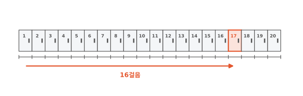
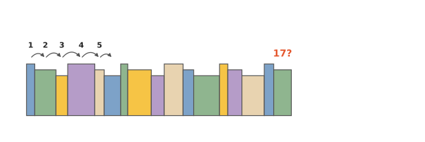
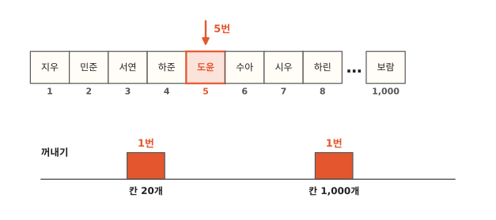
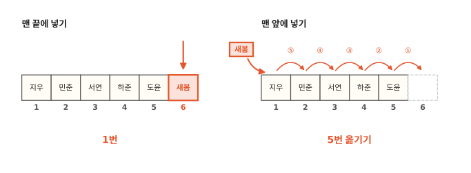
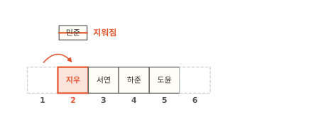
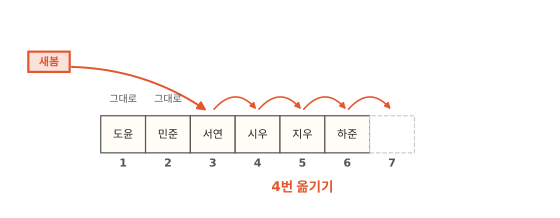
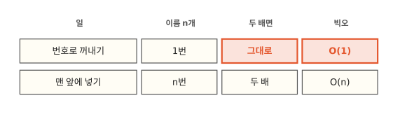

# 배열: 사물함처럼 번호로 바로 꺼내는 칸

아침에 교실에 들어오면 내 사물함 17번으로 곧장 가요. 1번부터 하나씩 열어 보는 사람은 없죠. 이 글을 읽고 나면 사물함이 몇 번 칸이든 바로 찾을 수 있는 까닭과 컴퓨터가 같은 방법으로 값을 꺼내는 배열을 알게 돼요. 이걸 알면 어떤 일은 칸이 아무리 많아도 빠르고 어떤 일은 칸이 많을수록 느려지는 까닭이 보여요.

!!! abstract "이 글에서 알게 되는 것"
    1. 같은 크기 칸을 빈 곳 없이 한 줄로 놓으면 몇 번째 칸인지만 알아도 자리를 계산할 수 있어요. 이렇게 놓고 번호로 꺼내 쓰는 것이 배열이에요.
    2. 배열은 칸이 20개든 1,000개든 번호로 한 번에 꺼내요. 빅오로 적으면 O(1)이에요.
    3. 대신 맨 앞이나 가운데에 넣으려면 그 뒤의 이름을 한 칸씩 다 옮겨야 해요. 이름이 두 배면 옮기는 일도 두 배라서 O(n)이에요.

## 1. 칸 크기가 같으면 눈 감고도 17번 칸에 가요

[1편](01-why-big-o.md)에서 양말 짝을 찾을 때는 바구니를 다 뒤졌어요. 사물함은 17번 칸을 찾으려고 앞 칸을 열어 보지 않아요. 문에 적힌 번호를 눈으로 읽으니까요. 그럼 눈을 감고도 17번 앞에 갈 수 있을까요?

사물함 칸은 모두 크기가 같고 빈 곳 없이 붙어서 한 줄로 서 있어요. 칸 폭이 딱 한 걸음이라고 해 볼게요. 아래 그림에서 눈금 아래 빨간 화살표를 보세요.

**그림 1.** 1번 칸 앞에서 열여섯 걸음 가면 17번 칸 앞이에요.
{ .fig-cap }

1번 칸에서 17번 칸까지는 16칸을 건너요. 그래서 열여섯 걸음이에요. 몇 번 칸이든 번호에서 1을 뺀 만큼 걸으면 돼요. 문에 적힌 번호를 하나도 안 읽고 갈 수 있어요.

책장은 달라요. 책은 얇은 것도 있고 두꺼운 것도 있어요. 아래 그림에서 책 위 숫자를 보세요.

**그림 2.** 두께가 제각각인 책은 첫 권부터 하나씩 세어야 17번째를 찾아요.
{ .fig-cap }

걸음으로는 17번째 책이 어디쯤인지 알 수 없어요. 앞에 꽂힌 책 16권의 두께가 다 다르거든요. 그래서 첫 번째 책부터 하나, 둘, 셋 세어 가요. 번호만 보고 자리를 알려면 칸 크기가 같아야 해요.

## 2. 메모리도 같은 크기 칸을 번호로 바로 꺼내요

컴퓨터도 사물함처럼 칸에 값을 넣어요. [컴퓨터 5편](../computer/05-where-computers-remember.md)에서 컴퓨터는 지금 쓰는 숫자를 메모리에 적는다고 했어요. 메모리 칸에도 사물함처럼 번호가 있어요. 다만 메모리 칸에는 문이 없어서 번호가 눈에 보이지 않아요. 그래서 컴퓨터는 눈 감고 걷는 사람처럼 찾아요. 칸 크기가 모두 같으니까 몇 번째 칸인지만 알면 어디 있는지 계산으로 알아내요. 사물함에서 번호에서 1을 뺀 만큼 걸었던 것처럼 컴퓨터도 첫 칸 자리에서 "칸 크기 × (번호 − 1)"만큼 건너가요.

친구 이름 20개를 적어 둔다고 해 볼게요. 컴퓨터는 메모리에 같은 크기 칸 20개를 빈 곳 없이 붙여서 마련해요. 그리고 1번 칸부터 차례로 이름을 하나씩 넣어요. 칸 하나에는 이름 하나만 들어가요. 아래 그림에서 빨간 5번 칸과 아래 막대 두 개를 보세요.

**그림 3.** 5번 칸을 꺼내는 일은 칸이 20개여도 1,000개여도 한 번이에요.
{ .fig-cap }

"5번 칸 꺼내 와" 하면 컴퓨터는 5번 칸으로 바로 가요. 앞의 1번부터 4번 칸은 들여다보지 않아요. 칸이 1,000개로 늘어도 계산 한 번으로 자리를 알아내니까 꺼내는 일은 늘지 않아요.

이렇게 같은 크기 칸을 빈 곳 없이 줄지어 놓고 번호로 꺼내 쓰는 것을 **배열**이라고 해요.

여기서 이름마다 길이가 다른데 어떻게 같은 크기 칸에 넣느냐는 생각이 들 거예요. "지우"와 "하늘보람"은 길이가 달라요. 그래서 칸에 이름 대신 "이름이 있는 곳"을 적은 쪽지를 넣기도 해요. 쪽지는 크기가 다 같아서 번호로 바로 찾을 수 있어요.

번호를 세는 법도 하나 알아 두면 좋아요. 많은 프로그래밍 언어는 배열의 첫 칸을 0번이라고 불러요. 첫 칸에서 몇 칸 떨어졌는지로 세기 때문이에요. 이 글에서는 사물함처럼 1번부터 셀게요.

## 3. 맨 앞에 넣으려면 뒤의 이름을 다 옮겨야 해요

꺼내기는 빨랐어요. 이번에는 넣어 볼게요. 이름 다섯 개가 1번부터 5번 칸에 들어 있고 6번 칸은 비어 있어요. 새 친구 새봄이를 넣을 거예요. 아래 그림에서 왼쪽과 오른쪽의 빨간 화살표 수를 비교해 보세요.

**그림 4.** 맨 끝에 넣기는 한 번이면 끝나요. 맨 앞에 넣기는 이름 다섯 개를 옮겨야 1번 칸이 비어요.
{ .fig-cap }

맨 끝에 넣는 건 쉬워요. 비어 있는 6번 칸에 넣으면 끝이에요.

맨 앞 1번 칸에는 벌써 지우가 있어요. 그래서 맨 뒤 도윤이부터 옮겨요. 도윤이를 빈 6번 칸으로, 하준이를 5번 칸으로, 서연이를 4번 칸으로 옮기는 식이에요. 그림의 ①부터 ⑤까지 다섯 번 옮기고 나서야 1번 칸이 비어요.

왜 앞의 지우부터 옮기지 않을까요? 아래 그림에서 지우를 먼저 2번 칸으로 옮기면 무슨 일이 생기는지 보세요.

**그림 5.** 지우를 먼저 2번 칸에 넣으면 거기 있던 민준이 지워져요.
{ .fig-cap }

칸 하나에는 이름 하나만 들어가요. 지우를 2번 칸에 넣는 순간 민준이 사라져요. 맨 뒤 도윤이는 빈 6번 칸으로 가니까 아무것도 지우지 않아요. 도윤이가 비운 5번 칸에 하준이가 들어가고 하준이가 비운 4번 칸에 서연이가 들어가요. 그래서 맨 뒤부터 옮겨요.

이름이 많을수록 옮기는 일도 많아져요. 이름이 스무 개 들어 있고 끝에 빈 칸이 하나 있으면 스무 번 옮겨야 해요. 맨 앞 이름을 하나 뺄 때도 같아요. 빈자리를 메우려고 나머지 이름을 모두 한 칸씩 앞으로 당겨요.

끝에 넣을 때도 빈 칸이 없으면 일이 생겨요. 컴퓨터는 더 큰 자리를 새로 마련해서 이름을 모두 옮겨 담아요. 이때 넉넉하게 마련해 두면 다음 몇 번은 옮기지 않고 끝에 바로 넣을 수 있어요.

## 4. 차례를 지키려면 가운데에도 넣어야 해요

여기서 이런 생각이 들 거예요. 교실이라면 새 친구에게 빈 사물함을 하나 주면 끝이잖아요. 왜 굳이 맨 앞에 넣을까요? 컴퓨터는 이름을 가나다 차례처럼 정해진 차례로 둬야 할 때가 많아요. 그러면 새 이름이 들어갈 자리가 정해져 있어서 아무 빈 칸에나 넣을 수 없어요.

가나다 차례로 둔 이름 여섯 개가 있다고 해 볼게요. 도윤, 민준, 서연, 시우, 지우, 하준이에요. 7번 칸은 비어 있어요. 새봄이는 가나다 차례로 민준과 서연 사이라서 3번 칸에 들어가야 해요. 아래 그림에서 빨간 굽은 화살표가 몇 개인지 세어 보세요.

**그림 6.** 새봄이를 3번 칸에 넣으려고 서연, 시우, 지우, 하준 네 이름만 옮겨요.
{ .fig-cap }

1번 도윤과 2번 민준은 그대로 둬요. 새 이름이 들어갈 3번 자리부터 끝까지만 한 칸씩 옮기면 돼요. 그래서 맨 앞에 넣을 때 가장 많이 옮기고 맨 끝에 넣을 때 가장 적게 옮겨요.

## 5. 꺼내기는 O(1), 맨 앞에 넣기는 O(n)이에요

1편의 빅오로 배열이 하는 두 일을 적어 볼게요. 빅오는 양이 두 배가 될 때 일이 몇 배가 되는지 말하는 이름이었어요. 이름 개수를 n이라고 써요. 아래 표에서 빨간 칸을 보세요.

**그림 7.** 번호로 꺼내기는 이름이 두 배가 돼도 일이 그대로라서 O(1)이에요.
{ .fig-cap }

번호로 꺼내기는 이름이 20개든 1,000개든 한 번이에요. 이름이 두 배가 돼도 일은 그대로예요. 이걸 O(1)이라고 적고 "오 일"이라고 읽어요. 맨 앞에 넣기는 이름 n개를 다 옮기니까 n번이에요. 이름이 두 배면 옮기는 일도 두 배라서 O(n)이에요.

그래서 배열은 번호로 자주 꺼내 쓰는 일에 잘 맞아요. 앞이나 가운데에 자주 넣고 빼야 하면 옮기는 일이 쌓여서 느려져요.

## 정리

사물함 칸은 크기가 같고 빈 곳 없이 붙어 있어서 1번 칸 앞에서 열여섯 걸음 가면 17번 칸이에요. 메모리 칸도 같은 크기라서 컴퓨터는 몇 번째 칸인지만 알면 자리를 계산해요. 같은 크기 칸을 줄지어 놓고 번호로 꺼내 쓰는 것을 배열이라고 해요.

배열은 칸이 20개든 1,000개든 번호로 한 번에 꺼내요. 그래서 O(1)이에요. 대신 맨 앞에 새봄이를 넣으려면 뒤의 이름 다섯 개를 맨 뒤부터 한 칸씩 옮겨야 해요. 이름이 두 배면 옮기는 일도 두 배라서 O(n)이에요. 가나다 차례를 지키며 가운데에 넣을 때는 그 자리부터 끝까지만 옮겨요.

[3편](03-why-sorted-is-fast.md)에서는 차례대로 놓인 카드에서 가운데부터 봐서 빨리 찾는 방법을 봐요.

### 새로 나온 말

- **배열**: 같은 크기 칸을 빈 곳 없이 줄지어 놓고 번호로 꺼내 쓰는 것. 이름 20개를 1번부터 20번 칸에 넣고 "5번 칸"으로 도윤을 꺼냈어요.
- **O(1)**: 양이 두 배가 돼도 일이 그대로라는 뜻의 빅오. 배열에서 번호로 꺼내기는 칸이 몇 개든 한 번이라서 O(1)이에요.
