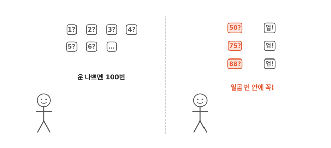
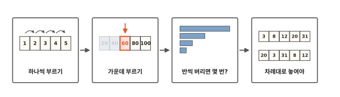
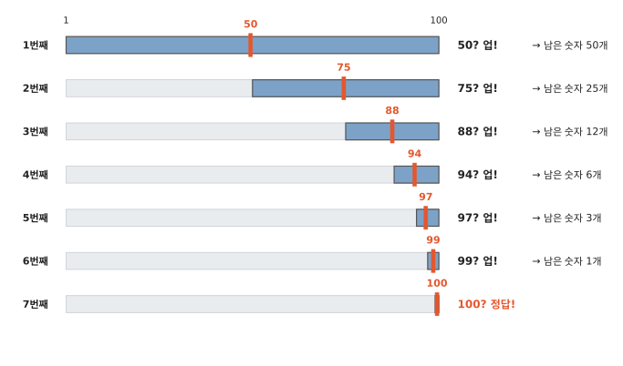
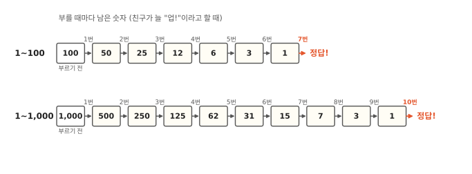
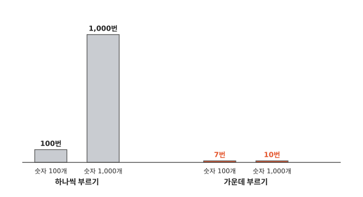
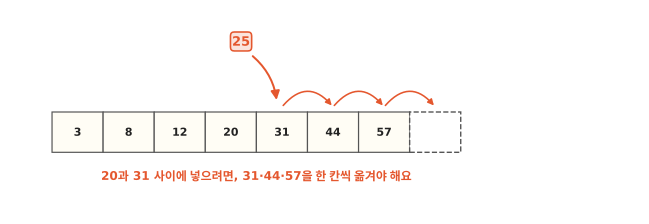

# 업다운 놀이는 왜 금방 맞힐까요?

## 1부터 100 사이 숫자 하나

친구가 1부터 100 사이 숫자를 하나 몰래 정했어요. 내가 숫자를 부르면 친구는 딱 한 마디만 해 줘요. 정한 숫자가 더 크면 "업!", 더 작으면 "다운!", 맞히면 "정답!"이에요.

그런데 어떤 친구는 아무리 운이 나빠도 일곱 번 안에 맞혀요. 어떻게 하는 걸까요?

## 하나씩 부르기에서 차례대로 놓기까지

알고리즘 세 번째 편이에요. 1, 2, 3… 차례로 부르면 운이 나쁠 때 100번을 불러야 해요. 하나씩 부르는 방법과 가운데를 부르는 방법을 비교하고, 몇 번이면 맞히는지 세어 봐요. 마지막 칸에서는 컴퓨터가 가운데를 보며 찾으려면 카드가 어떻게 놓여 있어야 하는지 알아봐요. 그렇게 놓아 두는 데 드는 일도 봐요.

## 가운데를 부르면 반씩 버려요

빨리 맞히는 친구는 처음에 50을 불러요. 1과 100의 한가운데쯤이에요.

친구가 "업!" 하면 정한 숫자는 50보다 커요. 그러면 1부터 50까지는 더 볼 필요가 없으니 버려요. 한 번 불렀을 뿐인데 숫자 절반을 버렸어요.

이제 남은 51부터 100까지의 가운데인 75를 불러요. 또 "업!"이면 51부터 75까지를 또 버려요. 늘 남은 숫자의 가운데를 부르니, 부를 때마다 남은 숫자가 반쯤으로 줄어요.

그림은 운이 제일 나쁜 때예요. 친구가 정한 숫자가 100이라서 계속 "업!"만 들어요. 남은 숫자는 50개, 25개, 12개, 6개, 3개, 1개로 줄어요. 25개의 반은 12개와 조금이에요. 부른 숫자 하나도 함께 빠지니까 12개가 남아요. 여섯 번 부르면 100 하나만 남아요. 하나만 남아도 그 숫자를 불러서 "정답!"을 들어야 끝나니까, 일곱 번째에 맞혀요.

## 몇 번이면 꼭 맞힐까요?

그림 위 줄은 앞에서 본 1부터 100까지예요. 운이 제일 나빠도 일곱 번이면 꼭 맞혀요.

숫자를 1부터 1,000까지로 늘리면 어떨까요? 그림 아래 줄처럼 남은 숫자가 500개, 250개, 125개… 로 줄어서, 아홉 번 부르면 하나가 남아요. 열 번째에 맞혀요.

하나씩 부르면 숫자가 1,000개일 때 운이 나쁘면 1,000번을 불러야 해요. 가운데를 부르면 열 번이에요. 막대 그림에서 빨간 막대는 너무 낮아서 거의 보이지도 않아요.

숫자가 두 배인 1부터 200까지는 몇 번일까요? 처음에 100을 부르면 운이 나빠도 101부터 200까지 100개가 남아요. 그다음은 1부터 100까지와 똑같아서 일곱 번이면 돼요. 모두 여덟 번이에요. 숫자가 100개에서 200개로 늘어도 부르는 횟수는 한 번 늘었을 뿐이에요.

이렇게 가운데를 보고 반씩 버리며 찾는 방법을 **이진 탐색**이라고 해요. "이진"의 "이"는 숫자 2예요. 둘로 나눈다는 뜻이에요.

## 차례대로 놓여 있어야 해요

업다운 놀이가 잘 된 데는 숨은 까닭이 있어요. 1부터 100까지 숫자는 처음부터 작은 것부터 큰 것으로 놓여 있어요. 그래서 50을 불러 "업!"을 들으면 정한 숫자가 50 위쪽에 있다는 걸 바로 알았어요.

컴퓨터도 이진 탐색을 써요. 숫자 카드가 2편의 배열처럼 한 줄로 놓여 있다고 해 봐요. 놀이에서는 친구가 "업!", "다운!"을 말해 줬지요? 컴퓨터는 친구 대신 스스로 카드를 보고 찾는 숫자보다 큰지 작은지 알아내요.

카드에서는 줄의 한가운데에 있는 카드를 봐요. 그림의 카드 15장에서는 왼쪽에서 여덟 번째가 한가운데라서, 양쪽에 일곱 장씩 있어요. 2편에서 본 것처럼 컴퓨터는 몇 번째 칸이든 바로 꺼낼 수 있어서, 한가운데 카드도 바로 꺼내요.

그림 위 줄에서 57을 찾아봐요. 여덟 번째 카드는 40이에요. 57은 40보다 크니까 40과 그 왼쪽 카드는 모두 버려요. 남은 오른쪽에서 또 한가운데 카드를 꺼내요.

그런데 이건 카드가 차례대로 놓여 있을 때만 돼요. 아래 줄처럼 뒤죽박죽이면 가운데가 40이어도 57이 왼쪽에 있는지 오른쪽에 있는지 몰라요. 반을 버릴 수가 없어요. 1편에서처럼 하나씩 다 봐야 해요.

작은 것부터 큰 것으로, 또는 가나다처럼 정해진 차례대로 늘어놓는 것을 **정렬**이라고 해요. 교실에서 키 순서로 줄을 서는 것도 정렬이에요.

2편 끝에서 번호를 모르는 이름은 어떻게 찾을지 물었지요? 가나다 차례로 정렬해 둔 이름은 번호를 몰라도 찾을 수 있어요. 한가운데 이름부터 보고, 찾는 이름이 앞쪽인지 뒤쪽인지 정하면 돼요.

## 차례를 지키려면 카드를 옮겨야 해요

정렬해 두면 찾기는 빨라요. 대신 새 숫자가 올 때 아무 데나 넣을 수 없어요. 차례에 맞는 자리에 넣어야 해요. 25를 20과 31 사이에 넣으려면, 2편에서 본 것처럼 그 뒤의 카드를 한 칸씩 옮겨야 해요.

찾기가 많은 목록이면 정렬해 둘 만해요. 넣기만 하고 찾을 일이 거의 없으면 그냥 맨 끝에 넣어요.

처음부터 뒤죽박죽인 카드를 차례대로 놓는 것도 일이에요. 손에 든 카드를 어떻게 정렬하면 좋을지는 다음 편에서 알아봐요.

## 정리

- **이진 탐색**: 정렬된 것에서 가운데를 보고 반씩 버리며 찾는 방법이에요. 숫자 1,000개도 열 번이면 찾아요.
- **정렬**: 작은 것부터 큰 것으로, 또는 가나다처럼 정해진 차례대로 늘어놓는 것이에요.

## 해 보기: 업다운 놀이 두 판

친구와 둘이서 해요.

1. 친구가 1부터 30 사이 숫자를 종이에 몰래 적어요. 100까지는 하나씩 부르기가 너무 길어서 30까지로 해요.
2. 나는 1, 2, 3… 차례로 불러요. 친구는 부를 때마다 바둑돌을 하나씩 놓아요. 맞히면 바둑돌을 세어요.
3. 친구가 숫자를 새로 적어요. 이번에는 늘 남은 숫자의 가운데쯤을 불러요. 딱 가운데가 아니어도 괜찮아요. 똑같이 바둑돌을 세어요.
4. 운에 따라 달라질 수 있으니, 2번과 3번을 두세 판씩 해서 바둑돌을 모아 봐요.
5. 어느 쪽 바둑돌이 적었나요?
6. 숫자 카드 열한 장을 섞어서 엎어 놓고 "7"을 찾아봐요. 가운데 카드를 뒤집어 보면 반을 버릴 수 있나요?
7. 이번에는 카드를 작은 수부터 차례로 엎어 놓고 다시 "7"을 찾아봐요. 가운데 카드를 보고 반을 버릴 수 있나요?

## 확인 문제

??? question "1. 다운이면"
    1부터 100 사이 숫자 맞히기에서 처음 부른 50이 "다운!"이었어요. 이제 어떤 숫자들이 남았을까요?

    **풀이**: 1부터 49까지예요. 정한 숫자가 50보다 작으니까요. 50은 이미 불러서 아닌 걸 알아요.

??? question "2. 뒤죽박죽 카드"
    카드가 뒤죽박죽으로 놓여 있으면 왜 반씩 버릴 수 없을까요?

    **풀이**: 가운데 카드를 봐도, 찾는 카드가 왼쪽에 있는지 오른쪽에 있는지 모르니까요.

??? question "3. 1부터 400까지"
    1부터 200까지는 가운데를 부르면 운이 제일 나빠도 여덟 번이면 맞혀요. 1부터 400까지는 운이 제일 나빠도 몇 번일까요?

    **풀이**: 아홉 번이에요. 처음에 200을 부르면 운이 나빠도 201부터 400까지 200개가 남아요. 그다음은 1부터 200까지와 같아서 여덟 번이면 돼요. 200개일 때보다 한 번 늘어요.

!!! abstract "어른을 위한 정리 (건너뛰어도 돼요)"
    - 이진 탐색은 정렬된 배열에서 O(log n)이에요. n이 두 배가 되면 비교가 한 번 늘어요. 정렬해 두지 않은 배열만으로는 앞에서부터 차례로 보는 O(n) 탐색이 기본이에요(해시 테이블을 따로 두면 달라져요).
    - 2편의 O(1) 인덱싱이 전제예요. 가운데 원소를 바로 꺼낼 수 없는 연결 리스트에서는 이진 탐색이 빠르지 않아요.
    - 파이썬은 `bisect` 모듈로 정렬된 리스트에서 위치를 찾아요. 찾기는 O(log n)이지만, `insort`로 넣으면 뒤 원소를 옮기는 O(n)이 더 커요.[^bisect]
    - 직접 재 보면, 정렬된 리스트 100만 개에서 맨 끝 값을 `x in xs`로 찾는 데 6밀리초쯤, `bisect`로는 0.14마이크로초쯤 걸렸어요. 개수를 두 배로 늘리면 앞쪽은 두 배로 느려졌고, `bisect`는 거의 그대로였어요.[^lab]

## 더 깊이

??? info "국어사전도 정렬되어 있어요"
    국어사전은 가나다 차례로 정렬되어 있어요. 그래서 찾는 낱말이 앞쪽인지 뒤쪽인지 짐작해서 펼 수 있어요. 이 글의 방법은 첫 글자를 따지지 않고 늘 한가운데부터 펴 봐요.

??? info "가운데가 둘이면?"
    숫자가 짝수 개면 딱 가운데가 없어요. 1부터 100까지라면 50과 51이 가운데예요. 이 글에서는 50을 불렀어요. 둘 중 아무거나 골라도 돼요. 어느 쪽을 고를지만 정해 두면 돼요.

??? info "전문가도 틀린 적이 있어요"
    원리는 간단한데 프로그램으로 정확하게 짜기는 어려워요. 아주 유명한 책에 실린 이진 탐색 코드에도 실수가 있었어요. 칸이 아주아주 많을 때만 나타나는 실수라서 20년쯤 지나서야 구글의 한 개발자가 찾아냈대요.[^bloch]

[^bisect]: Python 공식 문서, [bisect](https://docs.python.org/3/library/bisect.html). insort는 O(log n) 찾기보다 O(n) 넣기가 더 크다고 적혀 있어요.
[^lab]: [`lab/03_search.py`](https://github.com/oya150/bedrock/blob/main/lab/03_search.py)로 잰 값이에요(CPython 3.12.7, Apple Silicon 노트북). 다시 재면 숫자는 조금씩 달라져요. 같은 스크립트로 1부터 100, 200, 1,000까지 가운데를 부르면 운이 제일 나빠도 7번, 8번, 10번인 것도 확인했어요.
[^bloch]: Joshua Bloch, [Extra, Extra - Read All About It: Nearly All Binary Searches and Mergesorts are Broken](https://research.google/blog/extra-extra-read-all-about-it-nearly-all-binary-searches-and-mergesorts-are-broken/), Google Research 블로그(2006). 존 벤틀리의 책 『Programming Pearls』에 실린 이진 탐색에서 가운데를 구하는 덧셈이 넘치는 문제를 다뤄요.
