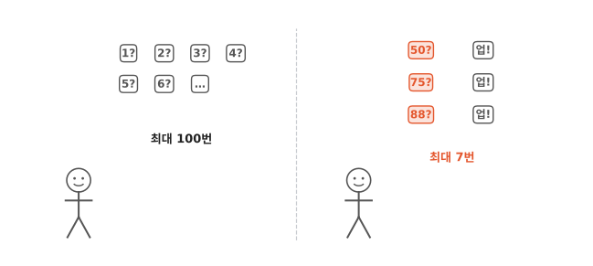
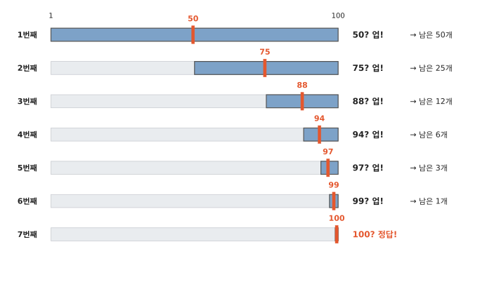
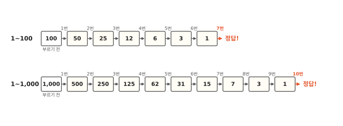
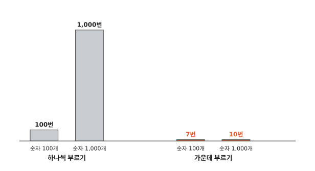
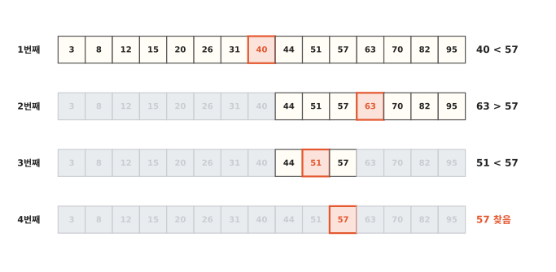
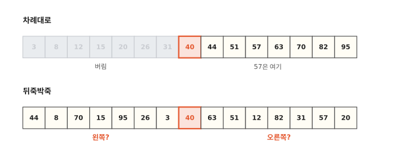
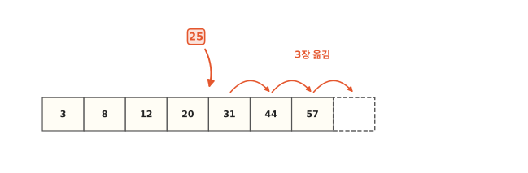

# 이진 탐색: 가운데부터 보면 빨리 찾는 까닭

친구가 1부터 100 사이 숫자를 하나 몰래 정하고 내가 맞히는 업다운 놀이가 있어요. 어떤 친구는 아무리 운이 나빠도 일곱 번 안에 맞혀요. 이 글을 읽고 나면 그 친구가 쓰는 방법이 컴퓨터가 빨리 찾는 방법과 같다는 걸 알게 돼요. 그리고 그 방법을 쓰려면 미리 무엇을 해 둬야 하는지도 알게 돼요.

!!! abstract "이 글에서 알게 되는 것"
    1. 업다운 놀이에서 늘 남은 숫자의 가운데를 부르면 한 번에 반씩 버려요. 1부터 100까지는 일곱 번, 1부터 1,000까지는 열 번이면 꼭 맞혀요.
    2. 가운데를 보고 반씩 버리며 찾는 방법을 이진 탐색이라고 해요. 찾을 것이 두 배로 늘어도 한 번만 더 보면 돼요.
    3. 이진 탐색은 카드가 차례대로 놓여 있을 때만 돼요. 차례대로 늘어놓는 일을 정렬이라고 해요. 정렬을 지키려면 새 카드를 넣을 때마다 다른 카드를 옮겨야 해요.

## 1. 하나씩 부르면 운이 나쁠 때 100번 불러요

놀이 규칙은 이래요. 내가 숫자를 부르면 친구는 한 마디만 해 줘요. 정한 숫자가 더 크면 "업!", 더 작으면 "다운!", 맞히면 "정답!"이에요.

가장 쉬운 방법은 1, 2, 3… 차례로 부르는 거예요. 친구가 정한 숫자가 3이면 금방 끝나요. 그런데 100이면 100번을 불러야 해요.

빨리 맞히는 친구는 처음에 50을 불러요. 아래 그림에서 두 아이가 부르는 숫자를 보세요.

**그림 1.** 하나씩 부르면 많게는 100번, 50부터 부르면 많게는 7번이에요.
{ .fig-cap }

오른쪽 아이는 50, 75, 88처럼 띄엄띄엄 불러요. 이렇게 부르면 왜 빨리 끝나는지 따라가 볼게요.

## 2. 가운데를 부르면 한 번에 반씩 버려요

앞에서 오른쪽 아이는 50부터 불렀어요. 50은 1과 100의 한가운데쯤이에요.

친구가 "업!" 하면 정한 숫자는 50보다 커요. 그러면 1부터 50까지는 더 볼 필요가 없어요. 한 번 불렀을 뿐인데 숫자 절반을 버렸어요.

이제 남은 51부터 100까지의 가운데인 75를 불러요. 또 "업!"이면 51부터 75까지를 버려요. 늘 남은 숫자의 가운데를 부르니까 부를 때마다 남은 숫자가 반쯤으로 줄어요.

운이 제일 나쁜 때를 볼게요. 친구가 정한 숫자가 100이라서 계속 "업!"만 들어요. 아래 그림에서 파란 띠가 줄어드는 모습을 보세요. 파란 띠는 아직 남은 숫자, 빨간 눈금은 부른 숫자예요.

**그림 2.** 남은 숫자가 50개, 25개, 12개, 6개, 3개, 1개로 줄고 일곱 번째에 맞혀요.
{ .fig-cap }

반으로 딱 나눠지지 않는 곳도 있어요. 두 번째에 75를 부르고 나면 76부터 100까지 25개가 남아요. 그 가운데인 88을 부르면 88과 그 아래 12개가 빠져서 89부터 100까지 12개가 남아요. 이렇게 여섯 번 부르면 100 하나만 남아요. 하나만 남아도 그 숫자를 불러서 "정답!"을 들어야 끝나요. 그래서 일곱 번째에 맞혀요.

숫자가 짝수 개면 딱 가운데가 없어요. 1부터 100까지는 50과 51이 가운데예요. 둘 중 무엇을 불러도 돼요. 이 글에서는 앞쪽을 불렀어요.

## 3. 숫자가 두 배가 되어도 한 번만 더 부르면 돼요

1부터 100까지는 일곱 번이었어요. 숫자를 1부터 1,000까지로 늘리면 몇 번일까요?

아래 그림의 두 줄을 비교해 보세요. 위 줄은 1부터 100까지, 아래 줄은 1부터 1,000까지예요. 친구가 늘 "업!"이라고 할 때 남은 숫자를 적었어요.

**그림 3.** 숫자가 100개면 일곱 번째, 1,000개면 열 번째에 맞혀요.
{ .fig-cap }

숫자가 열 배로 늘었는데 부르는 횟수는 세 번 늘었어요. 하나씩 부를 때와 나란히 놓으면 차이가 더 잘 보여요. 아래 막대에서 빨간 막대의 높이를 보세요.

**그림 4.** 하나씩 부르면 1,000번까지 늘지만 가운데를 부르면 10번이에요.
{ .fig-cap }

빨간 막대는 너무 낮아서 잘 보이지도 않아요. 숫자가 1,000개면 하나씩 부를 때는 운이 나쁘면 1,000번이에요. 가운데를 부르면 열 번이고요.

숫자가 꼭 두 배인 1부터 200까지는 어떨까요? 처음에 100을 부르면 운이 나빠도 101부터 200까지 100개가 남아요. 그다음은 1부터 100까지와 똑같아서 일곱 번이면 돼요. 모두 여덟 번이에요. 숫자가 두 배가 되면 부르는 횟수는 한 번 늘어요. 한 번 불러서 반을 버리고 나면 원래 크기로 돌아오기 때문이에요.

이렇게 가운데를 보고 반씩 버리며 찾는 방법을 **이진 탐색**이라고 해요. "이진"의 "이"는 숫자 2예요. 둘로 나눈다는 뜻이에요.

이진 탐색은 숫자가 두 배가 되면 한 번만 더 보면 돼요. [1편](01-why-big-o.md)의 빅오로는 이런 걸 O(log n)이라고 적고 "오 로그 엔"이라고 읽어요.

## 4. 반을 버리려면 카드가 차례대로 놓여 있어야 해요

업다운 놀이에서는 친구가 "업!", "다운!"을 말해 줬어요. 컴퓨터에게는 그런 친구가 없어요. 컴퓨터는 어떻게 이진 탐색을 할까요?

숫자 카드 15장이 작은 수부터 한 줄로 놓여 있다고 해 볼게요. 컴퓨터는 한가운데 카드를 꺼내서 찾는 숫자와 비교해요. 찾는 숫자가 더 크면 "업!"을 들은 것과 같고 더 작으면 "다운!"을 들은 것과 같아요. [2편](02-why-arrays-are-fast.md)에서 본 것처럼 컴퓨터는 몇 번째 칸이든 바로 꺼낼 수 있어서 한가운데 카드도 바로 꺼내요.

57을 찾아볼게요. 아래 그림에서 줄마다 빨간 카드가 컴퓨터가 꺼내 본 카드예요.

**그림 5.** 카드 15장에서 40, 63, 51, 57 네 장만 보고 57을 찾았어요.
{ .fig-cap }

카드 15장의 한가운데는 왼쪽에서 여덟 번째예요. 양쪽에 일곱 장씩 있어요. 처음 꺼낸 여덟 번째 카드는 40이에요. 57은 40보다 크니까 40과 그 왼쪽 카드를 모두 버려요. 남은 일곱 장의 가운데는 63이에요. 57이 더 작으니까 63과 그 오른쪽을 버려요. 남은 44, 51, 57의 가운데는 51이고 57이 더 커요. 마지막에 남은 57을 꺼내서 찾았어요.

그런데 이건 카드가 차례대로 놓여 있을 때만 돼요. 아래 그림에서 위 줄과 아래 줄의 가운데 카드는 둘 다 40이에요. 두 줄에서 57이 어디에 있는지 보세요.

**그림 6.** 차례대로 놓이면 40 왼쪽을 버리지만 뒤죽박죽이면 어느 쪽도 버릴 수 없어요.
{ .fig-cap }

차례대로 놓인 줄에서는 40보다 큰 카드가 모두 40 오른쪽에 있어요. 그래서 왼쪽을 버려도 돼요. 뒤죽박죽인 줄에서는 40보다 큰 카드가 양쪽에 흩어져 있어요. 57은 오른쪽에 있지만 40만 봐서는 그걸 알 수 없어요. 반을 버릴 수 없으니 [1편](01-why-big-o.md)에서처럼 하나씩 다 봐야 해요.

업다운 놀이가 잘 된 것도 1부터 100까지 숫자가 처음부터 작은 수부터 큰 수로 놓여 있어서예요. 이렇게 작은 것부터 큰 것으로, 또는 가나다처럼 정해진 차례대로 늘어놓는 일을 **정렬**이라고 해요. 국어사전도 가나다 차례로 정렬돼 있어요. 그래서 아무 데나 펴 보고 찾는 낱말이 앞쪽에 있는지 뒤쪽에 있는지 정할 수 있어요.

## 5. 차례를 지키려면 새 카드를 넣을 때 다른 카드를 옮겨요

정렬해 두면 찾기는 빨라요. 대신 새 카드가 오면 아무 데나 넣을 수 없어요. 차례에 맞는 자리에 넣어야 다음에도 이진 탐색을 쓸 수 있어요.

3, 8, 12, 20, 31, 44, 57이 차례대로 놓인 줄에 25를 넣어 볼게요. 25가 들어갈 자리는 20과 31 사이예요. 아래 그림에서 빨간 화살표가 몇 개인지 보세요.

**그림 7.** 25를 20과 31 사이에 넣으려면 31, 44, 57 세 장을 한 칸씩 옮겨요.
{ .fig-cap }

[2편](02-why-arrays-are-fast.md)에서 본 것처럼 한 줄로 놓인 칸 가운데에 무언가를 넣으려면 그 뒤의 칸을 하나씩 옮겨야 해요. 맨 끝에 넣으면 옮길 것이 없지만 차례가 깨져요.

그래서 찾을 일이 많은 목록이면 정렬해 둘 만해요. 넣기만 하고 찾을 일이 거의 없으면 그냥 맨 끝에 넣어요.

??? info "어른을 위한 덧붙임"
    이진 탐색은 정렬된 배열에서 O(log n)이에요. n이 두 배가 되면 비교가 한 번 늘어요. 정렬하지 않은 배열은 앞에서부터 하나씩 보는 O(n) 탐색이 기본이에요. 가운데 원소를 바로 꺼내는 O(1) 인덱싱이 전제라서 가운데까지 하나씩 따라가야 하는 연결 리스트에서는 이진 탐색이 빠르지 않아요. 파이썬은 [`bisect`](https://docs.python.org/3/library/bisect.html) 모듈로 정렬된 리스트에서 위치를 찾아요. 찾기는 O(log n)이지만 `insort`로 넣을 때는 뒤 원소를 옮기는 O(n)이 더 커요.

## 정리

업다운 놀이에서 늘 남은 숫자의 가운데를 부르면 한 번에 반씩 버려요. 그래서 1부터 100까지는 일곱 번, 1부터 1,000까지는 열 번이면 꼭 맞혀요. 이렇게 가운데를 보고 반씩 버리며 찾는 방법이 이진 탐색이에요. 숫자가 두 배가 되어도 한 번만 더 부르면 돼서 O(log n)이에요.

컴퓨터는 친구 대신 한가운데 카드를 꺼내 찾는 숫자와 비교해요. 카드 15장에서 57을 찾을 때 네 장만 봤어요. 이게 되려면 카드가 차례대로 놓여 있어야 해요. 뒤죽박죽이면 가운데를 봐도 어느 쪽을 버릴지 몰라요.

차례대로 늘어놓는 일이 정렬이에요. 정렬해 두면 찾기는 빠르지만 새 카드를 넣을 때마다 다른 카드를 옮겨야 해요.

그럼 처음부터 뒤죽박죽인 카드는 어떻게 정렬할까요? 손에 카드를 한 장씩 받아 정리하는 방법을 [4편](04-insertion-sort.md)에서 볼게요.

### 새로 나온 말

- **이진 탐색**: 차례대로 놓인 것에서 가운데를 보고 반씩 버리며 찾는 방법. 1부터 1,000까지 숫자도 열 번이면 맞혀요.
- **O(log n)**: 양이 두 배가 될 때 일이 한 번만 느는 것을 빅오로 적은 꼴. 이진 탐색이 O(log n)이에요.
- **정렬**: 작은 것부터 큰 것으로, 또는 가나다처럼 정해진 차례대로 늘어놓는 일. 업다운 놀이의 1부터 100까지 숫자가 처음부터 정렬돼 있었어요.
