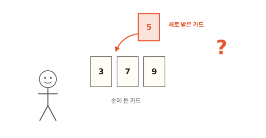
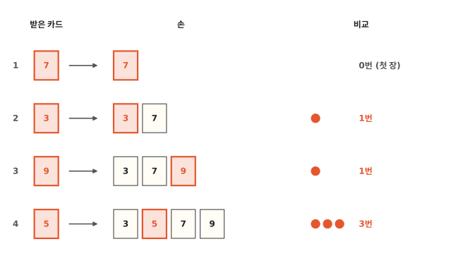
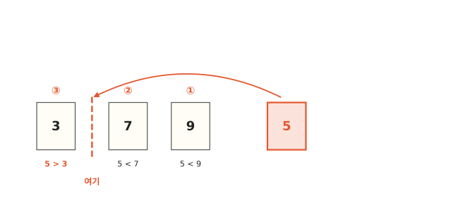
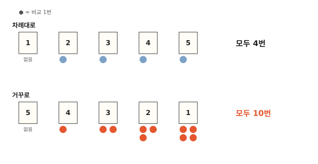
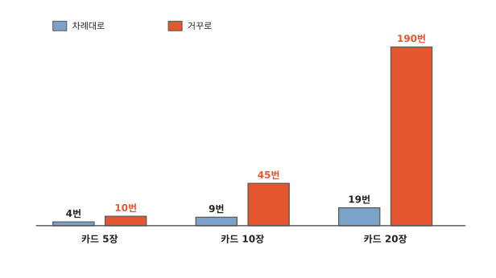
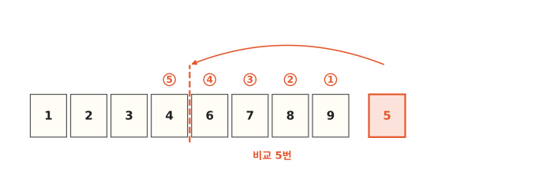

# 삽입 정렬: 손에 든 카드를 한 장씩 끼워 정리하기

카드 놀이를 할 때 카드를 한 장 받으면 손에 든 카드 사이 알맞은 자리에 끼워요. 다 받고 나면 손 안의 카드는 작은 수부터 차례대로 놓여 있어요. 이 글을 읽고 나면 컴퓨터도 같은 방법으로 정렬한다는 걸 알게 돼요. 카드가 들어오는 순서에 따라 일이 얼마나 달라지는지도 셀 수 있어요. 그러면 이 방법을 언제 써도 되고 언제 피해야 하는지 고를 수 있어요.

!!! abstract "이 글에서 알게 되는 것"
    1. 카드를 한 장 받을 때마다 손에 든 카드의 오른쪽 끝부터 비교하며 자리를 찾아 끼우면 손 안 카드는 늘 차례대로예요. 이 방법을 삽입 정렬이라고 해요.
    2. 같은 다섯 장이어도 차례대로 받으면 4번, 거꾸로 받으면 10번 비교해요. 거꾸로 받는 카드가 20장이면 190번으로 훨씬 빨리 늘어요.
    3. 카드가 적거나 거의 차례대로일 때는 금방 끝나요. 그래서 컴퓨터가 많이 쓰는 정렬 방법도 카드가 적을 때는 이 방법을 써요.

## 1. 컴퓨터는 카드를 두 장씩만 비교할 수 있어요

[3편](03-why-sorted-is-fast.md)에서 카드가 차례대로 놓여 있어야 빨리 찾을 수 있다고 했어요. 차례대로 늘어놓는 일을 정렬이라고 했고요. 이제 뒤죽박죽인 카드를 정렬해 볼게요.

아래 그림에서 아이가 들고 있는 카드와 새로 받은 카드를 보세요.

**그림 1.** 손에 3, 7, 9가 있고 5를 새로 받았어요.
{ .fig-cap }

사람은 손을 한눈에 보고 "3과 7 사이네" 하고 끼워요. 컴퓨터는 그렇게 못 해요. 한 번에 두 카드를 놓고 어느 쪽이 큰지 보는 일만 할 수 있어요. 그래서 5의 자리를 찾으려면 손에 든 카드와 하나씩 비교해야 해요.

이 글에서는 두 카드를 한 번 비교할 때마다 바둑돌을 하나씩 놓을게요. 바둑돌이 많을수록 컴퓨터가 일을 많이 한 거예요.

## 2. 받을 때마다 손 안의 알맞은 자리에 끼워요

카드를 7, 3, 9, 5 차례로 받는다고 해 볼게요. 아래 그림에서 줄마다 빨간 카드가 새로 받은 카드이고 오른쪽 바둑돌이 비교한 횟수예요.

**그림 2.** 7, 3, 9, 5를 받으며 끼우면 비교는 0번, 1번, 1번, 3번이에요.
{ .fig-cap }

첫 장 7은 손이 비어 있으니 그냥 쥐어요. 비교할 카드가 없어요.

둘째 장 3은 손에 있는 7과 비교해요. 3이 더 작으니 7 왼쪽에 끼워요. 비교 1번이에요.

셋째 장 9는 맨 오른쪽 카드 7과 비교해요. 9가 더 크니 7 오른쪽에 두면 끝이에요. 3과는 비교하지 않아도 돼요. 손의 카드는 이미 차례대로라서 3은 7보다 작아요. 7보다 큰 9는 3보다도 커요.

넷째 장 5는 세 번 비교해요. 네 장을 다 받으니 손에는 3, 5, 7, 9가 차례대로 놓였어요. 바둑돌은 모두 다섯 개예요.

## 3. 끼울 자리는 오른쪽 끝부터 비교하며 찾아요

앞 그림의 넷째 줄에서 5는 왜 세 번 비교했을까요? 그 장면만 크게 볼게요. 아래 그림에서 카드 위 동그라미 번호가 비교한 차례예요.

**그림 3.** 5는 9, 7, 3과 차례로 비교하고 3을 만나 멈춰서 3과 7 사이에 들어가요.
{ .fig-cap }

5는 오른쪽 끝 9부터 비교해요. 5가 더 작으니 한 칸 더 왼쪽으로 가요. 다음은 7이에요. 5가 또 더 작으니 더 왼쪽으로 가요. 다음은 3이에요. 이번엔 5가 더 커요. 여기서 멈추고 3과 7 사이에 끼워요.

규칙은 하나예요. 오른쪽 끝부터 비교하다가 새 카드보다 작은 카드를 만나면 멈추고 그 오른쪽에 끼워요. 끝까지 작은 카드를 못 만나면 맨 왼쪽에 끼워요.

이렇게 한 장씩 꺼내서 이미 정렬된 카드 사이 알맞은 자리에 끼워 넣으며 정렬하는 방법을 **삽입 정렬**이라고 해요. "삽입"은 끼워 넣는다는 뜻이에요.

## 4. 받는 순서가 바뀌면 비교 횟수가 달라져요

카드 7, 3, 9, 5에서는 비교가 5번이었어요. 받는 순서가 달라지면 어떨까요? 이번엔 1부터 5까지 카드 다섯 장을 두 가지 순서로 받아 볼게요. 아래 그림에서 두 줄의 바둑돌 수를 비교해 보세요.

**그림 4.** 같은 다섯 장이어도 차례대로 받으면 4번, 거꾸로 받으면 10번 비교해요.
{ .fig-cap }

1, 2, 3, 4, 5처럼 차례대로 받으면 새 카드는 늘 손에 있는 카드보다 커요. 맨 오른쪽 카드와 한 번만 비교하고 그 오른쪽에 두면 끝이에요. 첫 장은 비교하지 않으니까 네 장이 한 번씩, 모두 4번이에요.

5, 4, 3, 2, 1처럼 거꾸로 받으면 새 카드가 늘 제일 작아요. 손에 있는 카드를 한 장씩 다 지나서 맨 왼쪽까지 가야 해요. 4는 1번, 3은 2번, 2는 3번, 1은 4번 비교해요. 바둑돌을 모두 세면 1 + 2 + 3 + 4 = 10개예요.

## 5. 카드가 많아지면 거꾸로 받을 때 비교가 훨씬 빨리 늘어요

다섯 장에서는 4번과 10번이었어요. 차이가 크지 않아 보이죠. 카드를 늘려 볼게요.

차례대로 받으면 카드가 한 장 늘 때 비교도 한 번 늘어요. 10장은 9번, 20장은 19번이에요.

거꾸로 받으면 새 카드가 손에 있는 카드를 다 지나가요. 손에 든 카드가 많을수록 지나갈 카드도 많아요. 10장이면 1 + 2 + … + 9 = 45번, 20장이면 1 + 2 + … + 19 = 190번이에요. 아래 막대에서 빨간 막대가 자라는 속도를 보세요.

**그림 5.** 카드가 10장에서 20장으로 두 배가 되면 파란 막대는 두 배쯤, 빨간 막대는 네 배쯤 길어져요.
{ .fig-cap }

카드가 두 배가 되면 새 카드도 두 배, 새 카드마다 지나갈 카드도 두 배가 돼요. 그래서 거꾸로 받을 때 비교는 네 배쯤으로 늘어요. [1편](01-why-big-o.md)에서 양말을 하나 집고 다 뒤질 때의 O(n²)과 같은 모양이에요. 카드가 많고 거꾸로 오면 삽입 정렬은 오래 걸려요.

## 6. 거의 차례대로면 금방 끝나요

그럼 삽입 정렬은 느린 방법일까요? 꼭 그렇지는 않아요. 4절에서 차례대로 받은 카드는 한 장에 한 번씩만 비교했어요. 카드가 거의 차례대로일 때도 비슷해요.

1, 2, 3, 4, 6, 7, 8, 9가 차례대로 있고 5가 맨 끝에 왔어요. 아래 그림에서 5가 몇 장과 비교하는지 세어 보세요.

**그림 6.** 5는 9, 8, 7, 6, 4와 비교하고 4와 6 사이에 들어가요. 1, 2, 3은 보지 않아요.
{ .fig-cap }

5는 9, 8, 7, 6과 비교하고 4를 만나 멈춰요. 1, 2, 3은 보지 않아도 돼요. [3편](03-why-sorted-is-fast.md)에서 차례대로 놓인 카드 20과 31 사이에 25를 넣은 것도 이런 경우였어요.

카드가 몇 장 안 될 때도 금방 끝나요. 방법이 간단해서 준비할 것이 없거든요. 그래서 컴퓨터에서 많이 쓰는 정렬 방법도 카드가 적을 때는 한 장씩 끼워 넣어요.[^listsort]

??? info "컴퓨터는 카드를 어떻게 옮길까요"
    컴퓨터에서는 카드가 처음부터 한 줄로 놓여 있어요. 앞에서부터 한 장씩 정렬된 쪽으로 가져와 끼워요. 5를 3과 7 사이에 끼우려면 7과 9를 한 칸씩 오른쪽으로 옮겨서 빈자리를 만들어요. [2편](02-why-arrays-are-fast.md)에서 한 줄로 놓인 칸 가운데에 넣을 때 뒤 칸을 하나씩 옮긴 것과 같은 일이에요. 옮기는 횟수도 비교 횟수와 거의 같이 늘어요.

    손에 든 카드는 이미 차례대로라서 3편의 이진 탐색으로 끼울 자리를 찾을 수도 있어요. 그러면 비교는 줄어요. 하지만 자리를 만들려고 카드를 옮기는 일은 그대로예요.

??? info "어른을 위한 덧붙임"
    삽입 정렬은 역순일 때 비교가 n(n−1)/2번인 O(n²), 이미 정렬돼 있으면 n−1번인 O(n)이에요. 비교 횟수는 n에 순서가 뒤집힌 쌍(inversion)의 수를 더한 만큼을 넘지 않아요. 추가 메모리 없이 제자리에서 정렬하고 같은 값끼리의 순서를 지켜요(안정 정렬). 파이썬 `sorted()`와 `list.sort()`가 쓰는 Timsort는 원소가 64개보다 적으면 이진 삽입 정렬로 정리해요. 긴 배열에서도 짧은 구간(run)을 이진 삽입 정렬로 늘린 뒤 병합해요.[^listsort]

## 정리

카드를 한 장 받을 때마다 손에 든 카드의 오른쪽 끝부터 비교해요. 새 카드보다 작은 카드를 만나면 그 오른쪽에 끼워요. 이렇게 하면 손 안의 카드는 늘 차례대로이고 다 받으면 정렬이 끝나요. 이 방법이 삽입 정렬이에요.

일의 양은 비교 횟수로 셌어요. 다섯 장을 차례대로 받으면 4번, 거꾸로 받으면 10번이에요. 거꾸로 받는 카드가 20장이면 190번으로 늘어요. 카드가 두 배가 되면 거꾸로 받을 때 비교는 네 배쯤이 돼요.

반대로 카드가 적거나 거의 차례대로면 금방 끝나요. 그래서 많이 쓰는 정렬 방법도 작은 묶음은 삽입 정렬로 처리해요.

카드가 아주 많고 뒤죽박죽이면 어떻게 할까요? 반씩 나눠서 따로 정렬한 다음 합치는 방법을 [5편](05-merge-sort.md)에서 볼게요.

### 새로 나온 말

- **삽입 정렬**: 한 장씩 꺼내서 이미 정렬된 카드 사이 알맞은 자리에 끼워 넣으며 정렬하는 방법. 손에 3, 7, 9가 있을 때 5를 받으면 9, 7, 3과 비교하고 3과 7 사이에 끼워요.
- **비교**: 두 카드를 놓고 어느 쪽이 큰지 보는 일. 컴퓨터가 정렬할 때 하는 일의 양을 이 횟수로 세요.

[^listsort]: CPython 소스의 [`Objects/listsort.txt`](https://github.com/python/cpython/blob/3.12/Objects/listsort.txt)(3.12). 원소가 64개보다 적으면 이진 삽입 정렬을 쓰고 짧은 구간을 이진 삽입 정렬로 늘린다고 적혀 있어요.
