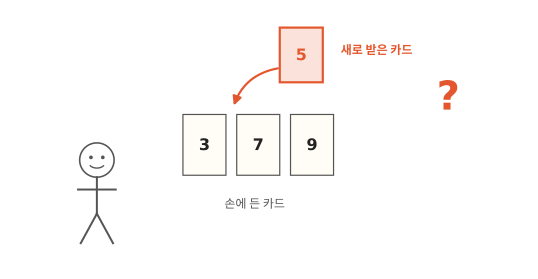
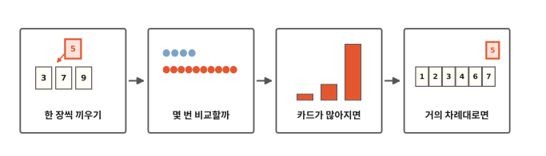
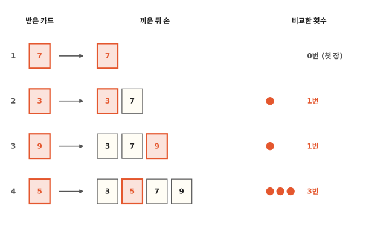
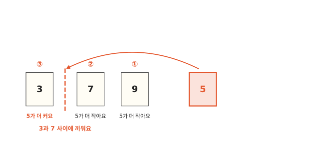
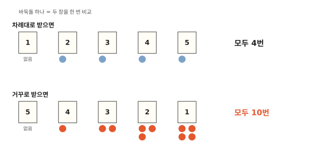
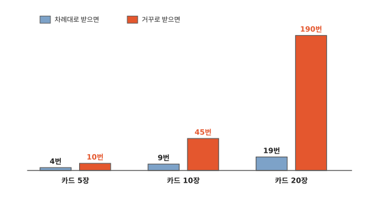
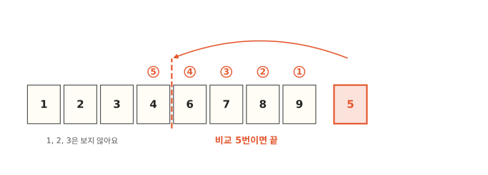

# 손에 든 카드는 어떻게 정리할까요?

## 카드를 한 장씩 받아요

카드 놀이를 시작해요. 카드를 한 장씩 받아요. 받을 때마다 작은 숫자는 왼쪽, 큰 숫자는 오른쪽에 오게 손에 끼워요. 지금 손에는 3, 7, 9가 있고 방금 5를 받았어요. 5는 3과 7 사이에 끼우면 돼요.

다 받고 나면 손 안의 카드가 작은 수부터 차례대로 놓여 있어요. 3편에서 차례대로 놓는 것을 정렬이라고 했지요? 사람은 이렇게 쉽게 정렬해요. 컴퓨터는 어떻게 할까요? 두 카드 가운데 어느 쪽이 큰지 보는 일을 몇 번이나 해야 할까요?

## 한 장씩 끼우기에서 거의 차례대로까지

알고리즘 네 번째 편이에요. 먼저 카드를 한 장씩 끼우는 방법을 컴퓨터처럼 따라가 봐요. 그다음 카드가 들어오는 순서에 따라 몇 번 비교하는지 세어 보고, 카드가 많아지면 어떻게 되는지 봐요. 마지막 칸에서는 이 방법이 언제 빠른지 봐요.

## 한 장씩 끼워요

카드를 7, 3, 9, 5 차례로 받는다고 해 봐요.

첫 장 7은 손이 비어 있으니 그냥 쥐어요. 비교할 카드가 없어요.

둘째 장 3은 손에 있는 7과 비교해요. 3이 더 작으니 7 왼쪽에 끼워요. 비교 1번이에요.

셋째 장 9는 맨 오른쪽 카드 7과 비교해요. 9가 더 크니 7 오른쪽에 두면 끝이에요. 3과는 비교하지 않아도 돼요. 손의 카드는 작은 수부터 줄 서 있어요. 3은 7보다 작고 7은 9보다 작으니, 3은 9보다도 작아요. 비교 1번이에요.

넷째 장 5는 맨 처음 그림에서 본 장면이에요. 이번에는 세 번 비교해요. 아래 그림으로 자세히 봐요.

5는 오른쪽 끝 9부터 비교해요. 5가 더 작으니 더 왼쪽으로 가요. 다음은 7이에요. 5가 또 더 작으니 더 왼쪽으로 가요. 다음은 3이에요. 이번엔 5가 더 커요. 그러면 멈추고 3과 7 사이에 끼워요.

이렇게 한 장씩 꺼내서, 이미 정렬된 카드 사이 알맞은 자리에 끼워 넣으며 정렬하는 방법을 **삽입 정렬**이라고 해요. "삽입"은 끼워 넣는다는 뜻이에요. 카드가 많아지면 어떻게 되는지는 아래에서 봐요.

사람은 손에 든 카드를 한눈에 보고 "7 앞이네" 하고 바로 끼워요. 컴퓨터는 한 번에 두 장씩만 볼 수 있어요. 그래서 이 글에서는 두 장을 한 번 볼 때마다 바둑돌을 하나씩 놓고, 바둑돌 수를 세어요.

## 몇 번 비교할까요?

이번엔 1부터 5까지 카드 다섯 장을 받아요. 받는 순서만 바꿔 볼게요.

1, 2, 3, 4, 5처럼 차례대로 받으면 새 카드는 늘 손에 있는 카드보다 커요. 맨 오른쪽 카드와 한 번만 비교하고 바로 오른쪽에 두면 끝이에요. 첫 장은 비교하지 않으니까 1번씩 네 장, 모두 4번이에요.

5, 4, 3, 2, 1처럼 거꾸로 받으면 어떨까요? 4는 5보다 작아요. 3은 5와 4보다 작아요. 새 카드가 늘 제일 작아서, 손에 있는 카드를 한 장씩 다 지나 맨 왼쪽까지 가요. 4는 1번, 3은 2번, 2는 3번, 1은 4번 비교해요. 그림처럼 비교할 때마다 바둑돌을 하나씩 놓으면 1개, 2개, 3개, 4개가 쌓여요. 바둑돌을 모두 세면 10개, 비교는 10번이에요.

같은 다섯 장이어도 4번이 나오고 10번이 나와요. 카드가 더 많아지면 이 차이는 얼마나 벌어질까요?

## 카드가 많아지면

거꾸로 받을 때 카드가 10장이면 1+2+3+4+5+6+7+8+9를 더해서 45번 비교해요. 20장이면 190번이에요.

차례대로 받으면 10장은 9번, 20장은 19번이에요. 카드가 한 장 늘면 비교도 한 번 늘어요.

그림에서 빨간 막대는 카드가 늘수록 파란 막대보다 훨씬 빨리 길어져요. 1편에서 양말 하나를 집고 바구니를 다 뒤지는 방법도 양말이 늘수록 일이 훨씬 빨리 늘었지요? 카드가 많고 거꾸로 오면 삽입 정렬은 오래 걸려요.

## 거의 차례대로면 금방이에요

그럼 삽입 정렬은 느린 방법일까요? 꼭 그렇지는 않아요.

1편에서 양말이 2개뿐일 때는 "하나 집고 다 뒤지기"가 먼저 끝났지요? 삽입 정렬도 카드가 몇 장 안 되면 방법이 간단해서 금방 끝나요.

그리고 카드가 거의 차례대로 있을 때도 금방 끝나요. 그림처럼 1, 2, 3, 4, 6, 7, 8, 9가 차례대로 있고 5가 맨 끝에 왔어요. 5는 9, 8, 7, 6, 4와 비교하고 4와 6 사이에 끼워요. 1, 2, 3은 보지 않아도 돼요. 3편에서 차례대로 놓인 카드 20과 31 사이에 25를 넣은 것도 이런 경우였어요.

컴퓨터에서 많이 쓰는 정렬 방법도 카드가 적을 때는 이렇게 한 장씩 끼워 넣어요.[^listsort]

카드가 아주 많고 뒤죽박죽이면 어떻게 할까요? 친구와 반씩 나눠서 정리한 다음 합치면 더 빠를까요? 다음 편에서 알아봐요.

## 정리

- **삽입 정렬**: 한 장씩 꺼내서, 이미 정렬된 카드 사이 알맞은 자리에 끼워 넣으며 정렬하는 방법이에요. 거의 차례대로인 카드는 금방, 거꾸로인 카드는 오래 걸려요.

## 해 보기: 카드 받아 정리하기

친구와 둘이서 해요. 1부터 8까지 숫자 카드와 바둑돌을 준비해요.

1. 친구가 카드를 1, 2, 3… 차례대로 한 장씩 건네줘요.
2. 나는 받을 때마다 손에 든 카드의 오른쪽 끝부터 한 장씩 비교하며 자리를 찾아요. 친구는 내가 두 장을 비교할 때마다 바둑돌을 하나 놓아요.
3. 다 받으면 바둑돌을 세어요.
4. 이번엔 8, 7, 6… 거꾸로 받아서 똑같이 해요.
5. 마지막으로 카드를 섞어서 받아 봐요.
6. 어느 때 바둑돌이 제일 많았나요? 차례대로는 7개, 거꾸로는 28개가 나오면 잘 센 거예요. 섞어서 받으면 그 사이 어딘가가 나와요.

## 확인 문제

??? question "1. 6은 어디에"
    손에 2, 4, 8이 있고 6을 받았어요. 오른쪽 끝부터 비교하면 몇 번 비교하고, 어디에 끼울까요?

    **풀이**: 2번 비교해요. 먼저 8과 비교하면 6이 더 작아요. 다음 4와 비교하면 6이 더 커요. 그래서 4와 8 사이에 끼워요.

??? question "2. 네 장을 거꾸로"
    카드 네 장을 4, 3, 2, 1처럼 거꾸로 받으면 모두 몇 번 비교할까요?

    **풀이**: 6번이에요. 3은 1번, 2는 2번, 1은 3번 비교해요. 1, 2, 3을 더하면 6이에요.

??? question "3. 맨 끝 카드보다 크면"
    차례대로 정렬된 카드 10장을 들고 있는데 한 장을 더 받았어요. 손에 있는 맨 오른쪽 카드보다 커요. 몇 번 비교할까요?

    **풀이**: 1번이에요. 맨 오른쪽 카드와 비교해서 더 크면 바로 그 오른쪽에 두면 돼요.

!!! abstract "어른을 위한 정리 (건너뛰어도 돼요)"
    - 삽입 정렬은 역순일 때 비교가 n(n−1)/2번인 O(n²), 이미 정렬돼 있으면 n−1번인 O(n)이에요. 비교 횟수는 n에 순서가 뒤집힌 쌍(inversion)의 수를 더한 만큼을 넘지 않아요. 추가 메모리 없이 제자리에서 정렬하고, 같은 값끼리의 순서를 지켜요(안정 정렬).
    - 파이썬 `sorted()`와 `list.sort()`가 쓰는 Timsort는 원소가 64개보다 적으면 맨 앞의 이미 정렬된 구간 뒤부터 전부 이진 삽입 정렬로 정리해요. 긴 배열에서는 이미 정렬된 짧은 구간(run)을 찾아, 짧은 구간을 32~64개 길이까지 이진 삽입 정렬로 늘린 뒤 병합해요. CPython에서는 비교가 데이터를 옮기는 것보다 훨씬 비싸서, 비교를 줄이는 이진 삽입이 이득이라고 설명해요.[^listsort]
    - 직접 재 보면, 순수 파이썬으로 짠 삽입 정렬로 1,000개를 정렬하는 데 이미 정렬된 리스트는 0.06밀리초, 무작위는 13밀리초쯤, 역순은 27밀리초쯤 걸렸어요. 2,000개로 늘리면 역순은 104밀리초로 네 배쯤 느려졌어요. 정렬된 리스트 끝에 가장 작은 값 하나가 온 경우는 1,000개에서 0.12밀리초였어요. 같은 무작위 1,000개를 `sorted()`로 정렬하면 0.05밀리초쯤이에요.[^lab]

## 더 깊이

??? info "책꽂이에 새 책 꽂기"
    가나다 차례로 꽂힌 책꽂이에 새 책을 한 권 꽂을 때도, 자리를 찾아 끼우고 옆 책을 조금씩 밀어요. 삽입 정렬의 한 걸음과 같아요.

??? info "컴퓨터는 카드를 어떻게 옮길까?"
    컴퓨터에서는 카드가 처음부터 한 줄로 놓여 있어요. 앞에서부터 한 장씩 정렬된 쪽으로 가져와 끼워요. 5를 3과 7 사이에 끼우려면, 7과 9를 한 칸씩 오른쪽으로 옮겨서 빈자리를 만들어요. 2편에서 사물함 줄 가운데에 넣을 때 뒤 칸을 하나씩 옮긴 것과 같은 일이에요. 옮기는 횟수도 비교한 횟수와 거의 같이 늘어나요.

??? info "끼울 자리를 반씩 버리며 찾으면?"
    손에 든 카드는 이미 차례대로라서, 3편의 이진 탐색으로 끼울 자리를 찾을 수 있어요. 그러면 비교는 줄어요. 그래도 자리를 만들려고 뒤 카드를 옮기는 일은 그대로예요.

??? info "몇 번 비교할지 미리 알 수 있을까?"
    카드마다 "나보다 먼저 받았는데 나보다 큰 카드"가 몇 장인지 세어서 모두 더해 봐요. 비교 횟수는 그 수보다 조금 더 많아요. 카드마다 "여기에 끼워도 되나?" 보는 비교가 한 번씩 더 있거든요. 차례대로 받으면 그 수는 0인데도 비교는 4번이에요. 거꾸로 받으면 그 수와 비교 횟수가 같아지고, 제일 많아요.

[^listsort]: CPython 소스의 [`Objects/listsort.txt`](https://github.com/python/cpython/blob/3.12/Objects/listsort.txt)(3.12). 원소가 64개보다 적으면 이진 삽입 정렬을 쓰고, 짧은 구간을 이진 삽입 정렬로 늘린다고 적혀 있어요.
[^lab]: [`lab/04_insertion.py`](https://github.com/oya150/bedrock/blob/main/lab/04_insertion.py)로 잰 값이에요(CPython 3.12.7, Apple Silicon 노트북). 다시 재면 숫자는 조금씩 달라져요. 같은 스크립트로 카드 5장, 10장, 20장을 거꾸로 받으면 10번, 45번, 190번 비교하는 것도 확인했어요.
