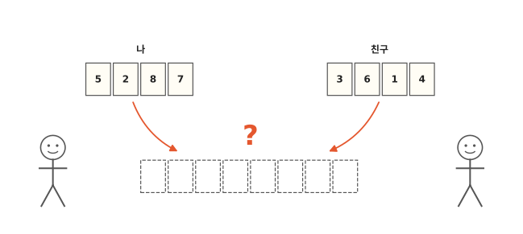
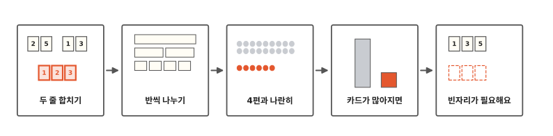
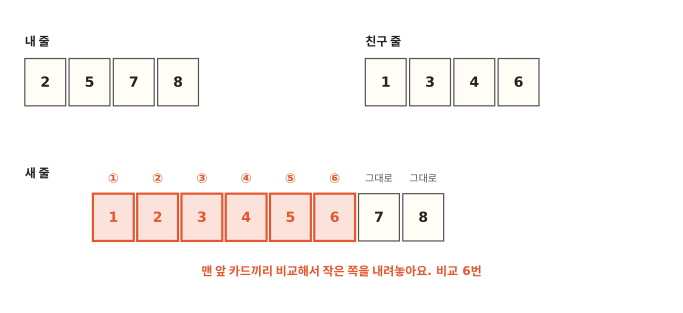
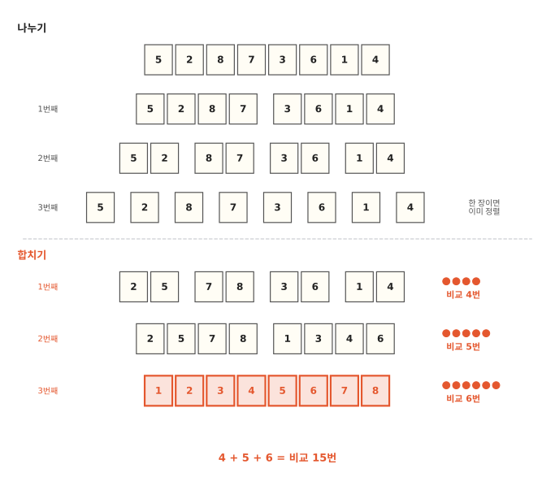
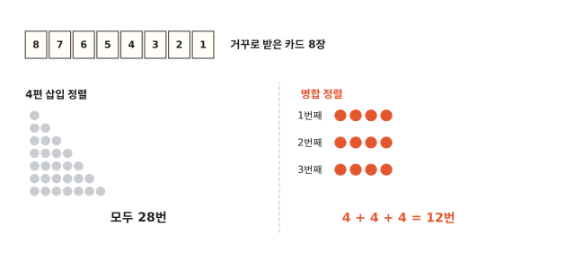
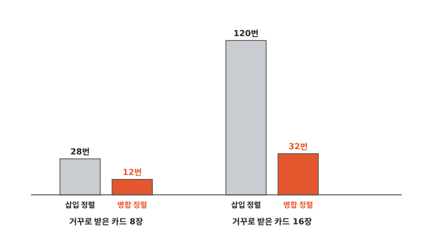
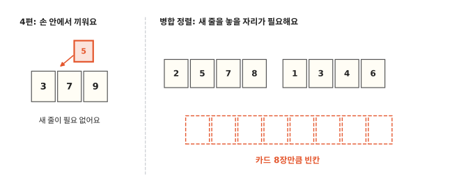

# 카드를 반씩 나눠 정리하면 왜 빠를까요?

## 친구와 넷씩 나눠요

4편에서 카드를 한 장씩 받아 손에 끼웠지요? 카드를 거꾸로 받으면 비교를 아주 많이 해야 했어요.

이번엔 카드 여덟 장 5, 2, 8, 7, 3, 6, 1, 4를 친구와 넷씩 나눠요. 나는 5, 2, 8, 7을, 친구는 3, 6, 1, 4를 작은 수부터 정리해요. 넷씩은 어떻게 정리하는지 조금 뒤에 볼게요. 둘 다 정리한 다음 한 줄로 합치면 어떨까요?

## 두 줄 합치기에서 빈자리까지

알고리즘 다섯 번째 편이에요. 먼저 정리된 두 줄을 한 줄로 합쳐 봐요. 그다음 카드를 한 장이 될 때까지 반씩 나눠요. 4편처럼 바둑돌로 비교를 세어서 4편 방법과 나란히 놓아 봐요. 카드가 많아지면 어떻게 되는지도 봐요. 마지막 칸에서는 이 방법에 무엇이 더 필요한지 봐요.

## 정렬된 두 줄은 맨 앞만 보면 돼요

나는 5, 2, 8, 7을 정리해서 2, 5, 7, 8이 됐어요. 친구는 1, 3, 4, 6이 됐어요. 두 줄 다 작은 수부터 놓여 있어서 줄에서 제일 작은 카드는 늘 맨 앞에 있어요. 그러니 두 줄의 맨 앞 카드끼리만 비교하면 돼요.

1. 2와 1을 비교해요. 1이 작으니 1을 새 줄에 놓아요.
2. 2와 3을 비교해요. 2를 놓아요.
3. 5와 3을 비교해요. 3을 놓아요.
4. 5와 4를 비교해요. 4를 놓아요.
5. 5와 6을 비교해요. 5를 놓아요.
6. 7과 6을 비교해요. 6을 놓아요.

이제 친구 줄이 비었어요. 내 줄에 남은 7과 8은 이미 작은 수부터 있으니 비교하지 않고 그대로 붙여요. 4편처럼 비교할 때마다 바둑돌을 하나씩 놓았다면 바둑돌은 6개예요.

## 한 장이 될 때까지 반씩 나눠요

이제 나는 네 장을 어떻게 정리했는지 볼게요. 네 장도 또 반으로 나누면 돼요. 5, 2와 8, 7로요. 두 장도 또 반으로 나누면 한 장씩이 돼요.

카드가 한 장뿐이면 비교할 카드가 없으니 이미 정렬된 거예요. 이제 한 장씩 된 카드를 다시 합쳐요. 합치는 방법은 앞에서 본 것과 똑같아요. 그림 아래쪽처럼 합치기를 세 번 해요.

- 1번째 합치기: 한 장끼리 합쳐서 두 장짜리 줄 넷을 만들어요. 한 쌍에 한 번씩, 네 쌍이라 바둑돌 4개.
- 2번째 합치기: 두 장짜리 줄끼리 합쳐서 네 장짜리 줄 둘을 만들어요. 2, 5와 7, 8을 합칠 때 2개, 3, 6과 1, 4를 합칠 때 3개라서 바둑돌 5개.
- 3번째 합치기: 네 장짜리 줄끼리 합쳐서 여덟 장 한 줄을 만들어요. 앞에서 본 바둑돌 6개.

바둑돌을 모두 세면 4 + 5 + 6 = 15개, 비교는 15번이에요.

카드를 반씩 나눠서 따로 정렬해요. 그다음 맨 앞 카드끼리 비교하며 합쳐요. 이렇게 정렬하는 방법을 **병합 정렬**이라고 해요. "병합"은 합친다는 뜻이에요.

친구가 있어야만 할 수 있는 건 아니에요. 컴퓨터에는 친구가 없어요. 혼자서 왼쪽 반을 먼저 정리해요. 그다음 오른쪽 반을 정리하고 둘을 합쳐요. 비교 수는 친구와 나눠 할 때와 똑같아요.

여덟 장은 반씩 세 번 나누면 한 장이 돼요. 8장에서 4장, 4장에서 2장, 2장에서 1장이에요. 3편 업다운 놀이에서 남은 숫자가 반씩 줄던 것과 같은 모양이에요. 그래서 합치기도 세 번이에요.

## 4편과 나란히 세어 봐요

카드 8장으로 두 방법을 나란히 세어 보면 이래요.

| 받은 카드 | 4편처럼 한 장씩 끼우기 | 병합 정렬 |
|---|---|---|
| 5, 2, 8, 7, 3, 6, 1, 4 | 22번 | 15번 |
| 8, 7, 6, 5, 4, 3, 2, 1 (거꾸로) | 28번 | 12번 |

두 줄 모두 병합 정렬 쪽이 적어요.

거꾸로 받은 카드를 그림으로 봐요. 4편처럼 한 장씩 끼우면 바둑돌이 1개, 2개, 3개… 7개씩 쌓여서 모두 28개예요. 병합 정렬은 합칠 때마다 4개씩이에요. 세 번 합치니까 4 + 4 + 4 = 12개예요.

## 카드가 많아지면

카드 16장을 거꾸로 받으면 어떨까요? 4편처럼 한 장씩 끼우면 120번 비교해요.

병합 정렬은 16장에서 8장, 4장, 2장, 1장으로 반씩 네 번 나누면 한 장이 돼요. 그래서 합치기를 네 번 해요. 거꾸로 받은 카드는 합칠 때마다 한쪽 줄이 통째로 먼저 놓이고, 다른 줄은 비교 없이 붙어요. 그래서 한 번 합칠 때마다 카드 16장의 반인 8번씩만 비교해요. 8 + 8 + 8 + 8 = 32번이에요.

카드가 8장에서 16장이 되면 삽입 정렬은 28번에서 120번이 돼요. 병합 정렬은 12번에서 32번이 돼요. 합치기는 한 번만 더 하면 되거든요.

## 합칠 때는 빈자리가 필요해요

그런데 병합 정렬에도 불편한 점이 있어요. 4편에서는 손에 든 카드 사이에 끼우면 됐어요. 병합 정렬은 두 줄을 합칠 때 새 줄을 놓을 빈자리가 있어야 해요. 컴퓨터도 합치는 동안 카드 수만큼 빈 칸을 더 써요.

카드가 아주 적으면 나누고 합치는 일이 오히려 더 많아요. 1편에서 양말이 2개뿐일 때 "하나 집고 다 뒤지기"가 먼저 끝났던 것과 같아요. 그래서 컴퓨터에서 많이 쓰는 정렬 방법은 두 가지를 섞어요. 짧은 줄은 한 장씩 끼워서 정리해요. 그 줄들은 병합 정렬처럼 합쳐요.[^listsort]

빈자리 없이, 카드가 놓인 그 자리에서 반씩 나눠 정리하는 방법도 있어요. 다음 편에서는 그 방법을 볼게요.

## 정리

- **병합 정렬**: 카드를 반씩 나눠 따로 정렬해요. 그다음 두 줄의 맨 앞 카드끼리 비교하며 한 줄로 합쳐요. 카드가 많아져도 비교가 천천히 늘어요. 합칠 때는 빈자리가 필요해요.

## 해 보기: 두 줄 합치기

친구와 둘이서 해요. 1부터 8까지 숫자 카드와 바둑돌을 준비해요.

1. 카드를 섞어서 넷씩 나눠 가져요.
2. 각자 자기 카드를 작은 수부터 늘어놓아요.
3. 두 줄의 맨 앞 카드끼리 비교해서 작은 카드를 새 줄에 놓아요. 비교할 때마다 바둑돌을 하나 놓아요.
4. 한 줄이 비면 남은 카드는 그대로 새 줄 끝에 붙여요.
5. 바둑돌이 몇 개였나요? 여러 번 해 봐요. 바둑돌이 8개가 나올 수 있을까요?

## 확인 문제

??? question "1. 세 장씩 두 줄"
    정렬된 두 줄 1, 4, 6과 2, 3, 5를 합쳐요. 맨 앞 카드끼리 비교하면 모두 몇 번 비교할까요?

    **풀이**: 5번이에요.

    1. 1과 2를 비교해요. 1을 놓아요.
    2. 4와 2를 비교해요. 2를 놓아요.
    3. 4와 3을 비교해요. 3을 놓아요.
    4. 4와 5를 비교해요. 4를 놓아요.
    5. 6과 5를 비교해요. 5를 놓아요.

    둘째 줄이 비었으니 6은 비교 없이 붙여요.

??? question "2. 금방 비는 줄"
    정렬된 두 줄 1, 2, 3과 4, 5, 6을 합치면 몇 번 비교할까요?

    **풀이**: 3번이에요. 1, 2, 3이 차례로 4보다 작아서 먼저 놓여요. 첫째 줄이 비면 4, 5, 6은 비교 없이 붙여요.

??? question "3. 몇 번 나누면"
    카드 4장은 반씩 몇 번 나누면 한 장이 될까요? 32장이면 몇 번일까요?

    **풀이**: 4장은 4장, 2장, 1장으로 2번이에요. 32장은 32장, 16장, 8장, 4장, 2장, 1장으로 5번이에요.

!!! abstract "어른을 위한 정리 (건너뛰어도 돼요)"
    - 병합 정렬은 입력 순서와 상관없이 O(n log n)이에요. 길이 m과 k인 정렬된 두 리스트를 합칠 때 비교는 많아야 m+k−1번이고, 합치는 단계는 log₂ n번이에요. 8개를 정렬할 때 비교는 가장 적으면 12번(역순·정순), 가장 많으면 17번이에요. 합칠 때 값이 같으면 왼쪽 것을 먼저 놓도록 짜면 같은 값끼리의 순서가 지켜지는 안정 정렬이 되고, 보통 O(n) 추가 메모리를 써요.
    - 앞에서부터 차례로 읽고 쓰기만 하면 돼서, 테이프처럼 순서대로만 읽을 수 있는 저장 장치나 메모리에 다 올릴 수 없는 큰 데이터를 정렬할 때 잘 맞아요. 이런 외부 정렬은 조각을 정렬한 뒤 여러 줄을 병합하는 방식이 기본이에요.
    - 파이썬 `sorted()`가 쓰는 Timsort는 이미 정렬된 구간을 찾고, 짧은 구간은 이진 삽입 정렬로 늘린 뒤 구간들을 병합해요.[^listsort]
    - 직접 재 보면, 순수 파이썬으로 1,000개를 정렬할 때 역순은 삽입 정렬 25밀리초, 병합 정렬 0.8밀리초쯤이었어요. 무작위는 13밀리초와 1.3밀리초쯤이었어요. 2,000개로 늘리면 역순 삽입 정렬은 105밀리초로 네 배쯤 느려졌어요. 병합 정렬은 2밀리초쯤으로 두 배를 조금 넘었어요.[^lab]

## 더 깊이

??? info "아주 오래된 컴퓨터 프로그램"
    지금까지 남아 있는 아주 오래된 컴퓨터 프로그램 가운데 하나가, 정렬된 두 줄을 합치는 프로그램이에요. 1945년에 폰 노이만이라는 수학자가 그때 만들던 컴퓨터를 위해 손으로 썼어요. 25년쯤 뒤에 도널드 크누스라는 컴퓨터 과학자가 이 원고를 꼼꼼히 살펴보고 글로 소개했어요.[^knuth]

??? info "줄 길이가 달라도 돼요"
    세 장짜리 줄과 다섯 장짜리 줄도 똑같이 맨 앞끼리 비교하며 합칠 수 있어요. 카드가 일곱 장이라 반으로 딱 안 나뉘면, 세 장과 네 장으로 나누면 돼요.

??? info "섞인 카드는 운에 따라 달라요"
    병합 정렬도 카드가 놓인 순서에 따라 비교 수가 조금 달라져요. 카드 여덟 장이면 적을 때는 12번, 운이 나쁘면 17번까지 가요. 거꾸로 받은 카드는 병합 정렬에게는 오히려 적게 드는 경우예요. 그래도 17번은 4편에서 거꾸로 받은 28번보다 적어요.

??? info "8개는 왜 안 나올까?"
    카드 여덟 장을 넷씩 두 줄로 합치면, 마지막 카드 한 장은 늘 비교 없이 붙어요. 다른 줄이 먼저 비니까요. 그래서 바둑돌은 많아야 7개예요.

[^listsort]: CPython 소스의 [`Objects/listsort.txt`](https://github.com/python/cpython/blob/3.12/Objects/listsort.txt)(3.12). 이미 정렬된 구간(run)을 찾아 짧으면 이진 삽입 정렬로 늘리고, 구간들을 병합한다고 적혀 있어요.
[^lab]: [`lab/05_merge.py`](https://github.com/oya150/bedrock/blob/main/lab/05_merge.py)로 잰 값이에요(CPython 3.12.7, Apple Silicon 노트북). 다시 재면 숫자는 조금씩 달라져요. 같은 스크립트로 본문의 비교 횟수 15번, 22번, 12번, 28번, 32번, 120번과 여덟 장의 최악 17번도 확인했어요.
[^knuth]: Donald E. Knuth, "Von Neumann's First Computer Program", *ACM Computing Surveys* 2(4), 1970, 247–260쪽. [doi:10.1145/356580.356581](https://doi.org/10.1145/356580.356581). EDVAC을 위해 1945년에 쓴 병합 루틴을 다뤄요.
