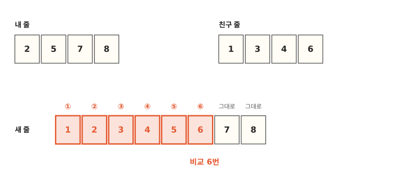
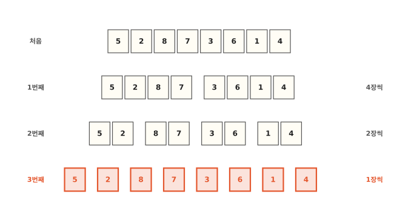
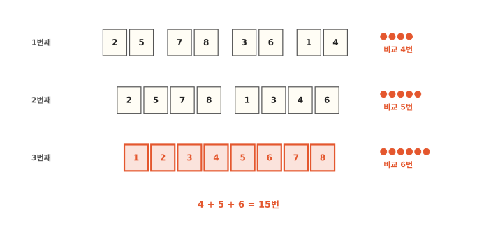
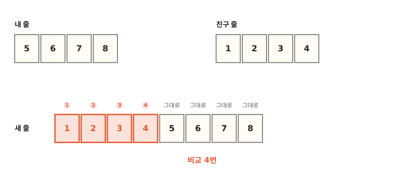
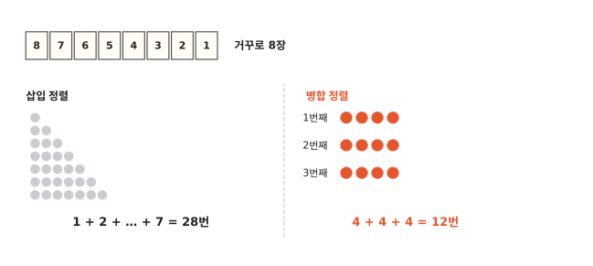
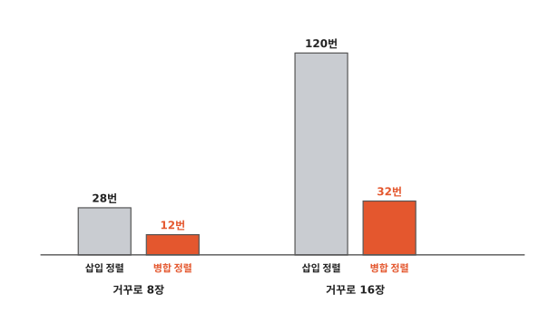
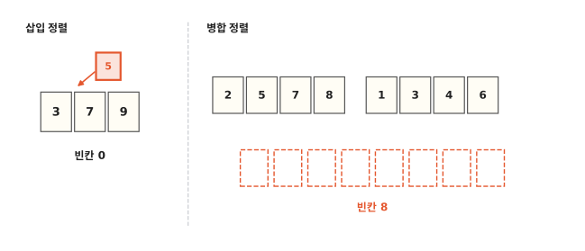

# 병합 정렬: 반씩 나눠 정렬하고 맨 앞끼리 합치기

[4편](04-insertion-sort.md)에서 카드를 한 장씩 받아 손에 끼웠어요. 거꾸로 받은 열 장은 비교가 45번이었죠. 이 글에서는 카드를 반씩 나눠 따로 정리한 다음 하나로 합치는 방법을 알게 돼요. 삽입 정렬보다 비교가 적고 카드가 많아질수록 차이가 더 벌어져요.

!!! abstract "이 글에서 알게 되는 것"
    1. 작은 수부터 놓인 두 줄은 맨 앞 카드끼리만 비교하면 한 줄로 합칠 수 있어요.
    2. 카드를 한 장이 될 때까지 반씩 나눈 다음 이 합치기를 되풀이하는 방법이 병합 정렬이에요. 여덟 장은 반씩 세 번 나뉘어서 합치기도 세 번이에요.
    3. 카드가 두 배로 늘어도 합치기는 한 번만 늘어서 삽입 정렬보다 비교가 훨씬 적어요. 대신 합치는 동안 카드 수만큼 빈칸이 필요해요.

## 1. 정렬된 두 줄은 맨 앞 카드끼리만 비교하면 합쳐져요

카드 여덟 장 5, 2, 8, 7, 3, 6, 1, 4가 있어요. 친구와 넷씩 나눠서 나는 5, 2, 8, 7을, 친구는 3, 6, 1, 4를 가져가요. 각자 작은 수부터 늘어놓으면 내 줄은 2, 5, 7, 8이 되고 친구 줄은 1, 3, 4, 6이 돼요. 넷을 어떻게 정리하는지는 다음 절에서 볼게요. 지금은 두 줄을 한 줄로 합치는 일만 해 봐요.

여기서 여덟 장을 처음부터 다시 다 비교해야 하나 싶을 거예요. 그럴 필요는 없어요. 두 줄 다 작은 수부터 놓여 있어서 줄에서 가장 작은 카드는 늘 맨 앞에 있거든요. 그래서 두 줄의 맨 앞 카드끼리만 비교해서 작은 쪽을 새 줄로 옮기면 돼요.

1. 2와 1을 비교해요. 1이 작으니 1을 새 줄에 놓아요.
2. 2와 3을 비교해요. 2를 놓아요.
3. 5와 3을 비교해요. 3을 놓아요.
4. 5와 4를 비교해요. 4를 놓아요.
5. 5와 6을 비교해요. 5를 놓아요.
6. 7과 6을 비교해요. 6을 놓아요.

이제 친구 줄이 비었어요. 내 줄에 남은 7과 8은 이미 작은 수부터 놓여 있으니 비교하지 않고 새 줄 끝에 붙여요. 아래 그림에서 새 줄의 빨간 카드 위에 붙은 번호를 보세요.

**그림 1.** 맨 앞 카드끼리 6번 비교해서 1부터 6까지 놓고 7과 8은 비교 없이 붙였어요.
{ .fig-cap }

4편처럼 비교할 때마다 바둑돌을 하나씩 놓았다면 바둑돌은 6개예요. 카드는 여덟 장인데 비교는 여덟 번이 안 돼요. 한 번 비교할 때마다 카드 한 장이 새 줄로 가고 한 줄이 비면 나머지는 비교 없이 붙기 때문이에요.

## 2. 한 장이 될 때까지 반씩 나눈 다음 합쳐 올라와요

앞에서는 넷씩 정리된 두 줄을 합쳤어요. 그럼 넷은 어떻게 정리할까요? 또 반으로 나눠요. 5, 2, 8, 7은 5, 2와 8, 7로 나누고 두 장은 다시 한 장씩으로 나눠요. 아래 그림에서 줄마다 카드 묶음이 몇 장씩인지 보세요.

**그림 2.** 여덟 장을 반씩 세 번 나누면 한 장씩이 돼요.
{ .fig-cap }

카드가 한 장뿐이면 비교할 상대가 없어요. 한 장짜리 줄은 그것만으로 이미 정렬된 줄이에요. 그러니 1절의 합치기를 쓸 수 있어요. 한 장짜리 줄 둘을 합치면 두 장짜리 줄이 돼요. 두 장짜리 줄 둘을 합치면 네 장짜리 줄이 돼요. 네 장짜리 줄 둘까지 합치면 여덟 장이 정렬돼요. 아래 그림에서 줄마다 놓인 빨간 바둑돌을 세어 보세요.

**그림 3.** 합치기를 세 번 해서 비교는 4 + 5 + 6 = 15번이에요.
{ .fig-cap }

- 1번째 합치기: 한 장짜리 두 줄은 한 번 비교하면 합쳐져요. 이런 쌍이 넷이라 4번이에요.
- 2번째 합치기: 2, 5와 7, 8을 합칠 때 2번, 3, 6과 1, 4를 합칠 때 3번이라서 5번이에요.
- 3번째 합치기: 1절에서 센 6번이에요.

이렇게 카드를 한 장이 될 때까지 반씩 나눈 다음 맨 앞 카드끼리 비교하며 합쳐 올라오는 정렬 방법을 **병합 정렬**이라고 해요. "병합"은 둘을 합친다는 뜻이에요.

친구가 꼭 있어야 하는 방법은 아니에요. 컴퓨터는 혼자서 왼쪽 반을 먼저 정리하고 오른쪽 반을 정리한 다음 둘을 합쳐요. 비교 수는 친구와 나눠 할 때와 같아요.

여덟 장은 8장, 4장, 2장, 1장으로 반씩 세 번 나누면 한 장이 됐어요. [3편](03-why-sorted-is-fast.md)의 업다운 놀이에서 남은 숫자가 반씩 줄던 것과 같은 모양이에요. 나눈 횟수만큼 합치기도 세 번이에요.

## 3. 같은 카드를 삽입 정렬보다 적게 비교해요

이제 4편의 삽입 정렬과 비교 수를 나란히 놓아 볼게요. 삽입 정렬은 카드를 한 장씩 꺼내서 이미 정렬된 카드 사이에 끼우는 방법이었어요.

| 받은 카드 | 삽입 정렬 | 병합 정렬 |
|---|---|---|
| 5, 2, 8, 7, 3, 6, 1, 4 | 22번 | 15번 |
| 8, 7, 6, 5, 4, 3, 2, 1 (거꾸로) | 28번 | 12번 |

거꾸로 받은 카드에서 차이가 커요. 병합 정렬은 어떻게 12번으로 끝날까요? 마지막 합치기를 보면 알 수 있어요. 거꾸로 받은 카드를 반으로 나누면 내 몫은 8, 7, 6, 5이고 친구 몫은 4, 3, 2, 1이에요. 각자 정리하면 5, 6, 7, 8과 1, 2, 3, 4가 돼요. 아래 그림에서 빨간 카드가 어느 줄에서 왔는지 보세요.

**그림 4.** 친구 줄이 4번 비교 만에 비어서 내 줄 5, 6, 7, 8은 통째로 붙어요.
{ .fig-cap }

내 줄 맨 앞 5를 1, 2, 3, 4와 차례로 비교하면 친구 줄 카드가 하나씩 먼저 놓여요. 친구 줄이 비면 5, 6, 7, 8은 비교 없이 붙어요. 그래서 비교는 4번이에요. 1번째와 2번째 합치기에서도 같은 일이 일어나서 4번씩이에요. 아래 그림에서 두 방법의 바둑돌을 비교해 보세요.

**그림 5.** 거꾸로 받은 여덟 장을 삽입 정렬은 28번, 병합 정렬은 12번 비교해요.
{ .fig-cap }

삽입 정렬은 새로 받은 카드가 늘 가장 작아서 손에 든 카드를 모두 지나가야 해요. 그래서 바둑돌이 1개, 2개, …, 7개로 늘어요. 병합 정렬은 합칠 때마다 한쪽 줄이 통째로 먼저 놓여서 4개씩 세 번이에요.

## 4. 카드가 두 배가 되어도 합치기는 한 번만 늘어요

카드 16장을 거꾸로 받으면 어떨까요? 삽입 정렬은 1 + 2 + … + 15 = 120번 비교해요.

병합 정렬은 16장, 8장, 4장, 2장, 1장으로 반씩 네 번 나누면 한 장이 돼요. 그래서 합치기도 네 번이에요. 3절처럼 합칠 때마다 한쪽 줄이 통째로 먼저 놓이니까 합치기 한 번에 카드 수의 반인 8번씩 비교해요. 8 + 8 + 8 + 8 = 32번이에요. 아래 그림에서 막대 높이를 비교해 보세요.

**그림 6.** 카드가 8장에서 16장이 되면 삽입 정렬은 28번에서 120번이 되고 병합 정렬은 12번에서 32번이 돼요.
{ .fig-cap }

카드가 두 배가 되면 삽입 정렬의 비교는 네 배 넘게 늘어요. 병합 정렬은 합치기 한 번에 하는 비교가 4번에서 8번으로 늘고 합치기 횟수는 세 번에서 네 번으로 한 번만 늘어요. 그래서 카드가 많을수록 두 방법의 차이가 더 벌어져요.

## 5. 합치는 동안 카드 수만큼 빈칸이 필요해요

병합 정렬에도 불편한 점이 있어요. 삽입 정렬은 손에 든 카드 사이에 끼우면 됐어요. 병합 정렬은 두 줄을 합칠 때 새 줄을 놓을 빈칸이 있어야 해요. 아래 그림에서 빨간 점선 칸을 보세요.

**그림 7.** 삽입 정렬은 빈칸 없이 끼우고 병합 정렬은 카드 8장을 합치려고 빈칸 8개를 써요.
{ .fig-cap }

컴퓨터도 마찬가지예요. 합치는 동안 카드 수만큼 빈칸을 더 써요.

카드가 아주 적을 때는 나누고 합치는 일이 오히려 번거로워요. [1편](01-why-big-o.md)에서 양말이 2개뿐일 때는 하나 집고 다 뒤지는 방법이 먼저 끝났던 것과 같아요. 그래서 파이썬 같은 프로그래밍 언어가 쓰는 정렬은 두 방법을 섞어요. 짧은 줄은 삽입 정렬로 정리하고 그 줄들을 병합 정렬처럼 합쳐요. 이 방법은 [7편](07-timsort.md)에서 볼게요.

## 정리

작은 수부터 놓인 두 줄은 맨 앞 카드끼리만 비교하면 한 줄로 합쳐져요. 2, 5, 7, 8과 1, 3, 4, 6은 6번 비교한 다음 남은 7, 8을 붙이면 끝났어요.

병합 정렬은 카드를 한 장이 될 때까지 반씩 나눈 다음 이 합치기를 되풀이해요. 한 장짜리 줄은 이미 정렬돼 있어서 합치기만 하면 돼요. 여덟 장은 반씩 세 번 나뉘어서 합치기도 세 번이에요. 5, 2, 8, 7, 3, 6, 1, 4는 비교 15번으로 정렬됐어요.

카드가 두 배로 늘어도 합치기는 한 번만 늘어요. 그래서 거꾸로 받은 16장을 삽입 정렬은 120번, 병합 정렬은 32번 비교해요. 대신 합치는 동안 카드 수만큼 빈칸이 필요해요.

[6편](06-quick-sort.md)에서는 빈칸 없이 카드가 놓인 자리에서 나눠 정렬하는 방법을 볼게요.

### 새로 나온 말

- **병합**: 정렬된 두 줄을 맨 앞 카드끼리 비교하며 한 줄로 합치는 일. 2, 5, 7, 8과 1, 3, 4, 6을 6번 비교해서 합쳤어요.
- **병합 정렬**: 카드를 한 장이 될 때까지 반씩 나눈 다음 병합을 되풀이해서 정렬하는 방법. 5, 2, 8, 7, 3, 6, 1, 4를 비교 15번으로 정렬했어요.
