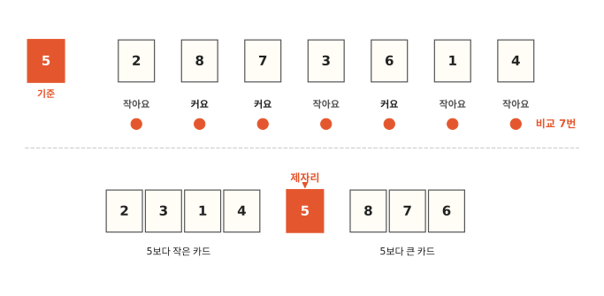
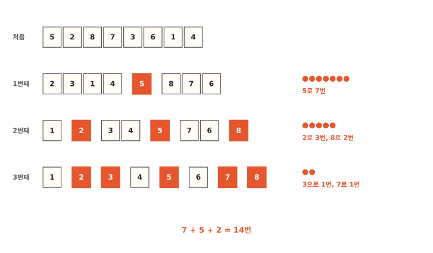
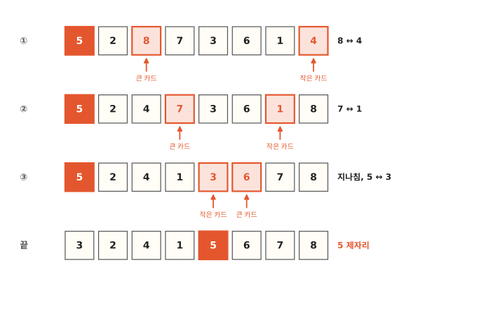
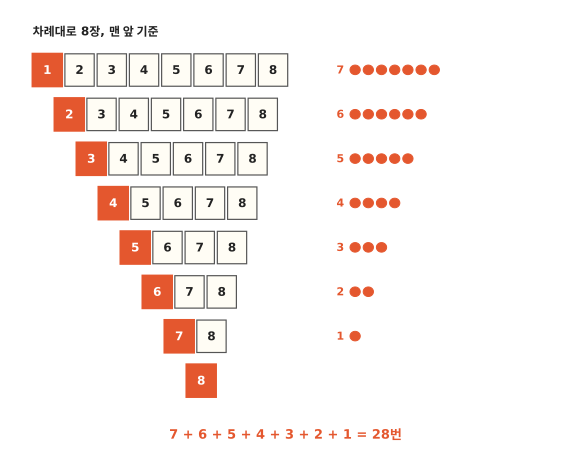
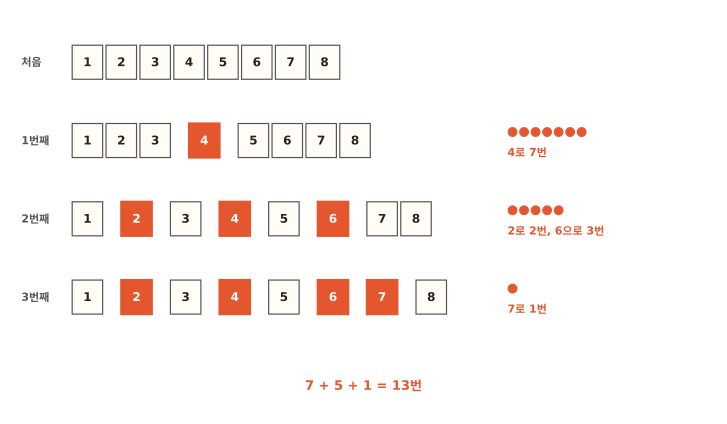
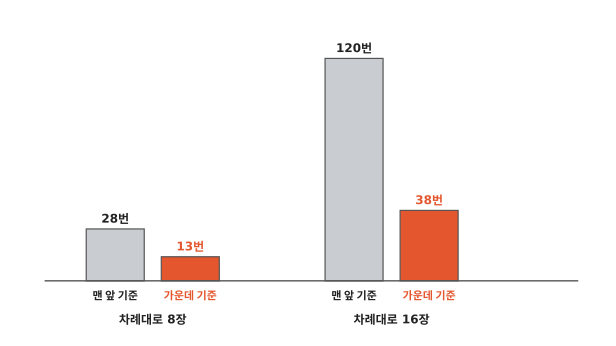

# 퀵 정렬: 기준 카드 하나로 나누어 정렬하기

[5편](05-merge-sort.md)에서는 카드를 반씩 나눠 정렬한 다음 합쳤어요. 합치는 동안 카드 수만큼 빈칸이 필요했죠. 이 글에서는 합치지 않고 나누기만 해서 정렬하는 방법을 알게 돼요. 빈칸 없이 정렬할 수 있는 대신 기준 카드를 잘못 고르면 아주 느려져요. 그래서 기준을 어떻게 고르는지도 함께 봐요.

!!! abstract "이 글에서 알게 되는 것"
    1. 기준 카드 하나를 골라 작은 카드는 왼쪽, 큰 카드는 오른쪽으로 나누면 기준 카드는 제자리에 와요.
    2. 나뉜 쪽을 한 장이 될 때까지 또 나누는 방법이 퀵 정렬이에요. 컴퓨터는 카드를 맞바꿔 나눠서 빈칸이 따로 필요 없어요.
    3. 차례대로 놓인 카드에서 맨 앞을 기준으로 고르면 한 장씩만 떨어져 나가서 아주 느려져요. 차례대로 놓인 카드라면 가운데 카드를 고를 때 반씩 나뉘어서 빨라져요.

## 1. 기준 카드와 한 장씩 비교하면 기준 카드가 제자리에 와요

5편과 같은 카드 5, 2, 8, 7, 3, 6, 1, 4로 시작해요. 이번엔 맨 앞 카드 5를 기준으로 골라요. 나머지 일곱 장을 5와 한 장씩 비교해요. 작으면 왼쪽, 크면 오른쪽에 모아요. 2는 왼쪽, 8은 오른쪽, 7도 오른쪽, 3은 왼쪽이에요. 끝까지 하면 비교는 7번이에요. 아래 그림에서 빨간 5가 어디에 섰는지 보세요.

**그림 1.** 5와 일곱 장을 한 번씩 비교해서 작은 카드 넷은 왼쪽, 큰 카드 셋은 오른쪽에 모였어요.
{ .fig-cap }

양쪽은 아직 뒤죽박죽이에요. 왼쪽은 2, 3, 1, 4이고 오른쪽은 8, 7, 6이에요. 그런데 5는 벌써 제자리에 왔어요. 5보다 작은 카드가 넷이니까 정렬이 끝나면 5는 앞에서 다섯 번째 자리에 서야 해요. 지금 5가 바로 그 자리에 있어요. 왼쪽 카드끼리 자리를 어떻게 바꿔도 5 앞에 작은 카드 넷이 있다는 건 바뀌지 않아요. 그래서 5는 이제 다시 움직이지 않아요.

## 2. 나뉜 쪽을 또 나누면 정렬이 끝나요

앞에서 5는 제자리를 찾았고 양쪽이 남았어요. 양쪽에도 같은 일을 해요. 왼쪽 2, 3, 1, 4는 맨 앞 2를 기준으로 3, 1, 4와 비교해요. 비교 3번이고 1은 왼쪽, 3과 4는 오른쪽으로 가요. 오른쪽 8, 7, 6은 8을 기준으로 7, 6과 비교해요. 비교 2번이고 둘 다 왼쪽으로 가요.

아직 두 장짜리 3, 4와 7, 6이 남았어요. 3, 4는 3을 기준으로 한 번 비교하고 7, 6은 7을 기준으로 한 번 비교해요. 카드가 한 장만 남으면 비교할 상대가 없으니 그 카드도 제자리예요. 아래 그림에서 줄마다 빨간 기준 카드가 늘어나는 것을 보세요.

**그림 2.** 줄마다 기준 카드가 제자리를 찾아서 세 번 나누면 정렬이 끝나요. 비교는 7 + 5 + 2 = 14번이에요.
{ .fig-cap }

기준 카드로 작은 카드와 큰 카드를 나누고 나뉜 쪽도 또 나눠요. 이렇게 정렬하는 방법을 **퀵 정렬**이라고 해요. "퀵"은 영어로 빠르다는 뜻이에요.

5편의 병합 정렬은 다 나눈 다음 합쳤어요. 퀵 정렬에는 합치는 일이 없어요. 나눌 때마다 기준 카드가 하나씩 제자리를 찾고 남은 쪽이 한 장이 되면 끝나요.

같은 카드를 세 방법으로 정렬한 비교 수를 나란히 놓으면 이래요. 삽입 정렬과 병합 정렬의 수는 [5편](05-merge-sort.md)에서 센 거예요.

| 방법 | 비교 |
|---|---|
| 삽입 정렬 | 22번 |
| 병합 정렬 | 15번 |
| 퀵 정렬 | 14번 |

이 카드에서는 퀵 정렬이 가장 적어요.

## 3. 컴퓨터는 두 손가락으로 카드를 맞바꿔 나눠요

1절에서는 카드를 왼쪽과 오른쪽에 따로 모았어요. 그러려면 카드를 옮겨 놓을 자리가 있어야 해요. 5편에서 빈칸이 필요했던 것과 같은 문제죠. 컴퓨터는 카드가 한 줄로 놓인 자리에서 두 장씩 맞바꿔서 나눠요.

기준 카드 5는 맨 앞에 둬요. 손가락 하나는 5 바로 옆에 놓고 다른 하나는 맨 오른쪽 끝에 놓아요.

- 왼쪽 손가락은 5보다 큰 카드를 만날 때까지 오른쪽으로 가요.
- 오른쪽 손가락은 5보다 작은 카드를 만날 때까지 왼쪽으로 가요.
- 둘 다 멈추면 두 카드를 맞바꿔요.

아래 그림에서 두 손가락이 멈춘 빨간 카드를 따라가 보세요.

**그림 3.** 8과 4, 7과 1을 맞바꾼 다음 손가락이 서로 지나치면 5를 3과 바꿔요.
{ .fig-cap }

①에서 왼쪽 손가락은 2를 지나 8에서 멈추고 오른쪽 손가락은 4에서 바로 멈춰요. 8과 4를 바꿔요. ②에서는 7과 1을 바꿔요. ③에서는 왼쪽 손가락이 6에서 멈추고 오른쪽 손가락이 3에서 멈춰요. 왼쪽 손가락이 오른쪽 손가락보다 더 오른쪽에 왔어요. 두 손가락이 서로 지나친 거예요.

지나쳤다는 건 더 바꿀 카드가 없다는 뜻이에요. 왼쪽 손가락이 지나온 2, 4, 1, 3은 모두 5보다 작고 오른쪽 손가락이 지나온 6, 7, 8은 모두 5보다 커요. 오른쪽 손가락이 멈춘 3은 작은 카드들의 맨 끝이에요. 그래서 5를 3과 바꾸면 5가 작은 카드 넷 바로 뒤에 서요. 1절에서 본 제자리예요.

왼쪽에 남은 카드는 3, 2, 4, 1이에요. 1절에서 모아 놓았을 때의 2, 3, 1, 4와 순서가 다르지만 어차피 또 나눌 카드라서 괜찮아요. 이렇게 나누면 비교 수도 1절에서 센 것과 조금 달라질 수 있어요. 이 글에서는 세기 쉬운 1절 방식으로 셀게요.

카드를 옮겨 둘 새 줄이 없어도 나눌 수 있어요. 그래서 퀵 정렬은 5편처럼 빈칸을 따로 마련하지 않아요.

## 4. 차례대로 놓인 카드를 맨 앞 기준으로 나누면 한 장씩만 떨어져요

이제 퀵 정렬이 느려지는 때를 볼게요. 카드가 이미 1, 2, 3, 4, 5, 6, 7, 8 차례대로 놓여 있다고 해 봐요. 맨 앞 1을 기준으로 고르면 1보다 작은 카드가 하나도 없어요. 왼쪽은 비고 나머지 일곱 장이 모두 오른쪽으로 가요. 비교는 7번이에요. 오른쪽 일곱 장에서 맨 앞 2를 고르면 또 여섯 장이 모두 오른쪽으로 가요. 아래 그림에서 줄이 한 장씩 짧아지는 모양을 보세요.

**그림 4.** 차례대로인 여덟 장을 맨 앞 기준으로 나누면 줄마다 한 장씩만 떨어져서 비교가 28번이에요.
{ .fig-cap }

반으로 나뉘지 않고 기준 카드 한 장씩만 떨어져 나가요. 비교는 7 + 6 + 5 + 4 + 3 + 2 + 1 = 28번이에요. [5편](05-merge-sort.md)에서 거꾸로 받은 여덟 장을 삽입 정렬했을 때도 28번이었어요. 그때만큼 느린 거예요. 카드가 16장이면 15 + 14 + … + 1 = 120번까지 가요.

[1편](01-why-big-o.md)에서는 양말 짝이 늘 바구니 맨 끝에 있다고 치고 운이 가장 나쁜 때를 일부러 세어 봤어요. 맨 앞 카드를 기준으로 고르는 퀵 정렬에게는 차례대로 놓인 카드가 그런 때예요.

## 5. 가운데 카드를 기준으로 고르면 반씩 나뉘어요

맨 앞 카드가 문제였으니 다른 카드를 골라 볼게요. 이번엔 가운데 있는 카드를 기준으로 골라요. 카드가 짝수 장이라 가운데가 두 장이면 앞쪽 카드를 골라요. 1부터 8까지면 4번째와 5번째가 가운데라서 4를 골라요.

4로 나누면 왼쪽에 1, 2, 3이 가고 오른쪽에 5, 6, 7, 8이 가요. 거의 반씩 나뉘었어요. 양쪽도 가운데 카드로 나눠요. 1, 2, 3은 2로 나누고 5, 6, 7, 8은 6으로 나눠요. 아래 그림에서 줄마다 놓인 바둑돌 수를 그림 4와 비교해 보세요.

**그림 5.** 같은 여덟 장을 가운데 기준으로 나누면 세 번 만에 끝나고 비교는 7 + 5 + 1 = 13번이에요.
{ .fig-cap }

맨 앞 기준일 때 28번이던 카드가 13번으로 끝나요. 카드가 많아지면 차이가 더 벌어져요. 아래 그림에서 16장일 때의 막대를 보세요.

**그림 6.** 차례대로인 카드 16장을 맨 앞 기준은 120번, 가운데 기준은 38번 비교해요.
{ .fig-cap }

그래서 프로그램은 기준을 고를 때 맨 앞 카드만 쓰지 않아요. 가운데 카드를 쓰기도 하고 아무 카드나 하나 뽑기도 해요. 아무 카드나 뽑으면 한 번쯤은 끝 카드가 뽑힐 수 있어요. 하지만 줄마다 계속 끝 카드만 뽑혀서 한 장씩만 떨어져 나가는 일은 거의 없어요.

## 정리

퀵 정렬은 기준 카드 하나를 골라 작은 카드는 왼쪽, 큰 카드는 오른쪽으로 나눠요. 다 나누면 기준 카드는 제자리에 와서 다시 움직이지 않아요. 나뉜 쪽도 한 장이 될 때까지 같은 방법으로 나누면 정렬이 끝나요. 5, 2, 8, 7, 3, 6, 1, 4는 비교 14번이었어요.

컴퓨터는 양 끝에서 다가오는 두 손가락으로 큰 카드와 작은 카드를 맞바꿔서 나눠요. 카드가 놓인 자리에서 나누니까 병합 정렬처럼 빈칸이 필요 없어요.

대신 기준을 잘못 고르면 느려져요. 차례대로 놓인 여덟 장을 맨 앞 기준으로 나누면 한 장씩만 떨어져서 28번 비교해요. 가운데 기준으로 나누면 13번이에요.

[7편](07-timsort.md)에서는 파이썬 같은 프로그래밍 언어가 실제로 쓰는 정렬을 볼게요. 5편 끝에서 말한 삽입 정렬과 병합 정렬을 섞는 방법이에요.

### 새로 나온 말

- **기준 카드**: 퀵 정렬에서 나머지 카드를 나누는 잣대로 고른 카드. 영어로 피벗이라고 해요. 처음엔 맨 앞 5를 골랐어요.
- **퀵 정렬**: 기준 카드로 작은 카드와 큰 카드를 나누고 나뉜 쪽을 또 나누는 정렬 방법. 5, 2, 8, 7, 3, 6, 1, 4를 비교 14번으로 정렬했어요.
