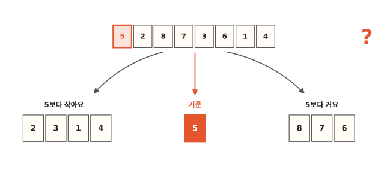
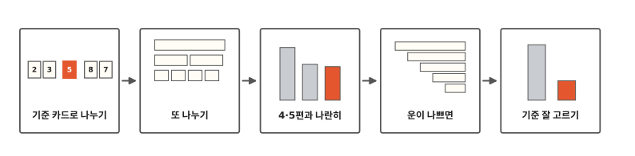
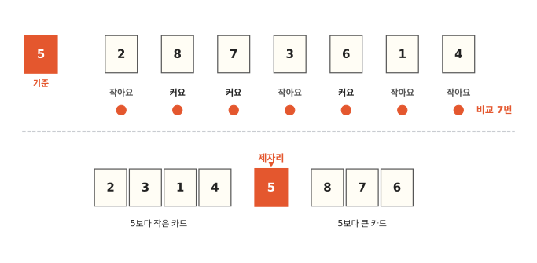
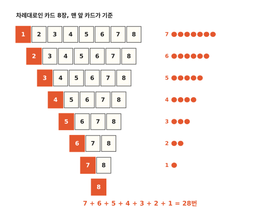
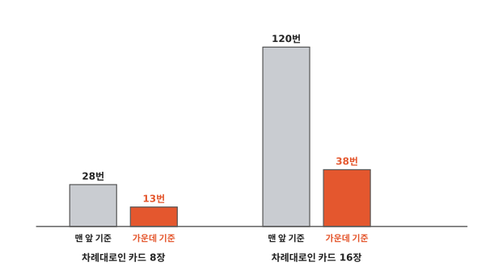

# 기준 카드 하나로 나누면 어떻게 정렬될까요?

## 기준 카드를 하나 골라요

5편에서는 카드를 반씩 나눠 정렬한 다음 다시 합쳤어요. 합칠 때 새 줄을 놓을 빈자리가 필요했지요.

이번에도 같은 카드 여덟 장 5, 2, 8, 7, 3, 6, 1, 4를 써요. 이번엔 합치지 않아요. 맨 앞 카드 5를 기준으로 골라요. 그리고 5보다 작은 카드는 왼쪽에, 큰 카드는 오른쪽에 모아 놓아요. 이렇게 나누기만 해도 정렬이 될까요?

## 나누기에서 기준 고르기까지

알고리즘 여섯 번째 편이에요. 먼저 기준 카드 하나로 카드를 두 쪽으로 나눠요. 나뉜 쪽은 또 나눠요.

그다음 4편, 5편 방법과 비교 수를 나란히 놓아 봐요. 이 방법이 아주 느려질 때가 언제인지, 그때는 기준을 어떻게 고르면 되는지도 봐요.

## 기준 카드와 한 장씩 비교해요

기준 카드 5와 나머지 일곱 장을 한 장씩 비교해요. 2는 5보다 작으니 왼쪽, 8은 크니 오른쪽, 7도 오른쪽, 3은 왼쪽… 이렇게 끝까지 가요. 4편처럼 비교할 때마다 바둑돌을 놓으면 7개예요.

3편 업다운 놀이에서 친구는 "업!"이나 "다운!"으로 더 큰지 작은지만 알려 줬지요. 기준 카드와 비교할 때도 더 큰지 작은지만 봐요.

다 나누면 왼쪽에 2, 3, 1, 4가 있고 오른쪽에 8, 7, 6이 있어요. 양쪽 다 아직 뒤죽박죽이에요.

그런데 5는 벌써 제자리에 왔어요. 5보다 작은 카드는 넷이에요. 정렬이 끝나면 5는 그 네 장 바로 뒤, 앞에서 다섯 번째 자리에 서야 해요. 지금 5가 바로 그 자리에 있어요. 이제부터 5는 다시 움직이지 않아요.

## 양쪽을 또 나눠요

왼쪽 2, 3, 1, 4도 똑같이 해요. 맨 앞 카드 2를 기준으로 골라 3, 1, 4와 한 번씩 비교해요. 바둑돌은 3개예요. 1은 왼쪽, 3과 4는 오른쪽으로 가요.

오른쪽 8, 7, 6은 맨 앞 8을 기준으로 7, 6과 비교해요. 바둑돌은 2개예요. 둘 다 8보다 작아서 왼쪽으로 가요.

아직 두 장짜리가 남았어요. 3, 4는 3을 기준으로 한 번 비교해요. 7, 6은 7을 기준으로 한 번 비교해요.

카드가 한 장만 남으면 비교할 카드가 없어요. 그 카드도 이미 제자리예요. 그림 3번째 줄의 1, 4, 6이 그래요. 줄마다 놓은 바둑돌을 세면 7 + 5 + 2 = 14개, 비교는 14번이에요.

기준 카드 하나를 골라 작은 카드는 왼쪽, 큰 카드는 오른쪽으로 나눠요. 나뉜 쪽도 또 같은 방법으로 나눠요. 이렇게 정렬하는 방법을 **퀵 정렬**이라고 해요. "퀵"은 영어로 빠르다는 뜻이에요.

5편 병합 정렬은 마지막에 합쳤지만 퀵 정렬은 나누기만 해요. 기준 카드가 하나씩 제자리를 찾고, 남은 쪽이 한 장이 될 때까지 나누면 끝나요.

그런데 우리는 카드를 왼쪽과 오른쪽에 따로 모아 놓았어요. 컴퓨터는 이렇게 하지 않아요. 카드가 한 줄로 놓인 그 자리에서 두 장씩 맞바꿔서 나눠요.

예를 들어 5, 2, 8, 7, 3, 6, 1, 4에서 앞쪽의 8과 맨 뒤의 4를 맞바꿔요. 그러면 작은 4는 앞으로, 큰 8은 뒤로 가요. 이렇게 몇 번 맞바꾸면 작은 카드는 앞쪽에, 큰 카드는 뒤쪽에 모여요. 그래서 5편처럼 빈자리를 따로 마련하지 않아도 돼요. 자세한 방법은 아래 "더 깊이"에 있어요.

## 4편, 5편과 나란히 세어 봐요

같은 카드 5, 2, 8, 7, 3, 6, 1, 4를 세 방법으로 정렬하면 비교 수가 이래요.

| 방법 | 비교 |
|---|---|
| 4편: 한 장씩 손에 끼우기 | 22번 |
| 5편: 병합 정렬 | 15번 |
| 퀵 정렬 | 14번 |

이 카드에서는 퀵 정렬이 제일 적어요. 카드가 놓인 순서가 바뀌면 어떨까요?

## 운이 나쁘면

카드가 이미 1, 2, 3, 4, 5, 6, 7, 8 차례대로 놓여 있다고 해 봐요. 맨 앞 카드 1을 기준으로 골라요.

1보다 작은 카드는 하나도 없어요. 그래서 왼쪽은 비고 나머지 일곱 장이 모두 오른쪽으로 가요. 바둑돌은 7개예요. 오른쪽 일곱 장에서 또 맨 앞 2를 기준으로 고르면 여섯 장이 모두 오른쪽으로 가요. 바둑돌은 6개예요.

반으로 나뉘지 않고 한 번에 한 장씩만 떨어져 나가요. 바둑돌은 7 + 6 + 5 + 4 + 3 + 2 + 1 = 28개예요. 4편에서 카드 여덟 장을 거꾸로 받았을 때도 28번이었어요. 그때와 똑같이 느려요. 카드 16장이면 120번까지 가요.

1편에서는 양말 짝이 늘 바구니 맨 끝에 있다고 치고 운이 제일 나쁜 때를 일부러 세어 봤어요. 퀵 정렬에서는 차례대로 놓인 카드가 맨 앞 기준에게 그런 때예요.

## 기준을 잘 고르면

이번엔 맨 앞 카드 대신 가운데에 있는 카드를 기준으로 골라 봐요. 카드가 짝수 장이라 가운데가 두 장이면 앞쪽 카드를 골라요. 1부터 8까지면 4번째와 5번째 카드가 가운데라서 4를 골라요.

4로 나누면 왼쪽에 1, 2, 3이 가고 오른쪽에 5, 6, 7, 8이 가요. 거의 반씩 나뉘었어요. 양쪽도 가운데 카드로 나누면 모두 13번이에요. 맨 앞 기준일 때 28번이던 것과 같은 카드예요.

카드가 16장이면 차이가 더 벌어져요. 그림처럼 맨 앞 기준은 120번, 가운데 기준은 38번이에요.

그래서 컴퓨터 프로그램은 기준을 고를 때 맨 앞 카드만 쓰지 않아요. 가운데 카드를 쓰기도 하고 아무 카드나 하나 뽑기도 해요.

그럼 파이썬 같은 프로그래밍 언어는 실제로 어떤 정렬을 쓸까요? 5편 끝에서 "두 가지를 섞어요"라고 했던 그 방법을 다음 편에서 볼게요.

## 정리

- **퀵 정렬**: 기준 카드 하나를 골라 작은 카드는 왼쪽, 큰 카드는 오른쪽으로 나눠요. 나뉜 쪽도 또 같은 방법으로 나눠요. 카드가 놓인 자리에서 두 장씩 바꾸기만 해서 5편처럼 빈자리를 따로 마련하지 않아요. 기준을 잘못 고르면 느려져요.

## 해 보기: 기준 카드 놀이

1부터 8까지 숫자 카드와 바둑돌을 준비해요. 둘이 하면 더 좋아요.

1. 카드를 섞어서 한 줄로 놓아요.
2. 맨 앞 카드를 기준으로 뽑아 가운데에 놓아요.
3. 나머지 카드를 한 장씩 기준과 비교해서 작으면 왼쪽, 크면 오른쪽에 놓아요. 비교할 때마다 친구가 바둑돌을 하나 놓아요.
4. 왼쪽과 오른쪽도 똑같이 해요. 한 장만 남으면 그쪽은 끝이에요.
5. 바둑돌이 몇 개였나요?
6. 이번엔 1부터 8까지 차례대로 놓고 다시 해 봐요. 바둑돌은 몇 개일까요?
7. 차례대로 놓고, 이번엔 가운데 카드를 기준으로 골라요. 가운데가 두 장이면 앞쪽 카드예요. 바둑돌은 몇 개일까요?

## 확인 문제

??? question "1. 첫 번째 나누기"
    카드 4, 1, 6, 3, 5가 있어요. 맨 앞 4를 기준으로 나누면 왼쪽과 오른쪽에 어떤 카드가 가고, 바둑돌은 몇 개일까요?

    **풀이**: 왼쪽에 1, 3이 가고 오른쪽에 6, 5가 가요. 4와 나머지 네 장을 한 번씩 비교하니 바둑돌은 4개예요.

??? question "2. 차례대로인 네 장"
    차례대로 놓인 카드 1, 2, 3, 4를 맨 앞 카드를 기준으로 퀵 정렬하면 모두 몇 번 비교할까요?

    **풀이**: 6번이에요. 1로 나눌 때 3번, 2로 나눌 때 2번, 3으로 나눌 때 1번이라서 3 + 2 + 1 = 6번이에요.

??? question "3. 기준 카드는 또 옮길까요?"
    한 번 나눈 뒤에, 기준 카드를 다시 옮겨야 할 때가 있을까요?

    **풀이**: 없어요. 기준 카드보다 작은 카드는 다 왼쪽에, 큰 카드는 다 오른쪽에 있어요. 그러니 기준 카드는 이미 제자리예요.

!!! abstract "어른을 위한 정리 (건너뛰어도 돼요)"
    - 퀵 정렬은 평균 O(n log n), 최악 O(n²)이에요. 본문의 최악은 이미 정렬된 입력에서 첫 원소를 피벗(기준)으로 고른 경우예요. 8개를 첫 원소 피벗으로 정렬하면 40,320가지 순서 전체에서 비교는 가장 적으면 13번, 가장 많으면 28번, 평균 16.9번쯤이었어요.[^lab]
    - 본문은 "피벗과 나머지 원소를 한 번씩 비교"해서 한 번 나눌 때 n−1번으로 셌어요. 실제 분할 구현은 양 끝 처리 방식에 따라 비교 수가 이와 조금 달라요. "더 깊이"의 두 손가락 방식은 호어가 쓴 두 포인터 분할을 교과서에서 흔히 쓰는 모양으로 옮긴 거예요. 피벗을 맨 앞에 두고, 마지막에 오른쪽 포인터 자리와 바꿔 제자리에 놓아요.
    - 제자리에서 분할하므로 추가 메모리는 재귀 스택뿐이에요. 작은 쪽만 재귀하고 큰 쪽은 반복문으로 처리하면 O(log n)이에요. 같은 값끼리의 순서는 지켜지지 않아요(불안정 정렬).
    - 최악을 피하려고 피벗을 무작위로 고르거나 세 원소의 중앙값(median-of-3)을 써요. GCC의 C++ 표준 라이브러리 `std::sort`는 세 원소 중앙값을 피벗으로 쓰는 퀵 정렬로 시작해요. 재귀가 너무 깊어지면 힙 정렬로 바꿔서 최악을 막아요(인트로 정렬). 짧게 남은 구간은 마지막에 삽입 정렬로 마무리해요.[^stl] 파이썬 `sorted()`는 Timsort를 써요(7편).
    - 순수 파이썬으로 이미 정렬된 1,000개를 첫 원소 피벗으로 정렬하면 12밀리초쯤 걸렸어요. 가운데 원소 피벗이면 1밀리초도 안 걸렸어요. 2,000개로 늘리면 첫 원소 피벗은 50밀리초쯤으로 네 배 가까이 느려졌어요. 무작위 순서 1,000개는 첫 원소 피벗 퀵 정렬 0.8밀리초, 5편 병합 정렬 1.1밀리초쯤이었어요.[^lab]

## 더 깊이

??? info "컴퓨터는 두 손가락으로 자리를 바꿔요"
    

    기준 카드 5는 맨 앞에 그대로 둬요. 손가락 하나는 5 바로 옆에, 다른 하나는 맨 오른쪽 끝에 놓아요.

    - 왼쪽 손가락은 큰 카드를 찾아 오른쪽으로 가요.
    - 오른쪽 손가락은 작은 카드를 찾아 왼쪽으로 가요.
    - 둘 다 찾으면 두 카드를 바꿔요.

    ①에서 왼쪽 손가락은 2를 지나 8에서 멈춰요. 오른쪽 손가락은 4에서 바로 멈춰요. 8과 4를 바꿔요. ②에서는 7과 1을 바꿔요.

    ③에서 왼쪽 손가락은 6에서, 오른쪽 손가락은 3에서 멈췄어요. 이번엔 두 손가락이 서로 지나쳤어요. 오른쪽 손가락이 지나온 6, 7, 8은 모두 5보다 커요. 왼쪽 손가락이 지나온 2, 4, 1, 3은 모두 5보다 작아요. 그러니 더 바꿀 카드가 없어요.

    오른쪽 손가락이 멈춘 3은 작은 카드들의 맨 끝이에요. 그래서 5를 3과 바꾸면 5가 작은 카드 넷 바로 뒤에 서요. 제자리예요.

    왼쪽에 남은 카드는 3, 2, 4, 1이에요. 모아 놓기로 나눴을 때는 2, 3, 1, 4였어요. 순서는 달라도 괜찮아요. 어차피 이 넷은 또 나눌 거니까요. 손가락으로 나누면 비교 수도 본문에서 센 것과 조금 달라질 수 있어요.

??? info "번역 사전을 찾다 떠오른 정렬"
    1960년 무렵, 토니 호어라는 영국 사람이 모스크바 국립대학에서 공부하고 있었어요. 그때 영국의 한 연구소에서 러시아어를 영어로 바꾸는 컴퓨터 번역 일을 해 보지 않겠냐는 편지를 받았어요. 그래서 컴퓨터로 번역하는 일이 어떤 것인지 알아보기 시작했어요.

    그 시절 컴퓨터 사전은 긴 테이프에 A부터 Z까지 차례대로 적혀 있었어요. 테이프를 처음부터 끝까지 읽는 데 몇 분이 걸렸대요. 문장의 낱말을 먼저 같은 순서로 정렬해 두면 테이프를 되감지 않고 한 번만 읽어도 낱말을 모두 찾을 수 있어요.

    호어는 낱말을 어떻게 정렬할지 생각해 봤어요. 처음 떠올린 방법은 너무 느려서 버렸어요. 두 번째로 떠올린 방법이 퀵 정렬이었다고 해요.[^chm] 이 방법은 1961년에 글로 발표됐어요.[^cacm]

??? info "기준과 같은 카드가 있으면?"
    카드에 같은 숫자가 여러 장 있을 수도 있어요. 기준과 같은 카드는 왼쪽에 둬도 되고 오른쪽에 둬도 돼요. 한쪽으로 정해 두기만 하면 돼요.

??? info "아무 카드나 뽑으면 왜 괜찮을까?"
    카드가 어떤 순서로 놓여 있든 상관없이 아무 카드나 하나 뽑는다고 해 봐요. 여덟 장이면 맨 끝 카드는 두 장뿐이에요. 한 번쯤은 끝 카드를 뽑을 수 있어요. 하지만 다음 줄에서도, 그다음 줄에서도 계속 끝 카드만 뽑아서 한 장씩만 떨어져 나가는 일은 거의 없어요.

[^lab]: [`lab/06_quick.py`](https://github.com/oya150/bedrock/blob/main/lab/06_quick.py)로 잰 값이에요(CPython 3.12.7, Apple Silicon 노트북). 다시 재면 숫자는 조금씩 달라져요. 카드를 모아 놓는 방식으로 짠 것이라 제자리 분할 구현과는 시간이 달라요. 같은 스크립트로 본문의 비교 횟수 14번, 28번, 13번, 120번, 38번과 확인 문제 답도 확인했어요.
[^stl]: GCC 14.2 [`libstdc++-v3/include/bits/stl_algo.h`](https://github.com/gcc-mirror/gcc/blob/releases/gcc-14.2.0/libstdc++-v3/include/bits/stl_algo.h)의 `__introsort_loop`, `__move_median_to_first`, `__final_insertion_sort`.
[^chm]: Computer History Museum, "Oral History of Sir Antony Hoare", 인터뷰 Jonathan P. Bowen, 2006년 9월 8일. [카탈로그 102658017](https://www.computerhistory.org/collections/catalog/102658017). 번역 일 제안 편지, 사전 테이프, 처음 떠올린 방법(거품 정렬)을 버린 이야기가 나와요. 호어는 1960년 러시아 생활을 이야기해요. CHM 추모글 ["In Memoriam: Sir Antony Hoare (1934–2026)"](https://computerhistory.org/blog/in-memoriam-sir-antony-hoare-1934-2026/)은 퀵 정렬을 만든 해를 1959년으로 적었어요.
[^cacm]: C. A. R. Hoare, "Algorithm 64: Quicksort", *Communications of the ACM* 4(7), 1961, 321쪽. [doi:10.1145/366622.366644](https://doi.org/10.1145/366622.366644). 자세한 해설은 C. A. R. Hoare, "Quicksort", *The Computer Journal* 5(1), 1962, 10–16쪽. [doi:10.1093/comjnl/5.1.10](https://doi.org/10.1093/comjnl/5.1.10).
