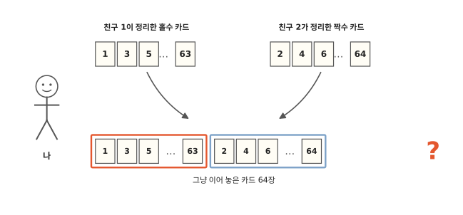
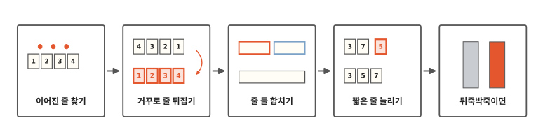
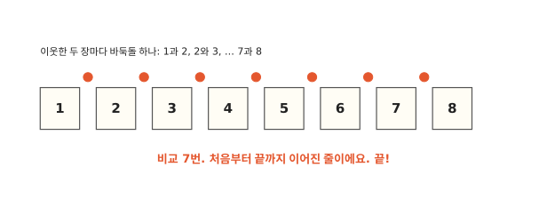
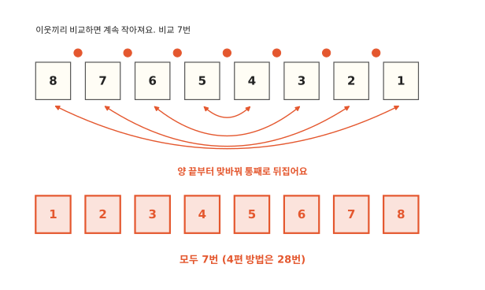
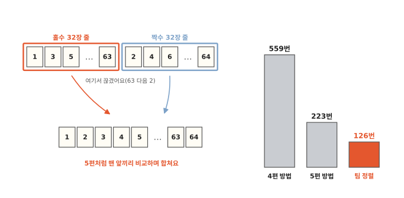
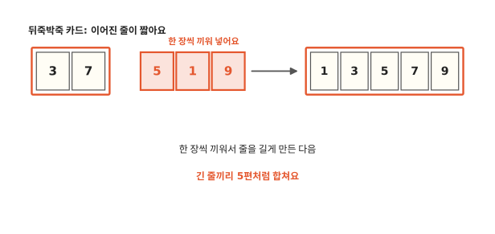
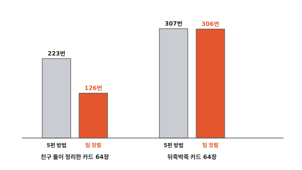

# 파이썬은 카드를 어떻게 정렬할까요?

## 친구 둘이 정리한 카드를 이어 놓았어요

친구 둘이 카드를 나눠 가졌어요. 한 친구는 홀수 카드만, 다른 친구는 짝수 카드만 32장씩 받아서 작은 수부터 정리했어요. 그다음 두 줄을 그냥 이어서 나에게 줬어요. 카드는 모두 64장이에요.

이제 이 카드를 1부터 64까지 정렬해야 해요. 4편처럼 한 장씩 끼워도 되고 5편처럼 반씩 나눠 합쳐도 돼요. 그런데 이 카드는 벌써 반쯤 정리돼 있어요. 그걸 버리고 처음부터 하면 아깝지 않을까요?

## 이어진 줄 찾기에서 뒤죽박죽까지

알고리즘 일곱 번째 편이에요. 파이썬은 컴퓨터에게 일을 시킬 때 쓰는 말(프로그래밍 언어) 가운데 하나예요. 이 편에서는 파이썬이 카드를 정렬할 때 실제로 무엇을 하는지 봐요.

이 편에서 "이어진 줄"은 옆에 붙어 있는 카드가 뒤로 갈수록 계속 커지는 묶음을 말해요. 1, 3, 5, 7처럼요. 파이썬은 이어진 줄을 찾아서 그대로 써요. 거꾸로 이어진 줄은 뒤집고 짧은 줄은 늘린 다음 줄끼리 합쳐요. 마지막 칸에서는 카드가 뒤죽박죽일 때를 봐요.

## 이미 차례대로면 금방 끝나요

친구 이야기는 잠깐 두고, 카드 여덟 장으로 먼저 해 봐요. 1, 2, 3, 4, 5, 6, 7, 8이 이미 차례대로 놓여 있어요.

파이썬은 맨 앞부터 옆에 붙은 두 장을 비교해 나가요. 1과 2, 2와 3, 3과 4… 7과 8까지 늘 뒤 카드가 더 커요. 비교 일곱 번 만에 "처음부터 끝까지 이어져 있네" 하고 끝내요.

사람은 한눈에 "차례대로네" 하고 알아요. 컴퓨터는 한눈에 못 봐요. 이웃한 두 장을 하나씩 비교해야 알 수 있어요. 그래서 일곱 번이에요.

4편처럼 한 장씩 끼우는 방법도 이때는 7번이었어요. 5편 병합 정렬은 이미 차례대로인 카드도 반씩 나눠서 다시 합치느라 12번 비교해요.

## 거꾸로 이어진 줄은 뒤집어요

이번엔 8, 7, 6, 5, 4, 3, 2, 1처럼 거꾸로 놓여 있어요. 이웃끼리 비교하면 이번엔 늘 뒤 카드가 더 작아요. 일곱 번 비교하고 나면 거꾸로 다 이어져 있다는 걸 알게 돼요.

거꾸로 이어진 줄은 통째로 뒤집으면 돼요. 맨 앞 8과 맨 뒤 1을 맞바꿔요. 7과 2, 6과 3, 5와 4도 맞바꿔요. 뒤집을 때는 비교하지 않아요. 그래서 비교는 모두 7번이에요.

4편에서 카드를 거꾸로 받았을 때는 28번 비교했어요. 그때는 새 카드마다 맨 앞까지 가야 했어요. 파이썬은 줄 전체를 한 번에 뒤집으니 그럴 필요가 없어요.

## 이어진 줄이 둘이면 합쳐요

이제 친구들이 준 카드 64장으로 돌아가요. 파이썬은 친구가 둘이었다는 걸 몰라요. 맨 앞부터 이웃끼리 비교해 나가다가 63 다음에 2가 오는 걸 보고서야 "여기서 끊겼네" 하고 알아요. 그 뒤로는 끝까지 또 이어져 있어요. 그래서 줄이 둘이에요.

카드가 네 장이면 이웃한 두 장은 첫째와 둘째, 둘째와 셋째, 셋째와 넷째로 세 쌍이에요. 카드보다 한 쌍 적어요. 그래서 64장이면 63쌍이에요. 쌍마다 한 번씩 비교하니 줄을 찾는 데 63번이 들어요.

줄 둘을 찾으면 5편에서 배운 대로 합쳐요. 두 줄의 맨 앞 카드끼리 비교해서 작은 카드를 새 줄에 놓아요. 이렇게 합치면 비교는 63번이에요.

이렇게 이어진 줄을 찾아 그대로 쓰고 줄끼리 합쳐서 정렬하는 방법을 **팀 정렬**(Timsort)이라고 해요. 거꾸로 이어진 줄을 뒤집는 일과 짧은 줄을 늘리는 일도 팀 정렬이 해요. "팀"은 이 방법을 만든 사람 팀 피터스의 이름이에요.

팀 정렬은 모두 63 + 63 = 126번 비교했어요. 그림 오른쪽 막대처럼 4편 방법이나 5편 방법보다 훨씬 적어요. 5편 방법은 이미 차례대로 놓인 부분을 쓰지 않고 처음부터 반씩 나누기 때문이에요.

## 줄이 너무 짧으면 끼워서 늘려요

카드가 뒤죽박죽이면 이어진 줄이 아주 짧아요. 두 장이나 세 장 이어지다가 금방 끊겨요. 짧은 줄을 그대로 두면 합치기를 아주 여러 번 해야 해요.

그래서 파이썬은 줄이 짧으면 뒤에 오는 카드를 한 장씩 끼워 넣어서 줄을 길게 만들어요. 그림에서는 3, 7 뒤에 오는 5, 1, 9를 끼워서 1, 3, 5, 7, 9를 만들었어요. 끼우는 건 4편과 같지만 끼울 자리는 3편 업다운 놀이처럼 가운데부터 보고 반씩 버리며 찾아요. 카드가 뒤죽박죽이면 이쪽이 비교가 적어요.

카드가 64장이면 줄이 짧을 때마다 32장까지 늘려요. 64장의 딱 반이에요. 그러면 32장짜리 줄 두 개가 생겨서 마지막에 한 번만 합치면 끝나요.

5편 끝에서 "컴퓨터에서 많이 쓰는 정렬 방법은 두 가지를 섞어요"라고 했던 게 이렇게 끼우기와 합치기를 섞는 일이었어요. 그럼 아무렇게나 섞인 카드에서는 비교를 얼마나 할까요?

## 뒤죽박죽이면

카드 64장을 아무렇게나 섞어서 정렬해 봤어요. 팀 정렬은 줄 두 개를 32장씩으로 늘린 다음 한 번 합쳐요. 비교는 306번이었어요. 5편 방법은 307번이었어요. 거의 같아요.

친구 둘이 정리한 카드에서는 5편 방법이 223번, 팀 정렬이 126번으로 차이가 컸어요.

6편 퀵 정렬은 차례대로 놓인 카드에서 맨 앞 카드를 기준으로 잡으면 아주 느려졌어요. 팀 정렬은 그렇게 갑자기 느려지는 순서가 따로 없어요.

출석부 끝에 전학생 이름 하나를 더해 다시 정렬한다고 해 봐요. 앞의 이름들은 모두 이어진 줄이에요. 팀 정렬은 긴 줄 하나와 짧은 줄 하나를 찾아 금방 끝내요.

그런데 비교를 이보다 더 줄일 수는 없을까요? 다음 편에서는 그 이야기를 해요.

## 정리

- **이어진 줄**: 옆에 붙어 있는 카드가 뒤로 갈수록 계속 커지는 묶음이에요.
- **팀 정렬**: 이어진 줄을 찾아 그대로 써요. 거꾸로 이어진 줄은 뒤집어요. 짧은 줄은 끼워 넣어 늘려요. 줄끼리는 맨 앞 카드끼리 비교하며 합쳐요. 파이썬이 쓰는 정렬 방법이에요.

## 해 보기: 줄 찾기 놀이

1부터 10까지 숫자 카드와 연필, 종이를 준비해요.

1. 친구가 카드를 섞어서 한 줄로 놓아요.
2. 왼쪽부터 이웃한 두 장을 비교해요. 뒤 카드가 더 크면 이어진 줄이에요. 더 작으면 거기서 끊겨요. 거꾸로 이어진 줄은 이번엔 따로 세지 않아요.
3. 종이에 줄마다 선을 그어 표시해요. 줄이 몇 개 나왔나요?
4. 이번엔 친구가 6부터 10까지를 먼저 놓고 그 뒤에 1부터 5까지를 이어 놓아요. 줄은 몇 개일까요?
5. 찾은 줄 둘을 5편처럼 맨 앞끼리 비교하며 합쳐 봐요.

## 확인 문제

??? question "1. 줄 찾기"
    카드 3, 5, 8, 2, 4, 9에서 이미 차례대로 이어진 줄을 찾으면 어떻게 나뉠까요?

    **풀이**: 3, 5, 8과 2, 4, 9로 줄이 두 개예요. 8 다음에 2가 와서 거기서 끊겨요.

??? question "2. 거꾸로 여섯 장"
    카드 6, 5, 4, 3, 2, 1을 팀 정렬로 정렬하면 비교는 몇 번일까요?

    **풀이**: 5번이에요. 이웃끼리 다섯 번 비교하면 거꾸로 이어진 줄 하나라는 걸 알아요. 그다음 통째로 뒤집어요. 뒤집을 때는 비교하지 않아요.

??? question "3. 거꾸로인 카드"
    4편 방법은 거꾸로 받은 카드에서 아주 느렸어요. 팀 정렬은 거꾸로인 카드에서 왜 빠를까요?

    **풀이**: 4편 방법은 카드마다 맨 앞까지 가며 비교해야 했어요. 팀 정렬은 거꾸로 이어진 줄을 찾아서 한 번에 뒤집어요.

!!! abstract "어른을 위한 정리 (건너뛰어도 돼요)"
    - Timsort는 자연 병합 정렬(natural mergesort)이에요. 왼쪽부터 이어진 줄(run)을 하나 찾고 앞의 run들과 병합하기를 번갈아 해요. run은 오름차순(같은 값 허용)이거나 엄격한 내림차순이에요. 내림차순 run은 제자리에서 뒤집어요. run이 minrun(32~64)보다 짧으면 이진 삽입 정렬로 늘린 뒤 병합해요. 원소가 64개보다 적으면 run 하나를 찾고 나머지는 이진 삽입 정렬로 끝내요. 병합 중 한쪽이 연달아 이기면 galloping(지수 탐색)으로 비교를 줄여요.[^listsort]
    - 내림차순이 "엄격"해야 뒤집는 까닭은 안정성 때문이에요. 같은 값이 섞인 내림차순을 뒤집으면 같은 값끼리 순서가 바뀌어요. Timsort는 안정 정렬이라서 이름순으로 정렬한 다음 학년순으로 다시 정렬하면 학년 안에서 이름순이 유지돼요.
    - 최악 O(n log n), 이미 정렬된 입력이면 비교 n−1번이에요. 임시 메모리는 많아야 n/2 칸이에요.[^listsort]
    - 본문의 비교 수는 비교될 때마다 수를 세는 객체로 실제 `sorted()`를 돌려서 셌어요. 같은 `sorted()`로 1,000개를 정렬해 보니 무작위 순서는 0.05밀리초쯤, 정렬된 줄 두 개를 이어 놓은 입력은 0.005밀리초 안팎이었어요.[^lab]
    - 팀 피터스가 다시 짠 `list.sort()`는 파이썬 2.3(2003년 7월)에 들어갔어요.[^py23] 자바의 `java.util.TimSort`도 머리말에 파이썬의 list sort를 옮겼다고 적혀 있어요.[^jdk]

## 더 깊이

??? info "카드가 적으면"
    카드가 64장보다 적으면 파이썬은 맨 앞에서 이어진 줄을 하나만 찾아요. 나머지 카드는 모두 4편처럼 그 줄에 끼워 넣어요. 다만 끼울 자리를 찾을 때는 3편 업다운 놀이처럼 반씩 버리며 찾아요. 이 편의 여덟 장 예는 줄 하나 찾기로 다 끝나는 경우라서 끼울 카드가 없었어요.

??? info "같은 숫자 카드의 순서"
    빨간 3과 파란 3처럼 숫자가 같은 카드가 있다고 해요. 팀 정렬은 원래 앞에 있던 카드를 정렬한 뒤에도 앞에 둬요. 6편 퀵 정렬은 이 순서를 지키지 않을 수 있어요.

??? info "출석부에 전학생"
    가나다순으로 정리된 출석부 끝에 전학생 한 명의 이름이 더해졌어요. 앞의 이름들은 다 이어진 줄이에요. 팀 정렬은 긴 줄 하나와 이름 하나를 찾아서 금방 끝내요.

[^listsort]: CPython 소스의 [`Objects/listsort.txt`](https://github.com/python/cpython/blob/3.12/Objects/listsort.txt)(3.12). run 찾기, 엄격한 내림차순 뒤집기, minrun 고르기, galloping, 임시 메모리를 자세히 설명해요.
[^lab]: [`lab/07_timsort.py`](https://github.com/oya150/bedrock/blob/main/lab/07_timsort.py)로 센 값이에요(CPython 3.12.7, Apple Silicon 노트북). 비교 수 7번, 12번, 28번, 63번, 126번, 559번, 223번, 306번, 307번과 확인 문제 답도 이 스크립트로 확인했어요. 시간은 다시 재면 조금씩 달라져요.
[^py23]: Python 문서 ["What's New in Python 2.3"](https://docs.python.org/3/whatsnew/2.3.html)의 Optimizations 절. 파이썬 2.3은 2003년 7월 29일에 나왔어요.
[^jdk]: OpenJDK [`java/util/TimSort.java`](https://github.com/openjdk/jdk/blob/jdk-21%2B35/src/java.base/share/classes/java/util/TimSort.java) 머리말.
