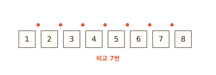
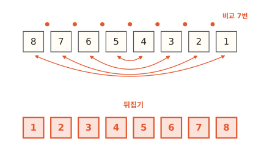
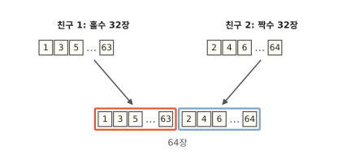
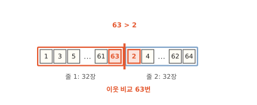
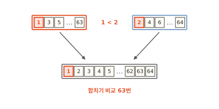
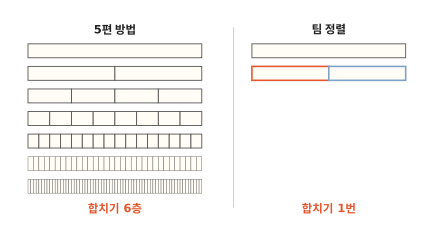
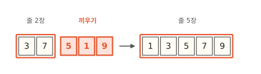
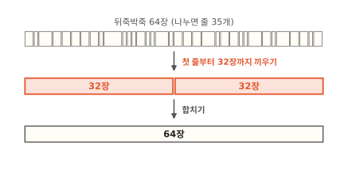

# 팀 정렬: 파이썬이 이미 정리된 줄을 살려 정렬하는 법

1부터 64까지 적힌 카드 64장이 있어요. 친구 둘이 홀수 카드와 짝수 카드를 나눠 작은 수부터 정리한 다음 두 줄을 그냥 이어서 나에게 줬어요. 이 64장은 벌써 반쯤 정리돼 있는데 처음부터 다시 정렬하면 아깝죠. 이 글을 읽고 나면 파이썬이 이미 정리된 부분을 찾아서 살려 쓰는 방법을 알게 돼요. 출석부 끝에 이름 하나를 더한 것처럼 반쯤 정리된 것을 다시 정렬할 일은 생각보다 자주 생겨요.

!!! abstract "이 글에서 알게 되는 것"
    1. 파이썬은 정렬을 시작하면 이웃한 두 장을 비교하며 이미 차례대로 이어진 줄부터 찾아요. 카드 8장이 차례대로면 비교 7번으로 끝나요.
    2. 거꾸로 이어진 줄은 통째로 뒤집고 너무 짧은 줄은 한 장씩 끼워 늘린 다음 줄끼리 합쳐요. 이 방법을 팀 정렬이라고 해요.
    3. 반쯤 정리된 카드에서는 처음부터 반씩 나누는 병합 정렬보다 일이 훨씬 적어요. 뒤죽박죽 카드에서는 병합 정렬과 비슷하고 갑자기 느려지는 순서가 없어요.

## 1. 이미 차례대로면 비교 7번으로 끝나요

파이썬은 컴퓨터에게 일을 시킬 때 쓰는 말(프로그래밍 언어) 가운데 하나예요. 파이썬에 카드를 정렬하라고 시키면 무엇부터 하는지 작은 예로 먼저 볼게요. 카드 여덟 장이 1, 2, 3, 4, 5, 6, 7, 8로 이미 차례대로 놓여 있어요.

파이썬은 맨 앞부터 옆에 붙은 두 장을 비교해 나가요. 아래 그림에서 카드 사이 위에 찍힌 빨간 점이 비교 한 번이에요.

**그림 1.** 카드 8장 사이는 일곱 군데라서 이웃끼리 비교하면 7번이에요.
{ .fig-cap }

1과 2, 2와 3, 3과 4… 7과 8까지 늘 뒤 카드가 더 커요. 일곱 번 비교하고 나면 파이썬은 "처음부터 끝까지 이어져 있네" 하고 끝내요.

사람은 한눈에 차례대로인 걸 알아요. 컴퓨터는 이웃한 두 장을 하나씩 비교해야 알 수 있어요. 그래서 일곱 번이 들어요.

[5편](05-merge-sort.md) 병합 정렬은 이 카드도 반씩 나눴다가 다시 합쳐요. 이미 차례대로라서 합칠 때마다 왼쪽 카드가 먼저 다 나가지만 그래도 비교는 해야 해요. 한 장짜리 둘을 합칠 때 1번씩 네 번, 두 장짜리 둘을 합칠 때 2번씩 두 번, 네 장짜리 둘을 합칠 때 4번이에요. 모두 12번이에요.

이렇게 옆에 붙은 카드가 뒤로 갈수록 계속 커지는 묶음을 이 글에서는 **이어진 줄**이라고 부를게요. 1, 3, 5, 7도 이어진 줄이에요.

## 2. 거꾸로 이어진 줄은 통째로 뒤집어요

앞에서는 카드가 차례대로였어요. 이번엔 8, 7, 6, 5, 4, 3, 2, 1처럼 거꾸로 놓여 있어요.

이웃끼리 비교하면 이번엔 늘 뒤 카드가 더 작아요. 일곱 번 비교하면 거꾸로 다 이어져 있다는 걸 알게 돼요. 아래 그림에서 빨간 화살표가 어느 카드끼리 잇는지 보세요.

**그림 2.** 양 끝 카드부터 맞바꾸면 거꾸로 이어진 줄이 차례대로 바뀌어요.
{ .fig-cap }

맨 앞 8과 맨 뒤 1을 맞바꿔요. 7과 2, 6과 3, 5와 4도 맞바꿔요. 어느 쪽이 큰지 이미 알고 있으니 뒤집을 때는 비교하지 않아요. 그래서 비교는 모두 7번이에요.

[4편](04-insertion-sort.md) 삽입 정렬로 거꾸로 받은 8장을 한 장씩 끼우면 1 + 2 + … + 7 = 28번 비교해요. 새 카드가 들어올 때마다 맨 앞까지 가야 하거든요. 파이썬은 거꾸로 이어진 줄을 찾으면 한 번에 뒤집으니 그럴 필요가 없어요.

## 3. 이어진 줄이 둘이면 맨 앞끼리 비교하며 합쳐요

이제 처음에 말한 친구 카드 64장으로 돌아가요. 아래 그림에서 위의 두 줄이 친구 둘이 정리한 카드이고 아래 줄이 내가 받은 카드예요.

**그림 3.** 내가 받은 64장은 홀수 32장 줄 뒤에 짝수 32장 줄을 이어 놓은 거예요.
{ .fig-cap }

파이썬은 친구가 둘이었다는 걸 몰라요. 그래서 앞에서처럼 맨 앞부터 이웃끼리 비교해 나가요. 아래 그림에서 빨간 세로줄이 그어진 곳을 보세요.

**그림 4.** 63 다음에 2가 와서 줄이 끊기고 32장짜리 줄 둘이 나와요.
{ .fig-cap }

1, 3, 5로 계속 커지다가 63 다음에 2가 와요. 여기서 "끊겼네" 하고 첫 줄을 마쳐요. 그 뒤로는 64까지 또 이어져 있어서 줄이 둘이에요. 카드 64장 사이는 63군데라서 줄을 찾는 데 이웃 비교 63번이 들어요.

줄 둘을 찾았으면 5편에서 배운 대로 합쳐요. 두 줄의 맨 앞 카드끼리 비교해서 작은 카드를 새 줄에 놓아요. 아래 그림에서 맨 앞의 빨간 카드 둘을 보세요.

**그림 5.** 맨 앞 1과 2 가운데 작은 1을 먼저 놓아요. 이렇게 63번 비교하면 64장이 한 줄이 돼요.
{ .fig-cap }

1과 2를 비교하면 1이 작아서 1을 놓아요. 다음엔 3과 2를 비교해서 2를 놓아요. 비교 한 번에 카드 한 장씩 놓다가 한쪽 줄이 바닥나면 남은 64는 비교 없이 붙여요. 그래서 합치기도 63번이에요.

이렇게 이어진 줄을 찾아 그대로 쓰고 줄끼리 합쳐서 정렬하는 방법을 **팀 정렬**(Timsort)이라고 해요. 앞에서 본 거꾸로 이어진 줄 뒤집기도 팀 정렬이 하는 일이에요. "팀"은 이 방법을 만든 팀 피터스의 이름이에요. 팀 피터스는 2003년에 이 방법을 파이썬에 넣었고[^py23] 자바도 이 방법을 옮겨 가 써요.[^jdk]

팀 정렬은 줄 찾기 63번과 합치기 63번으로 모두 126번 비교했어요.[^lab] 5편 병합 정렬이었다면 어땠을까요? 아래 그림에서 왼쪽과 오른쪽의 층 수를 비교해 보세요.

**그림 6.** 5편 방법은 64장을 한 장씩 될 때까지 나눴다가 여섯 층을 합치고 팀 정렬은 한 번만 합쳐요.
{ .fig-cap }

5편 방법은 이미 차례대로인 부분이 있어도 알아보지 않아요. 64장을 반씩 여섯 번 나눠서 한 장씩 만든 다음 여섯 층에 걸쳐 다시 합쳐요. 층마다 카드 64장을 모두 다시 놓아요. 팀 정렬은 줄 둘을 찾아서 한 번만 합치니 카드를 64장 놓는 일도 한 번뿐이에요.

## 4. 줄이 너무 짧으면 한 장씩 끼워서 늘려요

친구 카드는 줄이 32장씩 길었어요. 그런데 카드가 뒤죽박죽이면 어떨까요? 두세 장 이어지다가 금방 끊겨요. 짧은 줄이 수십 개 나오고 그걸 다 합치려면 합치기를 아주 여러 번 해야 해요.

그래서 파이썬은 줄이 짧으면 뒤에 오는 카드를 한 장씩 끼워 넣어서 줄을 길게 만들어요. 아래 그림에서 빨간 카드 세 장이 어디로 들어가는지 보세요.

**그림 7.** 2장짜리 줄 3, 7에 5, 1, 9를 끼워서 5장짜리 줄 1, 3, 5, 7, 9를 만들었어요.
{ .fig-cap }

끼우는 일은 4편과 같아요. 다만 끼울 자리를 찾을 때는 오른쪽 끝부터 하나씩 보지 않아요. [3편](03-why-sorted-is-fast.md) 업다운 놀이처럼 가운데부터 보고 반씩 버리며 찾아요. 카드가 뒤죽박죽이면 이쪽이 비교가 적어요.

얼마나 길게 늘릴지도 정해져 있어요. 카드가 64장이면 줄이 짧을 때마다 32장까지 늘려요. 64장의 딱 반이에요. 카드가 64장보다 적으면 맨 앞 줄 하나에 나머지 카드를 모두 끼워 넣어서 끝내요. 1절의 8장은 줄 하나가 이미 8장 전부라서 끼울 카드가 없었어요.

5편 끝에서 파이썬 같은 프로그래밍 언어가 쓰는 정렬은 삽입 정렬과 병합 정렬을 섞는다고 했어요. 짧은 줄은 끼워서 늘리고 긴 줄끼리는 합치는 팀 정렬이 그 방법이에요.

## 5. 뒤죽박죽 카드에서도 크게 느려지지 않아요

이번엔 카드 64장을 아무렇게나 섞어서 팀 정렬에 맡겨 볼게요. 아래 그림의 맨 윗줄은 섞인 카드를 이어진 줄로 나눠 본 모습이에요. 칸 하나가 줄 하나예요.

**그림 8.** 줄로 나누면 35개나 될 만큼 뒤죽박죽이지만 팀 정렬은 32장 줄 둘을 만들어 한 번만 합쳐요.
{ .fig-cap }

줄로 나눠 보면 35개가 나올 만큼 뒤죽박죽이에요. 팀 정렬이 이 35개를 다 찾지는 않아요. 찾은 첫 줄은 짧아요. 그래서 뒤 카드를 끼워 32장까지 늘려요. 남은 32장에서도 맨 앞 줄을 찾아 같은 방법으로 32장까지 늘려요. 그다음 둘을 한 번 합쳐요.

이렇게 섞인 카드에는 이미 정리된 부분이 거의 없어요. 그래서 팀 정렬과 5편 병합 정렬의 비교 수가 거의 같아요.[^lab] 반쯤 정리된 카드에서는 훨씬 빠르고 뒤죽박죽 카드에서는 비슷한 거예요.

[6편](06-quick-sort.md) 퀵 정렬은 차례대로 놓인 카드에서 맨 앞 카드를 기준으로 잡으면 아주 느려졌어요. 팀 정렬에는 그렇게 갑자기 느려지는 순서가 따로 없어요. 차례대로면 줄 하나, 거꾸로면 뒤집기 한 번, 뒤죽박죽이면 끼우고 합치기예요.

처음에 말한 출석부도 다시 볼게요. 가나다순으로 정리된 출석부 끝에 전학생 이름 하나를 더해서 다시 정렬해요. 앞의 이름들은 모두 이어진 줄이에요. 팀 정렬은 긴 줄 하나를 찾고 남은 이름 하나를 끼워 넣어서 금방 끝내요.

## 확인 문제

??? question "1. 줄 찾기"
    카드 3, 5, 8, 2, 4, 9에서 이어진 줄을 찾으면 어떻게 나뉠까요?

    **풀이**: 3, 5, 8과 2, 4, 9로 줄이 두 개예요. 8 다음에 2가 와서 거기서 끊겨요.

??? question "2. 거꾸로 여섯 장"
    카드 6, 5, 4, 3, 2, 1을 팀 정렬로 정렬하면 비교는 몇 번일까요?

    **풀이**: 5번이에요. 이웃끼리 다섯 번 비교하면 거꾸로 이어진 줄 하나라는 걸 알아요. 그다음 통째로 뒤집어요. 뒤집을 때는 비교하지 않아요.

## 정리

파이썬은 카드를 정렬할 때 맨 앞부터 이웃한 두 장을 비교하며 이미 차례대로 이어진 줄을 찾아요. 카드 8장이 차례대로면 비교 7번으로 끝나요. 거꾸로 이어져 있으면 7번 비교한 다음 통째로 뒤집어요.

친구 둘이 정리한 64장에서는 32장짜리 줄 둘을 찾아 맨 앞끼리 비교하며 한 번 합쳤어요. 줄이 너무 짧으면 한 장씩 끼워서 늘린 다음 합쳐요. 이렇게 이어진 줄을 살려 쓰는 방법이 팀 정렬이에요. 반쯤 정리된 카드에서는 병합 정렬보다 훨씬 적게 일하고 뒤죽박죽 카드에서는 병합 정렬과 비슷해요.

4편부터 이 글까지 본 정렬은 모두 두 장을 비교했어요. 비교를 더 줄일 수는 없을까요? [8편](08-counting-sort.md)에서 비교가 몇 번은 꼭 필요한지 세어 보고 비교하지 않는 정렬도 해 봐요.

### 새로 나온 말

- **이어진 줄**: 옆에 붙은 카드가 뒤로 갈수록 계속 커지는 묶음. 친구 카드 64장에는 홀수 32장 줄과 짝수 32장 줄이 있었어요.
- **팀 정렬**(Timsort): 이어진 줄을 찾아 살려 쓰는 정렬. 거꾸로 이어진 줄은 뒤집고 짧은 줄은 끼워 늘린 다음 줄끼리 합쳐요. 파이썬이 쓰는 정렬 방법이에요.

[^lab]: 비교 수 126번과 뒤죽박죽 카드에서 병합 정렬과 비슷하다는 것은 비교할 때마다 수를 세는 카드로 파이썬 `sorted()`를 돌려서 확인했어요([`lab/07_timsort.py`](https://github.com/oya150/bedrock/blob/main/lab/07_timsort.py)). 팀 정렬의 자세한 규칙은 CPython 소스의 [`Objects/listsort.txt`](https://github.com/python/cpython/blob/3.12/Objects/listsort.txt)에 있어요.
[^py23]: Python 문서 ["What's New in Python 2.3"](https://docs.python.org/3/whatsnew/2.3.html)의 Optimizations 절. 파이썬 2.3은 2003년 7월에 나왔어요.
[^jdk]: OpenJDK [`java/util/TimSort.java`](https://github.com/openjdk/jdk/blob/jdk-21%2B35/src/java.base/share/classes/java/util/TimSort.java) 머리말에 파이썬의 list sort를 옮겼다고 적혀 있어요.
