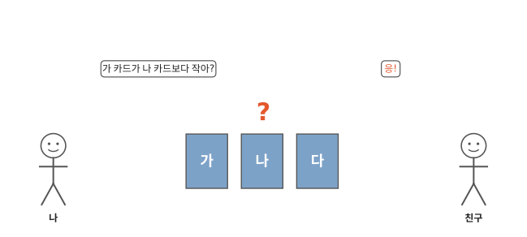
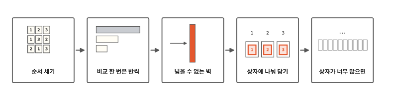
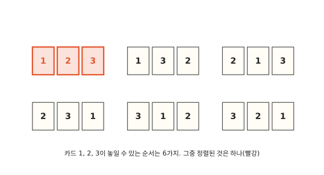
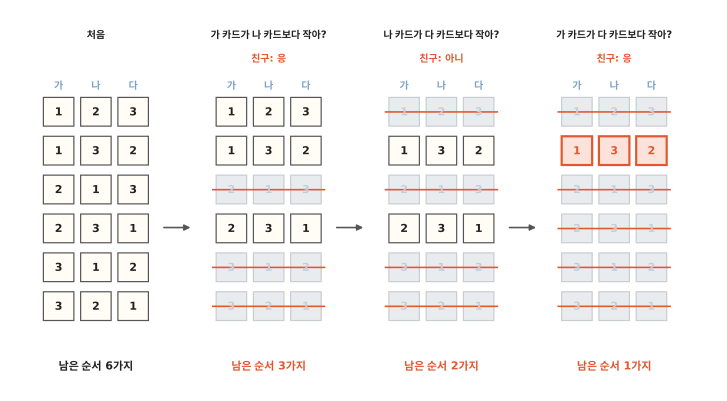
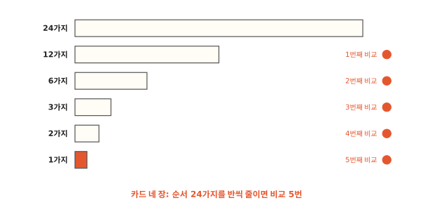
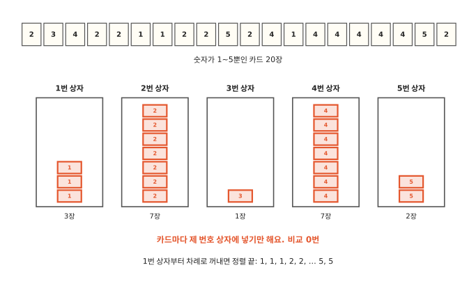
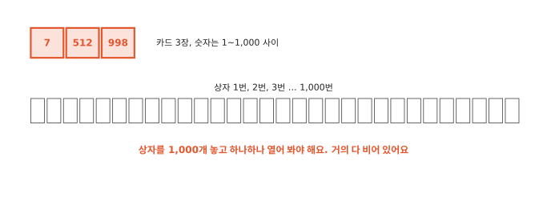

# 비교하지 않고 정렬할 수 있을까요?

## 뒤집은 카드 세 장

친구가 숫자 카드 1, 2, 3을 섞어서 뒤집어 놓았어요. 카드 뒷면에는 가, 나, 다라고 적혀 있어요. 나는 카드를 볼 수 없어요. 친구에게 "가 카드가 나 카드보다 작아?"처럼 두 장을 비교하는 질문만 할 수 있어요. 친구는 "응"이나 "아니"로만 대답해요.

운이 아무리 나빠도 질문을 몇 번 하면 세 카드의 숫자를 다 알 수 있을까요? 4편부터 7편까지 본 정렬 방법은 모두 이렇게 두 장을 비교했어요. 이 놀이로 비교가 몇 번이나 꼭 필요한지 알아봐요.

## 순서 세기에서 상자까지

알고리즘 여덟 번째 편이에요. 카드가 놓일 수 있는 순서가 몇 가지인지 세어 보고 질문 하나가 그걸 얼마나 줄이는지 봐요. 그러면 비교만으로는 더 줄일 수 없는 횟수가 나와요. 그림에서는 이걸 벽으로 그렸어요. 뒤쪽에서는 비교하지 않고 정렬하는 방법과 그 방법을 쓰기 어려운 때를 봐요.

## 카드 세 장은 순서가 6가지예요

카드 1, 2, 3이 놓일 수 있는 순서를 다 적어 봐요. 1이 맨 앞이면 1 2 3과 1 3 2, 두 가지예요. 2가 맨 앞이면 2 1 3과 2 3 1이에요. 3이 맨 앞이면 3 1 2와 3 2 1이에요. 모두 6가지예요.

뒤집힌 카드는 이 6가지 가운데 하나로 놓여 있어요. 나는 질문을 해서 그게 어느 것인지 알아내야 해요.

## 질문 하나로 많아야 반이 지워져요

그림의 줄은 가, 나, 다 카드에 놓인 숫자예요. 첫 질문 "가 카드가 나 카드보다 작아?"에 친구가 "응"이라고 했어요. 그러면 가 자리 숫자가 나 자리 숫자보다 큰 줄은 답이 될 수 없어요. 2 1 3은 가가 2, 나가 1이라 가가 더 커요. 그래서 지워요. 3 1 2와 3 2 1도 같은 까닭으로 지워요. 3가지가 남았어요.

친구가 "아니"라고 했다면 반대쪽 세 줄이 남았을 거예요. 어느 대답이 나와도 3가지가 남아요. 3편 업다운 놀이에서 "업!"이나 "다운!" 한마디를 들으면 남은 숫자가 반으로 줄었지요. 대답이 둘뿐인 질문은 이렇게 남은 것을 많아야 반으로 줄여요.

둘째 질문 "나 카드가 다 카드보다 작아?"에 친구가 "아니"라고 했어요. 남은 세 줄 가운데 1 2 3은 나가 2, 다가 3이라 나가 더 작아요. 대답과 맞지 않으니 지워요.

사탕 세 개를 둘이 나누면 두 개와 한 개가 되지요. 남은 순서 3가지도 질문 하나로 똑같이 반씩 나눌 수 없어요. 2가지와 1가지로 나뉘고, 이번엔 2가지 쪽이 남았어요.

셋째 질문 "가 카드가 다 카드보다 작아?"에 "응"이 나왔어요. 2 3 1은 가가 2, 다가 1이라 지워지고 1 3 2 하나만 남아요. 가는 1, 나는 3, 다는 2였어요.

이번엔 질문 세 번이 걸렸어요. 운이 나쁘면 어떤 질문을 골라도 세 번은 걸려요.

## 카드 네 장이면 비교 5번

카드가 네 장이면 놓일 수 있는 순서가 24가지로 늘어요. 맨 앞 카드가 1, 2, 3, 4 가운데 하나로 정해지면 뒤의 세 장은 앞에서 센 것처럼 6가지예요. 6 + 6 + 6 + 6 = 24가지예요. 질문 하나로 많아야 반씩 지워지니 그림처럼 다섯 번은 물어야 1가지가 남아요.

5편 병합 정렬은 카드를 반으로 나눴다가 맨 앞끼리 비교하며 합쳤어요. 이번에 네 장으로 모든 순서를 다 해 보니 병합 정렬은 운이 제일 나빠도 비교 5번이었어요. 비교만 하는 방법으로는 이보다 줄일 수 없어요.

카드가 많아지면 이 횟수도 같이 늘어요. 비교 말고 다른 방법을 써야 이 벽을 넘을 수 있어요.

## 숫자마다 상자를 놓아요

이번엔 카드 20장이 있어요. 카드에 적힌 숫자는 1, 2, 3, 4, 5 다섯 가지뿐이고 같은 숫자 카드가 여러 장 있어요.

상자 다섯 개를 놓고 1번부터 5번까지 번호를 붙여요. 카드를 한 장씩 집어서 카드 숫자와 같은 번호의 상자에 넣어요. 2가 적힌 카드는 2번 상자, 4가 적힌 카드는 4번 상자예요. 숫자만 보면 넣을 상자가 정해지니 다른 카드와 비교할 일이 없어요.

다 넣었으면 상자마다 카드가 몇 장인지 세어요. 1번 상자 3장, 2번 상자 7장… 이렇게 장수만 알면 1을 세 장, 2를 일곱 장 차례로 이어 놓아서 줄을 만들 수 있어요. 비교는 한 번도 하지 않았어요.

이렇게 숫자마다 카드가 몇 장인지 세어서 정렬하는 방법을 **계수 정렬**이라고 해요. "계수"는 개수를 센다는 뜻이에요.

2편에서 사물함은 번호만 알면 몇 번 칸이든 바로 찾아갔어요. 계수 정렬도 카드 숫자가 곧 상자 번호라서 바로 넣을 수 있어요.

같은 카드 20장을 7편에서 본 파이썬의 팀 정렬로 정렬하면 비교를 62번 해요. 상자에 넣을 때는 비교가 0번이에요. 대신 카드 20장을 한 장씩 상자에 넣는 일은 해야 해요.

## 상자가 너무 많으면

이번엔 카드가 세 장뿐인데, 카드 숫자가 1부터 1,000 사이 아무 수나 될 수 있어요. 그러면 상자가 1,000개 필요해요. 카드 세 장을 넣고 나서 1번 상자부터 1,000번 상자까지 하나하나 열어 봐야 해요. 거의 다 빈 상자예요.

카드 세 장은 4편처럼 한 장씩 끼워 넣어도 비교 몇 번이면 끝나요. 계수 정렬은 가장 작을 수 있는 숫자부터 가장 클 수 있는 숫자까지 사이가 좁을 때 써요. 상자를 그 사이 숫자만큼 놓아야 하니까요. 0점부터 100점까지인 시험 점수, 나이, 학년 같은 것이에요.

숫자 말고 이름이면 어떨까요? 이름에는 상자 번호가 없어요. 이름을 번호로 바꿀 수 있다면 2편 사물함처럼 바로 찾아갈 수 있을까요? 다음 편에서 볼게요.

## 정리

- **비교 한 번**: 두 장을 비교하는 질문은 대답이 둘이라 남은 순서를 많아야 반으로 줄여요. 카드 세 장은 3번, 네 장은 5번이 꼭 필요해요.
- **계수 정렬**: 숫자마다 상자를 놓고 카드를 제 번호 상자에 넣은 다음, 상자마다 장수를 세어 작은 숫자부터 이어 놓아요. 두 장을 비교하지 않아요. 가장 작을 수 있는 숫자부터 가장 클 수 있는 숫자까지 사이가 좁을 때 써요.

## 해 보기: 질문 세 번 놀이

카드 1, 2, 3과 바둑돌을 준비해요. 둘이 해요.

1. 친구가 카드 세 장을 섞어 뒤집어 놓고 뒷면에 가, 나, 다를 붙여요.
2. 종이에 6가지 순서를 다 적어 둬요.
3. "가 카드가 나 카드보다 작아?"처럼 두 장을 비교하는 질문을 해요. 질문할 때마다 바둑돌을 하나 놓고 답이 될 수 없는 줄을 지워요.
4. 한 줄만 남으면 카드를 뒤집어 확인해요.
5. 이미 아는 것은 다시 묻지 않기로 해요. 그러면 바둑돌이 네 개 필요한 적이 있을까요?
6. 이번엔 종이 스무 장에 1부터 5까지 숫자를 같은 숫자가 여러 번 나오게 적어요. 섞어서 컵이나 종이 상자에 숫자별로 나눠 담아 봐요.

## 확인 문제

??? question "1. 카드 두 장"
    카드 두 장이 놓일 수 있는 순서는 몇 가지이고, 비교는 몇 번이면 될까요?

    **풀이**: 1 2와 2 1로 2가지예요. "앞 카드가 뒤 카드보다 작아?" 한 번이면 알아요.

??? question "2. 상자에 담기"
    숫자가 1~3뿐인 카드 3, 1, 2, 3, 1을 상자에 나눠 담았다가 1번 상자부터 꺼내면 어떻게 놓일까요? 비교는 몇 번 할까요?

    **풀이**: 1, 1, 2, 3, 3이에요. 1번 상자에 두 장, 2번 상자에 한 장, 3번 상자에 두 장이 들어가요. 비교는 0번이에요.

??? question "3. 계수 정렬이 안 좋은 때"
    카드가 세 장이고 숫자는 1부터 1,000 사이 아무 수예요. 계수 정렬이 좋을까요?

    **풀이**: 좋지 않아요. 상자가 1,000개 필요하고 꺼낼 때 상자를 다 열어 봐야 해요. 세 장이면 비교해서 정렬하는 게 빨라요.

!!! abstract "어른을 위한 정리 (건너뛰어도 돼요)"
    - 비교 정렬의 하한: 원소 n개의 순서는 n!가지이고 비교 한 번은 결과가 둘이라, 어떤 비교 정렬이든 최악의 경우 적어도 ⌈log₂ n!⌉번은 비교해야 해요. log₂ n!은 대략 n log₂ n이라서 비교 정렬의 최악은 Ω(n log n)이에요. 3개는 3번, 4개는 5번, 5개는 7번, 8개는 16번이에요.[^lab]
    - 실제 구현은 하한보다 조금 더 써요. 파이썬 `sorted()`는 모든 순서를 돌려 보면 최악일 때 3개 4번, 4개 6번, 8개 18번 비교했어요. 짧은 입력은 먼저 이어진 줄을 찾느라 비교를 한 번 더 한 뒤 이진 삽입 정렬로 처리하기 때문이에요. 5편 병합 정렬은 4개에서 최악 5번으로 하한과 같았어요.[^lab]
    - 계수 정렬은 값의 범위가 k가지일 때 O(n + k)예요. 값마다 개수를 센 뒤 누적합으로 각 값이 들어갈 자리를 정하는 게 원래 방식이에요. 본문처럼 카드를 상자(리스트)로 옮기는 방식은 비둘기집 정렬(pigeonhole sort)에 더 가까워요. 생각은 같아서 본문에서는 상자로 보여 줬어요. 넣은 순서대로 꺼내면 같은 값끼리의 순서가 지켜지는 안정 정렬이 돼요. 자리수마다 안정한 계수 정렬을 되풀이하면 기수 정렬이에요.
    - 순수 파이썬으로 0~100 사이 정수 10만 개를 정렬하면 계수 정렬은 2.5밀리초쯤, 5편 병합 정렬(비교 수를 세는 코드 포함)은 170밀리초쯤 걸렸어요. C로 짠 `sorted()`도 7밀리초쯤이었어요. 값이 101가지뿐이라 파이썬으로 짠 계수 정렬이 C로 짠 비교 정렬보다 빨랐어요.[^lab]

## 더 깊이

??? info "어떤 순서든 질문 세 번이면 돼요"
    

    본문에서는 한 가지 길만 따라갔어요. 이 나무는 친구가 어떤 대답을 하든 다음에 무엇을 물으면 되는지 다 그려 놓은 거예요. 맨 아래 빨간 칸은 숫자 줄 대신 작은 카드부터 이름을 적었어요. 본문의 1 3 2는 가가 1, 다가 2, 나가 3이라서 "가 다 나"예요.

    왜 세 번보다 적게는 안 될까요? 친구가 늘 남은 순서가 더 많은 쪽으로 대답한다고 해 봐요. 어떤 질문을 해도 첫 대답 뒤에는 적어도 3가지가 남아요. 둘째 대답 뒤에도 적어도 2가지가 남아요. 그래서 두 번만 물어서는 꼭 알 수가 없어요.

??? info "카드 다섯 장이면"
    카드 다섯 장은 놓일 수 있는 순서가 120가지예요. 반씩 줄여 나가면 비교가 적어도 일곱 번 필요해요.

??? info "받아쓰기 시험지 정리"
    받아쓰기 점수가 0점부터 10점까지라면 상자 11개를 놓으면 돼요. 반 친구들 시험지를 점수 상자에 넣었다가 0점 상자부터 꺼내면 점수 순서대로 모여요.

??? info "자리마다 나눠 담기"
    숫자가 1부터 999까지라 상자가 너무 많으면, 일의 자리로 먼저 상자 10개에 나눠 담았다가 꺼내요. 그다음 십의 자리, 백의 자리로 같은 일을 해요. 상자는 10개만 있으면 돼요. 이 방법을 기수 정렬이라고 해요.

[^lab]: [`lab/08_counting.py`](https://github.com/oya150/bedrock/blob/main/lab/08_counting.py)로 센 값이에요(CPython 3.12.7, Apple Silicon 노트북). 순서의 가짓수와 반씩 줄일 때 필요한 비교 수, 세 장 나무가 모든 순서에서 세 번 안에 끝나는지, 병합 정렬 4장 최악 5번, `sorted()` 3·4·8장 최악 4·6·18번, 카드 20장의 상자별 장수와 `sorted()` 비교 62번을 이 스크립트로 확인했어요. 시간은 다시 재면 조금씩 달라져요.
