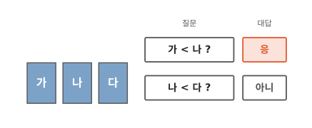
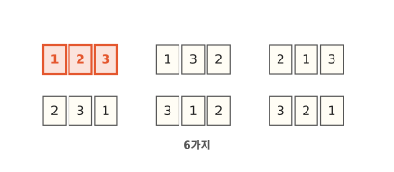
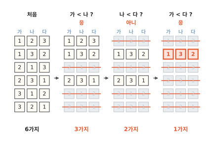
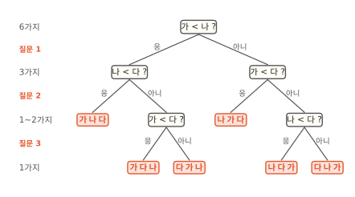
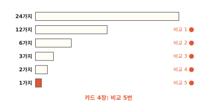
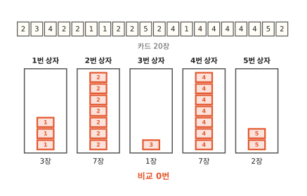
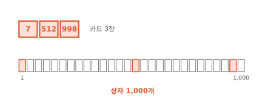

# 비교 정렬의 한계와 계수 정렬: 상자에 나눠 담아 정렬하는 법

친구가 숫자 카드 1, 2, 3을 섞어서 뒤집어 놓고 "이 카드가 저 카드보다 작아?"라는 질문에만 대답해 줘요. [4편](04-insertion-sort.md)부터 [7편](07-timsort.md)까지 본 정렬도 모두 이렇게 두 장을 비교하며 일했어요. 이 글에서는 비교만 하는 정렬이 적어도 몇 번은 비교해야 하는지 알게 돼요. 비교 없이 정렬하는 방법도 해 봐요.

!!! abstract "이 글에서 알게 되는 것"
    1. 카드 세 장이 놓일 수 있는 순서는 6가지예요. 두 장을 비교하는 질문 하나는 대답이 둘뿐이라서 남은 순서를 많아야 반으로 줄여요.
    2. 그래서 비교만 하는 정렬은 운이 나쁘면 세 장에 3번, 네 장에 5번은 꼭 비교해요. 카드가 늘면 이 횟수도 늘어요.
    3. 숫자마다 상자를 놓고 카드를 제 번호 상자에 넣으면 비교 없이 정렬돼요. 이걸 계수 정렬이라고 하고 숫자 범위가 좁을 때 써요.

## 1. 카드 세 장은 놓일 수 있는 순서가 6가지예요

친구가 뒤집어 놓은 카드 세 장의 뒷면에는 가, 나, 다라고 적혀 있어요. 나는 "가 카드가 나 카드보다 작아?"처럼 두 장을 비교하는 질문만 할 수 있어요. 친구는 "응"이나 "아니"로만 대답해요. 질문을 줄여 쓰려고 이 글에서는 "가 카드가 나 카드보다 작아?"를 "가 < 나 ?"로 적을게요.

**그림 1.** 뒤집은 카드 세 장을 두고 두 장씩 비교하는 질문만 할 수 있어요.
{ .fig-cap }

숫자를 알아내려면 먼저 답이 될 수 있는 것을 다 적어 봐요. 카드 1, 2, 3이 놓일 수 있는 순서예요. 1이 맨 앞이면 1 2 3과 1 3 2, 두 가지예요. 2가 맨 앞이면 2 1 3과 2 3 1이에요. 3이 맨 앞이면 3 1 2와 3 2 1이에요. 아래 그림에서 모두 몇 줄인지 세어 보세요.

**그림 2.** 카드 1, 2, 3이 놓일 수 있는 순서는 6가지이고 그중 정렬된 것은 빨간 1 2 3 하나예요.
{ .fig-cap }

뒤집힌 카드는 이 6가지 가운데 하나로 놓여 있어요. 질문을 해서 그게 어느 것인지 알아내면 카드를 정렬할 수 있어요.

## 2. 질문 하나는 남은 순서를 많아야 반으로 줄여요

앞에서 적은 6가지 순서를 질문으로 지워 나가 볼게요. 아래 그림에서 줄마다 가, 나, 다 카드에 놓인 숫자를 적었어요. 질문을 하나 할 때마다 빨간 줄로 지워지는 순서를 보세요.

**그림 3.** 질문 세 번에 남은 순서가 6가지, 3가지, 2가지, 1가지로 줄었어요.
{ .fig-cap }

첫 질문 "가 < 나 ?"에 친구가 "응"이라고 했어요. 그러면 가 자리 숫자가 나 자리 숫자보다 큰 줄은 답이 될 수 없어요. 2 1 3은 가가 2, 나가 1이라 가가 더 커요. 그래서 지워요. 3 1 2와 3 2 1도 같은 까닭으로 지워요. 3가지가 남았어요.

친구가 "아니"라고 했다면 반대쪽 세 줄이 남았을 거예요. 어느 대답이 나와도 3가지가 남아요. [3편](03-why-sorted-is-fast.md) 업다운 놀이에서 "업!"이나 "다운!" 한마디를 들으면 남은 숫자가 반으로 줄었죠. 대답이 둘뿐인 질문은 남은 것을 많아야 반으로 줄여요.

둘째 질문 "나 < 다 ?"에 친구가 "아니"라고 했어요. 남은 세 줄 가운데 1 2 3은 나가 2, 다가 3이라 나가 더 작아요. 대답과 맞지 않으니 지워요. 사탕 세 개를 둘이 나누면 두 개와 한 개가 되죠. 남은 순서 3가지도 질문 하나로 똑같이 반씩 나눌 수 없어서 2가지와 1가지로 나뉘어요. 이번엔 2가지 쪽이 남았어요.

셋째 질문 "가 < 다 ?"에 "응"이 나왔어요. 2 3 1은 가가 2, 다가 1이라 지워지고 1 3 2 하나만 남아요. 가는 1, 나는 3, 다는 2였어요.

## 3. 세 장은 운이 나쁘면 세 번 물어야 해요

앞에서는 질문 세 번으로 답을 찾았어요. 여기서 이런 생각이 들 거예요. 질문을 더 잘 고르면 두 번에 끝낼 수 있지 않을까?

아래 나무 그림은 친구가 어떤 대답을 하든 다음에 무엇을 물으면 되는지 다 그려 놓은 거예요. 맨 위 질문에서 출발해서 대답에 따라 갈래를 타고 내려가요. 빨간 칸에는 작은 카드부터 이름을 적었어요. 그림 3의 1 3 2는 가가 1, 다가 2, 나가 3이라서 "가 다 나"예요. 왼쪽의 층마다 남은 순서 수를 보세요.

**그림 4.** 어느 길로 가도 질문 세 번 안에 끝나고 운이 좋으면 두 번에 끝나요.
{ .fig-cap }

운이 좋으면 두 번에 끝나는 길도 있어요. "가 < 나 ?"에 응, "나 < 다 ?"에 응이면 가 나 다로 바로 정해져요. 하지만 늘 그렇게 되지는 않아요.

친구가 심술궂게 대답한다고 해 봐요. 질문을 받을 때마다 남은 순서가 더 많아지는 쪽으로 대답해요. 첫 질문이 무엇이든 6가지는 3가지와 3가지로 나뉘니까 3가지가 남아요. 둘째 질문에서 3가지는 2가지와 1가지로 나뉘고 친구는 2가지 쪽으로 대답해요. 아직 둘 가운데 무엇인지 몰라서 셋째 질문을 해야 해요. 그래서 질문을 어떻게 골라도 운이 나쁘면 세 번이 걸려요.

## 4. 카드 네 장이면 적어도 5번 비교해요

카드가 한 장 늘면 어떻게 될까요? 앞에서 한 방법대로 순서부터 세어 볼게요. 맨 앞 카드가 1, 2, 3, 4 가운데 하나로 정해지면 뒤의 세 장은 앞에서 센 것처럼 6가지예요. 6 + 6 + 6 + 6 = 24가지예요. 아래 그림에서 막대가 1가지까지 줄어드는 데 비교가 몇 번 드는지 보세요.

**그림 5.** 24가지를 반씩 줄여 1가지가 되려면 비교가 다섯 번 들어요.
{ .fig-cap }

24가지는 비교 한 번에 많아야 12가지로 줄어요. 12, 6, 3으로 줄고 3가지는 2가지와 1가지로 나뉘어요. 운이 나쁘면 2가지 쪽이 남아서 한 번 더 물어요. 그래서 다섯 번이에요.

[5편](05-merge-sort.md) 병합 정렬은 운이 제일 나쁠 때 네 장을 몇 번 비교할까요? 두 장씩 나누면 두 장짜리 묶음마다 1번씩 모두 2번 비교해요. 두 묶음을 합칠 때는 맨 앞끼리 비교하다가 한쪽이 바닥나면 멈춰요. 운이 나쁘면 마지막 한 장이 남을 때까지 3번 비교해요. 2 + 3 = 5번이에요. 그림 5에서 센 다섯 번과 딱 같아요.[^lab]

이렇게 두 장을 비교하는 것만으로 정렬하는 방법을 **비교 정렬**이라고 해요. 4편부터 7편까지 본 정렬이 모두 비교 정렬이에요. 비교 정렬은 아무리 잘 짜도 이 횟수 밑으로는 내려가지 못해요.

카드가 많아지면 이 횟수도 늘어요. 카드 다섯 장은 놓일 수 있는 순서가 120가지예요. 반씩 줄이면 60, 30, 15, 8, 4, 2, 1이라서 적어도 일곱 번 비교해야 해요. 이 횟수보다 줄이려면 비교 말고 다른 방법을 써야 해요.

## 5. 숫자마다 상자를 놓으면 비교하지 않아요

비교 말고 다른 방법이 있을까요? 이번엔 카드가 20장이고 숫자는 1, 2, 3, 4, 5 다섯 가지뿐이에요. 같은 숫자 카드가 여러 장 있어요.

상자 다섯 개를 놓고 1번부터 5번까지 번호를 붙여요. 카드를 한 장씩 집어서 카드 숫자와 같은 번호의 상자에 넣어요. 2가 적힌 카드는 2번 상자, 4가 적힌 카드는 4번 상자예요. 아래 그림에서 상자마다 카드가 몇 장 들었는지 보세요.

**그림 6.** 카드 20장을 숫자대로 상자에 넣었더니 3장, 7장, 1장, 7장, 2장이 들었고 비교는 한 번도 하지 않았어요.
{ .fig-cap }

숫자만 보면 넣을 상자가 정해져요. 다른 카드와 비교할 일이 없어요. [2편](02-why-arrays-are-fast.md)에서 사물함 번호만 알면 몇 번 칸이든 곧장 찾아갔죠. 여기서도 카드 숫자가 곧 상자 번호라서 곧장 넣을 수 있어요.

다 넣었으면 상자마다 카드가 몇 장인지 세어요. 1번 상자 3장, 2번 상자 7장, 3번 상자 1장, 4번 상자 7장, 5번 상자 2장이에요. 이 장수만 알면 1을 세 장, 2를 일곱 장 하는 식으로 차례로 이어 놓아서 정렬된 줄을 만들 수 있어요.

이렇게 숫자마다 카드가 몇 장인지 세어서 정렬하는 방법을 **계수 정렬**이라고 해요. "계수"는 개수를 센다는 뜻이에요.

비교는 0번이지만 일이 없는 건 아니에요. 카드 20장을 한 장씩 상자에 넣는 일은 20번 해요. 꺼낼 때는 1번부터 5번까지 상자 다섯 개를 차례로 열어 봐요.

## 6. 숫자 범위가 넓으면 상자가 너무 많아요

앞에서 상자를 차례로 열어 본다고 했어요. 상자가 다섯 개면 금방이에요. 상자가 아주 많으면 어떨까요?

이번엔 카드가 세 장뿐인데 숫자가 1부터 1,000 사이 아무 수나 될 수 있어요. 카드 숫자가 곧 상자 번호니까 상자가 1,000개 필요해요. 아래 그림에서 카드가 든 빨간 상자와 빈 상자의 수를 비교해 보세요.

**그림 7.** 카드 세 장을 넣으려고 상자를 1,000개 놓았는데 카드가 든 상자는 셋뿐이에요.
{ .fig-cap }

카드 세 장을 넣고 나면 1번 상자부터 1,000번 상자까지 하나하나 열어 봐야 해요. 거의 다 빈 상자예요. 카드 세 장은 4편처럼 한 장씩 끼워 넣으면 비교 몇 번으로 끝나요. 이럴 때는 계수 정렬이 오히려 손해예요.

그래서 계수 정렬은 가장 작을 수 있는 숫자부터 가장 클 수 있는 숫자까지 범위가 좁을 때 써요. 0점부터 100점까지인 시험 점수라면 상자 101개면 돼요. 나이나 학년도 범위가 좁아요.

## 확인 문제

??? question "1. 카드 두 장"
    카드 두 장이 놓일 수 있는 순서는 몇 가지이고 비교는 몇 번이면 될까요?

    **풀이**: 1 2와 2 1로 2가지예요. "앞 카드 < 뒤 카드 ?" 한 번이면 알아요.

??? question "2. 상자에 담기"
    숫자가 1~3뿐인 카드 3, 1, 2, 3, 1을 상자에 나눠 담았다가 1번 상자부터 꺼내면 어떻게 놓일까요? 비교는 몇 번 할까요?

    **풀이**: 1, 1, 2, 3, 3이에요. 1번 상자에 두 장, 2번 상자에 한 장, 3번 상자에 두 장이 들어가요. 비교는 0번이에요.

??? question "3. 받아쓰기 시험지"
    받아쓰기 점수는 0점부터 10점까지예요. 반 친구들 시험지를 계수 정렬로 점수 순서대로 모으려면 상자가 몇 개 필요할까요?

    **풀이**: 11개예요. 0점부터 10점까지 점수마다 상자 하나씩이에요. 시험지를 점수 상자에 넣었다가 0점 상자부터 꺼내면 점수 순서대로 모여요.

## 정리

카드 세 장이 놓일 수 있는 순서는 6가지예요. "가 < 나 ?"처럼 두 장을 비교하는 질문은 대답이 둘뿐이라서 남은 순서를 많아야 반으로 줄여요. 그래서 비교만 하는 정렬은 운이 나쁘면 세 장에 3번, 네 장에 5번, 다섯 장에 7번은 꼭 비교해요. 이렇게 비교만 하는 정렬을 비교 정렬이라고 해요.

비교 없이 정렬하려면 숫자마다 상자를 놓고 카드를 제 번호 상자에 넣으면 돼요. 상자마다 장수를 세어 작은 숫자부터 이어 놓는 이 방법이 계수 정렬이에요. 숫자 범위가 좁을 때는 빠르지만 범위가 넓으면 빈 상자를 여는 일이 더 커져요.

숫자 말고 이름이면 어떨까요? 이름에는 상자 번호가 없어요. 이름을 번호로 바꿀 수 있다면 사물함처럼 곧장 찾아갈 수 있을지 [9편](09-hash.md)에서 볼게요.

### 새로 나온 말

- **비교 정렬**: 두 장을 비교하는 것만으로 정렬하는 방법. 4편부터 7편까지 본 정렬이 모두 비교 정렬이에요. 카드 네 장이면 운이 나쁠 때 적어도 5번은 비교해요.
- **계수 정렬**: 숫자마다 상자를 놓고 카드를 제 번호 상자에 넣은 다음 상자마다 장수를 세어 작은 숫자부터 이어 놓는 정렬. 카드 20장을 1번부터 5번까지 상자에 넣을 때 비교는 0번이었어요.

[^lab]: 순서의 가짓수와 반씩 줄일 때 드는 비교 수, 세 장 나무가 모든 순서에서 세 번 안에 끝나는지, 병합 정렬이 네 장에서 운이 제일 나쁠 때 5번인지, 카드 20장의 상자별 장수는 [`lab/08_counting.py`](https://github.com/oya150/bedrock/blob/main/lab/08_counting.py)로 확인했어요.
