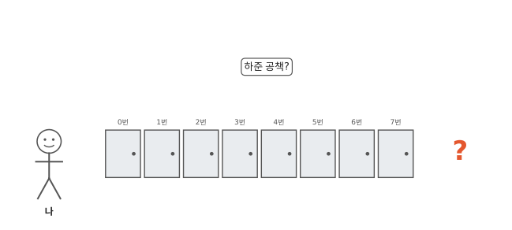
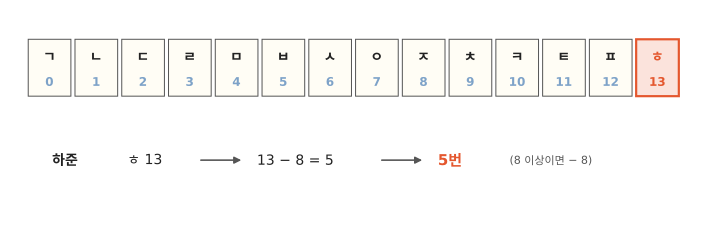
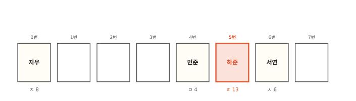
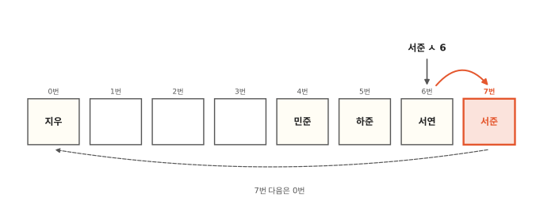
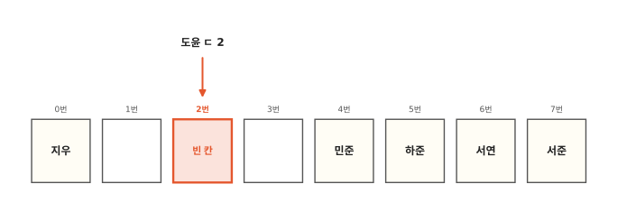
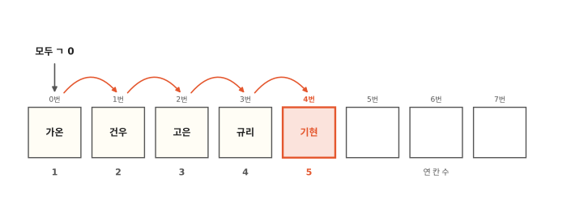
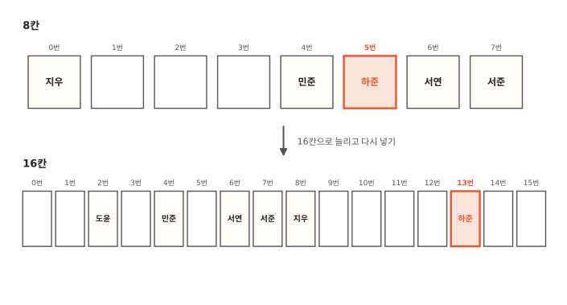

# 해시: 이름으로 칸을 바로 찾는 규칙

교실 사물함에 이름표가 없으면 친구 물건을 꺼내 달라는 부탁이 난감해요. 몇 번 칸인지 몰라서 앞에서부터 하나씩 열어 봐야 하거든요. 이 글을 읽고 나면 이름만 듣고 칸 하나를 바로 여는 방법을 알게 돼요. 파이썬 딕셔너리가 이름으로 값을 금방 꺼내는 것도 이 방법 덕분이에요.

!!! abstract "이 글에서 알게 되는 것"
    1. 이름을 칸 번호로 바꾸는 규칙을 정해 두면 넣을 때와 찾을 때 같은 칸을 바로 열 수 있어요. 이 규칙을 해시라고 해요.
    2. 두 이름이 같은 칸을 받으면 다음 빈 칸에 넣고 찾을 때도 같은 순서로 열어요. 한 칸에 많이 몰리면 하나씩 다 열어 보는 것과 같아져요.
    3. 칸이 거의 차면 사물함을 두 배로 늘리고 모두 다시 넣어요. 파이썬 딕셔너리가 이렇게 일해요.

## 1. 이름표가 없으면 하나씩 다 열어 봐야 해요

우리 반 사물함은 여덟 칸이에요. 컴퓨터처럼 첫 칸을 0번이라고 불러서 0번부터 7번까지 있어요. 첫 칸은 처음 자리에서 0칸 떨어져 있거든요. 어느 날 하준이가 "내 공책 좀 꺼내 줄래?" 하고 부탁했어요.

아래 그림에서 사물함 문을 보세요.


**그림 1.** 여덟 칸 모두 문이 닫혀 있고 이름표가 없어요.
{ .fig-cap }

어느 칸이 하준이 칸인지 알 길이 없어요. 0번부터 하나씩 열어 볼 수밖에 없죠. 운이 나쁘면 여덟 칸을 다 열어야 해요. [1편](01-why-big-o.md)에서 본 것처럼 하나씩 다 뒤지면 칸이 늘어나는 만큼 여는 횟수도 늘어요.

이름을 가나다순으로 정리해 두면 [3편](03-why-sorted-is-fast.md)처럼 가운데를 열어 보고 반씩 버리며 찾을 수 있어요. 그런데 새 친구가 전학 오면 가나다순에 맞는 자리에 끼워야 해요. 그러면 그 자리부터 끝까지 친구들이 물건을 한 칸씩 옮겨야 해요. [2편](02-why-arrays-are-fast.md)에서 본 일이에요.

2편 사물함은 번호만 알면 몇 번 칸이든 한 번에 열었어요. 이름만 알 때도 그렇게 열 수 있으면 좋겠죠.

## 2. 이름을 칸 번호로 바꾸면 칸 하나만 열면 돼요

이름에서 칸 번호를 얻는 규칙을 하나 정해 볼게요. 이름 첫 글자의 첫소리를 봐요. "민준"이면 ㅁ, "서연"이면 ㅅ이에요. 그리고 첫소리마다 번호를 하나씩 붙여요.

아래 표에서 ㅎ의 번호를 찾아보세요.


**그림 2.** ㄱ을 0으로 시작해 차례로 번호를 붙이면 ㅎ은 13이고 하준이는 5번 칸을 받아요.
{ .fig-cap }

ㅎ은 13이에요. 그런데 사물함은 7번 칸까지밖에 없어요. 그래서 번호가 8보다 크거나 같으면 8을 빼요. 13에서 8을 빼면 5라서 하준이 물건은 5번 칸에 넣어요. 같은 규칙으로 민준은 ㅁ이라 4번, 서연은 ㅅ이라 6번이에요. 지우는 ㅈ이라 8인데 8을 빼면 0이 돼서 0번 칸에 넣어요.

네 친구 물건을 넣은 사물함이 아래 그림이에요. 빨간 5번 칸을 보세요.


**그림 3.** 규칙대로 넣으니 하준이 물건은 5번 칸에 들어갔어요.
{ .fig-cap }

이제 하준이 공책을 찾아요. 넣을 때 쓴 규칙을 찾을 때도 써요. ㅎ은 13이고 8을 빼면 5. 5번 칸 하나만 열면 공책이 나와요. 앞에서부터 열어 볼 필요가 없어요.

이렇게 이름을 칸 번호로 바꾸는 규칙을 **해시**(hash)라고 해요. 영어로 잘게 다진다는 뜻이에요. 진짜 컴퓨터는 첫소리 하나만 보지 않아요. 컴퓨터는 글자마다 번호를 정해 둬요. 그리고 이름에 든 글자 번호를 모두 꺼내 마구 섞어서 칸 번호 하나를 만들어요. 우리 첫소리 규칙은 손으로 해 볼 수 있게 아주 줄인 해시예요.

## 3. 같은 칸을 받으면 다음 칸에 넣어요

규칙이 잘 돌아가던 중에 새 친구 서준이가 전학 왔어요. 서준은 ㅅ이라 6번 칸이에요. 그런데 6번 칸에는 벌써 서연이 물건이 있어요. 두 이름이 같은 칸 번호를 받은 거예요. 이런 일을 **충돌**이라고 해요.

충돌이 나면 다음 칸을 봐요. 7번 칸이 비어 있으니 서준이 물건은 7번 칸에 넣어요. 7번 칸도 차 있었다면 0번 칸으로 돌아가서 빈 칸을 찾아요. 사물함 끝과 처음이 이어져 있다고 생각하면 돼요.

아래 그림에서 빨간 화살표를 따라가 보세요.


**그림 4.** 서준이는 6번 칸을 받았지만 서연이 있어서 다음 7번 칸에 들어갔어요.
{ .fig-cap }

찾을 때도 같은 순서로 열어요. 규칙대로 6번 칸을 열면 서연이 물건이 나와요. 다음 7번 칸을 열면 서준이 물건이 있어요. 두 칸을 열었어요.

이번에는 아직 물건을 넣지 않은 도윤이 물건을 찾아볼게요. 도윤은 ㄷ이라 2번 칸이에요. 아래 그림에서 2번 칸을 보세요.


**그림 5.** 도윤이가 받는 2번 칸이 비어 있어요.
{ .fig-cap }

2번 칸이 비어 있어요. 도윤이 물건을 넣었다면 그때도 2번 칸이 비어 있었을 테니 2번 칸에 들어갔겠죠. 그래서 2번 칸 하나만 열어 보고 "도윤이 물건은 없어요"라고 말할 수 있어요. 규칙이 준 칸에 다른 친구 물건이 있을 때는 달라요. 빈 칸이 나올 때까지 이어서 열어 봐야 해요.

## 4. 한 칸에 몰리면 하나씩 다 열어 보는 것과 같아져요

서준이 때는 한 칸만 더 열면 됐어요. 같은 칸을 받는 이름이 많으면 어떨까요? 옆 반 친구 다섯은 가온, 건우, 고은, 규리, 기현이에요. 다섯 모두 첫소리가 ㄱ이라 규칙이 모두에게 0번 칸을 줘요.

가온이가 0번에 들어가면 건우는 다음 칸 1번으로 가요. 고은은 2번, 규리는 3번, 기현은 4번으로 밀려요. 아래 그림에서 기현이를 찾을 때 연 칸 수를 세어 보세요.


**그림 6.** 다섯 명이 모두 0번 칸을 받아서 기현이를 찾으려면 다섯 칸을 열어야 해요.
{ .fig-cap }

기현이 공책을 찾으려면 0번부터 4번까지 다섯 칸을 열어야 해요. 이름표 없는 사물함을 앞에서부터 여는 것과 다를 게 없어요. 규칙이 모든 이름에 같은 칸을 주면 해시를 쓰는 보람이 없어요.

그래서 좋은 해시는 이름을 여러 칸에 고르게 흩어 줘요. 첫소리 규칙은 이 점에서 나빠요. 우리 반에 ㄱ으로 시작하는 이름이 많으면 0번 칸 근처에 몰려요. 반대로 ㅋ이나 ㅌ으로 시작하는 이름은 드물어서 그 칸들은 늘 비어 있어요. 진짜 컴퓨터는 이름 글자를 모두 섞어서 칸 번호를 만들어요. 그래서 첫 글자가 같은 이름이나 비슷한 이름도 대개 서로 다른 칸으로 가요.

## 5. 칸이 거의 차면 사물함을 늘리고 모두 다시 넣어요

다시 우리 반이에요. 여덟 칸에 지우, 민준, 하준, 서연, 서준 다섯 명이 들어가서 빈 칸은 세 개뿐이에요. 4절에서 봤듯이 찬 칸이 줄줄이 이어지면 열어 볼 칸이 늘어요. 빈 칸이 적을수록 새 친구는 빈 칸을 찾아 여러 칸을 지나가야 하고 찾을 때도 그만큼 많이 열어야 해요. 그래서 여덟 칸 가운데 다섯 칸이 차면 더 넣지 않기로 해요.

여섯째 친구 도윤이가 오면 사물함을 16칸짜리로 바꿔요. 이제 15번 칸까지 있으니 규칙도 "16보다 크거나 같으면 16을 빼요"로 바꿔요. 그리고 다섯 친구 물건을 새 규칙으로 하나씩 다시 넣어요.

아래 그림에서 하준이 칸이 어디로 옮겨 가는지 보세요.


**그림 7.** 16칸으로 늘리고 다시 넣으니 하준이 물건은 5번에서 13번 칸으로 옮겨 갔어요.
{ .fig-cap }

하준은 13이에요. 16보다 작으니 빼지 않고 13번 칸에 넣어요. 지우는 8이라 8번 칸이에요. 민준과 서연은 전처럼 4번과 6번이에요. 서준은 이번에도 서연과 같은 6번을 받아서 7번 칸에 들어가요. 마지막으로 도윤이는 ㄷ이라 2번 칸에 넣어요. 칸이 두 배가 되니 빈 칸이 넉넉해서 겹치는 일이 줄어요.

다시 넣을 때는 칸 번호를 처음부터 새로 구해야 해요. 칸 수가 바뀌면 빼는 수도 바뀌어서 같은 이름이 다른 칸을 받거든요. 그래서 물건을 같은 번호 칸으로 옮기지 않고 한 명씩 규칙대로 다시 넣어요.

## 6. 파이썬 딕셔너리가 이렇게 일해요

파이썬에도 이름으로 바로 찾는 상자가 있어요. 사전이라는 뜻의 **딕셔너리**(dictionary)예요. 이름을 주면 거기 넣어 둔 값을 꺼내 줘요.

```python
locker = {"하준": "공책", "서연": "필통"}
print(locker["하준"])   # 공책
```

딕셔너리도 해시로 이름을 칸 번호로 바꿔서 그 칸을 열어요. 처음에는 칸 8개로 시작해요. 다섯 개까지 넣고 여섯째 이름을 넣을 때 칸을 늘리고 모두 다시 넣어요. 칸 수와 늘리는 때는 우리 사물함과 같아요.[^dict]

다른 곳은 둘이에요. 칸 번호를 만들 때는 이름의 글자를 모두 섞어요. 충돌이 나면 바로 다음 칸으로 가지 않고 정해진 순서로 건너뛰며 빈 칸을 찾아요. 그래도 넣을 때와 찾을 때 같은 순서를 쓰는 건 사물함과 똑같아요.

파이썬의 **셋**(set)도 해시를 써요. 물건 없이 이름만 넣어 두는 사물함이에요. "이 이름이 들어 있나?"를 앞에서부터 뒤지지 않고 금방 알 수 있어요.

## 확인 문제

??? question "하은이 물건은 어느 칸에 들어갈까요?"
    여덟 칸 사물함에 0번 지우, 5번 하준, 6번 서연, 7번 서준이 있어요. 하은이 물건은 어느 칸에 들어갈까요? 찾을 때는 몇 칸을 열까요?

    **풀이**: 1번 칸이에요. 하은은 ㅎ이라 13이고 8을 빼면 5예요. 5번(하준), 6번(서연), 7번(서준)이 차 있어서 0번으로 돌아가요. 0번(지우)도 차 있고 1번이 비어 있어요. 찾을 때는 5번, 6번, 7번, 0번, 1번으로 다섯 칸을 열어요.

??? info "파이썬 딕셔너리 속 (건너뛰어도 돼요)"
    - 파이썬 `dict`와 `set`은 해시 표예요. 충돌이 나면 다른 빈 칸을 찾아가는 개방 주소법을 써요. CPython은 해시 값의 윗자리 비트를 조금씩 섞어 넣으며(perturb) 건너뛰는 순서를 정해요.[^dict]
    - CPython `dict`는 칸 8개(`PyDict_MINSIZE`)로 시작하고 칸의 3분의 2(`USABLE_FRACTION`)까지 써요. 8칸이면 5개까지 넣을 수 있어요.[^dict]
    - 찾는 데 드는 시간은 평균 O(1)이에요. 해시가 한 칸에 몰리면 최악 O(n)이 돼요. 그래서 문자열 해시는 실행할 때마다 다른 무작위 값을 섞어서 일부러 몰리게 만드는 공격을 어렵게 해요(`PYTHONHASHSEED`).[^hash]
    - 리스트에서 `in`으로 찾으면 앞에서부터 하나씩 비교해서 O(n)이에요. 두 목록을 겹쳐 도는 반복에서 안쪽 목록을 `set`으로 바꾸면 O(n²)이 O(n)으로 줄어요.

## 정리

이름을 칸 번호로 바꾸는 규칙을 해시라고 해요. 물건을 넣을 때 규칙으로 칸을 정하고 찾을 때도 같은 규칙을 쓰면 칸 하나만 열면 돼요. 하준이는 ㅎ 13에서 8을 빼서 5번 칸이었어요.

서준이처럼 두 이름이 같은 칸을 받는 충돌이 나면 다음 빈 칸에 넣고 찾을 때도 같은 순서로 열어요. 다섯 명이 모두 0번을 받으면 하나씩 다 열어 보는 것과 같아져요. 그래서 좋은 해시는 이름을 여러 칸에 고르게 흩어요.

칸이 거의 차면 사물함을 두 배로 늘리고 새 규칙으로 모두 다시 넣어요. 파이썬 딕셔너리도 8칸에서 시작해 여섯째 이름이 들어올 때 칸을 늘려요.

이름으로는 이렇게 바로 찾을 수 있어요. 그런데 숙제 가운데 제일 급한 것처럼 가장 작은 것을 자꾸 꺼내야 할 때는 다른 방법이 필요해요. [10편](10-heap.md)에서 볼게요.

### 새로 나온 말

- **해시**: 이름을 칸 번호로 바꾸는 규칙. 이 글에서는 첫소리 번호에서 8을 빼는 규칙으로 하준이에게 5번 칸을 줬어요.
- **충돌**: 두 이름이 같은 칸 번호를 받는 일. 서준이와 서연이가 둘 다 6번을 받았어요.
- **딕셔너리**: 파이썬에서 이름으로 값을 바로 찾는 상자. 해시로 칸을 정하고 칸이 거의 차면 늘려요.
- **셋**: 값 없이 이름만 넣어 두는 딕셔너리 같은 상자. 이름이 들어 있는지 금방 알아요.

[^dict]: CPython 3.12 [`Objects/dictobject.c`](https://github.com/python/cpython/blob/3.12/Objects/dictobject.c)의 `PyDict_MINSIZE`, `USABLE_FRACTION`과 충돌 처리 설명 주석.
[^hash]: Python 3.12 문서 [Data model, `object.__hash__`](https://docs.python.org/3.12/reference/datamodel.html#object.__hash__)와 [`PYTHONHASHSEED`](https://docs.python.org/3.12/using/cmdline.html#envvar-PYTHONHASHSEED).
