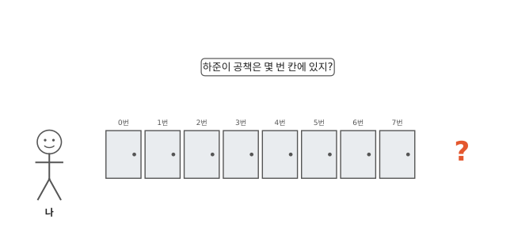
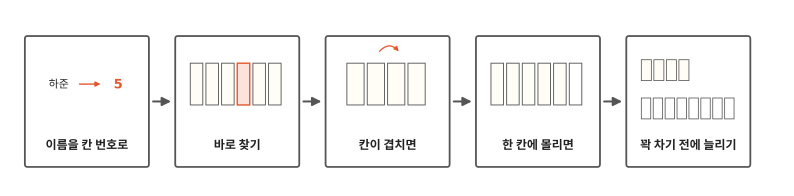
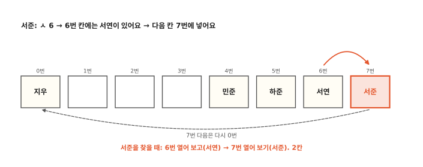
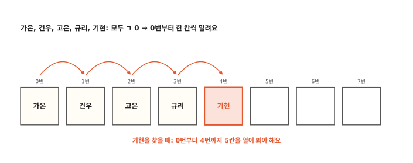
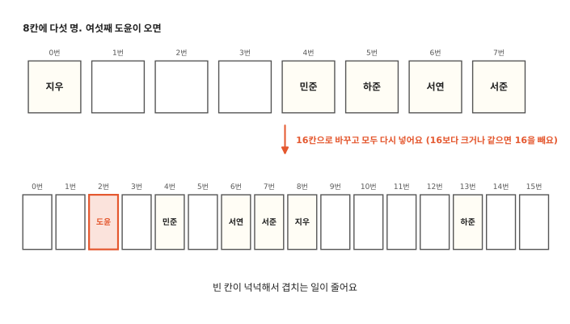

# 이름으로 어떻게 바로 찾을까요?

## 이름표 없는 사물함

우리 반 사물함은 0번부터 7번까지 여덟 칸이에요. 컴퓨터처럼 첫 칸을 0번이라고 불러요. 첫 칸은 처음 자리에서 0칸 떨어져 있거든요. 그런데 사물함에 이름표가 없어요. 하준이가 "내 공책 좀 꺼내 줄래?" 하고 부탁했어요. 하준이 공책은 몇 번 칸에 있을까요?

모르니까 0번부터 하나씩 열어 볼 수밖에 없어요. 1편의 "하나 집고 다 뒤지기"처럼요. 운이 나쁘면 여덟 칸을 다 열어야 해요.

친구 이름을 가나다순으로 정리해 두면 3편 업다운 놀이처럼 반씩 버리며 찾을 수 있어요. 그런데 새 친구가 전학 오면 가운데에 끼워야 해서 뒤 칸 친구들이 한 칸씩 옮겨야 해요. 2편에서 본 일이에요.

2편 사물함은 번호만 알면 몇 번 칸이든 바로 열었어요. 이름만 알 때도 그렇게 바로 열 수 있을까요?

## 이름을 칸 번호로 바꾸기에서 사물함 늘리기까지

알고리즘 아홉 번째 편이에요. 이름을 칸 번호로 바꾸는 규칙을 하나 정해서 사물함에 넣고 찾아봐요. 규칙이 두 친구에게 같은 칸을 줄 때와 여러 친구를 한 칸으로 몰아줄 때도 있어요. 마지막에는 사물함이 꽉 차기 전에 할 일과, 파이썬이 이 방법을 쓰는 상자를 봐요.

## 이름을 칸 번호로 바꿔요

규칙을 하나 정해요. 이름 첫 글자의 첫소리를 봐요. "민준"이면 ㅁ, "서연"이면 ㅅ이에요. 그림 위쪽 표처럼 첫소리마다 번호가 있어요. ㄱ은 0, ㄴ은 1, … ㅎ은 13이에요.

그런데 사물함에는 7번 칸까지밖에 없어요. 그래서 번호가 8보다 크거나 같으면 8을 빼요. 하준은 ㅎ이라 13이에요. 13에서 8을 빼면 5라서 하준이 물건은 5번 칸에 넣어요. 민준, 서연, 지우가 몇 번 칸인지는 그림 아래쪽에 있어요.

이제 하준이 공책을 찾아봐요. 물건을 넣을 때 이 규칙으로 넣어 두었으니 찾을 때도 같은 규칙을 쓰면 돼요. ㅎ은 13, 8을 빼면 5. 5번 칸을 열면 하준이 공책이 있어요. 한 번에 찾았어요.

1편에서 양말을 색깔별 자리에 바로 놓았던 것도 같은 생각이에요. 색깔을 보고 자리를 정했듯이 이름을 보고 칸을 정해요.

이렇게 이름을 칸 번호로 바꾸는 규칙을 **해시**(hash)라고 해요.

진짜 컴퓨터는 첫소리 하나만 보지 않아요. 컴퓨터 편 3편에서 컴퓨터는 글자마다 번호(문자 코드)를 정해 둔다고 했지요. 컴퓨터는 이름의 글자 번호를 모두 꺼내 마구 섞어서 칸 번호 하나를 만들어요. "해시"는 영어로 잘게 다진다는 뜻이에요. 우리 첫소리 규칙은 손으로 해 볼 수 있게 아주 줄인 해시예요.

## 칸이 겹치면 다음 칸으로

새 친구 서준이가 왔어요. 서준은 ㅅ이라 6번 칸이에요. 그런데 6번 칸에는 벌써 서연이 있어요. 두 친구가 같은 칸 번호를 받았어요.

이럴 때는 다음 칸을 봐요. 7번 칸이 비어 있으니 서준이 물건은 7번 칸에 넣어요. 만약 7번 칸도 차 있었다면 맨 앞 0번 칸으로 돌아가서 빈 칸을 찾아요. 사물함 끝과 처음이 이어져 있다고 생각하면 돼요.

서준이 공책을 찾을 때도 같은 순서로 열어요. 규칙대로 6번 칸을 열면 서연이 물건이 있어요. 그다음 7번 칸을 열면 서준이 물건이 있어요. 두 칸을 열었어요.

이번엔 도윤이 물건이 있는지 찾아봐요. 도윤은 ㄷ이라 2번 칸을 열어요. 2번 칸이 비어 있어요. 도윤이 물건을 넣었다면 그때도 2번 칸이 비어 있었을 테니 2번 칸에 넣었을 거예요. 그러니 도윤이 물건은 없다는 걸 한 번에 알아요. 규칙 칸이 차 있을 때는 빈 칸이 나올 때까지 이어서 열어 봐야 해요.

진짜 컴퓨터는 칸이 겹칠 때 꼭 바로 다음 칸으로 가지는 않아요. 정해진 다른 순서로 건너뛰며 빈 칸을 찾아요. 그래도 넣을 때와 찾을 때 같은 순서를 쓰는 건 똑같아요.

## 한 칸에 몰리면

이번엔 다른 반이에요. 친구 다섯이 가온, 건우, 고은, 규리, 기현이에요. 다섯 모두 첫소리가 ㄱ이라 규칙이 모두에게 0번 칸을 줘요.

가온이가 0번에 들어가면 건우는 다음 칸 1번, 고은은 2번, 규리는 3번, 기현은 4번으로 밀려요. 기현이 공책을 찾으려면 0번부터 4번까지 다섯 칸을 열어야 해요. 1편의 "하나 집고 다 뒤지기"와 다를 게 없어요.

좋은 규칙은 이름들을 여러 칸에 고르게 흩어 줘요. 진짜 컴퓨터는 이름 글자를 모두 섞어서 칸 번호를 만들어요. 그래서 첫 글자가 같은 이름이나 비슷한 이름도 대개 서로 다른 칸으로 가요.

## 꽉 차기 전에 늘려요

다시 우리 반이에요. 여덟 칸에 지우, 민준, 하준, 서연, 서준 다섯 명이 들어가서 빈 칸은 세 개뿐이에요. 칸이 거의 차면 새 친구는 빈 칸을 찾아 여러 칸을 지나가야 해요. 찾을 때도 그만큼 많이 열어야 해요. 그래서 여덟 칸 가운데 다섯 칸이 차면 더 넣지 않기로 해요.

여섯째 친구 도윤이가 오면 사물함을 16칸짜리로 바꿔요. 이제 15번 칸까지 있으니 규칙도 "16보다 크거나 같으면 16을 빼요"로 바꿔요. 그리고 다섯 친구 물건을 새 규칙으로 모두 다시 넣어요. 하준이 물건은 13번 칸으로 옮겨 가요. 다른 친구 칸은 그림에 있어요.

파이썬에도 이름으로 바로 찾는 상자가 있어요. 사전이라는 뜻의 **딕셔너리**(dictionary)예요. 딕셔너리도 해시로 이름을 칸 번호로 바꿔서 칸을 열어요. 처음에는 칸 8개로 시작하고, 여섯째 이름을 넣을 때 칸을 늘려요. 칸 수와 늘리는 때는 우리 사물함과 같아요. 칸 번호를 만드는 규칙과 겹칠 때 찾아가는 순서는 달라요.

이름으로는 이렇게 바로 찾을 수 있어요. 그런데 "숙제 가운데 제일 급한 것"처럼 가장 작은 것을 자꾸 꺼내야 할 때는 어떻게 할까요? 다음 편에서 볼게요.

## 정리

- **해시**: 이름을 칸 번호로 바꾸는 규칙이에요. 이름만 알면 칸을 바로 열 수 있어요. 좋은 규칙은 이름을 여러 칸에 고르게 흩어 줘요.
- **딕셔너리**: 파이썬에서 이름으로 바로 찾는 상자예요. 해시로 칸을 정하고, 칸이 겹치면 다른 빈 칸을 써요. 칸이 차기 전에 늘려요.

## 해 보기: 이름 사물함 놀이

종이컵 여덟 개에 0부터 7까지 번호를 적어 한 줄로 놓아요. 친구 이름을 쪽지에 적어요.

1. "이름을 칸 번호로 바꿔요" 그림 맨 위 표에서 이름 첫소리 번호를 찾아요. 8보다 크거나 같으면 8을 빼요. 쌍자음(ㄲ ㄸ ㅃ ㅆ ㅉ)으로 시작하는 이름은 이번엔 쓰지 않아요.
2. 그 번호 컵에 쪽지를 넣어요. 컵에 이미 쪽지가 있으면 다음 컵에 넣어요. 7번 다음은 0번이에요.
3. 친구가 이름 하나를 말하면 규칙으로 컵을 찾아 열어 봐요. 몇 개를 열었나요?
4. 첫소리가 같은 이름을 여러 개 넣어 봐요. 찾을 때 열어 보는 컵이 어떻게 달라지나요?

## 확인 문제

??? question "1. 하은이 칸"
    하은이는 여덟 칸 사물함에서 규칙으로 몇 번 칸을 받을까요?

    **풀이**: 5번이에요. 하은은 ㅎ이라 13이에요. 8을 빼면 5예요.

??? question "2. 자리가 없으면"
    사물함에 0번 지우, 5번 하준, 6번 서연, 7번 서준, 이렇게 네 명이 있어요. 하은이 물건은 어느 칸에 들어가고, 찾을 때 몇 칸을 열까요?

    **풀이**: 1번 칸이에요. 5번(하준), 6번(서연), 7번(서준)이 차 있어서 0번으로 돌아가요. 0번(지우)도 차 있고 1번이 비어 있어요. 찾을 때는 5번, 6번, 7번, 0번, 1번으로 다섯 칸을 열어요.

??? question "3. 다 같은 칸이면"
    규칙이 모든 이름에 같은 칸 번호를 준다면, 찾는 일은 몇 편의 어떤 방법과 같아질까요?

    **풀이**: 1편의 "하나 집고 다 뒤지기"와 같아져요. 같은 칸부터 한 칸씩 밀려 들어가서 하나씩 열어 봐야 해요.

!!! abstract "어른을 위한 정리 (건너뛰어도 돼요)"
    - 파이썬 `dict`와 `set`은 해시 표예요. 키의 해시 값으로 칸을 정하고, 칸이 겹치면(충돌) 다른 칸을 찾아가는 개방 주소법을 써요. 본문은 "다음 칸"으로 그렸지만 CPython은 해시 값의 윗자리 비트를 섞어 넣으며(perturb) 건너뛰는 순서로 찾아가요.[^dict]
    - CPython dict는 칸 8개(`PyDict_MINSIZE`)로 시작하고, 칸의 3분의 2(`USABLE_FRACTION`)가 차면 키워요. 8칸이면 5개까지 넣을 수 있어요. 실제로 재 보면 1·6·11·22번째 키를 넣을 때 크기가 커졌어요.[^dict][^lab]
    - 평균 O(1), 해시가 한쪽으로 몰리면 최악 O(n)이에요. 문자열 해시는 실행할 때마다 무작위 값으로 섞어서(salt) 일부러 몰리게 만드는 공격을 어렵게 해요(`PYTHONHASHSEED`).[^hash]
    - 이름 10만 개가 든 리스트에서 맨 끝 이름을 `in`으로 찾으면 0.84밀리초, 같은 이름을 딕셔너리에서 찾으면 30나노초쯤이었어요. 1편의 탈퇴 회원 고르기 같은 이중 반복은 한쪽을 `set`으로 바꾸면 O(n²)에서 O(n)이 돼요.[^lab]

## 더 깊이

??? info "첫소리 규칙이 나쁜 까닭"
    우리 반에 첫소리가 ㄱ인 이름이 많으면 0번 칸 근처에 몰려요. 반대로 ㅋ이나 ㅌ으로 시작하는 이름은 드물어서 그 칸들은 늘 비어 있어요. 좋은 규칙은 이름의 모든 글자를 써서 어느 칸이든 비슷하게 자주 나오게 해요.

??? info "셋(set)"
    파이썬의 셋(set)도 딕셔너리처럼 해시를 써요. 물건 없이 이름만 넣어 두는 사물함이에요. "이 이름이 들어 있나?"를 바로 알 수 있어요.

[^dict]: CPython 3.12 [`Objects/dictobject.c`](https://github.com/python/cpython/blob/3.12/Objects/dictobject.c)의 `PyDict_MINSIZE`, `USABLE_FRACTION`과 충돌 처리 설명 주석.
[^hash]: Python 3.12 문서 [Data model, `object.__hash__`](https://docs.python.org/3.12/reference/datamodel.html#object.__hash__)와 [`PYTHONHASHSEED`](https://docs.python.org/3.12/using/cmdline.html#envvar-PYTHONHASHSEED).
[^lab]: [`lab/09_hash.py`](https://github.com/oya150/bedrock/blob/main/lab/09_hash.py)로 확인했어요(CPython 3.12.7, Apple Silicon 노트북). 본문 사물함의 칸 번호, 열어 본 칸 수, 16칸으로 다시 넣은 결과와 확인 문제 답, dict 크기가 커지는 때, 찾기 시간을 이 스크립트로 셌어요. 시간은 다시 재면 조금씩 달라져요.
