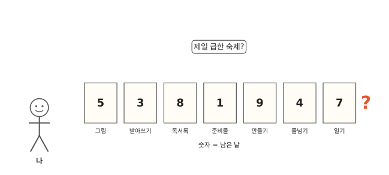
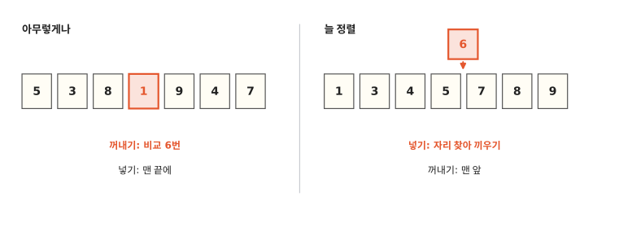
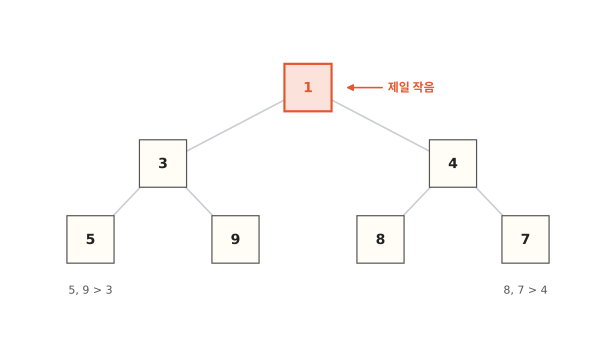
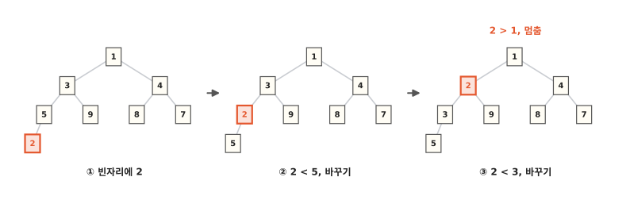
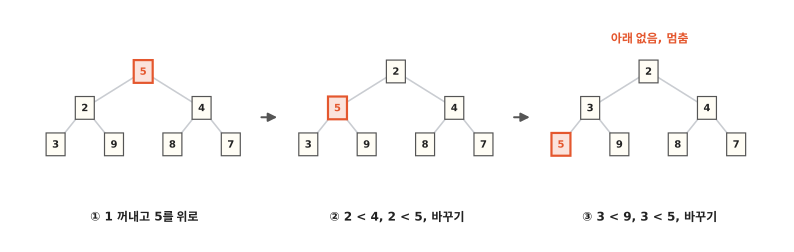
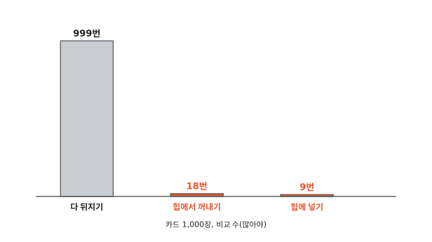
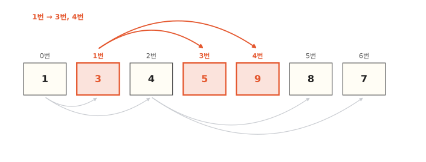

# 힙: 가장 급한 것을 늘 빨리 꺼내는 대진표

숙제가 여러 개 밀려 있으면 제일 급한 것부터 하고 싶어요. 그런데 하나를 끝낼 때마다 새 숙제가 또 생겨서 "지금 제일 급한 것"을 몇 번이고 다시 찾아야 해요. 이 글을 읽고 나면 카드를 대진표 모양으로 놓아서 제일 작은 카드를 늘 빨리 꺼내는 방법을 알게 돼요. 컴퓨터가 쌓인 일 가운데 급한 일부터 처리할 때 쓰는 방법이에요.

!!! abstract "이 글에서 알게 되는 것"
    1. 카드를 아무렇게나 두면 꺼낼 때가 느리고 늘 정렬해 두면 넣을 때가 느려요.
    2. 위 카드가 늘 아래 두 카드보다 작게 대진표 모양으로 놓으면 맨 위가 늘 제일 작아요. 이렇게 놓은 것을 힙이라고 해요.
    3. 넣을 때는 아래에서 위로, 꺼낼 때는 위에서 아래로 한 길만 지나가요. 그래서 카드가 1,000장이어도 비교는 많아야 넣을 때 9번, 꺼낼 때 18번이에요.

## 1. 아무렇게나 두거나 늘 정렬해 두면 어느 한쪽이 느려요

숙제가 일곱 개 있어요. 카드마다 숙제 이름과 숫자를 적었어요. 숫자는 숙제를 내기까지 남은 날 수예요. 아래 그림에서 숫자가 제일 작은 카드를 찾아보세요.


**그림 1.** 숫자는 남은 날 수라서 작을수록 급하고 준비물(1)이 제일 급해요.
{ .fig-cap }

준비물은 1이라 내일까지 챙겨야 해요. 만들기는 9라 아직 여유가 있고요. 나는 늘 숫자가 제일 작은 카드부터 하려고 해요. 그런데 하나를 끝내면 그사이에 새 숙제가 또 생겨요. 카드를 꺼내고 넣는 일이 계속 이어져요.

먼저 떠오르는 방법은 두 가지예요. 아래 그림에서 두 방법이 각각 어디서 빨간 일을 하는지 보세요.


**그림 2.** 아무렇게나 두면 꺼낼 때 일이 많고 늘 정렬해 두면 넣을 때 일이 많아요.
{ .fig-cap }

왼쪽은 카드를 아무렇게나 두는 방법이에요. 새 카드는 맨 끝에 놓으면 돼서 넣기는 쉬워요. 대신 제일 작은 카드를 찾을 때마다 처음부터 끝까지 다 봐요. [1편](01-why-big-o.md)에서 짝을 찾으려고 바구니를 다 뒤졌던 것과 같아요. 카드가 일곱 장이면 첫 카드를 들고 나머지 여섯 장과 하나씩 비교해서 비교가 6번이에요. 숙제를 하나 꺼낼 때마다 이걸 다시 해야 해요.

오른쪽은 카드를 늘 작은 수부터 정렬해 두는 방법이에요. 제일 작은 카드는 늘 맨 앞에 있어서 꺼낼 때 비교할 필요가 없어요. 대신 새 숙제가 생기면 [4편](04-insertion-sort.md)에서 손에 카드를 끼울 때처럼 알맞은 자리를 찾아 끼워야 해요. 운이 나쁘면 일곱 장과 다 비교해요.

넣을 때도 꺼낼 때도 빠른 방법이 있으면 좋겠죠. 카드를 한 줄 말고 다른 모양으로 놓아 볼게요.

## 2. 위 카드가 아래 두 카드보다 작으면 맨 위가 제일 작아요

카드를 운동회 대진표처럼 놓아 봐요. 대진표는 누가 누구와 겨루는지 나무 모양으로 그린 표예요. 맨 위 줄에 한 장, 그 아래 줄에 두 장, 그 아래 줄에 네 장을 놓아요. 카드마다 바로 아래에 카드가 두 장까지 선으로 이어져요. 카드는 위 줄부터 채우고 한 줄 안에서는 왼쪽부터 빈틈없이 채워요.

규칙은 하나예요. 선으로 이어진 위 카드는 늘 아래 두 카드보다 작아야 해요. 아래 그림에서 3과 그 아래 두 카드를 보세요.


**그림 3.** 위 카드가 늘 아래 두 카드보다 작아서 맨 위 1이 제일 작아요.
{ .fig-cap }

3은 아래 5와 9보다 작아요. 4는 아래 8과 7보다 작아요. 1은 아래 3과 4보다 작고요. 옆에 있는 카드끼리는 순서를 따지지 않아요. 8이 7보다 왼쪽에 있어도 괜찮고 3과 4가 자리를 바꿔도 괜찮아요.

이 규칙만 지키면 맨 위 카드가 늘 제일 작아요. 맨 위 카드는 아래 두 카드보다 작아요. 그 두 카드는 또 자기 아래 카드보다 작아요. 그래서 맨 위보다 작은 카드는 어디에도 있을 수 없어요. 운동회 대진표 맨 위에 이긴 사람이 서는 것과 비슷해요. 여기서는 작은 수가 이겨요.

이렇게 위 카드가 아래 카드보다 늘 작게 놓은 대진표 모양을 **힙**이라고 해요. "힙"(heap)은 영어로 쌓아 올린 더미라는 뜻이에요.

## 3. 새 카드는 맨 아래에 놓고 위로 올려 보내요

힙을 만들었으니 새 숙제를 넣어 볼게요. 남은 날이 2인 카드예요.

먼저 다음 빈자리에 놓아요. 맨 아래 줄 5, 9, 8, 7이 꽉 찼으니 새 줄의 맨 왼쪽이에요. 5 아래가 그 자리예요. 그런데 2는 위 카드 5보다 작아서 규칙에 맞지 않아요. 그래서 2와 5의 자리를 바꿔요. 2는 이제 3 아래에 있어요. 3보다도 작으니 또 바꿔요.

아래 그림에서 빨간 2가 올라가는 길을 따라가 보세요.


**그림 4.** 2는 5와 3을 차례로 넘어 1 바로 아래까지 올라가고 1보다 커서 멈춰요.
{ .fig-cap }

2가 1 아래까지 올라왔어요. 1보다는 크니까 여기서 멈춰요. 비교는 5와 한 번, 3과 한 번, 1과 한 번으로 모두 3번이에요. 옆 카드들과는 비교하지 않았어요. 9, 4, 8, 7은 쳐다보지도 않았죠. 새 카드는 맨 아래에서 맨 위로 가는 한 길만 지나가요.

## 4. 맨 위를 꺼내면 맨 끝 카드를 올려 아래로 내려 보내요

이제 제일 급한 숙제를 꺼내요. 맨 위 1이에요. 1을 꺼내면 맨 위가 비어요.

빈자리는 맨 끝 카드, 곧 맨 아래 줄 맨 오른쪽 카드로 채워요. 그래야 중간에 빈칸이 생기지 않아요. 맨 끝에 있던 5를 맨 위로 올려요. 그런데 5는 아래 2와 4보다 커서 규칙에 맞지 않아요.

한 줄 내려갈 때마다 비교를 두 번 해요.

1. 아래 두 카드 2와 4를 비교해서 작은 쪽을 골라요. 2예요.
2. 고른 2와 5를 비교해요. 5가 더 크니 둘의 자리를 바꿔요.

아래 그림에서 빨간 5가 내려가는 길을 보세요.


**그림 5.** 맨 위로 올린 5가 줄마다 아래 두 카드 가운데 작은 쪽과 자리를 바꾸며 내려가요.
{ .fig-cap }

2가 맨 위로 가고 5는 3과 9 위에 있어요. 한 번 더 해요. 3과 9를 비교하면 3이 작아요. 3과 5를 비교하면 5가 더 크니 바꿔요. 5 아래에는 카드가 없으니 멈춰요.

비교는 모두 4번이에요. 그리고 맨 위에는 남은 카드 가운데 제일 작은 2가 와 있어요. 다음 숙제도 맨 위에서 바로 꺼내면 돼요. 꺼낼 때도 넣을 때처럼 한 길만 지나가요. 이번에는 위에서 아래로요.

## 5. 카드가 1,000장이어도 줄은 열 개라 비교가 적어요

넣기와 꺼내기 모두 한 줄에 한 번이나 두 번만 비교했어요. 그러면 비교 수는 줄이 몇 개냐에 달려 있어요.

줄마다 놓을 수 있는 카드 수는 1장, 2장, 4장, 8장으로 한 줄 내려갈 때마다 두 배가 돼요. 그래서 열 줄을 모두 채우면 1 + 2 + 4 + … + 512 = 1,023장이 들어가요. 카드 1,000장도 열 줄이면 다 놓을 수 있어요.

열 줄짜리 힙에서 맨 아래부터 맨 위까지는 아홉 칸을 올라가요. 넣을 때는 한 칸에 비교 한 번이라 많아야 9번이에요. 꺼낼 때는 한 칸에 비교 두 번이라 많아야 18번이에요. 아래 그림에서 세 막대의 높이를 보세요.


**그림 6.** 카드 1,000장에서 다 뒤지기는 999번 비교하지만 힙은 꺼낼 때 18번, 넣을 때 9번이면 돼요.
{ .fig-cap }

아무렇게나 둔 카드 1,000장에서 제일 작은 카드를 찾으려면 999번 비교해요. 힙은 18번이에요. 카드가 두 배로 늘어도 힙은 줄이 하나 늘 뿐이라 비교가 한두 번만 늘어요. [3편](03-why-sorted-is-fast.md)의 이진 탐색처럼 두 배가 될 때 조금만 느는 모양이라 이것도 O(log n)이라고 적어요.

## 6. 파이썬 heapq는 대진표를 한 줄로 적어요

컴퓨터는 대진표를 그림으로 그리지 않고 한 줄로 적어요. 맨 위부터 줄마다 왼쪽에서 오른쪽으로 적으면 그림 3의 힙은 1, 3, 4, 5, 9, 8, 7이에요. 자리 번호는 0번부터 붙여요.

이렇게 적으면 어떤 카드 아래 두 카드가 몇 번 자리에 있는지 계산으로 알 수 있어요. 자리 번호에 2를 곱한 다음 1을 더한 자리와 2를 더한 자리예요. 아래 그림에서 1번 자리 3의 아래 두 카드를 찾아보세요.


**그림 7.** 1번 자리의 3 아래에는 1 × 2 + 1 = 3번 자리의 5와 1 × 2 + 2 = 4번 자리의 9가 있어요.
{ .fig-cap }

1번 자리의 아래 두 카드는 3번과 4번 자리예요. 3번 자리에는 5, 4번 자리에는 9가 있어요. 그림 3에서 3 아래에 있던 두 카드와 같죠. [2편](02-why-arrays-are-fast.md) 사물함처럼 번호만 알면 그 자리로 바로 가요.

파이썬에는 이 방법을 쓰는 `heapq`라는 도구가 있어요. 리스트를 한 줄로 적은 대진표로 다뤄요.

```python
import heapq

cards = [1, 3, 4, 5, 9, 8, 7]
heapq.heappush(cards, 2)
print(cards)                 # [1, 2, 4, 3, 9, 8, 7, 5]
print(heapq.heappop(cards))  # 1
print(cards)                 # [2, 3, 4, 5, 9, 8, 7]
```

`heappush`로 2를 넣은 결과는 3절에서 손으로 넣은 결과를 한 줄로 적은 것과 같아요. `heappop`으로 1을 꺼낸 뒤에는 4절처럼 2가 맨 앞에 와요.

## 확인 문제

??? question "2를 넣은 힙에 6을 넣으면 비교를 몇 번 할까요?"
    지금 힙은 맨 위 1, 그 아래 2와 4, 2 아래 3과 9, 4 아래 8과 7, 3 아래 5예요.

    **풀이**: 1번이에요. 다음 빈자리는 3 아래, 5의 오른쪽이에요. 6은 위 카드 3보다 커서 한 번 비교하고 그대로 멈춰요.

??? question "힙에서 두 번째로 작은 카드는 어디에 있을까요?"
    **풀이**: 맨 위 카드 바로 아래 두 카드 가운데 하나예요. 나머지 카드는 모두 이 두 카드 가운데 하나의 아래쪽에 있어서 그 카드보다 커요. 그러니 둘째로 작은 카드가 더 아래에 있을 수는 없어요.

??? info "어른을 위한 정리 (건너뛰어도 돼요)"
    - 이진 힙은 완전 이진 트리를 배열에 담고 `a[k] <= a[2k+1]`, `a[k] <= a[2k+2]`를 지켜요. 맨 앞 `a[0]`이 최솟값이에요. 넣기(sift-up)와 최솟값 꺼내기(sift-down)는 O(log n), 최솟값 보기는 O(1)이에요. 파이썬 `heapq` 문서도 힙을 토너먼트에 빗대어 설명해요.[^heapq]
    - 본문은 교과서 방식으로 셌어요. 꺼낼 때 한 줄 내려갈 때마다 아래 두 원소끼리 한 번, 작은 쪽과 내려가는 원소를 한 번 비교해요. CPython `heapq.heappop`은 먼저 맨 아래까지 작은 자식을 끌어올린 다음 위로 맞추는 방식이라 비교 수가 조금 달라요.
    - 우선순위 큐(작업 예약, 이벤트 시뮬레이션), 상위 k개(`heapq.nsmallest`), 정렬된 여러 줄 병합(`heapq.merge`)에 써요. 힙 정렬은 O(n log n)이지만 같은 값의 순서를 지키지 않아요(불안정).

## 정리

카드를 아무렇게나 두면 제일 작은 카드를 꺼낼 때마다 다 봐야 해요. 늘 정렬해 두면 새 카드를 넣을 때마다 자리를 찾아 끼워야 해요. 어느 쪽이든 한쪽 일이 많아요.

힙은 위 카드가 늘 아래 두 카드보다 작게 놓은 대진표 모양이에요. 그래서 맨 위가 늘 제일 작아요. 새 카드는 맨 아래 빈자리에 놓고 위 카드보다 작으면 바꾸며 올려 보내요. 맨 위를 꺼내면 맨 끝 카드를 올리고 아래 두 카드 가운데 작은 쪽과 바꾸며 내려 보내요. 둘 다 한 길만 지나가서 카드 1,000장에서도 비교는 많아야 넣을 때 9번, 꺼낼 때 18번이에요.

카드가 먼 창고 상자 속에 들어 있으면 카드 한 장을 가지러 가는 일 자체가 오래 걸려요. 그때 어떻게 찾는지는 [11편](11-btree.md)에서 볼게요.

### 새로 나온 말

- **힙**: 위 카드가 늘 아래 두 카드보다 작게 놓은 대진표 모양. 맨 위 1이 늘 제일 작았어요.
- **heapq**: 리스트를 한 줄로 적은 힙으로 다루는 파이썬 도구. `heappush`로 넣고 `heappop`으로 제일 작은 것을 꺼내요.

[^heapq]: Python 3.12 문서 [`heapq` — Heap queue algorithm](https://docs.python.org/3.12/library/heapq.html)의 첫 설명과 Theory 절.
