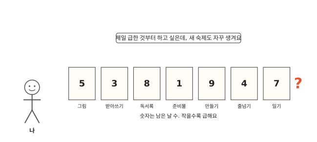
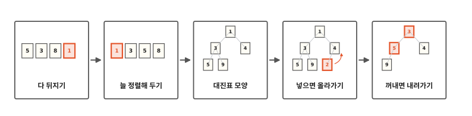
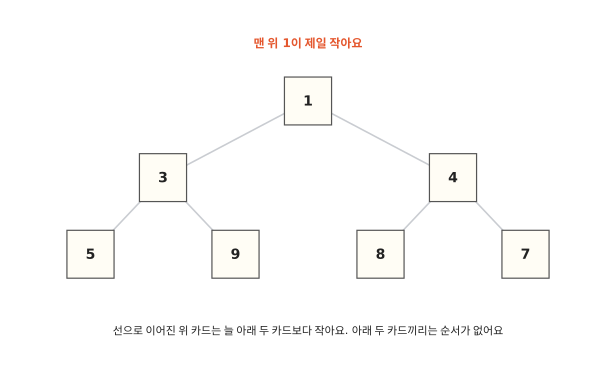
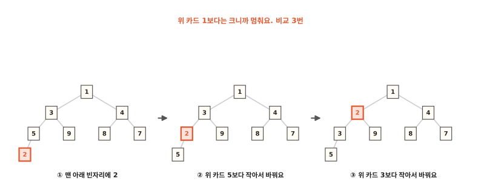
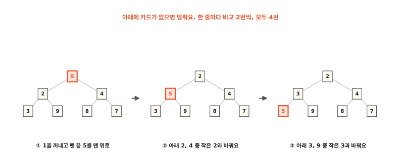
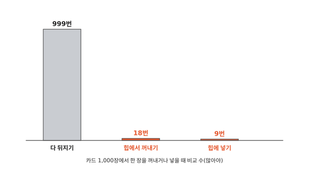

# 가장 급한 것을 어떻게 늘 빨리 꺼낼까요?

## 숙제 카드가 쌓여요

숙제가 일곱 개 있어요. 카드마다 숙제 이름과 숫자를 적었어요. 숫자는 숙제를 내기까지 남은 날 수예요. 준비물은 1이라 내일까지 챙겨야 하고, 만들기는 9라 아직 여유가 있어요.

나는 늘 제일 급한 숙제, 숫자가 제일 작은 카드부터 하려고 해요. 그런데 하나를 끝내면 그사이에 새 숙제가 또 생겨요. 카드를 꺼내고 넣는 일이 계속 이어져요.

9편에서는 이름으로 사물함 칸을 바로 찾았어요. 이번에 찾을 것은 이름으로 정해진 칸이 없어요. "지금 제일 작은 카드"를 찾아야 해요. 어떻게 해야 매번 빨리 찾을 수 있을까요?

## 다 뒤지기에서 꺼내기까지

알고리즘 열 번째 편이에요. 먼저 쉽게 떠오르는 방법 두 가지를 해 보고 무엇이 불편한지 봐요. 그다음 카드를 대진표처럼 놓는 방법을 봐요. 새 카드를 넣을 때와 제일 작은 카드를 꺼낼 때 비교를 몇 번 하는지도 세어 봐요.

## 다 뒤지거나, 늘 정렬해 두거나

먼저 떠오르는 방법은 카드를 아무렇게나 두는 거예요. 느린 방법이에요. 제일 작은 카드를 찾을 때마다 처음부터 끝까지 다 봐요. 1편에서 양말 하나를 집고 바구니를 처음부터 끝까지 뒤져 짝을 찾던 것처럼요. 카드 일곱 장이면 첫 카드를 들고 나머지 여섯 장과 하나씩 비교해야 해서 비교가 6번이에요. 숙제를 하나 꺼낼 때마다 이렇게 해야 해요.

다른 방법은 카드를 늘 작은 수부터 정렬해 두는 거예요. 그러면 제일 작은 카드는 늘 맨 앞에 있어서 꺼낼 때 비교할 필요가 없어요. 그런데 새 숙제가 생기면 4편에서 손에 카드를 끼울 때처럼 알맞은 자리를 찾아 끼워야 해요. 운이 나쁘면 일곱 장과 다 비교해요.

아무렇게나 두면 꺼낼 때가 느리고, 정렬해 두면 넣을 때가 느려요. 넣을 때도 꺼낼 때도 빠른 방법이 있어요.

## 위 카드는 아래 두 카드보다 작아요

카드를 운동회 대진표처럼 놓아 봐요. 대진표는 누가 누구와 겨루는지 나무 모양으로 그린 표예요. 맨 위 줄에 한 장, 그 아래 줄에 두 장, 그 아래 줄에 네 장이에요. 카드마다 바로 아래에 카드가 두 장까지 선으로 이어져 있어요. 카드는 위 줄부터, 한 줄 안에서는 왼쪽부터 빈틈없이 채워요.

규칙은 하나예요. 선으로 이어진 위 카드는 늘 아래 두 카드보다 작아야 해요. 그림에서 3은 아래 5와 9보다 작아요. 4는 아래 8과 7보다 작아요. 1은 아래 3과 4보다 작아요.

그런데 옆에 있는 카드끼리는 순서가 없어요. 8이 7보다 왼쪽에 있어도 괜찮아요. 3과 4 중 누가 왼쪽에 있어도 괜찮아요.

이 규칙만 지키면 맨 위 카드가 늘 제일 작아요. 맨 위 카드는 아래 두 카드보다 작고, 그 아래 카드들은 또 자기 아래 카드보다 작으니까요. 대진표 맨 위에 이긴 사람이 서는 것과 비슷해요. 여기서는 작은 수가 이겨요. 다만 운동회 대진표와 달리 이 대진표는 칸마다 카드를 한 장씩만 놓고, 옆 칸 카드끼리 겨루지 않아요.

이렇게 위 카드가 아래 카드보다 늘 작게 놓은 대진표 모양을 **힙**이라고 해요. "힙"(heap)은 영어로 쌓아 올린 더미라는 뜻이에요.

## 새 카드를 넣으면 올라가요

새 숙제가 생겼어요. 남은 날이 2인 카드예요. 힙에 넣어 봐요.

먼저 다음 빈자리에 놓아요. 맨 아래 줄 5, 9, 8, 7이 꽉 찼으니 새 줄의 맨 왼쪽이에요. 그림에서는 5 아래예요. 그런데 2는 위 카드 5보다 작아서 규칙에 맞지 않아요. 그래서 2와 5의 자리를 바꿔요.

2는 이제 3 아래에 있어요. 3보다도 작으니 또 바꿔요. 2가 1 아래까지 올라왔어요. 1보다는 크니까 여기서 멈춰요.

비교는 5와 한 번, 3과 한 번, 1과 한 번, 모두 3번이에요. 옆 카드들과는 비교하지 않았어요.

## 맨 위 카드를 꺼내면 내려가요

이제 제일 급한 숙제를 꺼내요. 맨 위 1이에요. 1을 꺼내면 맨 위가 비어요.

빈자리는 맨 끝 카드, 곧 맨 아래 줄 맨 오른쪽 카드로 채워요. 그래야 중간에 빈칸이 생기지 않아요. 맨 끝에 있던 5를 맨 위로 올려요. 5는 아래 2와 4보다 커서 규칙에 맞지 않아요.

한 줄 내려갈 때마다 비교를 두 번 해요.

1. 아래 두 카드 2와 4를 비교해서 작은 쪽을 골라요. 2예요.
2. 고른 2와 5를 비교해요. 5가 더 크니 둘의 자리를 바꿔요.

이제 2가 맨 위에 있고 5는 3과 9 위에 있어요. 한 번 더 해요. 3과 9를 비교하면 3이 작아요. 3과 5를 비교하면 5가 더 크니 바꿔요. 5 아래에는 카드가 없으니 멈춰요.

비교는 모두 4번이에요. 그리고 맨 위에는 이제 남은 카드 가운데 제일 작은 2가 있어요. 다음 숙제도 바로 꺼낼 수 있어요.

## 카드가 아주 많으면

줄마다 놓을 수 있는 카드 수는 1장, 2장, 4장, 8장이에요. 아래 줄로 갈 때마다 앞 줄 수만큼 또 더해서 늘어요. 그래서 열 줄을 모두 합치면 1,000장이 넘게 들어가요.

카드를 넣거나 꺼낼 때는 맨 위에서 맨 아래까지 한 길을 따라 한 줄씩만 지나가요. 카드가 1,000장이어도 줄은 열 개뿐이라 비교가 몇 번 안 들어요. 넣을 때는 많아야 9번, 꺼낼 때는 많아야 18번이에요.

다 뒤지기는 카드 1,000장이면 꺼낼 때마다 999번 비교해요. 파이썬에도 이렇게 힙을 쓰는 도구가 있어요. `heapq`라는 이름이에요.

그런데 카드가 먼 창고 상자 속에 들어 있으면 카드 한 장을 가지러 가는 일 자체가 오래 걸려요. 그때는 어떻게 찾을까요? 다음 편에서 볼게요.

## 정리

- **힙**: 위 카드가 늘 아래 두 카드보다 작게 놓은 대진표 모양이에요. 맨 위가 늘 제일 작아요.

## 해 보기: 숙제 대진표 놀이

숫자 카드 일곱 장과 바둑돌, 종이를 준비해요. 종이에 대진표 모양으로 칸을 그려요. 맨 위 1칸, 그 아래 2칸, 그 아래 4칸이에요.

1. 카드를 한 장씩 위 줄부터, 왼쪽부터 다음 빈칸에 놓아요. 위 칸 카드와 비교해서 작으면 자리를 바꿔요. 비교할 때마다 바둑돌을 하나 놓아요.
2. 카드를 다 넣었으면 맨 위 카드를 꺼내요. 제일 작은 카드가 맞나요?
3. 맨 끝 카드를 맨 위로 올려요. 아래 두 카드 가운데 작은 쪽과 비교해서 크면 바꾸며 내려 보내요. 다시 맨 위에 제일 작은 카드가 왔나요?
4. 이번엔 카드를 한 줄로 늘어놓고 제일 작은 카드를 찾아봐요. 비교할 때마다 바둑돌을 놓으면 몇 개가 들었나요?

## 확인 문제

??? question "1. 맨 위 카드"
    힙의 규칙을 지키는 대진표에서 맨 위 카드는 어떤 카드일까요?

    **풀이**: 제일 작은 카드예요. 위 카드가 늘 아래 두 카드보다 작으니 맨 위가 모두보다 작아요.

??? question "2. 6을 넣으면"
    2를 넣은 뒤의 힙(맨 위 1, 그 아래 2와 4, 2 아래 3과 9, 4 아래 8과 7, 3 아래 5)에 6을 넣으면 비교를 몇 번 할까요?

    **풀이**: 1번이에요. 다음 빈자리는 3 아래, 5의 오른쪽이에요. 6은 위 카드 3보다 커서 한 번 비교하고 그대로 멈춰요.

??? question "3. 두 번째로 작은 카드"
    힙에서 두 번째로 작은 카드는 어디에 있을까요?

    **풀이**: 맨 위 카드 바로 아래 두 카드 가운데 하나예요. 나머지 카드는 모두 이 두 카드 가운데 하나의 아래쪽에 있어서 그 카드보다 커요. 그러니 둘째로 작은 카드가 더 아래에 있을 수는 없어요.

!!! abstract "어른을 위한 정리 (건너뛰어도 돼요)"
    - 이진 힙은 완전 이진 트리를 배열에 담고 `a[k] <= a[2k+1]`, `a[k] <= a[2k+2]`를 지켜요. 맨 앞 `a[0]`이 최솟값이에요. 넣기(sift-up)와 최솟값 꺼내기(sift-down)는 O(log n), 최솟값 보기는 O(1)이에요. 파이썬 `heapq` 문서도 힙을 토너먼트에 빗대어 설명해요.[^heapq]
    - 본문은 교과서 방식으로 셌어요. 꺼낼 때 한 줄 내려갈 때마다 아래 두 원소끼리 한 번, 작은 쪽과 내려가는 원소를 한 번 비교해요. CPython `heapq.heappop`은 먼저 맨 아래까지 작은 자식을 끌어올린 뒤 위로 맞추는 방식이라 비교 수가 조금 달라요.
    - 우선순위 큐(작업 예약, 이벤트 시뮬레이션), 상위 k개(`heapq.nsmallest`), 정렬된 여러 줄 병합(`heapq.merge`)에 써요. 힙 정렬은 O(n log n)이지만 불안정해요.
    - 1만 개 중 최솟값을 꺼내고 새 값을 넣는 일을 1,000번 하면 리스트에서 `min`으로 찾아 지울 때 120밀리초쯤, `heapq.heapreplace`로는 0.4밀리초쯤이었어요.[^lab]

## 더 깊이

??? info "대진표를 한 줄로 적기"
    컴퓨터는 대진표를 그림으로 그리지 않고 한 줄로 적어요. 맨 위부터 줄마다 왼쪽에서 오른쪽으로 적으면 1, 3, 4, 5, 9, 8, 7이에요. 그러면 어떤 카드 아래 두 카드가 몇 번째 자리에 있는지 계산으로 바로 알 수 있어요. 2편 사물함처럼 번호만 알면 바로 찾아가요.

??? info "왜 9번과 18번일까"
    줄이 열 개면 맨 아래 줄에서 맨 위 줄까지 올라가는 길은 아홉 칸이에요. 넣을 때는 한 칸 올라갈 때마다 비교가 한 번이라 많아야 9번이에요. 꺼낼 때는 한 칸 내려갈 때마다 비교가 두 번이니 9번에 9번을 더해서 많아야 18번이에요. 열 줄에 들어가는 카드는 1 + 2 + 4 + 8 + 16 + 32 + 64 + 128 + 256 + 512 = 1,023장이에요.

??? info "숙제 말고도"
    병원 응급실은 먼저 온 사람보다 더 위급한 사람을 먼저 봐요. 컴퓨터도 할 일이 여러 개 쌓이면 급한 일부터 꺼내 처리할 때 힙을 써요.

[^heapq]: Python 3.12 문서 [`heapq` — Heap queue algorithm](https://docs.python.org/3.12/library/heapq.html)의 첫 설명과 Theory 절.
[^lab]: [`lab/10_heap.py`](https://github.com/oya150/bedrock/blob/main/lab/10_heap.py)로 셌어요(CPython 3.12.7, Apple Silicon 노트북). 본문 힙에 넣고 꺼낼 때의 비교 수, 확인 문제 답, 7·15·1,000장의 줄 수와 가장 많은 비교 수, 시간을 이 스크립트로 확인했어요. 시간은 다시 재면 조금씩 달라져요.
