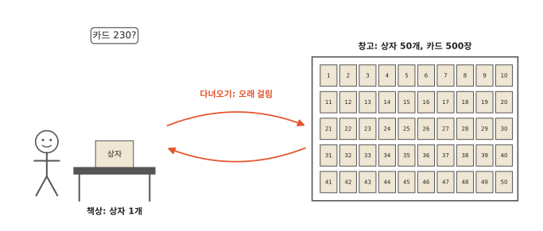
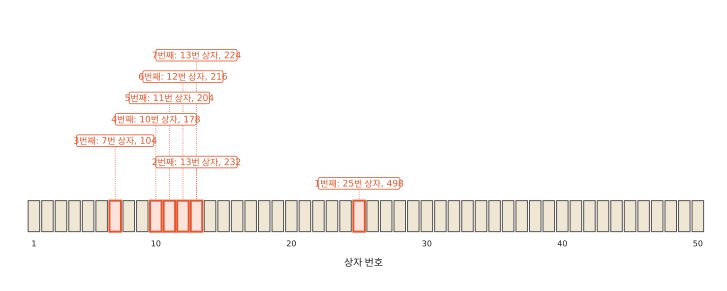
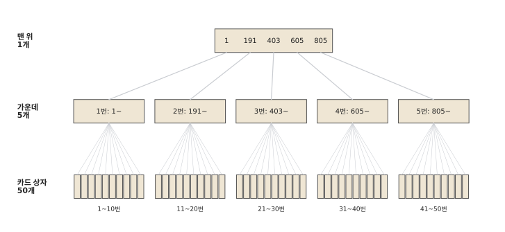
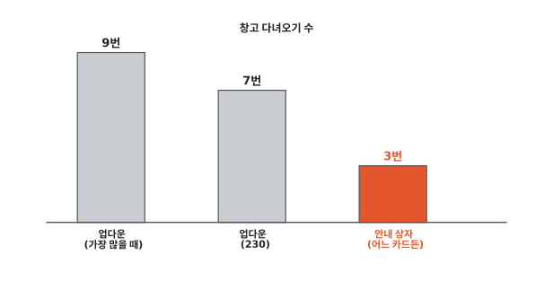
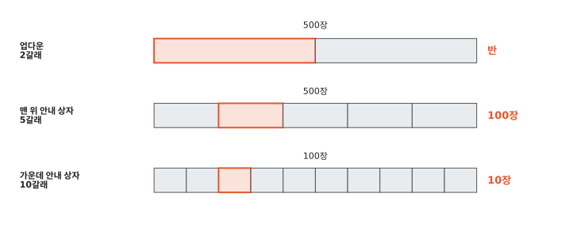

# B-트리: 안내 상자로 먼 창고에서 카드 찾기

베란다 창고에서 겨울옷 상자를 꺼내 본 적이 있을 거예요. 상자 안에서 옷을 고르는 건 금방인데 창고까지 다녀오는 데 시간이 더 걸려요. 이 글에서는 카드 500장이 먼 창고에 있을 때 한 장을 찾으려면 창고에 몇 번 다녀와야 하는지 세고 그 횟수를 줄이는 안내 상자를 만들어요. 데이터베이스가 많은 정보 가운데 하나를 빨리 찾는 방법이 이 안내 상자와 같아요.

!!! abstract "이 글에서 알게 되는 것"
    1. 상자가 먼 창고에 있으면 카드를 몇 장 보는지보다 창고에 몇 번 다녀오는지가 시간을 정해요.
    2. 업다운 놀이로 찾으면 상자마다 카드 한 장만 보고 돌려보내서 카드 230을 찾는 데 일곱 번 다녀와요. 안내 상자를 따라가면 어느 카드든 세 번이에요.
    3. 안내 상자 하나에 쪽지를 많이 넣을수록 층이 줄어요. 데이터베이스는 이렇게 짠 색인(B-트리)으로 느린 저장 장치를 적게 읽어요.

## 1. 창고에 다녀오는 횟수가 시간을 정해요

[10편](10-heap.md)까지는 카드가 늘 책상 위에 있었어요. 이번에는 카드가 멀리 있어요.

번호 카드가 500장 있어요. 카드마다 1부터 1,000 사이 숫자가 하나씩 적혀 있고 같은 숫자는 없어요. 작은 수부터 차례로 열 장씩 상자에 담았더니 상자가 50개 나왔어요. 1번 상자에 가장 작은 카드 열 장, 2번 상자에 그다음 열 장이 들어 있어요.

상자는 먼 창고에 있어요. 책상에는 상자를 하나만 놓을 수 있어요. 다른 상자를 보려면 책상 위 상자를 갖다 놓고 창고에 다녀와야 해요.

아래 그림에서 책상과 창고 사이를 오가는 빨간 화살표를 보세요.

**그림 1.** 책상에는 상자 하나만 놓이고 나머지 상자는 모두 먼 창고에 있어요.
{ .fig-cap }

책상 위 상자에 든 카드는 금방 볼 수 있어요. 창고에 한 번 다녀오는 일은 아주 오래 걸려요. 그래서 이번에는 카드를 몇 장 보는지 대신 창고에 몇 번 다녀오는지를 세요. 카드 230을 찾아볼게요.

## 2. 업다운으로 찾으면 창고에 일곱 번 다녀와요

카드가 작은 수부터 놓여 있으니까 [3편](03-why-sorted-is-fast.md)의 업다운 놀이로 찾을 수 있어요. 남은 카드의 가운데 한 장을 보고 찾는 수가 더 크면 오른쪽 반을 남기고 더 작으면 왼쪽 반을 남기는 방법이에요. 이진 탐색이라고도 불러요.

500장의 가운데 카드는 25번 상자에 있어요. 창고에 가서 25번 상자를 가져오니 가운데 카드는 498이에요. 230이 더 작으니까 왼쪽 반만 남아요. 다음 가운데 카드는 13번 상자에 있어요. 25번 상자를 갖다 놓고 13번 상자를 가져와요. 이번엔 232예요. 230이 또 더 작아요.

볼 카드가 바뀔 때마다 다른 상자가 필요해요. 아래 그림에서 빨간 상자 위 쪽지를 1번째부터 차례로 읽어 보세요.

**그림 2.** 업다운으로 230을 찾으면 상자를 일곱 번 가져오고 13번 상자는 두 번 가져와요.
{ .fig-cap }

일곱 번째에 13번 상자를 가져와서야 230을 찾아요. 13번 상자는 두 번째에도 가져왔는데 그때는 가운데 카드 232 한 장만 보고 돌려보냈어요. 책상에 상자를 하나만 둘 수 있어서 그사이에 다른 상자와 바꿔 놓았거든요.

업다운 놀이는 질문 수가 적은 방법이었어요. 그런데 질문 하나마다 창고에 다녀와야 해요. 상자에 카드가 열 장이나 들었는데 거의 한 장만 보고 돌려보내요. 여기서 아깝다는 생각이 들 거예요. 한 번 가져온 상자에서 더 많이 알아낼 수는 없을까요?

## 3. 안내 상자를 두 층으로 쌓아요

앞에서는 상자를 가져와도 카드 한 장만 썼어요. 이번에는 가져오면 안에 든 쪽지를 모두 쓰는 상자를 따로 만들어요.

카드 상자 50개를 열 개씩 다섯 묶음으로 나눠요. 1번부터 10번까지가 첫째 묶음, 11번부터 20번까지가 둘째 묶음이에요. 묶음마다 상자를 하나 새로 만들고 묶음 속 카드 상자 열 개의 첫 카드 번호를 쪽지에 적어 넣어요. 둘째 묶음이면 11번 카드 상자의 첫 카드 191, 12번의 206, 13번의 224처럼 쪽지가 열 장이에요. 이 상자를 가운데 안내 상자라고 부를게요. 묶음이 다섯이니까 가운데 안내 상자도 다섯 개예요.

이번엔 가운데 안내 상자 다섯 개의 첫 번호를 쪽지에 적어서 상자 하나에 넣어요. 1, 191, 403, 605, 805 다섯 장이에요. 이게 맨 위 안내 상자예요. 안내 상자도 모두 창고에 둬요.

아래 그림에서 층마다 상자가 몇 개인지 보세요.

**그림 3.** 맨 위 안내 상자 1개 아래에 가운데 안내 상자 5개가 있고 그 아래에 카드 상자 50개가 있어요.
{ .fig-cap }

위층 상자의 쪽지 한 장이 아래층 상자 하나를 가리켜요. 맨 위 안내 상자의 191은 가운데 안내 상자 2번을 가리키고 가운데 안내 상자 2번의 224는 카드 상자 13번을 가리켜요.

[컴퓨터 12편](../computer/12-how-search-works.md)에서 낱말마다 어디에 있는지 적어 둔 표를 색인이라고 했어요. 책 맨 끝의 찾아보기도 색인이에요. 안내 상자에는 카드 번호마다 어느 상자로 가면 되는지 적혀 있어요. 그래서 안내 상자도 색인이에요.

## 4. 안내 상자를 따라가면 세 번이면 찾아요

안내 상자를 다 만들었어요. 이걸로 230을 찾아볼게요. 아래 그림에서 빨간 쪽지를 위에서 아래로 따라가 보세요.

**그림 4.** 맨 위 안내 상자, 가운데 안내 상자 2번, 카드 상자 13번을 한 번씩 가져와서 230을 찾아요.
{ .fig-cap }

1. 창고에서 맨 위 안내 상자를 가져와요. 230은 191과 403 사이예요. 191로 시작하는 가운데 안내 상자 2번으로 가요.
2. 가운데 안내 상자 2번을 가져와요. 230은 224와 248 사이예요. 224로 시작하는 카드 상자 13번으로 가요.
3. 카드 상자 13번을 가져와요. 230이 들어 있어요.

창고에 세 번 다녀왔어요. 어떤 카드를 찾든 맨 위, 가운데, 카드 상자 세 층을 한 번씩 지나니까 늘 세 번이에요.

업다운 놀이와 나란히 놓아 볼게요. 카드 500장을 한 장씩 모두 찾아보면 업다운은 가장 많을 때 아홉 번 다녀와야 해요. 아래 그림에서 막대 셋의 높이를 보세요.

**그림 5.** 업다운은 230을 찾는 데 7번, 가장 많을 때 9번 다녀오고 안내 상자는 어느 카드든 3번이에요.
{ .fig-cap }

## 5. 갈래가 많을수록 층이 줄어요

안내 상자가 다녀오는 횟수를 줄인 까닭은 상자 하나가 나누는 갈래 수에 있어요. 갈래는 나뉘어 갈 수 있는 길이에요.

업다운 놀이는 카드 한 장을 볼 때마다 "크다"와 "작다" 두 갈래로 나눠요. 창고에 한 번 다녀와도 남은 카드는 반으로만 줄어요. 맨 위 안내 상자는 쪽지가 다섯 장이라서 다섯 갈래예요. 한 번에 500장이 100장으로 줄어요. 가운데 안내 상자는 쪽지가 열 장이라 열 갈래예요. 100장이 10장으로 줄고 그 10장은 카드 상자 하나에 다 들어 있어요.

아래 그림에서 줄마다 빨간 칸의 크기를 보세요.

**그림 6.** 두 갈래는 반을 남기고 다섯 갈래는 5분의 1, 열 갈래는 10분의 1만 남겨요.
{ .fig-cap }

한 번 다녀올 때 많이 줄일수록 다녀오는 횟수가 적어요. 안내 상자에 쪽지를 더 많이 넣으면 층이 더 적어도 돼요. 진짜 컴퓨터는 상자 하나에 쪽지를 몇백 장씩 넣어요. 그러면 아주 많은 카드도 서너 층만 내려가서 찾아요.

## 6. 데이터베이스는 안내 상자로 저장 장치를 덜 읽어요

학교나 가게, 은행은 아주 많은 사람의 정보를 컴퓨터에 모아 둬요. 많은 정보를 모아 두고 찾아 주는 프로그램을 **데이터베이스**라고 해요.

[컴퓨터 5편](../computer/05-where-computers-remember.md)에서 칠판 같은 곳이 메모리, 공책 같은 곳이 저장 장치였어요. 저장 장치는 메모리보다 느렸고요. 이 글에 옮기면 책상이 메모리, 먼 창고가 저장 장치예요. 데이터베이스는 정보를 저장 장치에 넣어 둬요. 그래서 저장 장치를 몇 번 읽는지를 세어요. 진짜 메모리에는 이 글의 책상과 달리 상자를 여러 개 놓을 수 있어서 자주 쓰는 맨 위 안내 상자는 늘 올려 두기도 해요.

정보가 상자에 아무 순서로 들어 있을 때도 있어요. 그러면 업다운도 쓸 수 없어서 상자를 처음부터 끝까지 다 열어 봐야 해요. 그래서 데이터베이스는 찾을 값만 따로 차례대로 적은 안내 상자를 여러 층으로 만들어 둬요. 이 색인을 따라가면 상자 몇 개만 열어요.

이렇게 안내 상자를 여러 층으로 쌓고 상자마다 갈래를 많이 둔 짜임을 **B-트리**라고 해요. 트리는 나무라는 뜻이에요. 그림 3처럼 맨 위 상자 하나에서 가지가 갈라져 내려가는 모양이라서 이렇게 불러요.

## 확인 문제

??? question "1. 가운데 안내 상자 고르기"
    맨 위 안내 상자에 1, 191, 403, 605, 805가 적혀 있어요. 카드 500을 찾으려면 가운데 안내 상자 몇 번으로 가야 할까요?

    **풀이**: 3번이에요. 500은 403과 605 사이라서 403으로 시작하는 셋째 가운데 안내 상자로 가요.

??? question "2. 쪽지가 두 장뿐이면"
    안내 상자 하나에 쪽지가 두 장씩만 들어간다면 안내 상자를 따라 내려가는 길은 길어질까요, 짧아질까요?

    **풀이**: 길어져요. 안내 상자 하나가 두 갈래로만 나누니까 업다운 놀이와 비슷해지고 내려가야 할 층이 많아져요.

??? info "어른을 위한 덧붙임 (건너뛰어도 돼요)"
    - 안내 상자 짜임은 B-트리 계열이에요. 데이터가 맨 아래에만 있어서 B+트리에 가깝고 한 번에 만든 정적 트리라는 점은 실제 구현과 달라요.
    - 디스크는 페이지(블록) 단위로 읽어요. 한 노드에 키를 많이 담아 분기 수(fan-out)를 키우면 트리 높이가 낮아지고 디스크 읽기 횟수가 줄어요. 분기 수가 m이면 높이는 대략 logₘ n이에요.
    - 새 키를 넣다가 노드가 꽉 차면 둘로 나누고 부모에 키 하나를 올려요. 루트가 나뉠 때만 높이가 1 늘어서 모든 리프가 늘 같은 깊이에 있어요. 본문은 넣기를 다루지 않았어요.
    - 색인은 찾기를 빠르게 하지만 쓸 때마다 색인도 고쳐야 하고 공간을 차지해요. 그래서 자주 찾는 열에만 만들어요.
    - 1972년 Bayer와 McCreight가 대용량 순서 색인을 위해 제안했어요. R. Bayer, E. McCreight, "Organization and maintenance of large ordered indexes", *Acta Informatica* 1(3), 1972, 173–189쪽. [doi:10.1007/BF00288683](https://doi.org/10.1007/BF00288683)

## 정리

창고가 멀면 카드를 몇 장 보는지보다 창고에 몇 번 다녀오는지가 시간을 정해요. 업다운 놀이는 상자를 가져올 때마다 카드 한 장만 보고 돌려보내요. 그래서 230을 찾는 데 일곱 번, 가장 많을 때는 아홉 번 다녀와요.

안내 상자는 가져올 때마다 안의 쪽지를 모두 써요. 맨 위 안내 상자는 다섯 갈래, 가운데 안내 상자는 열 갈래로 나눠서 500장을 100장으로, 100장을 10장으로 줄여요. 그래서 어느 카드든 창고에 세 번 다녀오면 찾아요. 쪽지를 많이 넣을수록 층이 줄어요.

데이터베이스는 이런 안내 상자, 곧 B-트리 색인을 만들어서 느린 저장 장치를 적게 읽어요. 지금까지는 카드 한 장을 빨리 찾았어요. [12편](12-bfs-dfs.md)에서는 서로 이어진 친구를 한 명도 빠뜨리지 않고 찾아가는 방법을 볼게요.

### 새로 나온 말

- **색인**: 무엇이 어디에 있는지 적어 둔 안내. 맨 위 안내 상자의 쪽지 191은 가운데 안내 상자 2번으로 가라는 안내예요.
- **갈래**: 상자 하나가 나누는 길의 수. 맨 위 안내 상자는 쪽지가 다섯 장이라서 다섯 갈래예요.
- **데이터베이스**: 많은 정보를 모아 두고 찾아 주는 프로그램. 저장 장치를 적게 읽으려고 색인을 만들어요.
- **B-트리**: 안내 상자를 여러 층으로 쌓고 상자마다 갈래를 많이 둔 색인. 이 글에서는 맨 위 1개, 가운데 5개, 카드 상자 50개의 세 층이었어요.
