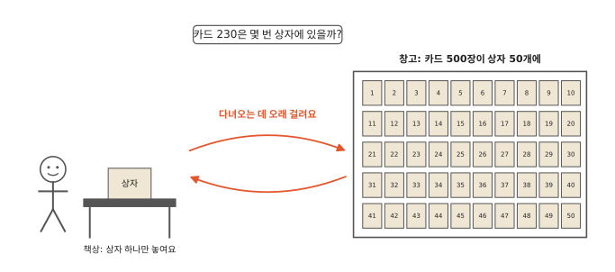
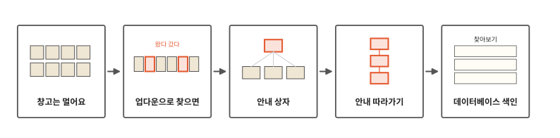
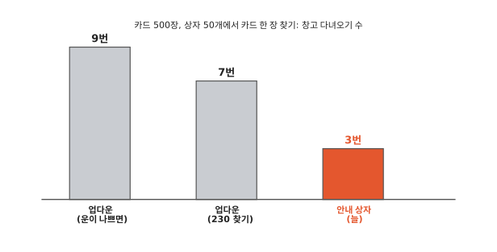

# 창고 속 카드는 어떻게 빨리 찾을까요?

## 카드가 창고에 있어요

10편 끝에서 카드가 먼 창고에 있으면 어떻게 찾을지 물었지요. 이번 편은 그 이야기예요.

번호 카드가 500장 있어요. 카드에는 1부터 1,000 사이 숫자가 하나씩 적혀 있고, 같은 숫자는 없어요. 작은 수부터 차례대로 열 장씩 상자에 담았더니 상자가 50개가 됐어요. 1번 상자에 제일 작은 카드 열 장, 2번 상자에 그다음 열 장이 들어 있어요.

상자는 멀리 있는 창고에 있어요. 책상에는 상자를 하나만 놓을 수 있어요. 다른 상자를 보려면 책상 위 상자를 갖다 놓고 창고에 다녀와야 해요. 책상 위 상자에 든 카드는 금방 볼 수 있지만, 창고에 한 번 다녀오는 일은 아주 오래 걸려요.

그래서 이번에는 카드를 몇 장 보는지 말고 창고에 몇 번 다녀오는지를 세요. 카드 230을 찾아봐요.

## 창고 다녀오기에서 색인까지

알고리즘 열한 번째 편이에요. 업다운 놀이로 찾을 때와 안내 상자를 따라 찾을 때 창고에 몇 번 다녀오는지 세어 봐요. 그다음 데이터베이스라는 프로그램이 같은 방법을 쓰는 모습을 봐요.

## 업다운으로 찾으면 창고를 여러 번 오가요

먼저 느린 방법이에요. 카드가 작은 수부터 놓여 있으니 3편에서 본 이진 탐색, 곧 업다운 놀이처럼 찾을 수 있어요. 남은 카드의 가운데 한 장을 보고, 찾는 수가 더 크면 오른쪽 반을, 더 작으면 왼쪽 반을 남겨요. 상자를 가져와도 규칙대로 가운데 카드 한 장만 봐요.

500장의 가운데 카드는 25번 상자에 있어요. 창고에 가서 25번 상자를 가져와 봤더니 498이에요. 230은 더 작으니 왼쪽 반만 남아요. 다음 가운데 카드는 13번 상자에 있어요. 25번 상자를 갖다 놓고 13번 상자를 가져와요. 232예요. 230이 또 더 작아요.

이렇게 볼 카드가 바뀔 때마다 다른 상자를 가져와야 해요. 그림처럼 상자를 일곱 번 가져와서야 230을 찾아요. 13번 상자는 두 번째에도 가져왔지만 그때는 가운데 카드 232 한 장만 보고 돌려보냈어요.

업다운 놀이는 질문 수가 적었어요. 그런데 질문 하나마다 창고에 다녀와야 하니 오래 걸려요. 상자 하나에 카드가 열 장이나 들어 있는데 거의 한 장만 보고 돌려보내요.

## 안내 상자를 만들어요

이번엔 상자를 한 번 가져올 때 그 안의 쪽지를 다 쓰는 방법이에요. 안내 상자를 만들어요.

카드 상자 50개를 열 개씩 다섯 묶음으로 나눠요. 묶음마다 가운데 안내 상자를 하나 만들어요. 그 안에는 묶음 속 카드 상자 열 개의 첫 카드 번호를 쪽지에 적어 넣어요. 그리고 맨 위 안내 상자 하나에 가운데 안내 상자 다섯 개의 첫 번호를 쪽지로 적어 넣어요. 쪽지 숫자는 그림에 있어요.

이제 230을 찾아봐요.

1. 창고에서 맨 위 안내 상자를 가져와요. 230은 191과 403 사이예요. 그러니 가운데 안내 상자 2번으로 가요.
2. 가운데 안내 상자 2번을 가져와요. 230은 224와 248 사이예요. 224로 시작하는 카드 상자는 13번이에요.
3. 카드 상자 13번을 가져와요. 230이 들어 있어요.

맨 위 안내 상자, 가운데 안내 상자, 카드 상자를 차례로 한 번씩 가져왔어요. 어떤 카드를 찾든 이 세 단계를 지나요.

컴퓨터 편 12편에서 낱말마다 어디에 있는지 적어 둔 표를 색인이라고 했지요. 책 맨 뒤 "찾아보기"도 색인이에요. 안내 상자도 카드 번호마다 어느 상자로 가면 되는지 적어 둔 색인이에요.

## 한 번 갈 때 많이 알아 와요

업다운 놀이는 카드 한 장을 볼 때마다 "크다"와 "작다" 두 갈래로만 나눴어요. 갈래는 나뉘어 갈 수 있는 길이에요. 카드 500장 모두를 하나씩 찾아보면 운이 나쁠 때는 창고에 아홉 번 다녀와야 했어요.

안내 상자는 가져올 때마다 여러 갈래로 나눠요. 맨 위 안내 상자는 쪽지가 다섯 장이라 다섯 갈래, 가운데 안내 상자는 쪽지가 열 장이라 열 갈래예요. 한 단계 내려갈 때마다 남는 카드가 훨씬 빨리 줄어요. 그래서 창고에 다녀오는 횟수가 단계 수만큼으로 줄어요.

안내 상자에 쪽지를 더 많이 넣으면 단계가 더 적어도 돼요. 진짜 컴퓨터는 상자 하나에 쪽지를 몇백 장씩 넣어요. 그러면 아주 많은 카드도 서너 단계 만에 찾아요.

## 데이터베이스도 이렇게 찾아요

학교나 가게, 은행은 아주 많은 사람의 정보를 컴퓨터에 모아 둬요. 이렇게 많은 정보를 모아 두고 찾아 주는 프로그램을 **데이터베이스**라고 해요.

컴퓨터 편 5편에서 칠판 같은 곳이 메모리, 공책 같은 곳이 저장 장치였지요. 저장 장치는 메모리보다 느렸어요. 이 편으로 치면 책상이 메모리, 먼 창고가 저장 장치예요. 데이터베이스는 정보를 저장 장치에 넣어 두기 때문에 저장 장치를 몇 번 읽는지 세어요. 진짜 메모리는 이 편의 책상과 달리 상자를 여러 개 놓을 수 있어서 자주 쓰는 맨 위 안내 상자는 늘 올려 두기도 해요.

정보는 상자에 아무 순서로 들어 있기도 해요. 그러면 업다운도 쓸 수 없어서 상자를 처음부터 끝까지 다 열어 봐야 해요. 그래서 데이터베이스는 찾을 값만 따로 차례대로 적은 안내 상자를 여러 단계로 만들어 둬요. 이 색인을 따라가면 상자 몇 개만 열어요.

지금까지는 카드 한 장을 빨리 찾는 법을 봤어요. 다음 편에서는 서로 이어진 것을 빠짐없이 찾아가는 법을 볼게요. 친구의 친구의 친구까지 찾아가려면 어떻게 할까요?

## 정리

- 색인(컴퓨터 편 12편): 어디에 있는지 적어 둔 안내예요. 안내 상자를 위에서 아래로 따라가면 창고에 몇 번만 다녀와도 원하는 카드를 찾아요.
- **데이터베이스**: 많은 정보를 모아 두고 찾아 주는 프로그램이에요. 색인을 만들어 저장 장치를 적게 읽어요.

## 해 보기: 안내 상자 놀이

종이 쪽지와 봉투(또는 종이컵)를 준비해요.

1. 종이 카드 마흔 장에 1부터 100 사이 숫자를 하나씩 적고 작은 수부터 늘어놓아요.
2. 다섯 장씩 봉투 여덟 개에 담고 봉투에 1번부터 8번까지 번호를 써요. 봉투가 카드 상자예요. 손에는 봉투를 하나만 들 수 있어요.
3. 쪽지 여덟 장에 봉투마다 첫 카드 숫자를 적어 새 봉투에 넣어요. 이게 안내 봉투예요.
4. 친구가 카드에 적힌 숫자 하나를 말하면 안내 봉투를 먼저 열고, 그다음 카드 봉투를 열어 찾아요. 봉투를 몇 번 열었나요?
5. 이번엔 안내 봉투 없이 1번 봉투부터 차례로 열어 찾아봐요. 운이 나쁘면 몇 번 열어야 할까요? 봉투가 50개라면 어떨까요?

## 확인 문제

??? question "1. 가운데 안내 상자 고르기"
    맨 위 안내 상자에 1, 191, 403, 605, 805가 적혀 있어요. 카드 500을 찾으려면 가운데 안내 상자 몇 번으로 가야 할까요?

    **풀이**: 3번이에요. 500은 403과 605 사이라서 403으로 시작하는 세 번째 가운데 안내 상자로 가요.

??? question "2. 상자가 작으면"
    안내 상자 하나에 쪽지가 두 장씩만 들어간다면 안내 상자를 따라 내려가는 길은 길어질까요, 짧아질까요?

    **풀이**: 길어져요. 안내 상자 하나가 두 갈래로만 나누니 업다운 놀이와 비슷해지고, 내려가야 할 단계가 많아져요.

??? question "3. 다녀오는 횟수"
    안내 상자를 따라 찾을 때 창고에 다녀오는 횟수는 무엇에 따라 정해질까요?

    **풀이**: 안내 상자를 몇 단계 지나는지에 따라 정해져요. 이 편의 창고는 맨 위 안내 상자, 가운데 안내 상자, 카드 상자 세 단계라 늘 세 번이에요.

!!! abstract "어른을 위한 정리 (건너뛰어도 돼요)"
    - 안내 상자 구조는 B-트리 계열이에요. 데이터가 맨 아래에만 있어 B+트리에 가깝고, 한 번에 만든 정적 트리라는 점, 키 10개에 아래 상자 10개를 둔 점은 실제 구현과 달라요. 디스크는 한 번에 페이지(블록) 단위로 읽기 때문에, 한 노드에 키를 많이 담아 분기 수(fan-out)를 키우면 트리 높이가 낮아지고 디스크 읽기 횟수가 줄어요. 분기 수가 m이면 높이는 대략 logₘ n이에요. 1972년 Bayer와 McCreight가 대용량 순서 색인을 위해 제안했어요.[^bayer]
    - SQLite는 보통 표마다 하나의 table b-tree(데이터는 리프에만, B+트리 꼴), 색인마다 하나의 index b-tree(안쪽 페이지에도 키가 있는 B-트리 꼴)를 파일 안에 두고, 페이지 크기 기본값은 4,096바이트예요.[^sqlite]
    - 파이썬 `sqlite3`로 100만 줄짜리 표에서 전화번호 하나를 찾아보면 색인 없이 35밀리초쯤(`SCAN member`), 색인을 만든 뒤에는 0.008밀리초쯤(`SEARCH ... USING COVERING INDEX`)이었어요. 파일이 이미 메모리 캐시에 올라온 상태에서 잰 값이라 디스크를 읽는 시간은 거의 들어 있지 않아요.[^lab]
    - 새 키를 넣다가 노드가 꽉 차면 둘로 나누고 부모에 키 하나를 올려요. 루트가 나뉠 때만 높이가 1 늘어서 모든 리프가 늘 같은 깊이에 있어요. 본문 장난감은 넣기를 다루지 않았어요.
    - 색인은 찾기를 빠르게 하지만 쓰기마다 색인도 고쳐야 하고 공간을 차지해요. 그래서 자주 찾는 열에만 만들어요.

## 더 깊이

??? info "업다운은 왜 같은 상자를 두 번 가져왔을까"
    업다운 놀이는 남은 카드의 가운데를 봐요. 처음에는 멀리 떨어진 카드를 보다가 점점 가까운 카드를 봐요. 230 근처까지 좁혀졌을 때 다시 13번 상자의 카드를 보게 된 거예요. 책상에 상자를 여섯 개쯤 둘 수 있다면 다시 안 가져와도 돼요. 이 놀이에서는 하나만 둘 수 있었어요.

??? info "도서관 안내판"
    큰 도서관에는 입구에 "1층 어린이책, 2층 소설"처럼 층 안내판이 있어요. 층에 가면 책장마다 "가~다", "라~마" 같은 안내가 붙어 있어요. 안내를 두 번 따라가면 책장 하나 앞에 서요. 안내 상자와 같은 생각이에요.

[^bayer]: R. Bayer, E. McCreight, "Organization and maintenance of large ordered indexes", *Acta Informatica* 1(3), 1972, 173–189쪽. [doi:10.1007/BF00288683](https://doi.org/10.1007/BF00288683).
[^sqlite]: SQLite 문서 [Database File Format](https://www.sqlite.org/fileformat2.html)의 B-tree Pages, Representation Of SQL Tables 절과 [PRAGMA page_size](https://www.sqlite.org/pragma.html#pragma_page_size).
[^lab]: [`lab/11_btree.py`](https://github.com/oya150/bedrock/blob/main/lab/11_btree.py)로 셌어요(CPython 3.12.7, SQLite 3.43.2, Apple Silicon 노트북). 카드 500장의 상자 배치, 업다운과 안내 상자의 창고 다녀오기 수, SQLite 실행 계획과 시간을 이 스크립트로 확인했어요. 시간은 다시 재면 조금씩 달라져요.
