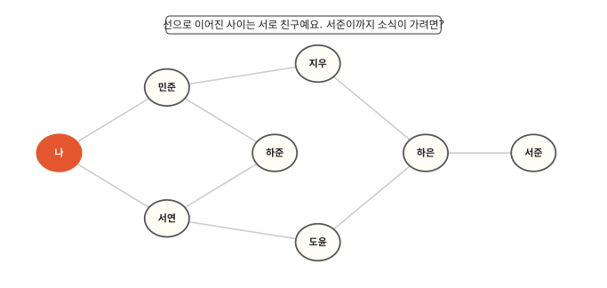
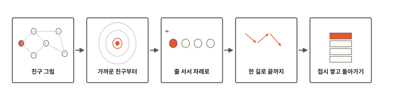
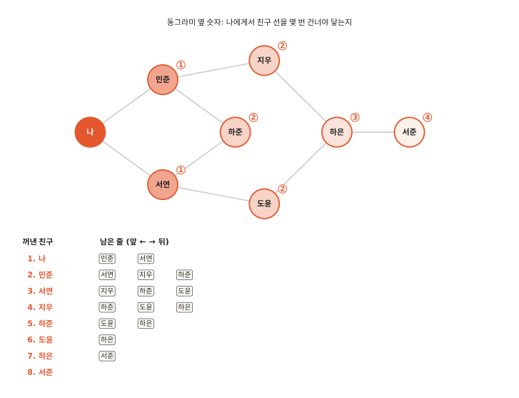
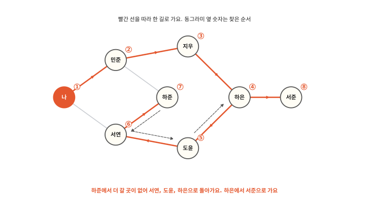
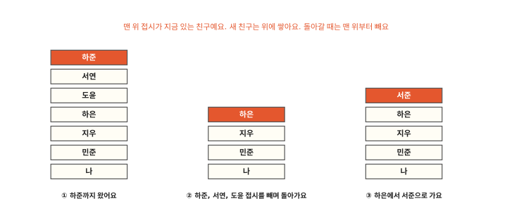

# 친구의 친구까지 빠짐없이 찾으려면?

## 소식을 친구의 친구까지

11편 끝에서 서로 이어진 것을 빠짐없이 찾아가는 법을 보자고 했지요. 그림은 친구 여덟 명이에요. 선으로 이어진 두 사람은 서로 친구예요.

나에게 좋은 소식이 생겼어요. 내 친구에게, 친구의 친구에게, 그 친구의 친구에게까지 한 명도 빠뜨리지 않고 알리고 싶어요. 나는 서준이를 모르지만 서준이에게도 소식이 가야 해요. 어떤 순서로 알리면 될까요?

## 친구 그림에서 접시 쌓기까지

알고리즘 열두 번째 편이에요. 친구를 빠짐없이 찾아가는 방법 두 가지를 봐요. 하나는 줄을 세워서 가까운 친구부터 찾는 방법이에요. 다른 하나는 접시를 쌓듯 걸어온 길을 쌓아 두고 한 길로 끝까지 갔다가 돌아오는 방법이에요.

## 줄을 세워 가까운 친구부터

첫째 방법은 줄을 세우는 거예요. 소식을 들은 친구를 줄 맨 뒤에 세워요. 그리고 줄 맨 앞 친구를 꺼내서 그 친구의 친구들에게 알려요. 새로 소식을 들은 친구는 또 줄 맨 뒤에 서요. 친구가 여럿이면 이름이 가나다순으로 먼저인 친구부터 세워요. 가나다순은 ㄱ, ㄴ, ㄷ… 차례예요. 도윤, 민준, 서연은 ㄷ, ㅁ, ㅅ 차례라 이 순서예요.

그림 아래 표를 따라가 봐요. 처음에 나를 꺼내서 민준, 서연을 줄에 세워요. 다음엔 맨 앞 민준을 꺼내서 지우, 하준을 줄 뒤에 세워요. 민준의 친구인 나는 이미 소식을 들었으니 다시 세우지 않아요. 이렇게 줄이 빌 때까지 하면 여덟 명 모두 소식을 들어요.

새로 들은 친구는 늘 줄 맨 뒤에 서요. 그래서 나와 더 가까운 친구가 먼 친구보다 먼저 줄에서 나와요. 그림의 숫자는 나에게서 친구 선을 몇 번 건너야 닿는지예요. 누구에게서 소식을 들었는지 적어 두면 서준이에게 온 길도 알 수 있어요. 나, 민준, 지우, 하은, 서준이에요.

"이미 소식을 들은 친구는 다시 세우지 않는다"는 약속이 꼭 있어야 해요. 그렇지 않으면 나, 민준, 나, 민준… 하고 같은 친구가 줄에 끝없이 다시 서요.

먼저 줄 선 사람이 먼저 나가는 줄을 **큐**라고 해요. 급식 줄이나 버스 정류장 줄이 큐예요.

## 한 길로 끝까지 가요

이번에는 소식을 전하는 대신 내가 직접 친구 집을 걸어서 찾아간다고 해 봐요. 미로에서 길을 찾을 때처럼 한 길로 끝까지 가 보는 거예요. 갈 수 있는 친구가 여럿이면 이번에도 이름이 가나다순으로 먼저인 친구에게 가요. 그림 숫자는 찾은 순서예요.

나에게서 민준에게 가요. 민준에게서는 아직 안 간 지우와 하준 가운데 지우에게 가요. 그다음은 하은, 도윤, 서연, 하준 차례로 한 길로 이어서 가요.

하준에게 오니 친구 민준과 서연은 벌써 다녀온 집이에요. 더 갈 곳이 없어요. 그러면 한 걸음씩 돌아가요.

1. 바로 전에 있던 서연에게 돌아가요. 서연에게도 더 갈 곳이 없어요.
2. 그 전에 있던 도윤에게 돌아가요. 도윤에게도 더 갈 곳이 없어요.
3. 그 전에 있던 하은에게 돌아가요. 하은에게는 아직 안 간 서준이 있어요. 서준에게 가요.

서준에게서도 갈 곳이 없으니 하은, 지우, 민준, 나로 차례로 돌아와요. 더 돌아갈 곳이 없으면 끝나요.

이번에도 여덟 명을 다 찾았어요. 순서는 첫째 방법과 달라요. 하은이를 4번째로 만났어요. 줄을 세울 때는 7번째였어요.

## 걸어온 길을 접시처럼 쌓아요

돌아갈 길을 잊지 않으려면 걸어온 길을 접시처럼 쌓아 두면 돼요. 새 친구 집에 갈 때마다 그 친구 이름 접시를 맨 위에 올려요. 맨 위 접시가 지금 있는 친구예요.

더 갈 곳이 없으면 맨 위 접시를 빼요. 그러면 그 아래 접시, 곧 바로 전에 있던 친구에게 돌아가요. 하준 접시를 빼면 서연이 맨 위가 돼요. 서연과 도윤 접시도 빼면 하은이 맨 위가 돼요. 하은에게서 서준에게 가니 서준 접시를 올려요.

접시로 하면 한 길로 깊이 들어가요. 늘 방금 올린 맨 위 접시의 친구에게서 다음 친구를 찾으니까요.

나중에 올린 접시를 먼저 빼는 쌓기를 **스택**이라고 해요. 쌓아 둔 책 더미도 스택이에요. 맨 아래 책을 빼려면 위의 책부터 들어내야 하지요.

친구 선을 몇 번 건너야 닿는지 알고 싶을 때는 줄(큐)로 찾아요. 미로처럼 한 길을 따라가 보는 일에는 접시(스택)가 맞아요. 막히면 바로 전 자리로 돌아가야 해요. 맨 위 접시만 빼면 돼요.

알고리즘 편은 여기까지예요. 양말 짝 찾기에서 시작해서 정렬하고, 찾고, 이어진 것을 따라가는 방법을 봤어요. 어느 방법이든 카드와 바둑돌로 직접 해 볼 수 있어요.

## 정리

- **큐**: 먼저 줄 선 것이 먼저 나가는 줄이에요. 큐로 찾아가면 가까운 친구부터 찾아요.
- **스택**: 나중에 쌓은 것을 먼저 빼는 접시 더미예요. 스택으로 찾아가면 한 길로 끝까지 갔다가 돌아와요.

## 해 보기: 친구 그림 따라가기

종이에 그림처럼 친구 그림을 그리고 바둑돌과 쪽지를 준비해요. 친구가 여럿이면 이름이 가나다순으로 먼저인 친구부터 해요.

1. 큐 놀이: 쪽지에 "나"를 적어 줄 맨 앞에 놓아요. 줄에 쪽지가 없어질 때까지 해요. 맨 앞 쪽지를 꺼내 그 친구의 친구들 이름을 새 쪽지에 적어 줄 맨 뒤에 놓아요. 이미 쪽지를 만든 친구 위에는 바둑돌을 올려 두고 다시 만들지 않아요. 꺼낸 순서를 적어 봐요.
2. 스택 놀이: 이번엔 쪽지를 위로 쌓아요. 쌓은 쪽지가 다 없어질 때까지 해요. 맨 위 친구에게서 아직 안 간 친구 한 명 쪽지를 위에 올려요. 이미 간 친구 위에는 바둑돌을 올려요. 갈 곳이 없으면 맨 위 쪽지를 빼요. 쪽지를 올린 순서를 적어 봐요.
3. 두 순서를 비교해 봐요. 하은이는 각각 몇 번째로 만났나요?

## 확인 문제

??? question "1. 선을 두 번 건너야 닿는 친구"
    그림에서 나에게서 친구 선을 두 번 건너야 닿는 친구는 누구누구일까요?

    **풀이**: 지우, 하준, 도윤이에요. 내 친구 민준, 서연의 친구들 가운데 나를 빼고, 나와 바로 친구가 아닌 사람이에요.

??? question "2. 줄에서 먼저 나오는 친구"
    큐에 민준, 서연이 차례로 서 있어요. 다음에 꺼내는 친구는 누구일까요? 스택에 민준, 서연을 차례로 쌓았다면요?

    **풀이**: 큐에서는 먼저 선 민준이 먼저 나와요. 스택에서는 나중에 쌓은 서연이 먼저 나와요.

??? question "3. 약속이 없으면"
    "이미 만난 친구는 다시 가지 않는다"는 약속이 없으면 어떤 일이 생길까요?

    **풀이**: 나와 민준처럼 서로 친구인 두 사람 사이를 끝없이 오갈 수 있어요. 찾기가 끝나지 않아요.

!!! abstract "어른을 위한 정리 (건너뛰어도 돼요)"
    - 친구 그림은 그래프(정점 8개, 간선 9개)예요. 큐로 찾으면 너비 우선 탐색(BFS), 스택(또는 재귀)으로 찾으면 깊이 우선 탐색(DFS)이에요. 둘 다 방문 표시를 하면 O(V + E)예요. 가중치 없는 그래프에서 BFS는 시작점에서 각 정점까지의 최단 간선 수를 구해요.
    - 본문 DFS는 걸어온 경로를 스택에 두고 막히면 pop하는 방식(재귀 DFS와 같은 순서)이에요. 이웃을 한꺼번에 스택에 넣는 반복형 DFS는 방문 순서가 조금 달라질 수 있어요.
    - 파이썬에서 큐는 `collections.deque`의 `append`/`popleft`로, 스택은 리스트의 `append`/`pop`으로 써요. 리스트의 `pop(0)`은 뒤 원소를 다 옮겨서 O(n)이에요(2편).[^deque]
    - 쓰임: BFS는 소셜 그래프의 "n촌", 가장 적은 정류장을 지나는 경로, 웹 크롤링 깊이 제한에, DFS는 미로·퍼즐 탐색, 위상 정렬(의존성 순서), 사이클 검사에 써요.

## 더 깊이

??? info "가나다순으로 정한 까닭"
    친구가 여럿일 때 누구에게 먼저 갈지는 정해 두기만 하면 돼요. 이 편에서는 가나다순으로 정했어요. 순서를 바꾸면 찾는 순서도 바뀌어요. 그래도 줄로 찾을 때 친구 선을 몇 번 건너야 닿는지는 그대로예요.

??? info "미로 찾기"
    미로에서 오른손을 벽에 대고 걷는 방법도 한 길로 끝까지 가 보는 방법과 닮았어요. 막다른 곳에서 되돌아 나와 다른 길로 가니까요. 다만 오른손 방법은 벽이 모두 바깥벽과 이어진 미로에서만 통해요. 가 본 곳을 표시하는 방법은 어떤 미로에서든 통해요.

[^deque]: Python 3.12 문서 [`collections.deque`](https://docs.python.org/3.12/library/collections.html#collections.deque). 본문의 찾은 순서와 단계는 [`lab/12_bfs_dfs.py`](https://github.com/oya150/bedrock/blob/main/lab/12_bfs_dfs.py)로 확인했어요.
