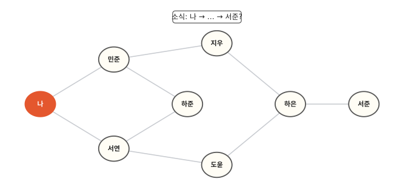
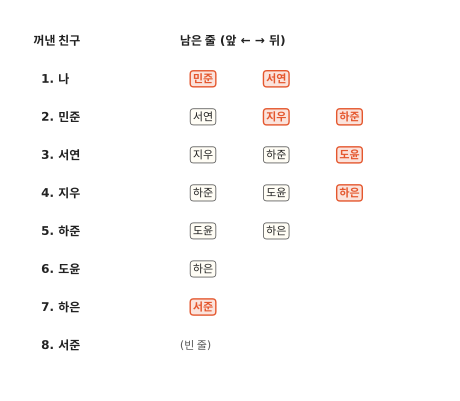
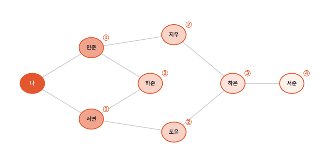
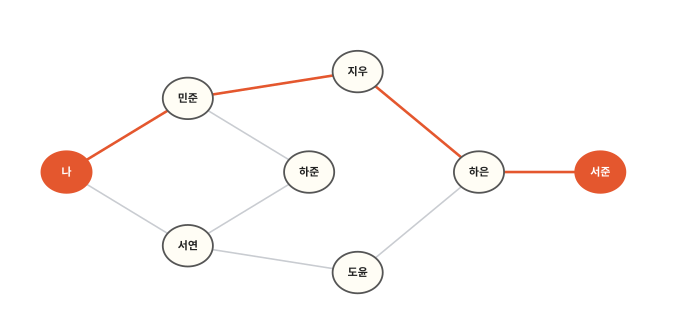
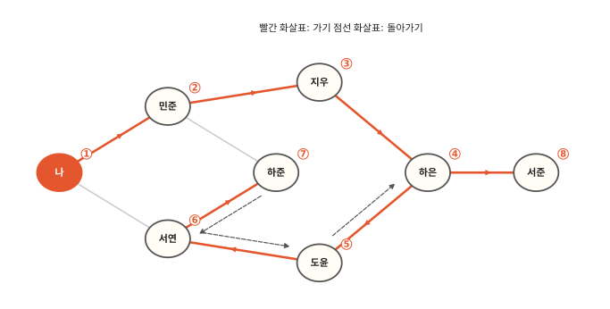
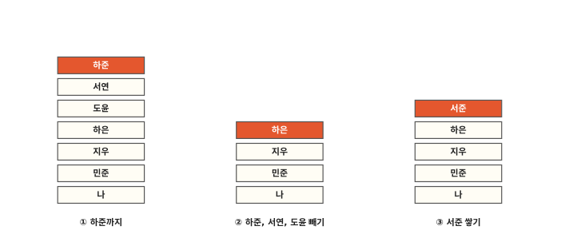
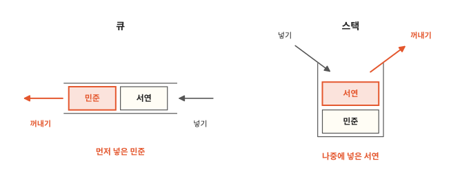

# BFS와 DFS: 친구의 친구까지 빠짐없이 찾아가기

좋은 소식이 생기면 친구에게 알리고 그 친구가 또 자기 친구에게 알려요. 그렇게 퍼지다 보면 누군가 한 명은 빠지기 쉬워요. 이 글에서는 친구의 친구의 친구까지 한 명도 빠뜨리지 않고 찾아가는 방법 두 가지를 해 봐요. 정류장을 가장 적게 지나는 길 찾기나 미로 풀기에도 이 두 방법을 써요.

!!! abstract "이 글에서 알게 되는 것"
    1. 소식을 들은 친구를 줄 맨 뒤에 세우고 맨 앞부터 꺼내면 가까운 친구부터 빠짐없이 찾아가요. 이런 줄을 큐라고 해요.
    2. 한 길로 끝까지 갔다가 막히면 한 걸음씩 돌아오는 방법으로도 모두 찾아요. 걸어온 길을 접시처럼 쌓아 두는 이 더미를 스택이라고 해요.
    3. 두 방법 모두 이미 만난 친구는 다시 넣지 않아야 끝나요. 몇 번 건너야 닿는지 알고 싶으면 큐를, 한 길을 따라가 보려면 스택을 써요.

## 1. 친구 그림에서 모두에게 소식을 전해요

[11편](11-btree.md)에서는 카드 한 장을 빨리 찾았어요. 이번에는 서로 이어진 사람을 빠짐없이 찾아가요.

아래 그림은 친구 여덟 명이에요. 선으로 이어진 두 사람은 서로 친구예요. 빨간 동그라미가 나예요.

**그림 1.** 나는 민준, 서연하고만 친구이고 서준과는 여러 사람을 건너야 이어져요.
{ .fig-cap }

나에게 좋은 소식이 생겼어요. 내 친구에게, 친구의 친구에게, 그 친구의 친구에게까지 한 명도 빠뜨리지 않고 알리고 싶어요. 나는 서준이를 모르지만 서준이에게도 소식이 가야 해요. 어떤 순서로 알리면 될까요?

하나 미리 정해 둘게요. 친구가 여럿이면 이름이 가나다순으로 앞선 친구부터 해요. 가나다순은 ㄱ, ㄴ, ㄷ… 차례예요. 도윤, 민준, 서연은 ㄷ, ㅁ, ㅅ 차례라서 이 순서예요.

## 2. 줄을 세우면 가까운 친구부터 소식을 들어요

첫째 방법은 줄을 세우는 거예요. 소식을 들은 친구를 줄 맨 뒤에 세워요. 그리고 줄 맨 앞 친구를 꺼내서 그 친구의 친구들에게 알려요. 새로 소식을 들은 친구는 또 줄 맨 뒤에 서요. 줄이 빌 때까지 이걸 되풀이해요.

처음엔 나를 꺼내서 민준과 서연에게 알리고 둘을 줄에 세워요. 다음엔 맨 앞 민준을 꺼내요. 민준의 친구는 나, 지우, 하준이에요. 나는 이미 소식을 들었으니 다시 세우지 않고 지우와 하준만 줄 뒤에 세워요.

아래 표에서 빨간 이름을 보세요. 그 차례에 새로 줄에 선 친구예요.

**그림 2.** 맨 앞에서 한 명씩 꺼내고 새로 소식을 들은 친구는 줄 맨 뒤에 서요.
{ .fig-cap }

5번째 하준과 6번째 도윤을 꺼낼 때는 빨간 이름이 없어요. 하준의 친구 민준과 서연, 도윤의 친구 서연과 하은은 이미 소식을 들었거든요. 8번째로 서준을 꺼내면 줄이 비어요. 여덟 명 모두 소식을 들었어요.

여기서 "이미 소식을 들은 친구는 다시 세우지 않는다"는 약속이 꼭 있어야 해요. 이 약속이 없으면 민준을 꺼낼 때 나를 다시 세우고 나를 꺼낼 때 민준을 또 세워요. 나, 민준, 나, 민준… 하고 같은 친구가 줄에 끝없이 다시 서서 찾기가 끝나지 않아요.

## 3. 줄로 찾으면 몇 번 건너야 닿는지 알 수 있어요

표에서 꺼낸 순서는 나, 민준, 서연, 지우, 하준, 도윤, 하은, 서준이에요. 이 순서를 친구 그림에 옮겨 보면 규칙이 보여요. 아래 그림에서 동그라미 옆 숫자를 보세요. 나에게서 친구 선을 몇 번 건너야 닿는지 적은 숫자예요.

**그림 3.** 민준과 서연은 선을 1번, 지우와 하준과 도윤은 2번, 하은은 3번, 서준은 4번 건너야 닿아요.
{ .fig-cap }

나를 빼고 꺼낸 순서대로 숫자를 읽으면 1, 1, 2, 2, 2, 3, 4예요. 숫자가 작은 친구부터 나왔어요. 새로 들은 친구는 늘 줄 맨 뒤에 서니까 나와 가까운 친구가 먼 친구보다 먼저 줄에서 나와요.

누구에게서 소식을 들었는지 적어 두면 서준에게 소식이 온 길도 알 수 있어요. 서준은 하은에게, 하은은 지우에게, 지우는 민준에게, 민준은 나에게서 들었어요. 아래 그림의 빨간 선이 그 길이에요.

**그림 4.** 소식은 나, 민준, 지우, 하은을 거쳐 서준에게 갔어요.
{ .fig-cap }

이 길은 선을 네 번 건너요. 그림 3에서 서준의 숫자가 4였죠. 줄로 찾으면 선을 가장 적게 건너는 길이 나와요.

먼저 줄 선 사람이 먼저 나가는 줄을 **큐**라고 해요. 급식 줄이나 버스 정류장 줄이 큐예요. 큐로 가까운 친구부터 넓게 훑어 가는 방법은 **너비 우선 탐색**이라고 해요. 영어 이름의 첫 글자를 따서 BFS라고도 불러요.

## 4. 한 길로 끝까지 갔다가 막히면 돌아와요

줄 세우기는 가까운 친구부터 넓게 퍼졌어요. 이번에는 소식을 전하는 대신 내가 친구 집을 걸어서 찾아간다고 해 볼게요. 미로에서 길을 찾을 때처럼 한 길로 끝까지 가 보는 거예요. 갈 수 있는 친구가 여럿이면 이번에도 가나다순으로 앞선 친구에게 가요.

나에게서 민준에게 가요. 민준에게서는 아직 안 간 지우와 하준 가운데 지우에게 가요. 지우에게서 하은, 하은에게서 도윤, 도윤에게서 서연, 서연에게서 하준으로 한 길로 이어서 가요.

하준에게 오니 친구 민준과 서연은 벌써 다녀온 집이에요. 더 갈 곳이 없어요. 그러면 한 걸음씩 돌아가요.

1. 바로 전에 있던 서연에게 돌아가요. 서연에게도 더 갈 곳이 없어요.
2. 그 전에 있던 도윤에게 돌아가요. 도윤에게도 더 갈 곳이 없어요.
3. 그 전에 있던 하은에게 돌아가요. 하은에게는 아직 안 간 서준이 있어요. 서준에게 가요.

아래 그림에서 빨간 화살표는 간 길이고 점선 화살표는 돌아온 길이에요. 동그라미 옆 숫자는 찾은 순서예요.

**그림 5.** 하준에서 막혀 서연, 도윤, 하은으로 돌아왔다가 하은에서 서준으로 가요.
{ .fig-cap }

서준에게서도 갈 곳이 없으니 하은, 지우, 민준, 나로 차례로 돌아와요. 더 돌아갈 곳이 없으면 끝나요.

이번에도 여덟 명을 다 찾았어요. 그런데 순서가 달라요. 하은이를 4번째로 만났어요. 줄을 세울 때는 7번째였어요.

## 5. 걸어온 길을 접시처럼 쌓아 두면 돌아갈 곳을 알아요

막혔을 때 바로 전에 있던 친구를 어떻게 기억할까요? 걸어온 길을 접시처럼 쌓아 두면 돼요. 새 친구 집에 갈 때마다 그 친구 이름을 적은 접시를 맨 위에 올려요. 맨 위 접시가 지금 있는 친구예요. 더 갈 곳이 없으면 맨 위 접시를 빼요. 그러면 그 아래 접시가 맨 위가 되는데 그 친구가 바로 전에 있던 친구예요.

아래 그림에서 빨간 맨 위 접시가 어떻게 바뀌는지 보세요.

**그림 6.** 하준까지 일곱 장을 쌓았다가 세 장을 빼서 하은으로 돌아가고 서준을 새로 쌓아요.
{ .fig-cap }

하준 접시를 빼면 서연이 맨 위가 돼요. 서연과 도윤 접시도 빼면 하은이 맨 위가 돼요. 하은에게서 서준에게 가니 서준 접시를 올려요. 늘 방금 올린 맨 위 접시의 친구에게서 다음 친구를 찾으니까 한 길로 깊이 들어가요.

나중에 올린 접시를 먼저 빼는 더미를 **스택**이라고 해요. 쌓아 둔 책 더미도 스택이에요. 맨 아래 책을 빼려면 위의 책부터 들어내야 하지요. 스택으로 한 길을 깊이 먼저 들어가는 방법은 **깊이 우선 탐색**, 줄여서 DFS라고 해요.

## 6. 큐는 먼저 넣은 것을, 스택은 나중에 넣은 것을 먼저 꺼내요

두 방법은 친구를 넣어 두었다가 꺼내는 쪽이 달라요. 민준과 서연을 차례로 넣고 하나를 꺼내 볼게요. 아래 그림에서 빨간 이름을 보세요.

**그림 7.** 큐에서는 먼저 넣은 민준이 나오고 스택에서는 나중에 넣은 서연이 나와요.
{ .fig-cap }

꺼내는 쪽 하나가 다를 뿐인데 찾는 순서가 크게 달라져요. 큐는 일찍 들어온 가까운 친구부터 꺼내서 넓게 퍼져요. 스택은 맨 위, 곧 방금 올린 친구에게서 계속 나아가서 한 길로 깊이 들어가요.

그래서 쓰는 곳도 달라요. 친구 선을 몇 번 건너야 닿는지 알고 싶을 때는 큐로 찾아요. 미로처럼 한 길을 따라가 보는 일에는 스택이 맞아요. 막히면 바로 전 자리로 돌아가야 하는데 맨 위 접시만 빼면 되거든요.

## 확인 문제

??? question "1. 선을 두 번 건너야 닿는 친구"
    친구 그림에서 나에게서 친구 선을 두 번 건너야 닿는 친구는 누구누구일까요?

    **풀이**: 지우, 하준, 도윤이에요. 내 친구 민준과 서연의 친구들 가운데 나를 빼면 이 셋이 남아요.

??? question "2. 먼저 나오는 친구"
    큐에 민준, 서연이 차례로 서 있어요. 다음에 꺼내는 친구는 누구일까요? 스택에 민준, 서연을 차례로 쌓았다면요?

    **풀이**: 큐에서는 먼저 선 민준이 먼저 나와요. 스택에서는 나중에 쌓은 서연이 먼저 나와요.

??? question "3. 약속이 없으면"
    "이미 만난 친구는 다시 가지 않는다"는 약속이 없으면 어떤 일이 생길까요?

    **풀이**: 나와 민준처럼 서로 친구인 두 사람 사이를 끝없이 오갈 수 있어요. 찾기가 끝나지 않아요.

??? info "어른을 위한 덧붙임 (건너뛰어도 돼요)"
    - 친구 그림은 그래프(정점 8개, 간선 9개)예요. 큐로 찾으면 너비 우선 탐색(BFS), 스택이나 재귀로 찾으면 깊이 우선 탐색(DFS)이에요. 둘 다 방문 표시를 하면 O(V + E)예요. 가중치 없는 그래프에서 BFS는 시작점에서 각 정점까지의 최단 간선 수를 구해요.
    - 본문 DFS는 걸어온 경로를 스택에 두고 막히면 pop하는 방식이라서 재귀 DFS와 순서가 같아요. 이웃을 한꺼번에 스택에 넣는 반복형 DFS는 방문 순서가 조금 달라질 수 있어요.
    - 파이썬에서 큐는 [`collections.deque`](https://docs.python.org/3.12/library/collections.html#collections.deque)의 `append`/`popleft`로, 스택은 리스트의 `append`/`pop`으로 써요. 리스트의 `pop(0)`은 뒤 원소를 다 옮겨서 O(n)이에요([2편](02-why-arrays-are-fast.md)).
    - 쓰임: BFS는 소셜 그래프의 "n촌", 가장 적은 정류장을 지나는 경로, 웹 크롤링 깊이 제한에 써요. DFS는 미로·퍼즐 탐색, 위상 정렬(의존성 순서), 사이클 검사에 써요.

## 정리

친구 그림에서 모두를 빠짐없이 찾아가는 방법은 두 가지였어요. 첫째는 소식을 들은 친구를 줄 맨 뒤에 세우고 맨 앞부터 꺼내는 방법이에요. 그러면 가까운 친구부터 찾고 서준에게 소식이 온 길 나, 민준, 지우, 하은, 서준도 알 수 있어요. 먼저 선 사람이 먼저 나가는 이 줄이 큐이고 이 방법이 너비 우선 탐색(BFS)이에요.

둘째는 한 길로 끝까지 갔다가 막히면 한 걸음씩 돌아오는 방법이에요. 걸어온 길을 접시처럼 쌓아 두고 맨 위부터 빼면 돌아갈 곳을 잊지 않아요. 나중에 쌓은 것을 먼저 빼는 이 더미가 스택이고 이 방법이 깊이 우선 탐색(DFS)이에요. 두 방법 모두 이미 만난 친구는 다시 넣지 않아야 끝나요.

알고리즘 편은 여기까지예요. [1편](01-why-big-o.md)의 양말 짝 찾기부터 카드 정렬과 빨리 찾기를 거쳐 이어진 것 따라가기까지 왔어요. 어느 방법이든 카드와 바둑돌, 사물함과 상자, 접시 같은 물건을 놓고 손으로 해 볼 수 있어요.

### 새로 나온 말

- **큐**: 먼저 들어온 것이 먼저 나가는 줄. 민준, 서연 차례로 서면 민준이 먼저 나와요.
- **스택**: 나중에 쌓은 것을 먼저 빼는 더미. 민준, 서연 차례로 쌓으면 서연이 먼저 나와요.
- **너비 우선 탐색(BFS)**: 큐로 가까운 친구부터 넓게 찾아가는 방법. 친구 그림에서는 나, 민준, 서연, 지우, 하준, 도윤, 하은, 서준 순서였어요.
- **깊이 우선 탐색(DFS)**: 스택으로 한 길을 끝까지 갔다가 돌아오는 방법. 친구 그림에서는 나, 민준, 지우, 하은, 도윤, 서연, 하준, 서준 순서였어요.
