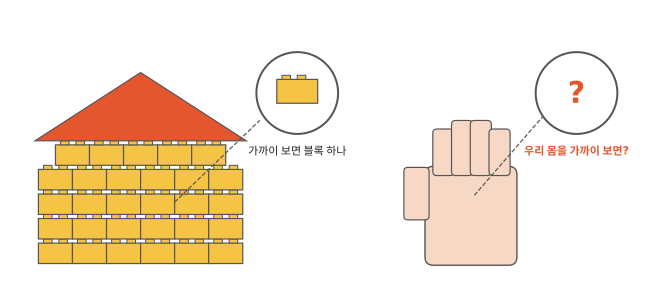
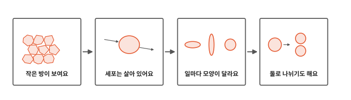
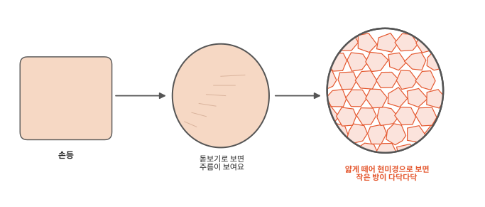
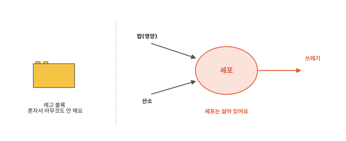
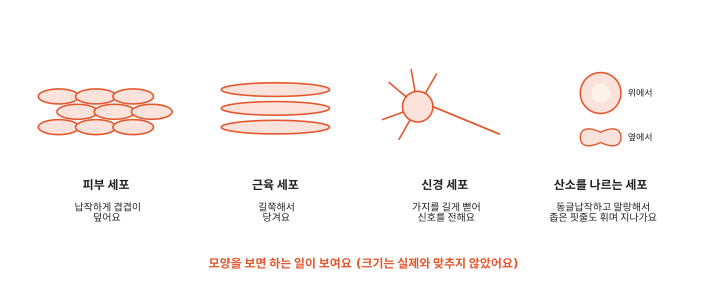
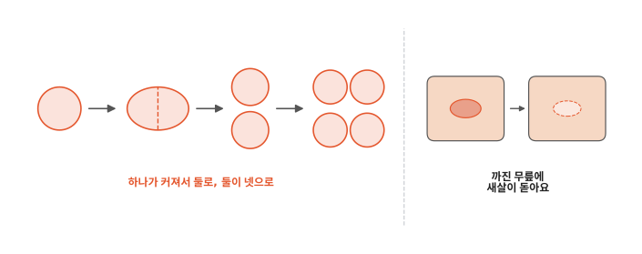

# 우리 몸은 무엇으로 만들어졌을까요?

## 레고 집을 가까이 보면

레고 블록을 하나씩 붙여서 커다란 집을 만들었어요. 멀리서 보면 그냥 집이지만 가까이 다가가 보면 작은 블록 하나하나가 보여요. 큰 집은 작은 블록이 많이 모여 생긴 거예요.

우리 몸도 멀리서 보면 손, 발, 얼굴이에요. 우리 몸을 확대해서 아주 가까이 보면 무엇이 보일까요?

## 작은 방에서 둘로 나뉘기까지

인체 첫 번째 편이에요. 몸을 확대해 보면 무엇이 보이는지, 그것이 레고 블록과 어떻게 다른지 봐요. 생김새가 하는 일과 어떻게 이어지는지도 봐요.

## 작은 방이 보여요

손등을 그냥 보면 매끈해요. 돋보기로 보면 가는 주름이 보여요. 피부를 아주 얇게 떼어 내서 현미경이라는 기계로 훨씬 더 크게 보면 작은 방 같은 것이 다닥다닥 붙어 있어요.

이 작은 방 하나하나를 **세포**라고 해요. 세포는 대부분 아주 작아서 눈으로는 볼 수 없어요. 현미경이 있어야 보여요.

뼈에도, 피에도, 눈에도, 머리카락이 자라나는 뿌리에도 세포가 있어요. 몸 전체가 이런 세포로 이루어져 있어요.

## 세포는 살아 있어요

작은 방이라고 했지만 세포 안은 꽉 차 있고 늘 바빠요. 세포는 살아 있거든요. 레고 블록은 혼자서 아무것도 하지 않아요.

세포는 우리가 먹은 밥에서 영양을 받아요. 영양은 밥에서 나오는, 힘이 되는 것이에요. 세포는 숨 쉴 때 들이마신 공기에서 산소도 받아요. 산소는 공기 속에 있는데 눈에는 안 보여요.

대부분의 세포는 영양과 산소로 힘을 만들어요. 그 힘으로 일을 해요. 쓰고 남은 쓰레기는 밖으로 내놓아요.

우리가 밥을 먹고 숨을 쉬면 그 영양과 산소가 몸속 세포까지 가요.

## 일마다 모양이 달라요

세포는 하는 일에 따라 생김새가 달라요.

피부 세포는 납작해요. 물고기 비늘처럼 겹겹이 덮어서 몸을 감싸요. 근육 세포는 길쭉해요. 고무줄처럼 짧게 줄어들면서 뼈를 당겨서 팔과 다리를 움직여요. 신경 세포는 몸 곳곳에 알림을 보내는 세포예요. 가지가 길게 뻗어 있어서 멀리 떨어진 곳까지 "뜨거워!", "움직여!" 같은 알림을 전해요.

피 속에서 산소를 나르는 세포도 있어요. 위에서 보면 동그래요. 옆에서 보면 납작하고 가운데가 쏙 들어가 있어요. 말랑해서 자기보다 좁은 핏줄도 휘어지며 지나가요.

## 둘로 나뉘기도 해요

세포는 레고 블록과 달리 스스로 늘어나기도 해요. 많은 세포는 조금 커진 다음 반으로 갈라져 둘이 돼요. 하나가 둘이 되고 둘이 넷이 돼요. 신경 세포처럼 다 자라면 거의 나뉘지 않는 세포도 있어요.

아기 때보다 키가 큰 데는 세포가 나뉘어 늘어난 것도 한몫해요. 무릎이 까졌다가 며칠 뒤에 새살이 돋는 것은 상처 둘레의 세포가 나뉘고 옮겨 가서 빈자리를 채우기 때문이에요.

세포가 쓰는 산소는 어디로 들어와서 세포까지 갈까요? 다음 편에서 볼게요.

## 정리

- 세포: 우리 몸을 이루는 아주 작은 방이에요. 살아 있어서 영양과 산소를 받아 일할 힘을 만들어요. 하는 일에 따라 모양이 달라요. 많은 세포는 둘로 나뉘어 늘어나요.

## 해 보기: 작은 방 찾기

1. 현미경이 있으면 양파 안쪽의 아주 얇은 막을 올려 보세요. 양파는 어른이 잘라 주고 막도 어른이 떼어 주세요. 유리판은 깨지기 쉬우니 조심해요. 작은 칸이 다닥다닥 붙어 있는 게 보이나요? 양파도 세포로 되어 있어요.
2. 현미경이 없으면 레고 블록을 세포 대신으로 놀아 봐요. 블록 여러 개를 붙여 손 모양을 만들어요. 블록을 하나 더 늘리려면 누가 붙여 줘야 하지요? 새 세포는 있던 세포가 나뉘어서 생겨요.
3. 벽에 키를 표시해 둔 곳이 있으면 지금 키와 비교해 봐요. 그사이 몸속에서 세포가 얼마나 나뉘었을지 이야기해 봐요.

## 확인 문제

??? question "1. 작은 방의 이름"
    우리 몸을 이루는 아주 작은 방을 무엇이라고 할까요?

    **풀이**: 세포예요. 현미경으로 봐야 보일 만큼 작아요.

??? question "2. 레고와 다른 점"
    레고 블록과 세포가 다른 점을 하나 말해 보세요.

    **풀이**: 세포는 살아 있어서 영양과 산소를 받고 쓰레기를 내놓아요. 많은 세포가 스스로 둘로 나뉘어 늘어나요. 하는 일에 따라 모양도 달라요.

??? question "3. 무릎이 낫는 까닭"
    까진 무릎에 새살이 돋는 것은 세포가 무엇을 해서일까요?

    **풀이**: 상처 둘레의 세포가 둘로 나뉘어 늘어나서 빈자리를 채우기 때문이에요. 세포가 상처 쪽으로 옮겨 가기도 해요.

!!! abstract "어른을 위한 정리 (건너뛰어도 돼요)"
    - 20~30세, 70kg 성인 남성 기준 모형으로 사람 세포는 약 30조 개(3.0×10¹³)로 추정돼요. 수로는 적혈구가 84%쯤을 차지해요. 몸속 세균 수도 비슷한 규모이고 대부분 큰창자에 있어요.[^sender] 조직별로 더한 다른 추정은 약 37조 개예요.[^bianconi]
    - 적혈구는 지름 7~8마이크로미터쯤인 가운데가 오목한 원반 모양이에요. 자라면서 핵을 내보내서 다 자란 적혈구에는 핵이 없어요. 막을 받치는 단백질이 유연해서 자기보다 가는 모세혈관도 휘어지며 지나가요. 적혈구는 나뉘지 않고 뼈 속 골수에서 새로 만들어지며, 핏속에서 길게는 120일쯤 살아요.[^rbc][^openstax] 다 자란 적혈구는 미토콘드리아도 없어서 산소를 나르기만 하고 쓰지는 않아요.
    - 세포는 세포막으로 둘러싸이고 대개 안에 유전 정보를 담은 핵이 있어요(다 자란 적혈구, 피부 각질층 세포 등은 없고 근육 세포는 여럿). 산소로 에너지를 만드는 일은 주로 미토콘드리아가 해요. 본문의 "영양과 산소로 일하는 힘을 만든다"는 이 세포 호흡을 말해요.
    - 몸이 자라고 상처가 낫는 데는 주로 체세포 분열이 일해요. 다만 생식세포, 적혈구, 대부분의 신경 세포, 일부 근육 세포는 거의 나뉘지 않아요.[^openstax] 피부 바깥층(각질층) 세포는 죽은 채 떨어져 나가고 아래층에서 새 세포가 올라와요. 목욕할 때 밀면 나오는 때에도 이 각질이 땀·기름·먼지와 섞여 있어요.

## 더 깊이

??? info "\"세포\"라는 이름"
    360년쯤 전인 1665년, 영국의 로버트 훅이라는 과학자가 현미경으로 얇게 자른 코르크(병마개를 만드는 나무껍질)를 봤어요. 작은 칸이 벌집처럼 늘어선 것을 보고 영어로 "cells"라고 적었어요. 작은 방이라는 뜻이에요. 그때 훅이 본 건 이미 죽은 식물 세포의 빈 칸을 둘러싼 벽이었어요.[^hooke]

??? info "양파 세포는 왜 네모날까"
    식물 세포는 바깥에 단단한 벽이 있어요. 그래서 양파 세포는 반듯한 칸처럼 보여요. 사람 세포는 그런 벽이 없어서 모양이 더 자유로워요.

??? info "세포 하나가 몸 전체인 생물"
    세균은 세포 하나가 몸 전체예요. 우리 몸은 세포가 많이 모여 서로 일을 나눠 맡고 있어요.

[^sender]: R. Sender, S. Fuchs, R. Milo, "Revised Estimates for the Number of Human and Bacteria Cells in the Body", *PLOS Biology* 14(8): e1002533, 2016. [doi:10.1371/journal.pbio.1002533](https://doi.org/10.1371/journal.pbio.1002533).
[^bianconi]: E. Bianconi 외, "An estimation of the number of cells in the human body", *Annals of Human Biology* 40(6): 463–471, 2013. [doi:10.3109/03014460.2013.807878](https://doi.org/10.3109/03014460.2013.807878).
[^rbc]: OpenStax, *Anatomy and Physiology 2e*, 18.3 ["Erythrocytes"](https://openstax.org/books/anatomy-and-physiology-2e/pages/18-3-erythrocytes). 지름 7~8마이크로미터, 자라며 핵을 내보냄, 유연한 막 단백질, 최대 120일.
[^openstax]: OpenStax, *Anatomy and Physiology 2e*, 3.5 ["Cell Growth and Division"](https://openstax.org/books/anatomy-and-physiology-2e/pages/3-5-cell-growth-and-division).
[^hooke]: Robert Hooke, *Micrographia*, 1665, 관찰 18 "Of the Schematisme or Texture of Cork". [Project Gutenberg 판](https://www.gutenberg.org/ebooks/15491).
