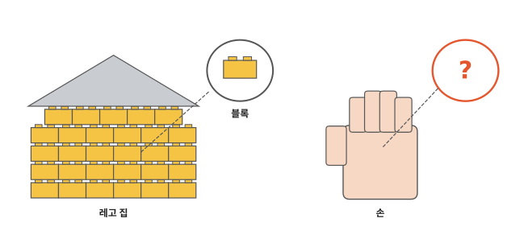
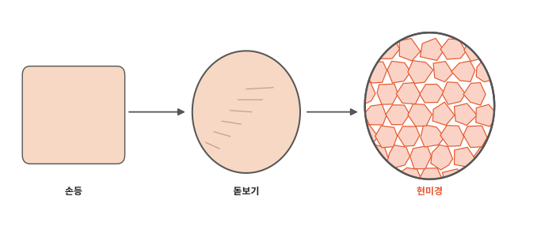
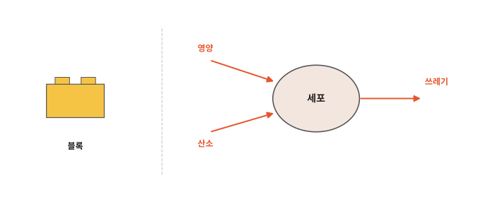
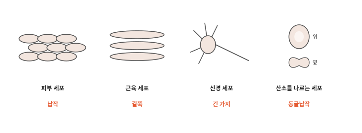
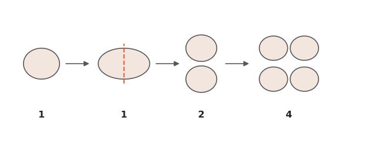
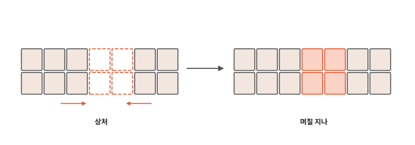

# 세포: 몸을 이루는 작은 방

레고 블록으로 집을 지으면 멀리서는 그냥 집이에요. 가까이 가면 작은 블록 하나하나가 보여요. 우리 몸도 멀리서 보면 손과 발과 얼굴이에요. 이 글을 읽고 나면 몸이 아주 작은 방으로 되어 있고 그 방이 살아 있다는 걸 알게 돼요. 이걸 알면 밥을 먹고 숨을 쉬어야 하는 까닭과 까진 무릎이 저절로 낫는 까닭이 함께 보여요.

!!! abstract "이 글에서 알게 되는 것"
    1. 몸을 얇게 떼어 현미경으로 크게 보면 작은 방이 다닥다닥 붙어 있어요. 이 작은 방을 세포라고 해요.
    2. 세포는 살아 있어요. 영양과 산소를 받아 힘을 만들고 쓰레기를 내놓아요.
    3. 세포는 하는 일에 따라 모양이 달라요. 많은 세포는 둘로 나뉘어 늘어나서 키를 키우고 상처를 메워요.

## 1. 몸을 크게 보면 작은 방이 다닥다닥 붙어 있어요

레고 집부터 볼게요. 아래 그림 왼쪽에서 집의 블록 하나를 크게 키운 동그라미를 보세요.

**그림 1.** 레고 집은 블록이 모여 생겼어요. 손을 크게 키우면 무엇이 보일지는 아직 물음표예요.
{ .fig-cap }

손으로 해 볼게요. 손등을 그냥 보면 매끈해요. 돋보기로 보면 가는 주름이 보여요. 더 크게 보려면 피부를 아주 얇게 떼어 내서 현미경에 올려요. 현미경은 아주 작은 것을 크게 키워 보여 주는 기계예요. 아래 그림에서 맨 오른쪽 동그라미 안을 보세요.

**그림 2.** 손등을 돋보기로 보면 주름이 보이고 현미경으로 보면 작은 방이 다닥다닥 붙어 있어요.
{ .fig-cap }

현미경 속에는 작은 방 같은 것이 빈틈없이 붙어 있어요. 방마다 모양이 조금씩 달라요. 이 작은 방 하나하나를 **세포**라고 해요. 세포는 대부분 아주 작아서 눈으로는 볼 수 없어요. 현미경이 있어야 보여요.

손등에만 세포가 있는 게 아니에요. 뼈에도 피에도 눈에도 있고 머리카락이 자라는 뿌리에도 있어요. 몸 전체가 세포로 되어 있어요. 레고 집이 블록으로 되어 있는 것과 같아요.

여기서 이런 생각이 들 거예요. 그럼 세포는 레고 블록이랑 똑같은 걸까요? 다른 점이 셋 있어요. 다음 절부터 하나씩 볼게요.

## 2. 세포는 살아 있어서 영양과 산소를 받아요

첫째로 다른 점은 세포가 살아 있다는 거예요. 레고 블록은 집에 끼워 두면 혼자서 아무것도 하지 않아요. 세포는 작은 방이라고 불러도 속이 비어 있지 않아요. 안이 꽉 차 있고 늘 바빠요.

세포는 우리가 먹은 밥에서 영양을 받아요. 영양은 밥에서 나와서 몸에 힘이 되는 것이에요. 숨 쉴 때 들이마신 공기에서는 산소를 받아요. 산소는 공기 속에 있는데 눈에는 안 보여요.

아래 그림에서 세포로 들어가는 화살표와 나오는 화살표를 보세요. 왼쪽 블록에는 화살표가 하나도 없어요.

**그림 3.** 블록은 주고받는 것이 없고 세포는 영양과 산소를 받아 쓰레기를 내놓아요.
{ .fig-cap }

대부분의 세포는 영양과 산소로 힘을 만들어요. 그 힘으로 자기 일을 해요. 쓰고 남은 쓰레기는 밖으로 내놓아요.

우리가 밥을 먹고 숨을 쉬어야 하는 까닭이 여기 있어요. 밥과 숨으로 들어온 영양과 산소가 몸속 세포 하나하나까지 가야 하거든요.

## 3. 세포는 하는 일에 따라 모양이 달라요

둘째로 다른 점은 모양이에요. 그림 1의 레고 집은 똑같은 블록으로 지었어요. 세포는 맡은 일마다 생김새가 달라요. 아래 그림에서 빨간 낱말과 세포 모양을 맞춰 보세요.

**그림 4.** 피부, 근육, 신경, 산소를 나르는 세포는 생김새가 저마다 달라요. 크기는 실제와 다르게 그렸어요.
{ .fig-cap }

피부 세포는 납작해요. 물고기 비늘처럼 겹겹이 덮어서 몸을 감싸요. 1절에서 현미경으로 본 손등의 작은 방도 피부 세포예요.

근육 세포는 길쭉해요. 고무줄처럼 짧게 줄어들면서 뼈를 당겨요. 그래서 팔과 다리가 움직여요.

신경 세포는 몸 곳곳에 알림을 보내요. 가지가 길게 뻗어 있어서 멀리 떨어진 곳까지 "뜨거워!"나 "움직여!" 같은 알림을 전해요.

피 속에는 산소를 나르는 세포가 있어요. 위에서 보면 동그래요. 옆에서 보면 납작하고 가운데가 쏙 들어가 있어요. 말랑해서 자기보다 좁은 핏줄도 휘어지며 지나가요. 2절에서 산소가 세포 하나하나까지 가야 한다고 했죠. 그 산소를 피 속에서 실어 나르는 게 이 세포예요.

## 4. 많은 세포는 둘로 나뉘어 늘어나요

셋째로 다른 점은 늘어나는 방법이에요. 레고 집을 키우려면 누군가 블록을 더 가져와서 붙여야 해요. 세포는 스스로 늘어나요. 아래 그림에서 빨간 점선과 그 아래 숫자를 보세요.

**그림 5.** 세포 하나가 커진 다음 빨간 점선을 따라 갈라지면 둘이 되고 둘은 다시 넷이 돼요.
{ .fig-cap }

많은 세포는 조금 커진 다음 반으로 갈라져서 둘이 돼요. 둘은 또 커져서 넷이 되고요. 세포 하나가 이렇게 둘로 갈라지는 일을 **세포 분열**이라고 해요.

아기 때보다 키가 큰 데는 세포가 나뉘어 늘어난 것도 한몫해요. 벽에 키를 표시해 둔 곳이 있으면 지금 키와 대 보세요. 그사이 몸속에서 세포가 아주 여러 번 나뉘었어요.

모든 세포가 나뉘지는 않아요. 신경 세포처럼 다 자라고 나면 거의 나뉘지 않는 세포도 있어요.

## 5. 상처 둘레의 세포가 나뉘어 빈자리를 메워요

세포가 나뉘는 일은 다쳤을 때도 쓰여요. 무릎이 까지면 그 자리의 피부 세포가 떨어져 나가요. 그런데 며칠 지나면 새살이 돋아요. 아래 그림에서 빈자리가 어떻게 바뀌는지 보세요.

**그림 6.** 상처 난 빈칸을 둘레에서 나뉘어 옮겨 온 빨간 새 세포가 채웠어요.
{ .fig-cap }

새살은 상처 둘레에 남은 세포에서 와요. 둘레의 세포가 나뉘어 늘어나요. 늘어난 세포가 상처 쪽으로 옮겨 가서 빈자리를 채워요. 그게 새살이에요.

레고 집에서 블록이 하나 빠지면 누가 끼워 줄 때까지 구멍으로 남아요. 몸은 세포가 스스로 구멍을 메워요.

??? info "세포라는 이름은 어디서 왔을까요"
    1665년 영국의 과학자 로버트 훅이 현미경으로 얇게 자른 코르크를 봤어요. 코르크는 병마개를 만드는 나무껍질이에요. 작은 칸이 벌집처럼 늘어선 걸 보고 훅은 영어로 "cells"라고 적었어요. 작은 방이라는 뜻이에요. 그때 훅이 본 건 이미 죽은 식물 세포에서 빈 칸을 둘러싼 벽이었어요.[^hooke]

## 정리

몸을 얇게 떼어 현미경으로 보면 작은 방이 다닥다닥 붙어 있어요. 이 방이 세포예요. 손등에도 뼈에도 피에도 세포가 있어요.

세포는 레고 블록과 세 가지가 달라요. 먼저 살아 있어서 밥에서 온 영양과 숨으로 들어온 산소를 받아 힘을 만들고 쓰레기를 내놓아요. 하는 일에 따라 모양도 달라서 피부 세포는 납작하고 근육 세포는 길쭉해요. 그리고 많은 세포는 둘로 나뉘어 늘어나요. 그래서 키가 크고 까진 무릎에 새살이 돋아요.

세포가 쓰는 산소는 어디로 들어와서 세포까지 갈까요? [2편](02-breathing.md)에서 숨이 가는 길을 따라가 볼게요.

### 새로 나온 말

- **세포**: 몸을 이루는 아주 작은 방. 현미경으로 본 손등에 다닥다닥 붙어 있던 칸 하나하나예요.
- **현미경**: 아주 작은 것을 크게 키워 보여 주는 기계.
- **영양**: 밥에서 나와서 세포가 힘을 만드는 데 쓰는 것.
- **산소**: 공기 속에 있는 눈에 안 보이는 것. 세포는 영양과 산소로 힘을 만들어요.
- **세포 분열**: 세포 하나가 커진 다음 둘로 갈라지는 일. 키가 크고 상처가 낫는 데 쓰여요.

[^hooke]: Robert Hooke, *Micrographia*, 1665, 관찰 18 "Of the Schematisme or Texture of Cork". [Project Gutenberg 판](https://www.gutenberg.org/ebooks/15491).
