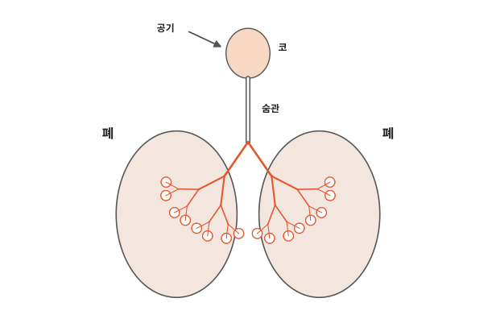
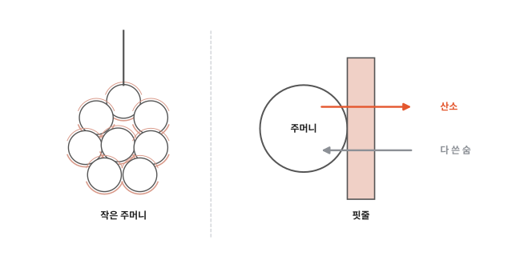
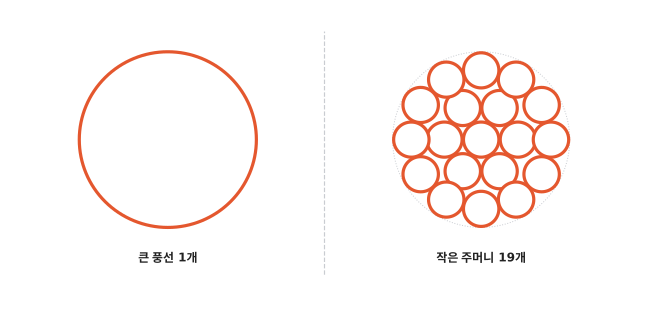
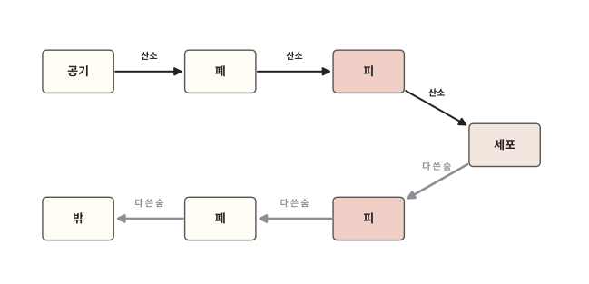
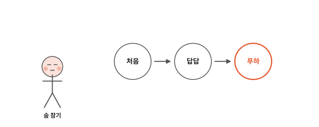
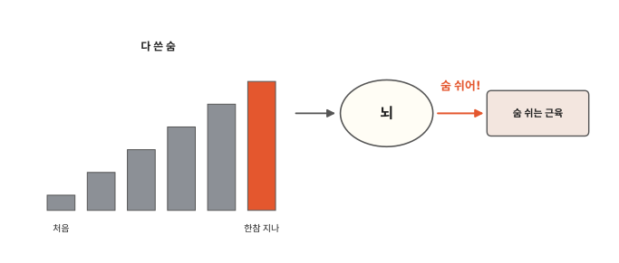

# 숨: 산소가 들어오고 다 쓴 숨이 나가는 길

숨 참기 놀이를 하면 처음 몇 초는 괜찮다가 끝내 "푸하" 하고 숨을 쉬게 돼요. 이 글을 읽고 나면 들이쉰 공기가 몸속 어디까지 가는지 알게 돼요. 숨을 참으면 몸이 왜 저절로 숨을 쉬는지도 알게 돼요.

!!! abstract "이 글에서 알게 되는 것"
    1. 들이쉰 공기는 코와 숨관을 지나 나뭇가지처럼 갈라진 길을 따라 폐 속 작은 주머니까지 가요.
    2. 작은 주머니 벽에서 산소는 피로 들어가고 다 쓴 숨은 피에서 나와요. 주머니가 작고 많아서 산소가 한꺼번에 많이 들어가요.
    3. 숨을 참으면 다 쓴 숨이 몸속에 쌓여요. 뇌가 이걸 알아채고 숨 쉬는 근육에 알려서 몸이 저절로 숨을 쉬어요.

## 1. 들이쉰 공기는 코와 숨관을 지나 폐로 가요

숨을 한 번 들이쉬고 그 공기를 따라가 볼게요.

공기는 먼저 코로 들어가요. 콧속에는 털과 끈적한 콧물이 있어서 먼지를 붙잡아요. 콧속을 지나는 동안 차가운 공기는 조금 따뜻해지고 촉촉해져요.[^openstax1]

그다음 공기는 목 안쪽의 숨관을 타고 내려가요. 숨관은 공기가 다니는 굵은 관이에요. 숨관은 가슴 안에서 둘로 갈라져요. 하나는 오른쪽으로 가고 하나는 왼쪽으로 가요. 아래 그림에서 숨관 끝부터 빨간 길이 어떻게 갈라지는지 보세요.

**그림 1.** 숨관에서 갈라진 길은 둘로 또 둘로 갈라지며 가늘어지고 끝마다 작은 주머니가 달려요.
{ .fig-cap }

갈라진 길은 또 둘로 갈라지고 또 둘로 갈라져요. 나무를 거꾸로 세운 모양과 닮았어요. 숨관이 줄기이고 갈라진 길이 가지예요. 가지는 갈라질수록 가늘어져요.

이 가지가 가득 들어 있는 곳이 **폐**예요. 폐는 가슴 속 오른쪽과 왼쪽에 하나씩 있어요. 숨을 들이쉬면 폐가 늘어나고 내쉬면 줄어들어요.

## 2. 가지 끝 작은 주머니에서 산소가 피로 들어가요

그림 1에서 가지 끝마다 작은 동그라미가 달려 있었죠. 들이쉰 공기가 마지막으로 닿는 곳이 여기예요. 가장 가는 가지 끝에는 아주 작은 주머니가 포도송이처럼 모여 달려 있어요. 이 주머니를 **폐포**라고 해요. 생김새는 포도송이 같지만 속은 풍선처럼 비어 있어요. 공기가 이 속으로 들어갔다 나왔다 해요.

아래 그림 왼쪽에서 주머니를 감싼 가는 선을 보세요. 오른쪽은 주머니 하나와 핏줄이 맞닿은 곳을 크게 그린 거예요.

**그림 2.** 주머니와 핏줄이 맞닿은 얇은 벽을 지나 산소는 피로 가고 다 쓴 숨은 주머니로 와요.
{ .fig-cap }

주머니 바깥은 아주 가는 핏줄이 칭칭 감싸고 있어요. 주머니 벽도 아주 얇고 핏줄 벽도 아주 얇아요. 공기 속 산소는 이 얇은 벽 두 겹을 지나 피 속으로 들어가요. 피에 탄 산소는 몸 곳곳의 세포까지 가요. 피가 어떻게 온몸을 도는지는 [4편](04-blood.md)에서 봐요.

그림 2에는 반대로 가는 회색 화살표도 있어요. 이건 다 쓴 숨이에요. 4절에서 따라가 볼게요.

## 3. 작은 주머니가 많을수록 산소가 많이 들어가요

여기서 이런 생각이 들 거예요. 폐 속에 큰 풍선 하나만 두면 더 간단하지 않을까요? 앞에서 산소는 주머니 벽이 핏줄과 붙은 곳을 지나 피로 들어갔어요. 그런 벽이 길수록 산소가 한꺼번에 많이 들어가요.

같은 자리를 두 가지로 채워 볼게요. 아래 그림에서 빨간 선이 어느 쪽에 더 많은지 보세요. 빨간 선은 핏줄과 붙어 있는 주머니 벽이에요.

**그림 3.** 같은 자리를 작은 주머니 19개로 채우면 빨간 선이 큰 풍선 1개보다 훨씬 길어요.
{ .fig-cap }

큰 풍선 하나는 빨간 선이 바깥 한 바퀴뿐이에요. 같은 자리를 작은 주머니로 채우면 주머니마다 빨간 선이 한 바퀴씩 생겨요. 그림의 작은 주머니는 지름이 큰 풍선의 5분의 1이라서 한 바퀴 길이도 5분의 1이에요. 그래도 19개를 모두 이으면 큰 풍선 한 바퀴의 네 배 가까이 돼요.

빨간 선은 산소가 지나가는 문이에요. 문이 많으면 사람이 한꺼번에 많이 드나들 수 있어요. 빨간 선이 길면 산소도 한꺼번에 많이 들어가요. 실제 폐 속 주머니는 그림보다 훨씬 작고 훨씬 많아요. 어른의 폐 속 주머니 벽을 모두 펼치면 교실 바닥 하나쯤 된다고 해요.[^alveoli]

## 4. 다 쓴 숨은 산소가 온 길을 거꾸로 나가요

[1편](01-cells.md)에서 세포는 힘을 만들고 쓰레기를 내놓는다고 했어요. 그 쓰레기 가운데 하나가 다 쓴 숨이에요. 이름은 **이산화탄소**예요. 아래 그림에서 윗줄의 산소 길을 먼저 따라간 다음 아랫줄의 회색 화살표를 따라가 보세요.

**그림 4.** 산소는 공기에서 폐와 피를 거쳐 세포로 가고 다 쓴 숨은 세포에서 피와 폐를 거쳐 밖으로 나가요.
{ .fig-cap }

다 쓴 숨은 세포에서 피로 나와서 피를 타고 폐까지 와요. 그리고 작은 주머니 벽을 지나 주머니 안으로 들어가요. 그림 2의 회색 화살표가 이 대목이에요. 숨을 내쉬면 "후" 하고 몸 밖으로 나가요.

피는 이 길을 쉬지 않고 돌아요. 숨을 들이쉴 때마다 작은 주머니에서 산소가 피로 들어가요. 피에 실려 온 다 쓴 숨은 주머니로 나와서 내쉬는 숨에 섞여 나가요.

## 5. 다 쓴 숨이 쌓이면 뇌가 숨을 쉬게 해요

이제 처음의 숨 참기 놀이로 돌아가 볼게요. 아래 그림은 숨을 참는 동안 느끼는 것을 차례로 적은 거예요.

**그림 5.** 숨을 참으면 처음엔 괜찮다가 답답해지고 끝내 "푸하" 하고 숨을 쉬어요.
{ .fig-cap }

세포는 낮에도 밤에도 일해요. 잠잘 때도 심장은 뛰고 뇌도 일해요. 그래서 산소가 계속 들어와야 하고 다 쓴 숨도 계속 생겨요. 숨을 참으면 내보내지 못한 다 쓴 숨이 몸속에 점점 쌓여요.

아래 그림에서 회색 막대가 높아지다가 빨간 막대에 이르면 무슨 일이 일어나는지 보세요.

**그림 6.** 다 쓴 숨이 쌓이면 뇌가 숨 쉬는 근육에 "숨 쉬어!" 하고 알려요.
{ .fig-cap }

뇌에는 다 쓴 숨이 얼마나 쌓였는지 살피는 곳이 있어요. 다 쓴 숨이 많아지면 뇌가 숨 쉬는 근육에 "숨 쉬어!" 하고 알려요.[^openstax3] 숨 쉬는 근육 가운데 가장 큰 것은 가슴과 배 사이에 있는 **가로막**이에요. 가로막이 아래로 내려가면 가슴 속에 폐가 늘어날 자리가 생겨요.

배에 손을 얹고 숨을 들이쉬어 보세요. 대개 배가 조금 나와요. 가로막이 아래로 내려가면서 배를 살짝 밀거든요.

숨 참기 놀이에서 가슴이 답답했던 것도 이 알림 때문이에요. 참을수록 알림이 세져서 몸이 저절로 숨을 쉬어요. 이 알림은 우리가 생각하지 않아도 와요. 잠든 동안에도 숨을 쉬는 건 이 덕분이에요.

## 정리

들이쉰 공기는 콧속에서 먼지를 걸러 내고 숨관을 타고 내려가요. 숨관은 거꾸로 선 나무처럼 갈라지고 가장 가는 가지 끝에는 작은 주머니인 폐포가 달려 있어요.

작은 주머니 벽에서 산소는 피로 들어가고 다 쓴 숨은 피에서 나와요. 폐 속에는 큰 풍선 하나 대신 작은 주머니가 아주 많아서 핏줄과 붙은 벽이 길어요. 그래서 산소가 한꺼번에 많이 들어가요.

세포는 쉬지 않고 산소를 쓰고 다 쓴 숨을 내놓아요. 숨을 참으면 다 쓴 숨이 쌓이고 뇌가 이를 알아채서 숨 쉬는 근육을 움직여요. 그래서 숨은 오래 멈출 수 없어요.

세포가 받는 것에는 산소 말고 영양도 있었어요. 밥이 어떤 길을 거쳐 영양이 되어 세포까지 가는지는 [3편](03-digestion.md)에서 볼게요.

### 새로 나온 말

- **숨관**: 목에서 가슴까지 공기가 다니는 굵은 관. 가슴 안에서 둘로 갈라져요.
- **폐**: 가슴 속 오른쪽과 왼쪽에 하나씩 있는 숨 쉬는 곳. 숨관에서 갈라진 가지가 가득 들어 있어요.
- **폐포**: 폐 속 가장 가는 가지 끝에 달린 작은 주머니. 이 벽에서 산소가 피로 들어가요.
- **이산화탄소**: 세포가 힘을 만들고 내놓는 다 쓴 숨.
- **가로막**: 가슴과 배 사이에 있는 숨 쉬는 근육. 아래로 내려가면 폐가 늘어날 자리가 생겨요.

[^openstax1]: OpenStax, *Anatomy and Physiology 2e*, 22.1 ["Organs and Structures of the Respiratory System"](https://openstax.org/books/anatomy-and-physiology-2e/pages/22-1-organs-and-structures-of-the-respiratory-system).
[^alveoli]: OpenStax, *Anatomy and Physiology 2e*, 22.2 ["The Lungs"](https://openstax.org/books/anatomy-and-physiology-2e/pages/22-2-the-lungs). 폐포 표면적 약 70제곱미터.
[^openstax3]: OpenStax, *Anatomy and Physiology 2e*, 22.3 ["The Process of Breathing"](https://openstax.org/books/anatomy-and-physiology-2e/pages/22-3-the-process-of-breathing).
