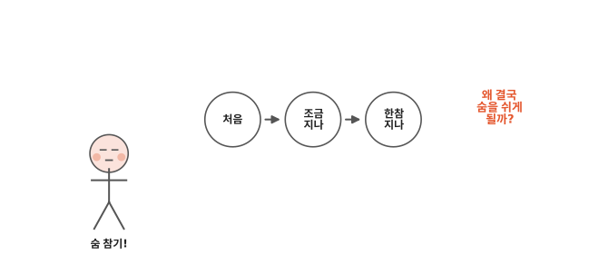
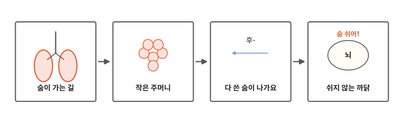
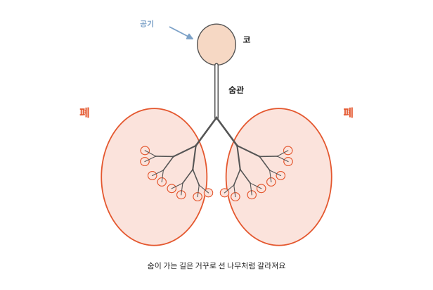
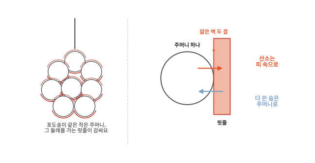
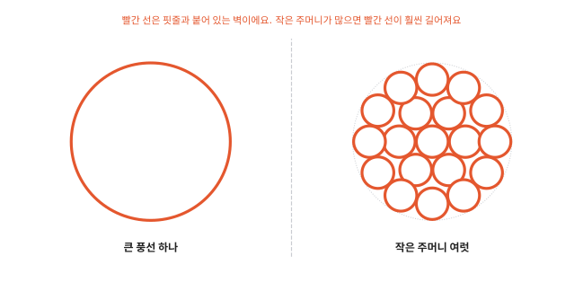
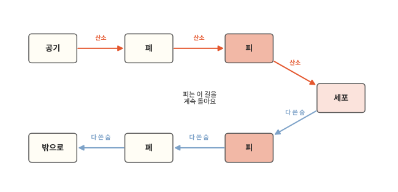
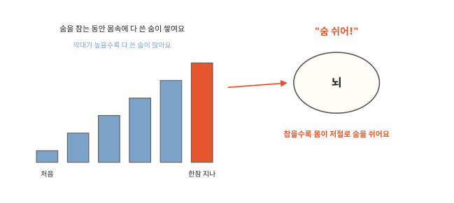

# 숨은 왜 쉬지 않고 쉴까요?

## 숨 참기 놀이

숨 참기 놀이를 해 본 적 있나요? 처음 몇 초는 괜찮아요. 조금 지나면 가슴이 답답해져요. 그러면 몸이 저절로 "푸하" 하고 숨을 쉬어요.

밤에 잠들어 있을 때도 우리는 숨을 쉬어요. 숨 쉬라고 마음먹은 적이 없는데도요. 숨은 왜 이렇게 쉬지 않고 쉴까요?

## 숨이 가는 길에서 쉬지 않는 까닭까지

인체 두 번째 편이에요. [1편](01-cells.md)에서 세포가 산소를 받아 일할 힘을 만든다고 했어요. 그 산소가 코로 들어와 어디까지 가는지 따라가 봐요. 그리고 숨을 멈추면 왜 몸이 가만있지 않는지도 봐요.

## 숨이 가는 길

숨을 들이쉬면 공기가 코로 들어가요. 콧속에는 털과 끈적한 콧물이 있어서 먼지를 붙잡아요. 콧속을 지나는 동안 차가운 공기는 조금 따뜻해지고 촉촉해져요.

그다음 공기는 목 안쪽의 숨관을 타고 내려가요. 숨관은 공기가 다니는 굵은 관이에요. 숨관은 가슴 안에서 둘로 갈라져요. 하나는 오른쪽, 하나는 왼쪽으로 가요.

갈라진 길은 또 둘로, 또 둘로 계속 갈라져요. 나무를 거꾸로 세운 모양과 닮았어요. 숨관이 줄기이고 갈라진 길이 가지예요. 가지는 갈라질수록 점점 가늘어져요.

이 가지들이 가득 들어 있는 곳이 **폐**예요. 폐는 가슴 속 오른쪽과 왼쪽에 하나씩 있어요. 숨을 들이쉬면 폐가 늘어나고 내쉬면 줄어들어요.

## 작은 주머니

가장 가는 가지 끝에는 아주 작은 주머니가 포도송이처럼 모여 달려 있어요. 들이쉰 공기는 여기까지 와요.

생김새는 포도송이 같지만 속은 풍선처럼 비어 있어요. 포도알처럼 꽉 차 있지 않아요. 공기가 이 속으로 들어갔다 나왔다 해요.

주머니 바깥은 아주 가는 핏줄이 칭칭 감싸고 있어요. 주머니 벽도 아주 얇고 핏줄 벽도 아주 얇아요. 공기 속 산소는 이 얇은 벽 두 겹을 슥 지나 피 속으로 들어가요. 피에 탄 산소는 몸 곳곳의 세포까지 가요. 피가 어떻게 온몸을 도는지는 4편에서 봐요.

폐 속에 큰 풍선 하나만 두면 안 될까요?

산소는 주머니 벽이 핏줄과 붙어 있는 곳에서만 피로 들어가요. 그림의 빨간 선이 그런 벽이에요. 큰 풍선 하나는 빨간 선이 바깥 한 바퀴뿐이에요. 같은 자리를 작은 주머니로 채우면 주머니마다 빨간 선이 한 바퀴씩 생겨요. 빨간 선은 산소가 지나가는 문과 같아요. 문이 많으면 사람이 한꺼번에 많이 드나들 수 있지요. 빨간 선이 길면 산소도 한꺼번에 많이 들어가요.

어른의 폐 속 주머니 벽을 모두 펼치면 교실 바닥 하나쯤 된다고 해요.[^alveoli]

## 다 쓴 숨이 나가요

세포는 산소로 일할 힘을 만들고 나면 쓰레기를 내놓아요. 그중 하나가 다 쓴 숨이에요. 이름은 이산화탄소예요.

다 쓴 숨은 산소가 온 길을 거꾸로 가요. 세포에서 피로 나와서 피를 타고 폐까지 와요. 그리고 작은 주머니 벽을 지나 주머니 안으로 들어가요. 숨을 내쉴 때 "후-" 하고 몸 밖으로 나가요.

피는 이 길을 쉬지 않고 돌아요. 숨을 쉴 때마다 폐 속 작은 주머니에서 산소가 피로 들어가요. 피에 실려 온 다 쓴 숨은 주머니로 나와요.

## 쉬지 않는 까닭

세포는 낮에도 밤에도 일해요. 잠잘 때도 심장은 뛰고 뇌도 일해요. 그래서 산소도 계속 들어와야 해요.

다 쓴 숨도 계속 생겨요. 숨을 참으면 내보내지 못한 다 쓴 숨이 몸속에 점점 쌓여요.

뇌에는 다 쓴 숨이 얼마나 쌓였는지 살피는 곳이 있어요. 다 쓴 숨이 많아지면 뇌가 숨 쉬는 근육에 "숨 쉬어!" 하고 알려요. 숨 쉬는 근육은 가슴 아래쪽에서 폐가 늘어날 자리를 만들어 주는 근육이에요. 숨 참기 놀이에서 가슴이 답답했던 것도 이 알림이에요. 참을수록 알림이 세져서 몸이 저절로 숨을 쉬어요.

이 알림은 우리가 생각하지 않아도 와요. 잠든 동안에도 숨을 쉬는 건 이 덕분이에요.

밥을 먹으면 그 영양은 어떤 길로 세포까지 갈까요? 다음 편에서 볼게요.

## 정리

- 폐: 가슴 속 오른쪽과 왼쪽에 있어요. 숨이 가는 길이 나무처럼 갈라진 끝에 작은 주머니가 아주 많이 달려 있어요. 주머니에서 산소는 피로 들어가고 다 쓴 숨은 피에서 나와요.
- 숨을 계속 쉬는 까닭: 세포가 쉬지 않고 산소를 쓰고 다 쓴 숨을 내놓아서예요. 다 쓴 숨이 쌓이면 뇌가 저절로 숨을 쉬게 해요.

## 해 보기: 내 숨 세어 보기

1. 의자에 편하게 앉아서 배에 손을 얹어 보세요. 숨을 들이쉴 때 배가 어떻게 되나요? 내쉴 때는요? 대개 들이쉴 때 배가 조금 나와요. 숨 쉬는 근육이 아래로 내려가면서 배를 살짝 밀거든요.
2. 어른이 시계로 1분을 재 주세요. 그동안 숨을 몇 번 쉬는지 세어 봐요. 들이쉬고 내쉬면 한 번이에요.
3. 제자리에서 조금 뛴 다음 다시 1분 동안 세어 봐요. 가만히 있을 때보다 많아졌나요? 몸이 움직이면 세포가 일을 더 해요. 그래서 산소가 더 필요하고 다 쓴 숨도 더 생겨요. 어린이는 어른보다 숨을 더 자주 쉬어요. 사람마다 횟수가 조금씩 달라요.
4. 가만히 앉아서 편할 만큼만 숨을 참았다가 쉬어 봐요. 답답해지면 바로 쉬어요. 누가 오래 참나 겨루지 않아요. 물속에서도 하지 않아요.

숨 쉬기가 평소와 달리 힘들거나 아픈 것 같으면 어른께 바로 말해요.

## 확인 문제

??? question "1. 산소가 피로 들어가는 곳"
    들이쉰 공기 속 산소는 어디에서 피로 들어갈까요?

    **풀이**: 폐 속 작은 주머니에서요. 주머니를 감싼 가는 핏줄로 산소가 들어가요.

??? question "2. 작은 주머니가 많은 까닭"
    폐 속에는 왜 큰 풍선 하나 대신 작은 주머니가 아주 많을까요?

    **풀이**: 산소는 주머니 벽이 핏줄과 붙어 있는 곳에서 피로 들어가요. 작은 주머니가 많으면 그런 벽이 훨씬 길고 넓어져서 산소가 한꺼번에 많이 들어가요.

??? question "3. 결국 숨을 쉬게 되는 까닭"
    숨을 오래 참으려 해도 결국 숨을 쉬게 되는 것은 왜일까요?

    **풀이**: 숨을 참는 동안 다 쓴 숨이 몸속에 쌓여요. 뇌가 그것을 알아채고 "숨 쉬어!" 하고 숨 쉬는 근육에 알려요.

!!! abstract "어른을 위한 정리 (건너뛰어도 돼요)"
    - 본문의 "숨이 가는 길"은 기도, "숨관"은 기관이에요. 기도는 코(또는 입) → 인두 → 후두 → 기관 → 기관지 → 세기관지로 이어지며 계속 갈라져요. 끝의 작은 주머니가 폐포예요. 폐포 하나는 지름 200마이크로미터쯤이에요. 코털과 점액이 먼지를 붙잡아요. 섬모는 점액을 밀어 올려요. 축축한 점막이 공기를 데우고 적셔요.[^openstax1]
    - 폐포 벽과 모세혈관 벽이 맞붙은 얇은 막(호흡막)에서 산소와 이산화탄소가 확산으로 오가요. 폐포 표면적은 모두 합쳐 약 70제곱미터로 알려져 있어요.[^alveoli] 본문의 "교실 바닥 하나쯤"은 가로 9미터, 세로 7.5미터쯤 되는 교실을 떠올려 붙인 비교예요.
    - 숨을 들이쉬는 주된 근육은 가슴과 배 사이의 가로막(횡격막)이에요. 가로막이 수축하면 아래로 내려가면서 가슴 속 공간이 넓어지고 공기가 들어와요. 이때 배 속 장기가 밀려서 대개 배가 조금 나와요(본문 해 보기 1). 내쉬는 것은 보통 근육이 풀리면서 저절로 일어나요.[^openstax3]
    - 숨 쉬는 리듬은 연수의 호흡 중추가 만들고 뇌교가 조절을 도와요. 본문의 "다 쓴 숨"은 이산화탄소예요. 내쉰 숨에도 산소가 조금 남아 있어요. 숨을 쉬게 만드는 가장 큰 자극은 핏속 이산화탄소 농도예요. 산소 농도보다 더 크게 작용해요. 이산화탄소가 늘면 뇌 안 액체와 혈액이 산성 쪽으로 기울어요. 뇌줄기의 중추 화학 수용체와 목동맥·대동맥의 말초 화학 수용체가 이를 감지해 호흡이 빨라지고 깊어져요. 어른은 보통 1분에 12~18번 숨을 쉬어요. 어린아이일수록 더 자주 쉬어요.[^openstax3]
    - 해 보기 4번의 숨 참기는 앉아서 편한 범위에서만 하도록 했어요. 물속 숨 참기나 오래 참기 겨루기는 정신을 잃을 위험이 있어 넣지 않았어요.

## 더 깊이

??? info "하품"
    가끔 우리는 저절로 입을 크게 벌리고 숨을 깊이 들이쉬어요. 하품이에요. 하품이 왜 나오는지는 과학자들도 아직 다 밝히지 못했어요.

??? info "높은 산에 오르면"
    아주 높은 산에서는 공기가 옅어서 한 번 숨 쉴 때 들어오는 산소가 적어요. 이때는 핏속 산소가 모자란 것을 몸이 알아채고 숨이 더 가빠져요.

??? info "물고기는 어떻게 숨 쉴까"
    물고기는 폐 대신 아가미로 물속에 녹아 있는 산소를 받아요. 아가미도 얇은 막이 아주 많이 겹쳐 있어서 넓은 벽으로 산소를 받아들여요.

[^openstax1]: OpenStax, *Anatomy and Physiology 2e*, 22.1 ["Organs and Structures of the Respiratory System"](https://openstax.org/books/anatomy-and-physiology-2e/pages/22-1-organs-and-structures-of-the-respiratory-system).
[^alveoli]: OpenStax, *Anatomy and Physiology 2e*, 22.2 ["The Lungs"](https://openstax.org/books/anatomy-and-physiology-2e/pages/22-2-the-lungs). 폐포 표면적 약 70제곱미터.
[^openstax3]: OpenStax, *Anatomy and Physiology 2e*, 22.3 ["The Process of Breathing"](https://openstax.org/books/anatomy-and-physiology-2e/pages/22-3-the-process-of-breathing).
