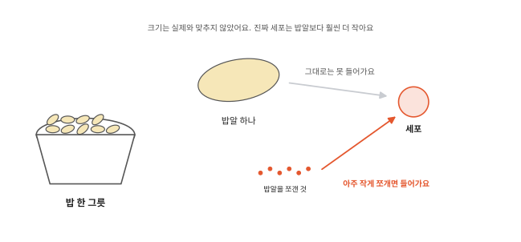
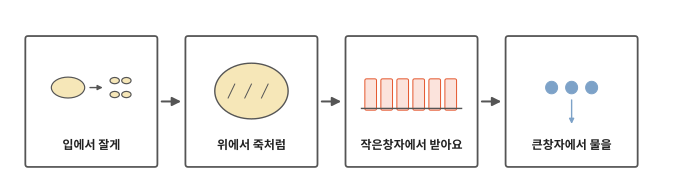
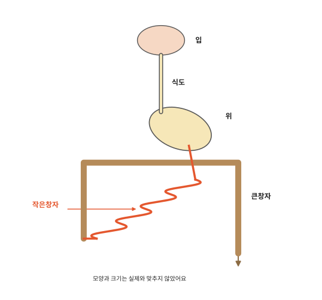
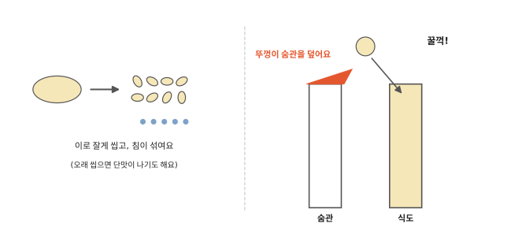
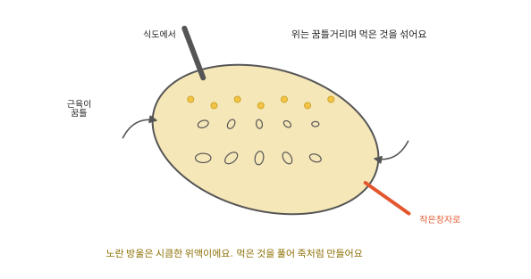
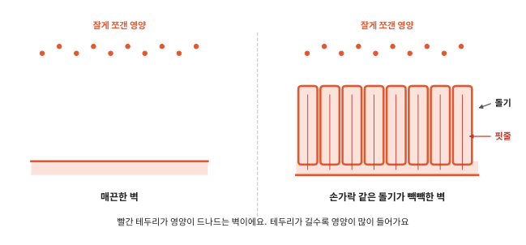
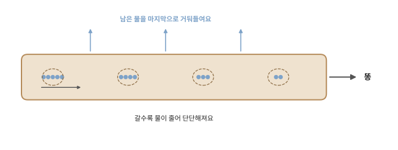

# 밥을 먹으면 어디로 갈까요?

## 밥알과 세포

[1편](01-cells.md)에서 세포는 밥에서 나온 영양을 받아 일할 힘을 만든다고 했어요. 그런데 세포는 눈에 안 보일 만큼 작아요. 밥알 하나는 눈으로 잘 보이지요. 밥알은 세포보다 훨씬 커요.

이렇게 큰 밥알이 어떻게 작은 세포 속으로 들어갈까요?

## 입에서 큰창자까지

인체 세 번째 편이에요. 밥 한 숟가락이 입에 들어가서 어떤 길을 거치는지 따라가 봐요. 가는 곳마다 밥이 어떻게 바뀌는지도 봐요.

먹은 것이 지나가는 길은 입에서 시작해 한 줄로 이어져 있어요. 입, 식도, 위, 작은창자, 큰창자 순서예요.

## 입에서 잘게

밥을 입에 넣고 이로 잘게 씹어요. 그동안 입 안에서 침이 나와 밥에 섞여요. 침은 밥을 축축하게 해서 삼키기 쉽게 해 줘요.

밥이 침과 오래 섞이면 밥의 한 부분이 단맛 나는 것으로 바뀌어요. 그래서 밥을 오래 씹으면 조금씩 단맛이 나는 걸 느끼는 사람이 많아요.

먹은 것을 아주 작게 쪼개는 일을 **소화**라고 해요. 세포가 받아 쓸 수 있을 만큼 작게 쪼개요. 이로 부수는 것만으로는 그만큼 작아지지 않아요. 침처럼 몸에서 나오는 물이 먹은 것을 다른 아주 작은 것으로 바꿔 줘야 해요. 가위로 종이를 잘게 자르는 것과 각설탕이 물에 녹아 안 보이게 되는 것만큼 달라요. 소화는 입에서 벌써 시작돼요.

꿀꺽 삼키면 밥은 식도라는 관으로 내려가요. 식도는 배 속 주머니인 위까지 이어진 관이에요. 식도 바로 앞쪽에는 공기가 다니는 숨관이 있어요. [2편](02-breathing.md)에서 본 그 관이에요. 삼키는 순간 작은 뚜껑이 숨관 입구를 덮어서 밥이 숨관으로 가지 않게 막아요. 가끔 밥알이 숨관 쪽으로 잘못 들어가면 콜록콜록 기침이 나요. 기침이 숨관에 들어온 것을 밀어내요.

식도 벽의 근육은 윗부분부터 차례로 조였다 풀리면서 밥을 아래로 밀어 내려요. 치약 튜브를 뒤에서부터 눌러 짜는 것과 비슷해요. 치약 튜브는 한번 눌린 곳이 그대로 납작하지만 식도는 눌렸던 곳이 다시 풀려요.

## 위에서 죽처럼

식도 끝에는 위가 있어요. 위는 늘어나는 주머니예요. 비어 있을 때는 작다가 밥을 먹으면 크게 늘어나요.

위 벽의 근육은 꿈틀거리면서 먹은 것을 주무르듯 섞어요. 그동안 위 벽에서 아주 시큼한 물이 나와요. 이 물이 위액이에요. 위액은 고기나 달걀 같은 음식을 풀어 줘요. 음식에 묻어 들어온, 눈에 안 보이는 작은 세균도 많이 없애요.

몇 시간 동안 섞이고 풀리면 먹은 것은 걸쭉한 죽처럼 돼요. 그러면 조금씩 작은창자로 넘어가요.

그런데 위액이 그렇게 시큼하면 위 벽은 왜 안 녹을까요? 위 벽은 끈적하고 두꺼운 막으로 덮여 있어요. 이 막이 위액을 막아 줘요.

## 작은창자에서 받아요

위를 지난 죽은 작은창자로 와요. 작은창자는 가는 관인데 아주 길어요. 배 속에 꼬불꼬불 접혀 들어 있어요.

작은창자에는 배 속의 다른 곳에서 보낸 물이 들어와 섞여요. 먹은 것을 쪼개는 물이에요. 죽이 된 밥은 여기서 아주아주 작은 알갱이까지 쪼개져요. 드디어 세포가 받아 쓸 수 있을 만큼 작아져요.

이제 작은 알갱이가 작은창자 벽을 지나 피로 들어가요. 작은창자 벽에는 손가락 같은 작은 돌기가 빽빽하게 솟아 있어요. 돌기 속에는 가는 핏줄이 지나가요. 마신 물도 대부분 여기서 몸으로 들어가요.

그림의 빨간 테두리를 보세요. 영양은 이 테두리를 지나 핏줄로 들어가요. 매끈한 벽은 빨간 테두리가 짧아요. 돌기가 솟은 벽은 돌기마다 테두리가 올라갔다 내려와서 훨씬 길어요. 빨간 테두리가 길수록 영양이 한꺼번에 많이 들어가요. 폐 속에 작은 주머니가 많았던 것([2편](02-breathing.md))도 같은 방법이에요.

피에 탄 영양은 산소처럼 몸 곳곳의 세포까지 가요. 그럼 작은창자에서 영양을 다 내주고 남은 찌꺼기는 어디로 갈까요?

## 큰창자에서 물을

작은창자를 지나고 나면 몸이 쓰지 못하는 찌꺼기와 물이 조금 남아요. 남은 것은 큰창자로 넘어가요.

큰창자는 작은창자보다 굵어요. 큰창자는 남은 물을 마지막으로 한 번 더 몸으로 거둬들여요. 물이 빠질수록 찌꺼기는 점점 단단해져요. 그렇게 똥이 되어 몸 밖으로 나가요.

먹은 것이 똥이 되어 나가기까지 대략 하루쯤 걸려요. 사람마다, 먹은 음식마다 차이가 커요.

이제 산소도 영양도 피에 탔어요. 피가 이것들을 싣고 온몸을 어떻게 도는지는 다음 편에서 볼게요.

## 정리

- 소화: 먹은 것을 세포가 받아 쓸 수 있을 만큼 아주 작게 쪼개는 일이에요. 입에서 씹고 침이 섞여요. 위에서 섞고 풀어 죽처럼 만들어요. 작은창자에서 아주 작게 쪼개 피로 받아들여요.
- 큰창자: 남은 물을 마지막으로 거둬들여요. 남은 찌꺼기는 똥이 되어 나가요.

## 해 보기: 밥 오래 씹기

1. 흰 밥 한 숟가락을 입에 넣고 바로 삼키지 말고 천천히 씹어 보세요. 서른 번쯤 씹어도 좋아요.
2. 처음 맛과 나중 맛이 다른가요? 단맛이 나는지 느껴 봐요. 사람마다 느끼는 정도가 달라요.
3. 침을 꿀꺽 삼킬 때 목 앞쪽에 손가락을 살짝 대 보세요. 삼키는 순간 무언가 위로 올라갔다 내려오는 게 느껴지나요? 목 안쪽이 올라가면서 뚜껑이 숨관 입구를 덮어요.

## 확인 문제

??? question "1. 왜 쪼갤까요"
    밥은 왜 아주 작게 쪼개져야 할까요?

    **풀이**: 세포는 아주 작아서 밥알처럼 큰 것은 받아들일 수 없어요. 아주 작게 쪼개야 피를 타고 세포까지 가서 쓰일 수 있어요.

??? question "2. 영양이 피로 들어가는 곳"
    잘게 쪼갠 영양은 어디에서 피로 들어갈까요? 그곳 벽은 어떻게 생겼나요?

    **풀이**: 작은창자에서요. 벽에 손가락 같은 작은 돌기가 빽빽하게 솟아 있어요. 그래서 영양이 지나가는 벽이 길고 넓어요. 돌기 속 핏줄로 영양이 들어가요.

??? question "3. 큰창자가 하는 일"
    큰창자는 무슨 일을 할까요?

    **풀이**: 작은창자를 지나고 남은 물을 마지막으로 몸으로 거둬들여요. 물이 빠진 찌꺼기는 단단한 똥이 돼요. 마신 물은 대부분 그보다 앞서 작은창자에서 몸으로 들어가요.

!!! abstract "어른을 위한 정리 (건너뛰어도 돼요)"
    - 침은 하루 1~1.5리터쯤 나와요. 침 속 아밀레이스가 녹말을 더 작은 당으로 바꾸기 시작해요. 밥을 오래 씹으면 단맛이 나는 까닭으로 흔히 설명돼요. OpenStax는 분해가 시작된다고만 써요. 식도는 25센티미터쯤이에요. 꿈틀운동(연동)으로 음식을 위(胃)까지 밀어요. 삼킬 때 후두덮개가 후두 입구를 덮어요. 본문의 "뚜껑"이 후두덮개예요. 덮는 곳은 숨관(기관) 바로 위 후두 입구예요.[^mouth]
    - 위는 비었을 때 주먹만 하지만 4리터까지 늘어날 수 있어요. 염산 때문에 위 속은 pH 1.5~3.5로 아주 산성이에요. 이 산이 먹은 세균 상당수를 죽이고 단백질을 풀어요. 위 벽은 중탄산염이 많은 두꺼운 점액으로 덮여 산을 막아요. 위에서 시작되는 화학 소화는 주로 단백질이에요. 침 아밀레이스는 위산이 섞이면 멈춰요. 위는 식사 뒤 2~4시간 안에 비워져요.[^stomach]
    - 작은창자는 살아 있는 사람에서 약 3미터예요. 둥근 주름, 융털, 미세융모가 흡수 면적을 600배 넘게 늘려요. 본문의 "아주 작은 알갱이"는 포도당, 아미노산 같은 분자예요. 당과 아미노산은 융털 속 혈관으로 들어가 간을 먼저 거쳐요(지방은 대부분 림프관으로 가요). 마신 물도 대부분 작은창자에서 흡수돼요. 큰창자는 나머지를 거둬요. 작은창자를 다 지나는 데 3~5시간, 큰창자에는 보통 12~24시간 머물러요. 위 2~4시간과 더하면 대략 17~33시간이에요. 본문 "하루쯤"은 이를 어림한 말이에요. 사람과 음식마다 차이가 커요.[^intestine]
    - 이자액과 쓸개즙은 작은창자 첫 부분(샘창자)으로 들어와 소화를 거들어요. 본문은 "배 속의 다른 곳에서 보낸 물"로만 썼어요.
    - 똥에는 소화되지 않은 찌꺼기 말고도 장 속 세균, 떨어져 나온 장 세포, 물이 섞여 있어요.

## 더 깊이

??? info "누워 있어도 삼킬 수 있을까"
    식도는 근육이 밀어서 음식을 보내요. 그래서 누워 있을 때도 삼킨 것이 배 속 주머니인 위까지 가요.

??? info "배에서 꼬르륵 소리가 나는 까닭"
    위와 창자는 비어 있을 때도 가끔 꿈틀거려요. 그때 안에 든 공기와 물이 밀리면서 소리가 나요.

??? info "소는 왜 되새김질을 할까"
    풀은 사람이 거의 소화하지 못하는 질긴 성분이 많아요. 소는 위가 여러 칸으로 나뉘어 있어요. 첫 번째 칸 속에는 아주 작은 생물들이 살면서 그 질긴 성분을 쪼개 줘요. 소는 삼킨 풀을 입으로 다시 올려 한 번 더 잘게 씹어요. 잘게 씹을수록 작은 생물들이 쪼개기 쉬워져요.

[^mouth]: OpenStax, *Anatomy and Physiology 2e*, 23.3 ["The Mouth, Pharynx, and Esophagus"](https://openstax.org/books/anatomy-and-physiology-2e/pages/23-3-the-mouth-pharynx-and-esophagus).
[^stomach]: OpenStax, *Anatomy and Physiology 2e*, 23.4 ["The Stomach"](https://openstax.org/books/anatomy-and-physiology-2e/pages/23-4-the-stomach).
[^intestine]: OpenStax, *Anatomy and Physiology 2e*, 23.5 ["The Small and Large Intestines"](https://openstax.org/books/anatomy-and-physiology-2e/pages/23-5-the-small-and-large-intestines).
