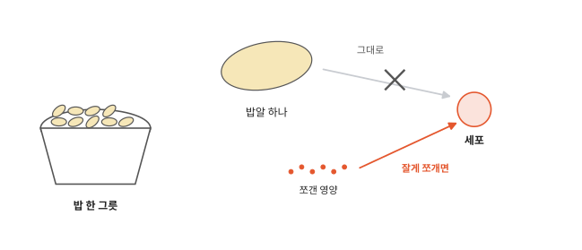
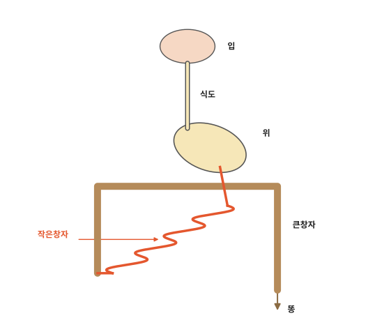
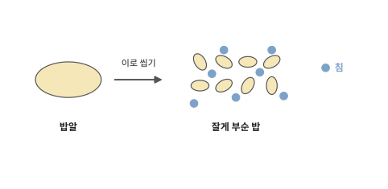
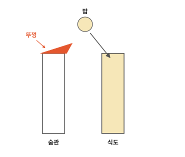
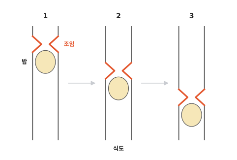
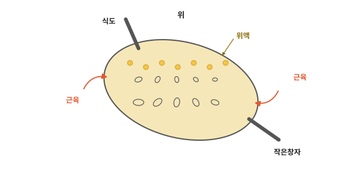
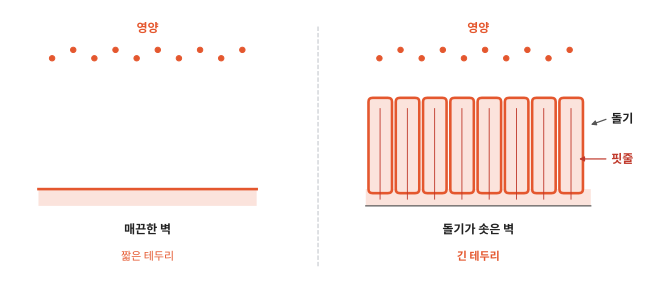
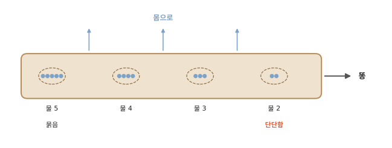

# 소화: 밥 한 숟가락이 몸속에서 가는 길

밥을 먹고 나면 힘이 나요. [1편](01-cells.md)에서 세포는 밥에서 나온 영양으로 일할 힘을 만든다고 했어요. 그런데 세포는 눈에 안 보일 만큼 작고 밥알은 눈에 잘 보여요. 이 글에서는 밥 한 숟가락이 입에서 큰창자까지 가는 길을 따라가요. 그 길에서 밥이 어떻게 세포가 받을 만큼 작아지는지 알게 돼요. 오래 씹은 밥에서 단맛이 나는 까닭과 사레들면 기침이 나는 까닭도 함께 보여요.

!!! abstract "이 글에서 알게 되는 것"
    1. 세포는 아주 작아서 밥알을 그대로 받지 못해요. 먹은 것을 세포가 받아 쓸 만큼 아주 작게 쪼개는 일을 소화라고 해요.
    2. 밥은 입, 식도, 위, 작은창자, 큰창자를 한 줄로 지나요. 입에서 씹어 침과 섞고 위에서 죽처럼 풀고 작은창자에서 아주 작은 알갱이로 쪼개요.
    3. 쪼갠 영양은 작은창자 벽의 돌기를 지나 피로 들어가요. 남은 찌꺼기는 큰창자에서 물이 빠져 똥이 돼요.

## 1. 밥알은 세포가 받기에 너무 커요

밥 한 그릇에서 밥알 하나를 집어 보세요. 손가락 끝에 올려도 잘 보이죠. 세포는 현미경으로 봐야 보여요. 밥알 하나가 세포 하나보다 훨씬 커요.

아래 그림에서 밥알과 세포 사이의 두 화살표를 보세요. 크기는 실제와 다르게 그렸어요. 진짜 세포는 그림보다 훨씬 더 작아요.

**그림 1.** 밥알은 그대로 세포에 못 들어가고 아주 작게 쪼갠 것만 들어가요.
{ .fig-cap }

그래서 몸은 밥알을 세포가 받아 쓸 수 있을 만큼 작아질 때까지 쪼개요. 쪼개는 일은 한곳에서 끝나지 않아요. 먹은 것은 입에서 시작하는 긴 관을 지나면서 조금씩 작아져요. 아래 그림에서 입부터 맨 아래 화살표까지 길을 따라가 보세요.

**그림 2.** 먹은 것은 입, 식도, 위, 작은창자, 큰창자를 한 줄로 지나요.
{ .fig-cap }

길은 갈라지지 않고 한 줄로 이어져 있어요. 그림에서는 짧게 그렸지만 진짜 작은창자는 아주 길어서 배 속에 꼬불꼬불 접혀 들어 있어요. 밥 한 숟가락을 입에 넣고 이 길을 차례로 따라가 볼게요.

## 2. 입에서 씹으면 침이 섞이고 쪼개기가 시작돼요

밥을 입에 넣고 이로 씹어요. 큰 밥알이 작은 조각 여러 개로 부서져요. 그동안 입 안에서 침이 나와 밥에 섞여요. 침은 밥을 축축하게 해서 삼키기 쉽게 해 줘요.

아래 그림에서 밥알 조각 사이의 파란 방울을 보세요.

**그림 3.** 이가 밥알을 잘게 부수고 파란 침 방울이 그 사이에 섞여요.
{ .fig-cap }

여기서 해 볼 게 하나 있어요. 흰 밥 한 숟가락을 입에 넣고 삼키지 말고 서른 번쯤 천천히 씹어 보세요. 처음 맛과 나중 맛이 다른가요? 조금씩 단맛이 난다고 느끼는 사람이 많아요. 느끼는 정도는 사람마다 달라요.

단맛은 침 때문에 나요. 밥이 침과 오래 섞이면 밥의 한 부분이 단맛 나는 것으로 바뀌거든요.[^mouth] 이 일은 이로 부수는 것과 달라요. 이로 부순 조각은 작아져도 여전히 밥 조각이에요. 침은 밥의 한 부분을 다른 것으로 바꿔요. 그래서 처음 밥에 없던 단맛이 나요.

이로 아무리 오래 씹어도 밥알은 세포가 받을 만큼 작아지지 않아요. 침처럼 몸에서 나오는 물이 먹은 것을 아주 작은 것으로 바꿔 줘야 해요. 이렇게 먹은 것을 세포가 받아 쓸 수 있을 만큼 아주 작게 쪼개는 일을 **소화**라고 해요. 소화는 입에서 벌써 시작돼요.

## 3. 삼키면 뚜껑이 숨관을 막고 식도가 밥을 밀어 내려요

씹은 밥을 꿀꺽 삼켜요. 밥은 **식도**라는 관으로 들어가요. 식도는 목에서 배 속 주머니인 위까지 이어진 관이에요.

그런데 목 안에는 관이 하나 더 있어요. [2편](02-breathing.md)에서 본 숨관이에요. 공기가 다니는 숨관은 식도 바로 앞쪽에 있어요. 아래 그림에서 숨관 입구를 덮은 빨간 뚜껑을 보세요.

**그림 4.** 삼키는 순간 뚜껑이 숨관 입구를 덮어서 밥은 식도로만 가요.
{ .fig-cap }

삼키는 순간 작은 뚜껑이 숨관 입구를 덮어요. 그래서 밥이 숨관으로 가지 않아요. 침을 꿀꺽 삼키면서 목 앞쪽에 손가락을 살짝 대 보세요. 무언가 위로 올라갔다 내려오는 게 느껴질 거예요. 목 안쪽이 올라가면서 뚜껑이 숨관을 덮는 순간이에요.

가끔 밥알이 숨관 쪽으로 잘못 들어가요. 이걸 사레들었다고 해요. 그러면 콜록콜록 기침이 나요. 기침이 숨관에 들어온 것을 밀어내요.

식도에 들어온 밥은 식도 벽의 근육이 밀어 내려요. 아래 그림에서 빨간 조임이 어디 있는지 1, 2, 3 차례로 보세요.

**그림 5.** 밥 바로 위가 조이고 그 조임이 아래로 옮겨 가면서 밥을 밀어 내려요.
{ .fig-cap }

근육은 위쪽부터 차례로 조였다 풀려요. 조인 곳이 늘 밥 바로 위에 있어서 밥은 아래로만 밀려요. 치약 튜브를 끝에서부터 눌러 짜는 것과 비슷해요. 다른 점도 있어요. 치약 튜브는 눌린 곳이 납작하게 남지만 식도는 눌렸던 곳이 다시 풀려요. 근육이 밀어 주니까 누워 있을 때도 삼킨 것이 위까지 가요.

## 4. 위는 시큼한 위액으로 밥을 죽처럼 풀어요

식도 끝에는 **위**가 있어요. 위는 늘어나는 주머니예요. 비어 있을 때는 작다가 밥을 먹으면 크게 늘어나요.

아래 그림에서 주머니 양옆의 빨간 화살표와 노란 방울을 보세요.

**그림 6.** 위 근육이 꿈틀거리며 밥을 섞고 노란 위액이 밥을 풀어요.
{ .fig-cap }

위 벽의 근육은 꿈틀거리면서 먹은 것을 주무르듯 섞어요. 그동안 위 벽에서 아주 시큼한 물이 나와요. 이 물을 **위액**이라고 해요. 위액은 고기나 달걀 같은 음식을 풀어 줘요. 음식에 묻어 들어온 작은 세균도 많이 없애요.[^stomach]

몇 시간 동안 섞이고 풀리면 밥은 걸쭉한 죽처럼 돼요. 그러면 조금씩 작은창자로 넘어가요.

여기서 이런 생각이 들 거예요. 위액이 그렇게 시큼하면 위 벽은 왜 안 녹을까요? 위 벽은 끈적하고 두꺼운 막으로 덮여 있어요. 이 막이 위액을 막아 줘요.

## 5. 작은창자는 밥을 아주 작게 쪼개서 돌기로 받아들여요

위에서 죽이 된 밥은 **작은창자**로 와요. 작은창자는 가는 관인데 아주 길어요. 그림 2에서 꼬불꼬불한 빨간 관이에요.

작은창자에는 배 속의 다른 곳에서 보낸 물이 들어와 섞여요. 이 물도 먹은 것을 쪼개요. 죽이 된 밥은 여기서 아주아주 작은 알갱이가 돼요. 드디어 세포가 받아 쓸 수 있을 만큼 작아졌어요.

이제 이 알갱이가 작은창자 벽을 지나 피로 들어가야 해요. 작은창자 벽에는 손가락 같은 작은 돌기가 빽빽하게 솟아 있어요. 돌기 속에는 가는 핏줄이 지나가요. 영양은 벽의 빨간 테두리를 지나 핏줄로 들어가요. 아래 그림에서 두 벽의 빨간 테두리 길이를 비교해 보세요.

**그림 7.** 돌기가 솟은 벽은 매끈한 벽보다 빨간 테두리가 훨씬 길어요.
{ .fig-cap }

매끈한 벽은 테두리가 한 줄이라 짧아요. 돌기가 솟은 벽은 돌기마다 테두리가 올라갔다 내려와서 훨씬 길어요. 테두리가 길수록 영양이 한꺼번에 많이 들어가요. [2편](02-breathing.md)에서 폐 속에 작은 주머니가 많았던 것도 같은 방법이에요. 마신 물도 대부분 여기서 몸으로 들어가요.[^intestine]

피에 탄 영양은 산소처럼 몸 곳곳의 세포까지 가요. 영양을 내주고 나면 작은창자에는 몸이 쓰지 못하는 찌꺼기와 물이 조금 남아요.

## 6. 큰창자는 남은 물을 거둬들이고 찌꺼기를 똥으로 내보내요

남은 찌꺼기와 물은 **큰창자**로 넘어가요. 큰창자는 작은창자보다 굵어요. 아래 그림에서 왼쪽에서 오른쪽으로 갈수록 파란 물방울이 몇 개씩 남는지 보세요.

**그림 8.** 큰창자를 지날수록 물이 몸으로 빠져서 물방울이 5개에서 2개로 줄어요.
{ .fig-cap }

큰창자는 남은 물을 마지막으로 한 번 더 몸으로 거둬들여요. 물이 빠질수록 찌꺼기는 단단해져요. 그렇게 똥이 되어 몸 밖으로 나가요.

밥이 입에 들어가서 똥이 되어 나가기까지 대략 하루쯤 걸려요.[^intestine] 걸리는 시간은 사람마다, 먹은 음식마다 많이 달라요.

## 정리

세포는 아주 작아서 밥알을 그대로 받지 못해요. 그래서 몸은 먹은 것을 세포가 받아 쓸 만큼 아주 작게 쪼개요. 이 일이 소화예요.

밥 한 숟가락은 입, 식도, 위, 작은창자, 큰창자를 한 줄로 지나요. 입에서는 이가 부수고 침이 섞여서 쪼개기가 시작돼요. 삼킬 때는 뚜껑이 숨관을 막고 식도 근육이 밥을 위까지 밀어 내려요. 위는 꿈틀거리며 섞고 시큼한 위액으로 풀어서 밥을 죽처럼 만들어요.

작은창자는 죽을 아주 작은 알갱이로 쪼개요. 그리고 돌기가 빽빽한 벽으로 받아들여 피에 실어요. 남은 찌꺼기는 큰창자에서 물이 빠져 단단한 똥이 돼요.

이제 [2편](02-breathing.md)의 산소도 이 글의 영양도 피에 탔어요. 피가 이것들을 싣고 온몸을 어떻게 도는지는 [4편](04-blood.md)에서 볼게요.

### 새로 나온 말

- **소화**: 먹은 것을 세포가 받아 쓸 수 있을 만큼 아주 작게 쪼개는 일. 밥을 오래 씹으면 단맛이 나는 것도 침이 소화를 시작해서예요.
- **식도**: 목에서 위까지 이어진 관. 벽의 근육이 위쪽부터 차례로 조여서 밥을 밀어 내려요.
- **위**: 식도 끝에 있는 늘어나는 주머니. 꿈틀거리며 밥을 섞어 죽처럼 만들어요.
- **위액**: 위 벽에서 나오는 아주 시큼한 물. 고기나 달걀을 풀고 세균을 많이 없애요.
- **작은창자**: 위 다음에 오는 가늘고 아주 긴 관. 벽의 돌기로 영양과 물을 받아들여요.
- **큰창자**: 작은창자 다음에 오는 굵은 관. 남은 물을 거둬들이고 찌꺼기를 똥으로 내보내요.

[^mouth]: OpenStax, *Anatomy and Physiology 2e*, 23.3 ["The Mouth, Pharynx, and Esophagus"](https://openstax.org/books/anatomy-and-physiology-2e/pages/23-3-the-mouth-pharynx-and-esophagus).
[^stomach]: OpenStax, *Anatomy and Physiology 2e*, 23.4 ["The Stomach"](https://openstax.org/books/anatomy-and-physiology-2e/pages/23-4-the-stomach).
[^intestine]: OpenStax, *Anatomy and Physiology 2e*, 23.5 ["The Small and Large Intestines"](https://openstax.org/books/anatomy-and-physiology-2e/pages/23-5-the-small-and-large-intestines).
