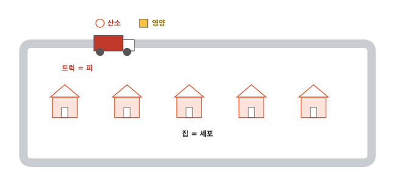
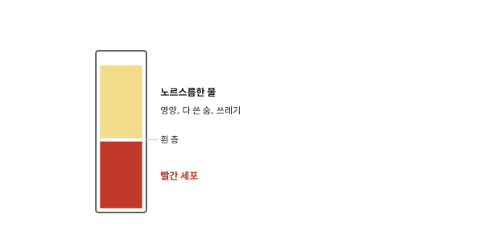
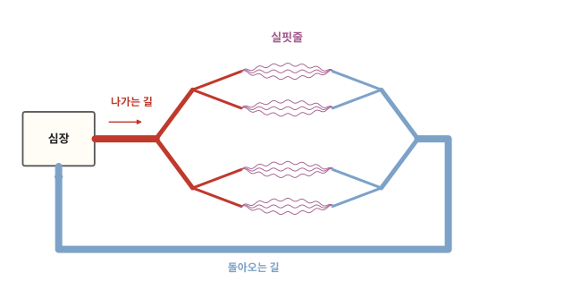
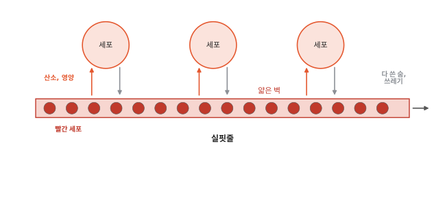
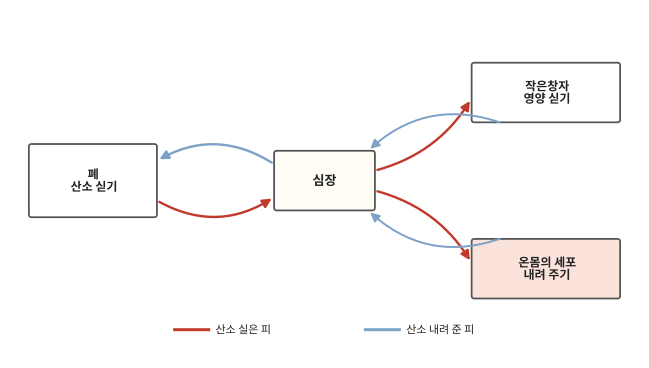
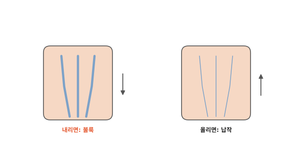

# 피: 산소와 영양을 온몸에 나르는 길

택배 트럭은 아파트 단지 안 길을 돌면서 집집마다 물건을 내려 줘요. 우리 몸에서는 피가 이 트럭 노릇을 해요. 이 글을 읽고 나면 피 속에 무엇이 들었는지 알게 돼요. 피가 어떤 길로 돌면서 세포에 산소와 영양을 건네는지도 알게 돼요.

!!! abstract "이 글에서 알게 되는 것"
    1. 피에는 산소를 나르는 빨간 세포와 영양이 녹은 노르스름한 물이 들어 있어요.
    2. 피는 심장에서 나가는 길로 나가 실핏줄을 지나고 돌아오는 길로 심장에 돌아와요. 이렇게 돌면서 폐에서 산소를, 작은창자에서 영양을 다시 실어요.
    3. 피가 세포와 산소와 영양을 주고받는 곳은 가장 가는 핏줄인 실핏줄이에요. 벽이 아주 얇아서 산소와 영양이 벽을 지나 세포로 가요.

## 1. 세포는 제자리에 있어서 피가 찾아가요

[1편](01-cells.md)에서 세포는 산소와 영양을 받아야 일할 수 있다고 했어요. [2편](02-breathing.md)에서는 산소가, [3편](03-digestion.md)에서는 영양이 피에 탔어요. 그런데 세포는 집처럼 제자리에 붙어 있어요. 발가락 끝 세포는 폐까지 산소를 가지러 갈 수 없어요.

아래 그림에서 길을 도는 트럭과 제자리에 있는 집을 보세요.

**그림 1.** 집은 제자리에 있고 산소와 영양을 실은 트럭이 집 앞까지 와요.
{ .fig-cap }

몸에서는 집이 세포이고 트럭이 피예요. 피가 온몸을 돌면서 발가락 끝 세포 앞까지 산소와 영양을 가져다줘요. 그럼 이 트럭에는 무엇이 실려 있을까요? 피를 나눠 보면 알 수 있어요.

## 2. 피를 돌리면 빨간 세포와 노르스름한 물로 나뉘어요

피는 그냥 빨간 물처럼 보여요. 병원에서는 피를 검사할 때 통에 담고 피가 굳어 덩어리지지 않게 약을 조금 넣어요. 그리고 기계로 빙빙 돌려요. 그러면 피가 여러 층으로 나뉘어요. 아래 그림에서 통 속 세 층을 보세요.

**그림 2.** 기계로 돌린 피는 아래 붉은 층, 아주 얇은 흰 층, 위 노르스름한 물로 나뉘어요.
{ .fig-cap }

아래쪽 붉은 층은 산소를 나르는 세포예요. 1편에서 본 가운데가 쏙 들어간 동글납작한 세포예요. 이 세포가 피를 빨갛게 보이게 해서 이 글에서는 **빨간 세포**라고 부를게요. 빨간 세포는 폐에서 산소를 싣고 다녀요.

위쪽 노르스름한 물에는 작은창자에서 받아들인 영양이 녹아 있어요. 세포가 내놓은 다 쓴 숨과 쓰레기도 이 물에 녹아서 실려 가요.

가운데 아주 얇은 흰 층에는 몸을 지키는 **흰 세포**와 피가 날 때 구멍을 막는 작은 조각이 있어요. 작은 조각은 [6편](06-clotting.md)에서 다시 만나요. 흰 세포는 [12편](12-immune.md)에서 자세히 볼게요.

어른 몸에는 피가 1리터 우유 팩으로 네 개에서 여섯 개쯤 들어 있어요.[^blood] 어린이는 몸이 작은 만큼 더 적어요. 이제 이 피가 어떤 길로 다니는지 볼게요.

## 3. 피는 심장에서 나가 실핏줄을 지나 돌아와요

피가 다니는 길을 **핏줄**이라고 해요. 핏줄은 몸 곳곳에 뻗어 있고 모두 하나로 이어져 있어요. 피는 가슴 가운데에서 조금 왼쪽에 있는 심장에서 나가요.

그림의 색은 피에 실린 산소 양을 나눈 거예요. 산소 실은 피는 빨강, 산소 내려 준 피는 파랑으로 칠했어요. 진짜 피는 모두 붉어요. 아래 그림에서 심장에서 나간 빨간 길이 어떻게 바뀌는지 따라가 보세요.

**그림 3.** 나가는 길은 갈라질수록 가늘어져요. 실핏줄을 지난 피는 굵어지는 길로 모여 심장에 돌아와요.
{ .fig-cap }

나가는 길은 처음에는 굵어요. 몸 곳곳으로 가면서 나무처럼 갈라지고 점점 가늘어져요. 가장 가늘어진 핏줄을 **실핏줄**이라고 해요. 실처럼 가늘다는 뜻이에요. 실핏줄은 몸 구석구석에 그물처럼 퍼져 있어요. 2편에서 폐 속 주머니를 감싸던 가는 핏줄도, 3편에서 작은창자 돌기 속을 지나던 가는 핏줄도 모두 실핏줄이에요.

실핏줄을 지난 피는 다시 모여요. 돌아오는 길은 가는 핏줄이 모여 점점 굵어지면서 심장까지 이어져요.

온몸으로 나가는 길에는 산소 실은 피가 흘러서 빨강이에요. 실핏줄에서 세포에 산소를 내려 준 피가 돌아오는 길로 모이니 돌아오는 길은 파랑이에요.

## 4. 실핏줄의 얇은 벽으로 세포와 주고받아요

택배 트럭은 집 앞에 잠깐 서서 물건을 내려놓아요. 피는 멈추지 않고 흐르면서 물건을 주고받아요. 쓰레기도 받아 가요. 이 일이 일어나는 곳이 실핏줄이에요.

실핏줄은 아주 가늘어요. 가장 가는 실핏줄은 빨간 세포가 한 줄로 겨우 지나갈 만큼 가늘어요.[^vessel] 벽도 아주 얇아요. 아래 그림에서 실핏줄과 세포 사이를 오가는 화살표를 보세요. 크기는 실제와 다르게 그렸어요.

**그림 4.** 산소와 영양은 얇은 벽을 지나 세포로 가고 다 쓴 숨과 쓰레기는 거꾸로 피로 와요.
{ .fig-cap }

실핏줄을 지나는 동안 산소와 영양이 얇은 벽을 지나 옆에 있는 세포로 가요. 세포가 내놓은 다 쓴 숨과 쓰레기는 거꾸로 벽을 지나 피에 실려요.

굵은 핏줄에서는 이런 주고받기가 일어나지 않아요. 벽이 여러 겹이고 피도 빨리 지나가거든요. 굵은 핏줄은 피를 멀리까지 빨리 보내는 큰길이에요. 실핏줄은 몸 구석구석에 그물처럼 퍼져 있어서 어느 세포 가까이에서나 주고받을 수 있어요.

## 5. 피는 한 바퀴 돌면서 폐와 작은창자에서 다시 실어요

산소와 영양을 내려 준 피는 돌아오는 길로 심장에 와요. 그리고 다시 나가요. 트럭은 물건을 다 내려 주면 창고에 들러 다시 싣죠. 피에게는 폐와 작은창자가 창고예요.

아래 그림도 색은 그림 3처럼 산소 양으로 나눴어요. 그래서 심장에서 폐로 가는 화살표는 심장에서 나가는데도 파랑이에요. 온몸에 산소를 내려 주고 막 돌아온 피라서 그래요. 폐에서 산소를 싣고 심장에 돌아오면 빨강이 돼요. 심장을 떠난 화살표가 어디에 들렀다 오는지 보세요.

**그림 5.** 피는 폐에서 산소를, 작은창자에서 영양을 싣고 온몸의 세포에 내려 준 다음 심장으로 돌아와요.
{ .fig-cap }

피는 폐를 지나면서 산소를 새로 싣고 다 쓴 숨을 내려놓아요. 작은창자를 지나는 피는 영양을 새로 실어요. 그러고는 온몸의 세포 앞을 지나며 산소와 영양을 내려 줘요. 진짜 길은 훨씬 복잡해요. 그림에는 큰 흐름만 그렸어요.

피가 쉬지 않고 도는 덕분에 세포는 제자리에 있어도 늘 산소와 영양을 받아요.

## 6. 손등에 비치는 파르스름한 줄은 돌아오는 길이에요

돌아오는 길은 손등에서 볼 수 있어요. 손등을 잘 보세요. 피부 아래로 파르스름한 줄이 보이나요? 이 줄이 돌아오는 길의 핏줄이에요. 그 안의 피도 붉어요. 피부를 거쳐 보면 파랗게 보일 뿐이에요.[^veins]

이제 한 손을 아래로 늘어뜨리고 천천히 열을 셀 동안 기다려 보세요. 그다음에는 그 손을 머리 위로 들고 다시 열을 세어 보세요. 팔이 저리거나 아프면 바로 내려요. 아래 그림에서 두 손등의 파란 줄 굵기를 비교해 보세요.

**그림 6.** 손을 내리면 손등 핏줄이 불룩해지고 올리면 납작해져요.
{ .fig-cap }

손을 내리면 돌아오는 피가 심장까지 위로 올라가야 해요. 그래서 피가 손등 핏줄에 조금 고여 불룩해져요. 손을 올리면 피가 심장 쪽으로 내려가기 쉬워서 핏줄이 납작해져요. 핏줄이 잘 보이는 정도는 사람마다 달라요. 잘 보이고 안 보이고로 몸이 건강한지 알 수는 없어요.

## 정리

세포는 제자리에 붙어 있어서 산소와 영양을 가지러 갈 수 없어요. 그래서 피가 온몸을 돌며 실어다 줘요. 피를 기계로 돌리면 아래에 빨간 세포가, 위에 노르스름한 물이 모여요. 빨간 세포는 산소를 나르고 노르스름한 물은 영양과 다 쓴 숨과 쓰레기를 실어 날라요.

피는 심장에서 나가는 길로 나가 나무처럼 갈라지고 가장 가는 실핏줄까지 가요. 실핏줄은 벽이 아주 얇아서 여기서 산소와 영양을 세포에 주고 다 쓴 숨과 쓰레기를 받아요. 그다음 돌아오는 길로 모여 심장에 돌아와요. 이렇게 한 바퀴 도는 동안 폐에서 산소를, 작은창자에서 영양을 다시 실어요.

그런데 피는 무엇이 밀어서 이렇게 쉬지 않고 돌까요? [5편](05-heart.md)에서 심장을 들여다볼게요.

### 새로 나온 말

- **빨간 세포**: 피 속에서 산소를 나르는 세포. 피를 기계로 돌리면 통 아래에 붉은 층으로 모여요.
- **흰 세포**: 피 속에서 몸을 지키는 세포. 피를 기계로 돌리면 아주 얇은 흰 층에 모여요.
- **핏줄**: 피가 다니는 길. 심장에서 나가는 길과 심장으로 돌아오는 길이 하나로 이어져 있어요.
- **실핏줄**: 가장 가는 핏줄. 벽이 아주 얇아서 여기서 세포와 산소, 영양, 다 쓴 숨을 주고받아요.

[^blood]: OpenStax, *Anatomy and Physiology 2e*, 18.1 ["An Overview of Blood"](https://openstax.org/books/anatomy-and-physiology-2e/pages/18-1-an-overview-of-blood).
[^vessel]: OpenStax, *Anatomy and Physiology 2e*, 20.1 ["Structure and Function of Blood Vessels"](https://openstax.org/books/anatomy-and-physiology-2e/pages/20-1-structure-and-function-of-blood-vessels).
[^veins]: A. Kienle 외, "Why do veins appear blue? A new look at an old question", *Applied Optics* 35(7): 1151–1160, 1996. [doi:10.1364/AO.35.001151](https://doi.org/10.1364/AO.35.001151).
