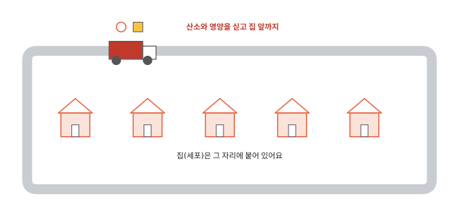
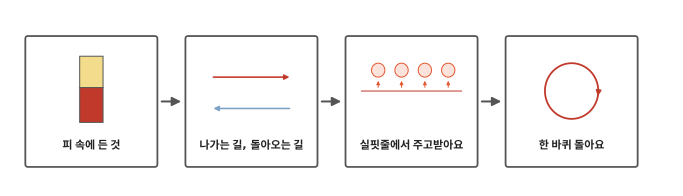
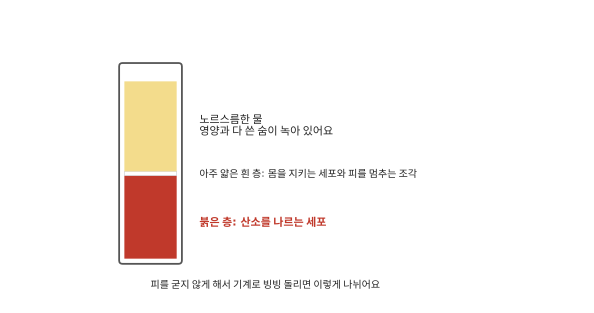
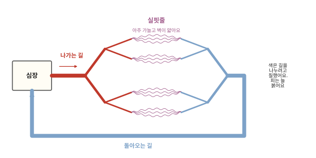
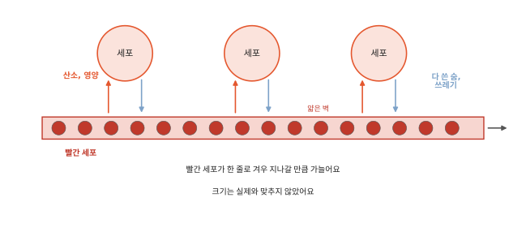
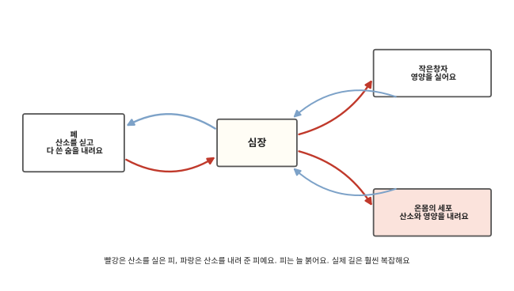
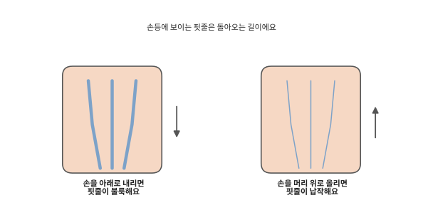

# 피는 왜 온몸을 돌까요?

## 집 앞까지 오는 트럭

아파트 단지에 택배 트럭이 들어와요. 트럭은 단지 안 길을 따라 돌면서 집집마다 물건을 내려 줘요. 집이 물건을 가지러 나가지 않아도 돼요.

우리 몸의 세포도 집처럼 제자리에 붙어 있어요. [1편](01-cells.md)에서 세포는 산소와 영양을 받아야 일할 수 있다고 했어요. [2편](02-breathing.md)에서 산소가, [3편](03-digestion.md)에서 영양이 피에 탔어요. 그런데 발가락 끝 세포는 폐까지 산소를 가지러 갈 수 없어요. 그럼 산소와 영양은 어떻게 발가락 끝까지 갈까요?

## 피 속에 든 것에서 한 바퀴까지

인체 네 번째 편이에요. 몸속 택배 트럭인 피를 따라가며 피 속에 든 것과 다니는 길, 물건을 주고받는 곳을 차례로 알아봐요.

## 피 속에 든 것

피는 그냥 빨간 물처럼 보여요. 병원에서는 피를 검사할 때 통에 담아요. 피가 굳어 덩어리지지 않게 약을 조금 넣어요. 그리고 기계로 빙빙 돌려요. 그러면 피가 여러 층으로 나뉘어요.

아래쪽 붉은 층은 산소를 나르는 세포예요. 1편에서 본, 가운데가 쏙 들어간 동글납작한 세포예요. 이 세포가 피를 빨갛게 보이게 해요. 그래서 이 편에서는 짧게 빨간 세포라고 부를게요. 빨간 세포는 폐에서 산소를 싣고 다녀요.

위쪽은 노르스름한 물이에요. 이 물에는 작은창자에서 받아들인 영양이 녹아 있어요. 세포가 내놓은 다 쓴 숨과 쓰레기도 녹아서 실려 가요.

가운데에는 아주 얇은 흰 층이 있어요. 몸을 지키는 세포와 피가 날 때 구멍을 막는 작은 조각이에요. 이것들은 나중 편에서 다시 만나요.

어른 몸에는 피가 1리터 우유 팩으로 네 개에서 여섯 개쯤 들어 있어요.[^blood] 어린이는 몸이 작은 만큼 더 적어요.

## 나가는 길, 돌아오는 길

피가 다니는 길이 핏줄이에요. 핏줄은 몸 곳곳에 뻗어 있고 하나로 이어져 있어요.

피는 가슴 가운데 조금 왼쪽에 있는 심장에서 나가요. 나가는 길은 처음에는 굵어요. 몸 곳곳으로 가면서 나무처럼 갈라지고 점점 가늘어져요.

가장 가늘어진 핏줄을 **실핏줄**이라고 해요. 실처럼 가늘다는 뜻이에요. 실핏줄은 몸 구석구석에 그물처럼 퍼져 있어요. 2편에서 폐 속 주머니를 감싸던 가는 핏줄, 3편에서 작은창자 돌기 속을 지나던 가는 핏줄이 모두 실핏줄이에요.

실핏줄을 지난 피는 다시 모여요. 돌아오는 길은 가는 핏줄이 모여 점점 굵어지면서 심장까지 이어져요.

그림에서는 두 길을 쉽게 나누어 보려고 나가는 길을 빨강, 돌아오는 길을 파랑으로 칠했어요. 진짜 피는 어느 길에서나 붉어요.

## 실핏줄에서 주고받아요

택배 트럭은 집 앞에 잠깐 서서 물건을 내려놓아요. 피는 멈추지 않고 흐르면서 물건을 주고받아요. 쓰레기도 받아 가요.

실핏줄은 아주 가늘어요. 가장 가는 실핏줄은 빨간 세포가 한 줄로 겨우 지나갈 만큼 가늘어요.[^vessel] 벽도 아주 얇아요.

그래서 실핏줄을 지나는 동안 산소와 영양이 얇은 벽을 지나 옆에 있는 세포로 가요. 세포가 내놓은 다 쓴 숨과 쓰레기는 거꾸로 벽을 지나 피에 실려요.

굵은 핏줄은 벽이 여러 겹이고 피도 빨리 지나가서 이런 주고받기를 하지 못해요. 굵은 핏줄은 피를 멀리까지 빨리 보내는 큰길이에요. 주고받기는 실핏줄에서 일어나요. 실핏줄은 몸 구석구석에 그물처럼 퍼져 있어서 세포 가까이에서 주고받을 수 있어요.

## 한 바퀴 돌아요

산소와 영양을 내려 준 피는 돌아오는 길로 심장에 와요. 그리고 다시 나가요.

피는 한 바퀴 도는 동안 폐에서 산소를 새로 싣고 다 쓴 숨을 내려놓아요. 작은창자를 지나는 피는 영양을 새로 실어요. 택배 트럭이 창고에 들러 물건을 다시 싣는 것과 비슷해요.

피가 쉬지 않고 도는 덕분에 세포는 제자리에 있어도 늘 산소와 영양을 받아요.

그런데 피는 무엇이 밀어서 이렇게 돌까요? 다음 편에서 볼게요.

## 정리

- 실핏줄: 가장 가는 핏줄이에요. 벽이 아주 얇아서 여기에서 산소와 영양을 세포에 주고 다 쓴 숨과 쓰레기를 받아요.
- 피는 심장에서 나가는 길, 실핏줄, 돌아오는 길을 따라 한 바퀴 돌아요. 돌면서 폐에서 산소를, 작은창자에서 영양을 다시 실어요.

## 해 보기: 손등 핏줄 보기

1. 손등을 잘 보세요. 피부 아래로 파르스름한 줄이 보이나요? 이것은 돌아오는 길의 핏줄이에요. 그 안의 피도 붉어요. 피부를 거쳐 보면 파랗게 보일 뿐이에요.
2. 한 손을 아래로 늘어뜨리고 천천히 열을 셀 동안 기다려 보세요. 손등 핏줄이 어떻게 되나요?
3. 이번에는 그 손을 머리 위로 들고 다시 열을 셀 동안 기다려 보세요. 핏줄이 어떻게 바뀌나요? 팔이 저리거나 아프면 바로 내려요.

손을 내리면 돌아오는 피가 심장까지 위로 올라가야 해요. 그래서 피가 손등 핏줄에 조금 고여 불룩해져요. 손을 올리면 피가 심장 쪽으로 내려가기 쉬워서 핏줄이 납작해져요. 사람마다 잘 보이는 정도가 달라요. 핏줄이 잘 보이고 안 보이고로 몸이 건강한지 알 수는 없어요.

## 확인 문제

??? question "1. 왜 피가 돌까요"
    세포는 산소와 영양을 왜 직접 가지러 가지 않을까요? 대신 무엇이 가져다줄까요?

    **풀이**: 세포는 제자리에 붙어 있어서 움직여 가지러 갈 수 없어요. 피가 온몸을 돌면서 가져다줘요.

??? question "2. 주고받는 곳"
    피는 어디에서 세포와 산소, 영양, 다 쓴 숨을 주고받을까요?

    **풀이**: 실핏줄에서요. 실핏줄은 아주 가늘고 벽이 얇아서 산소와 영양이 벽을 지나 세포로 가요.

??? question "3. 다시 싣는 곳"
    산소를 다 내려 준 피는 어디에서 산소를 다시 실을까요?

    **풀이**: 폐에서요. 피는 한 바퀴 돌아 폐를 지나면서 산소를 다시 싣고 다 쓴 숨을 내려놓아요.

!!! abstract "어른을 위한 정리 (건너뛰어도 돼요)"
    - 피의 주요한 일 가운데 하나는 세포에 산소와 영양을 주고 노폐물을 치우는 것이에요. 피 한 시료에서 적혈구가 약 45%예요. 백혈구와 혈소판이 든 버피층은 1% 미만이에요. 나머지는 혈장이며 혈장의 약 92%가 물이에요. 성인 남성은 피가 5~6리터, 여성은 4~5리터쯤이에요.[^blood]
    - 본문의 빨간 세포는 적혈구예요. 나가는 길은 동맥, 돌아오는 길은 정맥, 실핏줄은 모세혈관이에요. 모세혈관 안지름은 5~10마이크로미터예요. 가장 가는 것은 적혈구가 겨우 비집고 지나갈 정도예요. 가스와 물질 교환은 모세혈관에서 일어나요. 정맥은 동맥보다 벽이 얇아요. 팔다리의 정맥에는 피가 거꾸로 흐르지 않게 하는 판막이 있어요. 어느 순간이든 온몸 정맥에 피의 약 64%가 들어 있어요.[^vessel]
    - 본문은 큰 흐름만 그렸어요. 실제로는 심장에서 폐로 갔다 오는 길(폐순환)과 온몸으로 갔다 오는 길(체순환)이 따로 있고 심장을 두 번 지나요. 작은창자에서 흡수한 영양은 간문맥으로 간을 먼저 거쳐요. 이 내용은 5편에서 심장의 칸과 함께 다뤄요.
    - 정맥혈도 붉어요. 정맥이 피부 너머로 파랗게 보이는 것은 피부가 빛을 흩뜨리고 흡수하는 방식과 정맥혈의 흡수 특성이 겹친 결과로 설명돼요.[^veins]
    - 손을 내리면 정맥이 부풀고 올리면 꺼져요. 중력 때문에 정맥 안 피가 고이거나 빠지는 거예요. 이 관찰은 건강 상태를 판단하는 방법이 아니에요.

## 더 깊이

??? info "곤충의 피는 왜 빨갛지 않을까"
    곤충은 몸에 난 작은 숨구멍에서 가는 관이 몸속 곳곳으로 뻗어 있어요. 이 관이 공기를 세포 가까이까지 직접 날라요. 피가 산소를 나르지 않아도 되니 빨간 세포도 없어요.

[^blood]: OpenStax, *Anatomy and Physiology 2e*, 18.1 ["An Overview of Blood"](https://openstax.org/books/anatomy-and-physiology-2e/pages/18-1-an-overview-of-blood).
[^vessel]: OpenStax, *Anatomy and Physiology 2e*, 20.1 ["Structure and Function of Blood Vessels"](https://openstax.org/books/anatomy-and-physiology-2e/pages/20-1-structure-and-function-of-blood-vessels).
[^veins]: A. Kienle 외, "Why do veins appear blue? A new look at an old question", *Applied Optics* 35(7): 1151–1160, 1996. [doi:10.1364/AO.35.001151](https://doi.org/10.1364/AO.35.001151).
