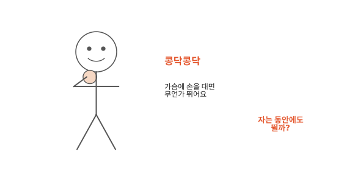
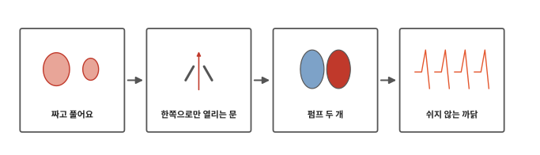
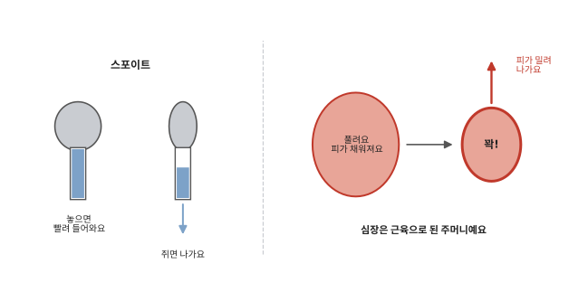
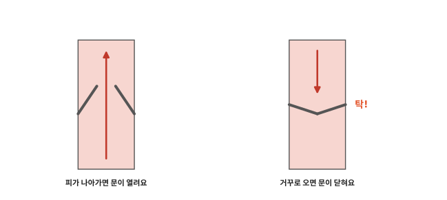
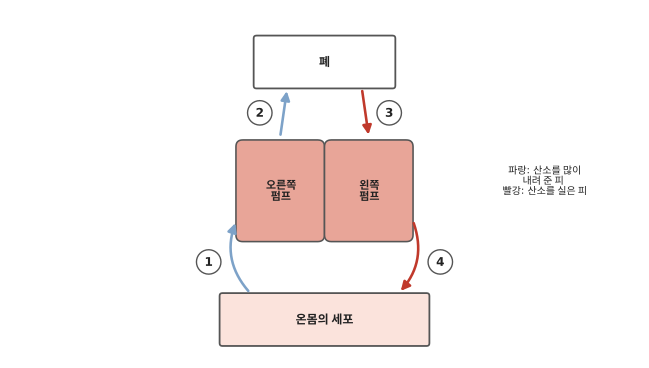
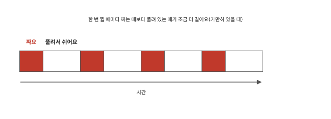
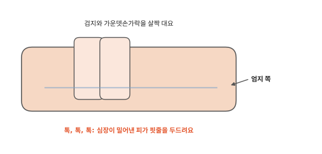

# 심장은 왜 쉬지 않고 뛸까요?

## 콩닥콩닥

가슴 왼쪽에 손바닥을 대고 가만히 있어 보세요. 콩닥콩닥 무언가 뛰는 게 느껴지나요? 달리기를 하고 나면 더 세게, 더 빨리 뛰어요.

[4편](04-blood.md)에서 피가 온몸을 쉬지 않고 돈다고 했어요. 피는 혼자 돌지 못해요. 누군가 밀어 줘야 해요. 가슴 속에서 콩닥콩닥 뛰는 것이 피를 밀어요.

## 짜고 풀어요에서 쉬지 않는 까닭까지

인체 다섯 번째 편이에요. 피를 미는 것이 어떻게 생겼는지, 피가 왜 한쪽으로만 가는지, 왜 한 번도 쉬지 않는지 차례로 알아봐요.

## 짜고 풀어요

스포이트를 써 본 적 있나요? 고무 머리를 꾹 쥐면 안에 든 물이 밀려 나가요. 손을 놓으면 고무가 다시 부풀면서 물이 빨려 들어와요.

가슴 속에서 뛰는 것은 **심장**이에요. 심장은 주먹만 한 주머니인데 벽이 두꺼운 근육으로 되어 있어요. 이 근육이 꽉 짜면 안에 든 피가 핏줄로 밀려 나가요. 근육이 풀리면 심장이 다시 넓어지면서 피가 들어와 채워져요.

콩닥 한 번이 짜기 한 번이에요. 심장은 짜고 풀기를 되풀이하면서 피를 계속 밀어 보내요.

스포이트와 다른 점도 있어요. 스포이트는 사람이 쥐어 줘야 하지만 심장은 스스로 짜요. 그리고 스포이트는 들어온 구멍으로 다시 나가지만 심장은 들어오는 문과 나가는 문이 따로 있어요.

## 한쪽으로만 열리는 문

심장이 짜면 피는 앞으로도 뒤로도 밀려 나가려고 해요. 그런데 피는 늘 나가는 길로만 가요. 심장 안에 한쪽으로만 열리는 문이 있어서 그래요.

피가 가야 할 쪽으로 밀면 문이 열려요. 거꾸로 돌아오려고 하면 문이 탁 닫혀요. 피는 한 방향으로만 흘러요.

가슴에 귀를 대면 "쿵, 쾅" 소리가 들려요. 이 소리는 심장 안의 문이 닫히는 소리예요. 한 번 뛸 때 문이 두 군데에서 차례로 닫혀서 소리가 두 번 나요. 손목에서 느끼는 톡은 한 번이에요.

## 펌프 두 개

심장 안은 오른쪽과 왼쪽 둘로 나뉘어 있어요. 둘 사이는 벽으로 막혀 있어서 피가 섞이지 않아요. 펌프 두 개가 나란히 붙어서 함께 뛰어요.

피는 이 순서로 돌아요. 그림의 화살표를 1부터 따라가 보세요.

1. 온몸을 돌며 산소를 많이 내려 준 피가 오른쪽 펌프로 돌아와요.
2. 오른쪽 펌프가 이 피를 숨 쉬는 곳인 폐로 보내요. 폐에서 피는 산소를 새로 실어요([2편](02-breathing.md)).
3. 산소를 실은 피가 왼쪽 펌프로 돌아와요.
4. 왼쪽 펌프가 이 피를 온몸으로 힘껏 밀어 보내요.

피는 폐에 다녀오는 길과 온몸에 다녀오는 길을 번갈아 돌아요. 길마다 심장을 한 번씩 지나요. 온몸은 폐보다 길이 훨씬 많고 넓어서 피를 보내려면 더 센 힘이 들어요. 그래서 왼쪽 펌프의 벽이 더 두꺼워요.

그림은 나를 마주 보고 선 사람의 심장이라서 오른쪽 펌프가 그림의 왼쪽에 있어요.

## 쉬지 않는 까닭

[2편](02-breathing.md)에서 봤듯이 세포는 낮에도 밤에도 일하면서 산소와 영양을 써요. 피가 멈추면 세포에 산소가 가지 못해요. 그러니 심장은 자는 동안에도 멈추면 안 돼요.

심장에게 "뛰어!" 하고 시키는 것은 심장 안에 있어요. 심장 안에는 스스로 박자를 만드는 작은 곳이 있어요. 거기서 "지금!" 하는 신호가 나오면 심장 근육이 차례로 짜요. 우리가 생각하지 않아도 심장이 뛰는 건 이 덕분이에요. 뇌는 이 박자를 빠르게 하거나 느리게 할 뿐이에요.

그렇게 계속 뛰면 지치지 않을까요? 심장은 한 번 짜고 나면 풀려 있는 틈이 있어요. 가만히 있을 때는 짜는 시간보다 풀려 있는 시간이 더 길어요. 그림에서 흰 칸이 빨간 칸보다 긴 것처럼요. 이렇게 쉬는 틈이 있어서 심장은 지치지 않고 뛰어요.

달리기를 하면 근육 세포가 일을 더 해요. 산소와 영양이 더 필요해져요. 심장도 더 빨리 뛰어 피를 더 많이 보내요. 이때 숨도 함께 가빠져요([2편](02-breathing.md)).

피가 다니다가 핏줄이 다쳐 구멍이 나면 어떻게 될까요? 다음 편에서 볼게요.

## 정리

- 심장: 주먹만 한 근육 주머니예요. 꽉 짜면 피가 밀려 나가고 풀리면 피가 채워져요. 한쪽으로만 열리는 문이 있어서 피가 거꾸로 가지 않아요.
- 심장은 오른쪽 펌프(폐로)와 왼쪽 펌프(온몸으로)로 나뉘어요. 스스로 박자를 만들어 쉬지 않고 뛰어요. 뛸 때마다 짧게 풀려 쉬어요.

## 해 보기: 맥박 세기

1. 손바닥이 위로 오게 손을 펴요. 다른 손의 검지와 가운뎃손가락을 손목 안쪽, 엄지 쪽에 살짝 대 보세요. 톡, 톡 하는 게 느껴지면 그게 맥박이에요. 심장이 한 번 짤 때마다 밀려간 피가 핏줄을 한 번 두드려요.
2. 어른이 시계로 1분을 재 주세요. 맥박이 몇 번 뛰는지 세어 봐요.
3. 제자리에서 조금 뛴 다음 다시 세어 봐요. 몇 번 더 뛰었나요?
4. 가족의 가슴에 귀를 살며시 대고 "쿵, 쾅" 소리를 들어 봐요. 싫다고 하면 하지 않아요.

맥박 수는 사람마다, 나이마다 달라요. 어린이는 어른보다 빨리 뛰어요. 센 숫자로 몸이 건강한지 판단하지는 않아요.

## 확인 문제

??? question "1. 피를 미는 방법"
    심장은 어떻게 피를 밀어 보낼까요?

    **풀이**: 근육으로 된 주머니가 꽉 짜면 피가 밀려 나가요. 풀리면 피가 다시 채워져요. 이걸 되풀이해요.

??? question "2. 쿵쾅 소리"
    가슴에서 들리는 "쿵, 쾅" 소리는 무엇일까요?

    **풀이**: 심장 안의 문이 닫히는 소리예요. 문은 피가 거꾸로 가지 못하게 막아요.

??? question "3. 자는 동안에도"
    자는 동안에도 심장이 뛰는 까닭은 무엇일까요?

    **풀이**: 세포가 자는 동안에도 산소를 쓰기 때문에 피가 계속 돌아야 해요. 심장 안에 스스로 박자를 만드는 곳이 있어서 뇌가 시키지 않아도 뛰어요.

!!! abstract "어른을 위한 정리 (건너뛰어도 돼요)"
    - 심장은 주먹만 한 크기로 두 폐 사이(종격)에 있고 끝(심첨)은 가슴뼈 바로 왼쪽에 있어요. 오른쪽과 왼쪽에 각각 심방(받는 방) 하나, 심실(미는 방) 하나가 있어 네 칸이에요. 판막이 피를 한 방향으로만 흐르게 해요. 본문의 "오른쪽 펌프"는 우심방·우심실, "왼쪽 펌프"는 좌심방·좌심실이에요.[^anat]
    - 폐로 갔다 오는 길을 폐순환, 온몸으로 갔다 오는 길을 체순환이라고 해요. 쉬고 있는 어른에서 심실은 한 번에 약 70mL를 내보내요. 1분에 75번 뛰면 하루 약 10만 8천 번 뛰어요. 교재는 하루에 심장이 미는 피를 약 1만 4천 리터로 어림해요(양쪽 심실을 합친 값으로 읽혀요).[^anat] 왼쪽 심실 벽이 더 두꺼운 것은 체순환의 저항이 커서 더 높은 압력이 필요해서예요.
    - "쿵"(S1)은 심실이 짤 때 방실판막이, "쾅"(S2)은 심실이 풀릴 때 반달판막이 닫히는 소리예요. 심실이 짜는 시간은 약 0.27초, 풀리는 시간은 약 0.43초예요(교재 예시, 심실만 센 값).[^cycle]
    - 박자를 만드는 곳은 동방결절이에요. 신경이나 호르몬의 조절이 없으면 1분에 80~100번쯤 신호를 내요. 자율신경과 호르몬은 이 박자를 빠르게 또는 느리게 조절해요.[^elec]
    - 어른의 쉬는 심박수는 대개 1분에 60~100번이에요. 신생아는 120번쯤이고 어린이도 어른보다 빨라요. 운동하면 건강한 젊은이는 150번까지 오를 수 있어요. 1분에 내보내는 피(심박출량)는 평균 약 5.25리터예요.[^phys] 본문 해 보기는 수치로 건강을 판단하지 않도록 썼어요.

## 더 깊이

??? info "심장 근육은 왜 쥐가 나지 않을까"
    팔다리 근육은 힘이 겹쳐 들어가면 오므라든 채 풀리지 않기도 해요. 심장 근육은 한 번 짠 다음 일정 시간 동안 다시 짤 수 없게 되어 있어요. 그래서 짜기가 겹쳐 굳지 않고 짜고 풀기가 꼭 번갈아 일어나요.

??? info "작은 동물일수록 심장이 빨리 뛸까"
    대체로 몸집이 작은 동물일수록 심장이 빨리 뛰어요. 쥐나 작은 새의 심장은 사람보다 훨씬 빨리 뛰어요.

??? info "심장 모양 ♡은 진짜 심장을 닮았을까"
    카드에 그리는 ♡ 모양은 진짜 심장과 많이 달라요. 진짜 심장은 위가 넓고 아래로 갈수록 좁아지는 원뿔 비슷한 모양이에요.

[^anat]: OpenStax, *Anatomy and Physiology 2e*, 19.1 ["Heart Anatomy"](https://openstax.org/books/anatomy-and-physiology-2e/pages/19-1-heart-anatomy).
[^elec]: OpenStax, *Anatomy and Physiology 2e*, 19.2 ["Cardiac Muscle and Electrical Activity"](https://openstax.org/books/anatomy-and-physiology-2e/pages/19-2-cardiac-muscle-and-electrical-activity).
[^cycle]: OpenStax, *Anatomy and Physiology 2e*, 19.3 ["Cardiac Cycle"](https://openstax.org/books/anatomy-and-physiology-2e/pages/19-3-cardiac-cycle).
[^phys]: OpenStax, *Anatomy and Physiology 2e*, 19.4 ["Cardiac Physiology"](https://openstax.org/books/anatomy-and-physiology-2e/pages/19-4-cardiac-physiology).
