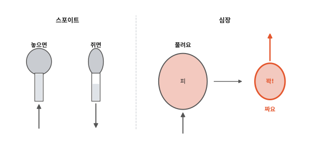
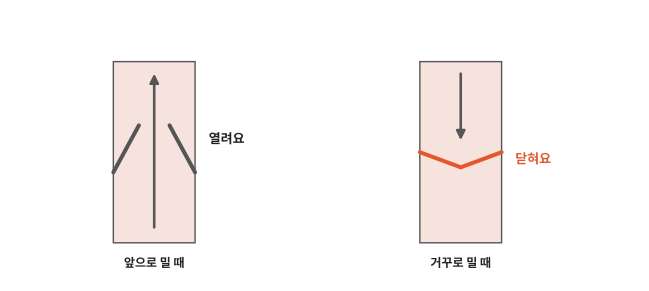
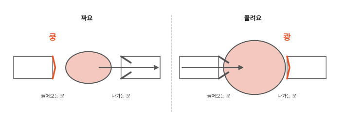
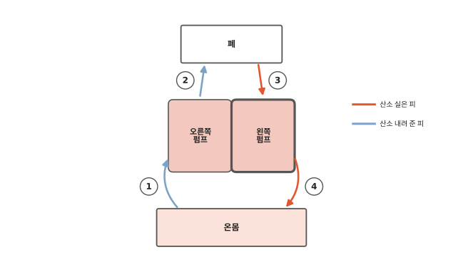
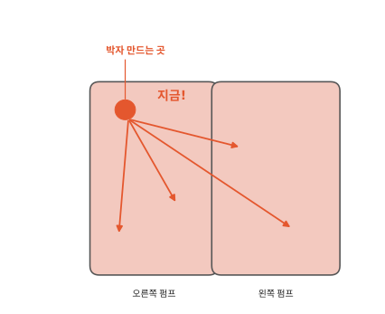
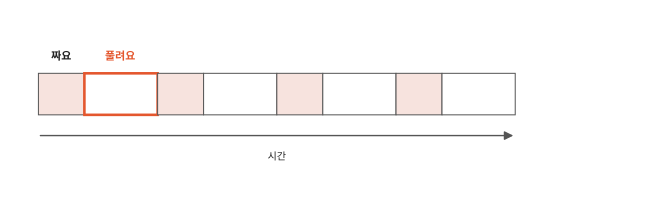
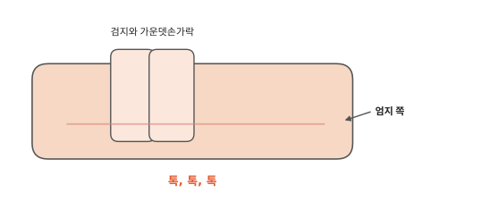

# 심장: 쉬지 않고 피를 짜서 미는 근육 주머니

가슴 왼쪽에 손바닥을 대고 가만히 있어 보세요. 콩닥콩닥 무언가 뛰어요. 달리기를 하고 나면 더 세게 더 빨리 뛰고요. 이 글을 읽고 나면 가슴에서 뛰는 심장이 피를 어떻게 밀어 보내는지 알게 돼요. 자는 동안에도 멈추지 않는 까닭도 함께 보여요. [4편](04-blood.md)에서 본 피가 온몸을 쉬지 않고 도는 힘이 여기서 나와요.

!!! abstract "이 글에서 알게 되는 것"
    1. 심장은 근육으로 된 주머니예요. 꽉 짜면 피가 밀려 나가고 풀리면 피가 들어와요. 안에 한쪽으로만 열리는 문이 있어서 피가 거꾸로 가지 않아요.
    2. 심장 안은 펌프 두 개로 나뉘어 있어요. 오른쪽 펌프는 피를 폐로 보내고 왼쪽 펌프는 온몸으로 보내요.
    3. 심장 안에 스스로 박자를 만드는 곳이 있어서 자는 동안에도 뛰어요. 짤 때마다 풀려 쉬는 틈이 있어서 지치지 않아요.

## 1. 심장은 짜고 풀기를 되풀이해서 피를 밀어요

4편에서 피는 온몸을 쉬지 않고 돈다고 했어요. 그런데 피는 혼자 흐르지 못해요. 누군가 밀어 줘야 해요. 가슴 속에서 콩닥콩닥 뛰는 것이 피를 밀어요.

어떻게 미는지 스포이트로 먼저 해 볼게요. 고무 머리를 꾹 쥐면 안에 든 물이 밀려 나가요. 손을 놓으면 고무가 다시 부풀면서 물이 빨려 들어와요. 쥐고 놓기를 되풀이하면 물을 계속 옮길 수 있어요.

가슴 속에서 뛰는 것도 이렇게 일해요. 이것은 주먹만 한 주머니이고 벽이 두꺼운 근육으로 되어 있어요. 이 근육이 꽉 짜면 안에 든 피가 핏줄로 밀려 나가요. 근육이 풀리면 주머니가 다시 넓어지면서 피가 들어와 채워져요. 이 근육 주머니를 **심장**이라고 해요.

아래 그림에서 왼쪽 스포이트와 오른쪽 심장을 비교해 보세요.

**그림 1.** 스포이트는 쥐면 물이 나가고 심장은 짜면 피가 나가요.
{ .fig-cap }

가슴에서 느낀 콩닥 한 번이 짜기 한 번이에요. 심장은 짜고 풀기를 되풀이하면서 피를 계속 밀어 보내요.

스포이트와 다른 점이 둘 있어요. 스포이트는 사람이 쥐어 줘야 하는데 심장은 스스로 짜요. 그리고 스포이트는 물이 들어온 구멍으로 다시 나가지만 심장은 들어오는 문과 나가는 문이 따로 있어요. 문부터 볼게요.

## 2. 한쪽으로만 열리는 문이 피를 한 방향으로 보내요

심장이 짜면 피는 사방으로 밀려요. 들어왔던 쪽으로 되돌아가려고도 해요. 그런데 피는 늘 나가는 길로만 가요. 심장 안에 한쪽으로만 열리는 문이 있어서 그래요.

이 문은 날개 두 개로 되어 있어요. 아래 그림에서 피가 미는 쪽에 따라 날개가 어떻게 움직이는지 보세요.

**그림 2.** 피가 앞으로 밀면 날개가 벌어지고 거꾸로 밀면 날개가 맞닿아 길을 막아요.
{ .fig-cap }

날개는 피가 가야 할 쪽으로만 젖혀져요. 거꾸로 오는 피는 두 날개를 밀어 서로 맞닿게 해요. 문이 피의 힘으로 열리고 닫히는 거예요.

심장에는 이런 문이 들어오는 쪽과 나가는 쪽에 하나씩 있어요. 아래 그림에서 짤 때와 풀릴 때 각각 어느 문이 열려 있는지 보세요.

**그림 3.** 짤 때는 나가는 문만 열리고 풀릴 때는 들어오는 문만 열려요.
{ .fig-cap }

심장이 짜면 피가 나가는 문을 밀어 열고 들어오는 문은 밀어 닫아요. 심장이 풀리면 넓어진 주머니로 피가 들어오는 문을 열고 들어와요. 이때 나가는 문 밖에 있던 피가 되돌아오려다가 그 문을 닫아요. 그래서 피는 들어오는 문에서 나가는 문 쪽으로만 흘러요.

가슴에 귀를 대면 "쿵, 쾅" 하고 두 번 소리가 들려요. 이 소리가 문이 닫히는 소리예요. 짜기 시작할 때 들어오는 문이 닫히면서 "쿵" 하고 풀리기 시작할 때 나가는 문이 닫히면서 "쾅" 해요. 그림 3에 빨간 글씨로 적은 곳이에요.[^cycle]

## 3. 심장 안의 펌프 두 개가 피를 폐와 온몸으로 나눠 보내요

지금까지는 심장을 주머니 하나로 그렸어요. 실제 심장 안은 오른쪽과 왼쪽으로 나뉘어 있어요. 둘 사이는 벽으로 막혀 있어서 피가 섞이지 않아요. 두 쪽은 나란히 붙어서 함께 짜고 함께 풀려요. 둘 다 그림 3처럼 들어오는 문과 나가는 문이 있어요. 물이나 피를 밀어 보내는 기계를 펌프라고 하니까 이 둘을 오른쪽 펌프와 왼쪽 펌프라고 부를게요.

그림의 색은 산소 양을 나눈 거예요. 진짜 피는 모두 붉어요. [4편](04-blood.md)처럼 산소 실은 피는 빨강, 산소 내려 준 피는 파랑으로 칠했어요. 아래 그림에서 화살표를 1부터 차례로 따라가 보세요.

**그림 4.** 피는 온몸, 오른쪽 펌프, 폐, 왼쪽 펌프를 차례로 지나 다시 온몸으로 가요.
{ .fig-cap }

1. 온몸을 돌며 산소를 많이 내려 준 피가 오른쪽 펌프로 돌아와요.
2. 오른쪽 펌프가 이 피를 폐로 보내요. 폐에서 피는 산소를 새로 실어요([2편](02-breathing.md)).
3. 산소를 실은 피가 왼쪽 펌프로 돌아와요.
4. 왼쪽 펌프가 이 피를 온몸으로 힘껏 밀어 보내요.

피는 폐에 다녀오는 길과 온몸에 다녀오는 길을 번갈아 돌아요. 길마다 심장을 한 번씩 지나요. 온몸은 폐보다 다녀올 길이 훨씬 많고 넓어요. 그래서 온몸으로 피를 보내려면 더 센 힘이 들고 왼쪽 펌프의 벽이 더 두꺼워요. 그림 4에서도 왼쪽 펌프의 테두리를 더 굵게 그렸어요.[^anat]

그림 4는 나를 마주 보고 선 사람의 심장이에요. 그래서 그 사람의 오른쪽 펌프가 그림에서는 왼쪽에 있어요.

## 4. 심장은 스스로 박자를 만들어서 자는 동안에도 뛰어요

[1편](01-cells.md)과 [2편](02-breathing.md)에서 봤듯이 세포는 낮에도 밤에도 산소와 영양을 써요. 피가 멈추면 세포에 산소가 가지 못해요. 그러니 심장은 자는 동안에도 멈추면 안 돼요. 1절에서 심장은 스스로 짠다고 했어요. 그럼 짜라는 신호는 어디서 올까요?

신호는 심장 안에서 나와요. 심장 안에는 스스로 박자를 만드는 작은 곳이 있어요. 거기서 "지금!" 하는 신호가 나와요. 신호가 심장 근육으로 퍼지면 근육이 차례로 짜요. 아래 그림에서 빨간 점에서 퍼져 나가는 화살표를 보세요.

**그림 5.** 박자를 만드는 곳에서 나온 신호가 두 펌프 전체로 퍼져요.
{ .fig-cap }

이 신호는 박자에 맞춰 저절로 되풀이돼요. 그래서 우리가 생각하지 않아도 심장이 뛰어요. 자는 동안에도 마찬가지예요. 뇌는 이 박자를 빠르게 하거나 느리게 할 뿐이에요.[^elec]

달리기를 하면 다리 근육 세포가 일을 더 해요. 산소와 영양이 더 필요해지죠. 그러면 박자가 빨라지고 심장이 피를 더 많이 보내요. 이때 숨도 함께 가빠져요([2편](02-breathing.md)).

## 5. 한 번 짜고 나면 풀려 쉬는 틈이 있어서 지치지 않아요

평생 한 번도 쉬지 않고 뛰면 지치지 않을까 싶을 거예요. 심장도 쉬어요. 박자마다 아주 짧게 쉬어요.

아래 그림은 가만히 있을 때 심장이 네 번 뛰는 동안을 시간 순서로 그린 거예요. 짜는 칸과 풀린 칸의 길이를 비교해 보세요.

**그림 6.** 가만히 있을 때는 짜는 때보다 풀려 쉬는 때가 더 길어요.
{ .fig-cap }

심장은 한 번 짜고 나면 풀려 있는 틈이 있어요. 이 틈에 피가 들어와 주머니를 채우고 근육은 쉬어요. 가만히 있을 때는 짜는 때보다 풀려 있는 때가 더 길어요.

심장 근육에는 이 틈을 지키는 성질도 있어요. 팔다리 근육은 짜라는 신호가 연달아 들어오면 짜기가 겹쳐서 오므라든 채 풀리지 않기도 해요. 심장 근육은 한 번 짜고 나면 얼마 동안 다시 짤 수 없어요. 그래서 짜기가 겹치지 않고 짜기와 풀기가 꼭 번갈아 일어나요.

## 6. 손목의 맥박으로 심장이 뛰는 수를 셀 수 있어요

심장이 짤 때마다 밀려 나간 피가 핏줄을 한 번씩 두드려요. 손목 안쪽에 손가락을 대면 이 두드림이 톡톡 느껴져요. 이것을 **맥박**이라고 해요. 가슴에서 듣는 소리는 한 번 뛸 때 "쿵, 쾅" 두 번이지만 손목의 톡은 한 번이에요.

아래 그림에서 손가락 두 개를 대는 자리를 보세요.

**그림 7.** 검지와 가운뎃손가락을 손목 안쪽 엄지 쪽에 살짝 대면 맥박이 느껴져요.
{ .fig-cap }

맥박을 세어 볼게요.

1. 손바닥이 위로 오게 손을 펴요. 다른 손의 검지와 가운뎃손가락을 손목 안쪽 엄지 쪽에 살짝 대요.
2. 어른이 시계로 1분을 재 주면 톡이 몇 번인지 세어요.
3. 제자리에서 조금 뛴 다음 다시 세어요. 4절에서 본 것처럼 수가 늘어요.
4. 가족의 가슴에 귀를 살며시 대고 "쿵, 쾅"을 들어 봐요. 싫다고 하면 하지 않아요.

맥박 수는 사람마다 다르고 나이마다 달라요. 어린이는 어른보다 빨리 뛰어요. 센 숫자로 몸이 건강한지 판단하지는 않아요.

## 정리

가슴에서 느낀 콩닥 한 번은 심장이 한 번 짠 거예요. 심장은 근육으로 된 주머니라서 꽉 짜면 피가 밀려 나가고 풀리면 피가 들어와요. 들어오는 문과 나가는 문은 한쪽으로만 열려서 피가 거꾸로 가지 않아요. 이 문이 닫힐 때 "쿵, 쾅" 소리가 나요.

심장 안은 펌프 두 개로 나뉘어 있어요. 오른쪽 펌프는 피를 폐로 보내 산소를 싣게 하고 왼쪽 펌프는 그 피를 온몸으로 밀어요. 박자는 심장 안에서 스스로 만들어서 자는 동안에도 뛰어요. 짤 때마다 풀려 쉬는 틈이 있어서 지치지 않아요.

피는 이렇게 쉬지 않고 돌아요. 그런데 핏줄이 다쳐 구멍이 나면 피가 계속 새어 나갈까요? [6편](06-clotting.md)에서 볼게요.

### 새로 나온 말

- **심장**: 짜고 풀기를 되풀이하며 피를 미는 근육 주머니. 주먹만 하고 가슴 속에서 콩닥콩닥 뛰어요.
- **펌프**: 물이나 피를 밀어 보내는 기계. 심장 안에는 피를 폐로 보내는 오른쪽 펌프와 온몸으로 보내는 왼쪽 펌프가 있어요.
- **맥박**: 심장이 민 피가 핏줄을 두드리는 것. 손목 안쪽 엄지 쪽에서 톡톡 느껴져요.

[^anat]: OpenStax, *Anatomy and Physiology 2e*, 19.1 ["Heart Anatomy"](https://openstax.org/books/anatomy-and-physiology-2e/pages/19-1-heart-anatomy).
[^elec]: OpenStax, *Anatomy and Physiology 2e*, 19.2 ["Cardiac Muscle and Electrical Activity"](https://openstax.org/books/anatomy-and-physiology-2e/pages/19-2-cardiac-muscle-and-electrical-activity).
[^cycle]: OpenStax, *Anatomy and Physiology 2e*, 19.3 ["Cardiac Cycle"](https://openstax.org/books/anatomy-and-physiology-2e/pages/19-3-cardiac-cycle).
