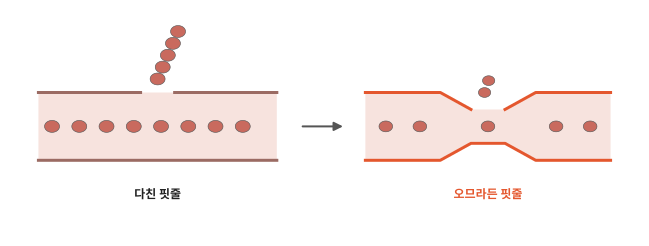
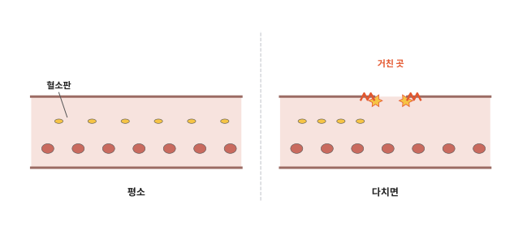
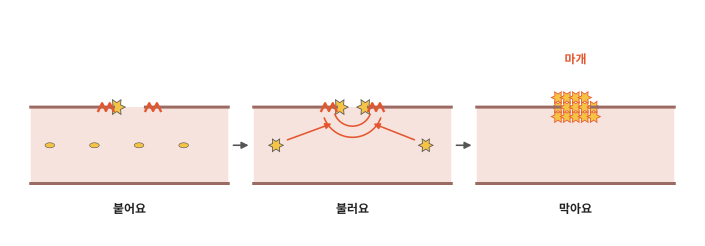
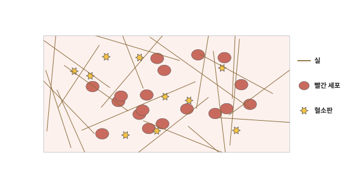
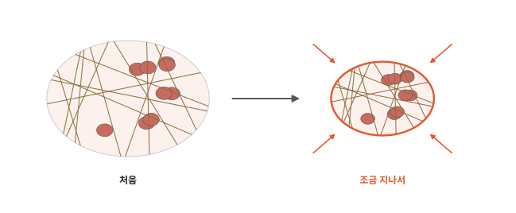
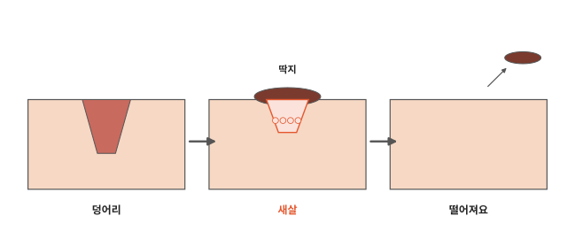

# 피가 멈추는 과정: 혈소판 마개에서 딱지까지

종이를 넘기다가 손가락이 살짝 베이면 따끔하면서 피가 몽글 맺혀요. 그런데 조금 지나면 피가 더 나오지 않아요. 이 글을 읽고 나면 핏줄에 구멍이 났을 때 몸이 피를 멈추는 순서를 알게 돼요. [5편](05-heart.md)에서 본 심장은 쉬지 않고 피를 밀어요. 그런데도 작은 상처로 피가 다 새어 나가지 않는 까닭이 여기에 있어요.

!!! abstract "이 글에서 알게 되는 것"
    1. 핏줄이 다치면 먼저 벽이 오므라들어 피가 덜 나와요. 이어서 혈소판이라는 작은 조각이 다친 곳에 달라붙고 서로 불러 모여서 구멍을 막아요.
    2. 피 속에 녹아 있던 재료가 가는 실로 바뀌어 마개를 그물처럼 감싸요. 그물에 빨간 세포가 걸리고 그물이 오므라들면서 덩어리가 단단해져요.
    3. 피부 밖으로 나온 덩어리는 말라서 딱지가 되고 그 아래에서 새살이 차요. 이 일은 모두 다친 곳에서만 일어나요.

## 1. 다친 핏줄은 먼저 오므라들어서 피가 덜 나와요

종이에 베인 손가락으로 돌아가 볼게요. 종이 날이 피부 속 핏줄 벽을 찢으면 그 틈으로 피가 새어 나와요. 심장이 피를 계속 밀고 있으니 가만두면 피는 계속 나오겠죠. 몸은 이 구멍을 몇 단계에 걸쳐 막아요.

첫 단계는 핏줄이 좁아지는 거예요. 조금 굵은 핏줄은 벽에 근육이 있어요. 이런 핏줄이 다치면 다친 벽의 근육이 오므라들어요. 아래 그림에서 왼쪽과 오른쪽 핏줄의 구멍으로 빠져나가는 빨간 세포 수를 세어 보세요.

**그림 1.** 핏줄 벽이 오므라들면 길이 좁아져서 구멍으로 빠져나가는 피가 줄어요.
{ .fig-cap }

빠져나가는 빨간 세포가 왼쪽은 다섯 개, 오른쪽은 두 개예요. 하지만 막힌 건 아니어서 피는 아직 새어 나와요. 아주 가는 실핏줄은 벽에 근육이 없어서 오므라들지도 못해요. 구멍을 막아 줄 것이 따로 있어야 해요.

## 2. 혈소판이 다친 곳의 거친 벽에 달라붙어요

[4편](04-blood.md)에서 피를 기계로 돌리면 아주 얇은 흰 층이 생긴다고 했어요. 그 안에 피가 날 때 구멍을 막는 작은 조각이 들어 있어요. 이 조각을 **혈소판**이라고 해요. 혈소판은 큰 세포에서 떨어져 나온 조각이라서 세포라고 부르지 않아요. 빨간 세포보다도 작아요.[^plt]

평소에 혈소판은 매끈한 모양으로 핏줄 속을 떠다녀요. 핏줄 안쪽 벽은 혈소판이 붙지 않게 막아 줘요. 그런데 핏줄이 찢어지면 매끈한 안쪽 벽 아래에 있던 거친 부분이 드러나요. 벽지가 찢어지면 그 아래 거친 벽이 보이는 것과 비슷해요.

아래 그림에서 평소와 다쳤을 때 혈소판 모양을 비교해 보세요.

**그림 2.** 평소에는 매끈하게 떠다니던 혈소판이 다친 곳의 거친 벽에 닿으면 뾰족하게 바뀌어 달라붙어요.
{ .fig-cap }

그림 2 오른쪽에서 거친 곳에 붙은 혈소판은 별처럼 뾰족해요. 혈소판은 거친 곳에 닿으면 이렇게 모양이 바뀌고 끈적해져서 그 자리에 붙어 있어요.[^hemo]

## 3. 붙은 혈소판이 다른 혈소판을 불러 마개를 만들어요

혈소판 한두 개로는 구멍을 다 막지 못해요. 그래서 달라붙은 혈소판은 작은 신호를 내보내요. "여기야!" 하고 부르는 거예요. 지나가던 다른 혈소판이 이 신호를 알아채고 와서 붙어요. 새로 붙은 혈소판도 신호를 내서 또 다른 혈소판을 불러요.

아래 그림을 왼쪽부터 차례로 보세요. 구멍에 붙은 혈소판 수가 어떻게 늘어나는지 보면 돼요.

**그림 3.** 붙은 혈소판이 다른 혈소판을 불러 모아서 혈소판 무더기가 구멍을 덮어요.
{ .fig-cap }

부르고 붙기가 되풀이되면 혈소판이 수북이 쌓여 구멍을 덮어요. 구멍을 막는 이 무더기를 혈소판 마개라고 해요. 마개는 병 입구를 막는 뚜껑을 떠올리면 돼요.

둑에 구멍이 나면 사람들이 모래주머니를 날라 와 막아요. 혈소판에게는 날라 줄 사람이 없어요. 서로 불러서 모여요.

## 4. 가는 실이 그물을 쳐서 마개를 단단하게 굳혀요

혈소판 마개는 아직 무르고 약해요. 심장이 밀어 보내는 피가 세게 부딪히면 떨어져 나갈 수 있어요. 그래서 몸은 마개를 단단하게 굳혀요.

피 속 물에는 실의 재료가 눈에 안 보이게 녹아 있어요. 다친 곳에서는 이 재료가 아주 가는 실로 바뀌어요. 달걀흰자를 익히면 흐르던 것이 하얗게 굳죠. 피가 굳는 방법은 달걀과 다르지만 흐르던 것이 굳은 것으로 바뀐다는 점은 같아요. 이 실들이 마개 둘레에 그물처럼 얽혀요.

아래 그림에서 실 사이에 무엇이 걸려 있는지 보세요.

**그림 4.** 실 그물 사이사이에 빨간 세포와 혈소판이 걸려 있어요.
{ .fig-cap }

그물에 빨간 세포와 혈소판이 걸리면서 붉은 덩어리가 돼요. 상처에서 보이는 검붉은 덩어리가 이것이에요.

시간이 조금 지나면 덩어리가 한 번 더 바뀌어요. 마개 속 혈소판이 실을 잡아당겨서 그물이 오므라들어요. 아래 그림에서 처음 덩어리와 조금 지난 덩어리의 크기를 비교해 보세요.

**그림 5.** 그물이 오므라들면 덩어리가 작고 단단해져요.
{ .fig-cap }

작아진 만큼 덩어리는 더 단단해져요. 덩어리에 붙어 있던 상처 가장자리도 서로 당겨져요.[^hemo]

여기서 걱정이 하나 생길 거예요. 피가 이렇게 잘 굳는다면 다치지 않은 핏줄 속에서도 굳어 버리지 않을까요? 그러면 피가 핏줄을 막아서 돌지 못해요. 몸은 피가 다친 곳에서만 굳도록 해요. 그림 2를 다시 보세요. 혈소판이 달라붙는 거친 곳은 핏줄이 찢어진 곳에만 드러나요. 안 다친 벽은 매끈해서 혈소판이 붙지 않아요. 그래서 붙기도, 실이 생기기도 다친 곳에서 시작해요.

## 5. 덩어리는 딱지가 되고 그 아래에서 새살이 차요

피가 멈춰도 상처는 아직 벌어져 있어요. 피부 바깥으로 나온 덩어리는 공기를 만나 마르면서 딱딱해져요. 이것이 **딱지**예요.

딱지 아래에서는 상처를 고치는 일이 이어져요. [1편](01-cells.md)에서 세포는 둘로 나뉘어 늘어난다고 했어요. 상처 둘레의 세포가 나뉘고 옮겨 가서 빈자리를 조금씩 채워요. 딱지는 그동안 상처를 덮어 주는 뚜껑 노릇을 해요.

아래 그림을 왼쪽부터 차례로 보세요. 가운데 그림에서 딱지 아래 빨간 테두리로 그린 곳이 새살이에요.

**그림 6.** 딱지가 덮고 있는 동안 아래에서 새살이 차오르고 다 차면 딱지가 떨어져요.
{ .fig-cap }

새살이 다 차오르면 딱지는 저절로 떨어져요. 딱지를 일부러 떼면 아직 덜 찬 상처가 다시 드러나요.

피부 속 다친 핏줄 안에도 덩어리가 생겨서 구멍을 막고 있어요. 이 덩어리는 핏줄이 다 나으면 천천히 녹아 없어져요. 둑의 모래주머니는 사람이 치워야 하지만 몸은 상처를 고친 뒤 마개도 스스로 치워요.

이미 생긴 작은 상처가 있다면 딱지가 떨어질 때까지 지켜볼 수 있어요. 일부러 상처를 내지는 않아요.

1. 날마다 같은 때에 딱지의 색과 크기를 살펴서 적어요.
2. 딱지는 떼지 말고 그대로 둬요. 며칠째에 저절로 떨어지는지 적어요.
3. 딱지가 떨어진 자리의 피부 색이 둘레와 같은지 봐요.

상처가 아프면 어른에게 말해요.

## 정리

종이에 베인 손가락에서 피가 멈추기까지 몸은 네 가지 일을 해요. 먼저 다친 핏줄의 벽이 오므라들어 피가 덜 나와요. 그다음 혈소판이 다친 곳의 거친 벽에 달라붙고 서로 불러 모여서 마개를 만들어요. 피 속에 녹아 있던 재료는 가는 실로 바뀌어 마개를 그물처럼 감싸요. 그물에 빨간 세포가 걸리고 그물이 오므라들면서 덩어리가 단단해져요.

피부 밖으로 나온 덩어리는 말라서 딱지가 되고 그 아래에서 새살이 차요. 새살이 다 차면 딱지가 떨어지고 핏줄 속 덩어리도 녹아 없어져요. 이 모든 일은 거친 벽이 드러난 다친 곳에서만 일어나요.

상처가 낫는 동안에도 세포는 쉬지 않고 일해요. 세포가 일하면 열도 생겨요. 몸이 그 열을 어떻게 다루는지는 [7편](07-sweat.md)에서 볼게요.

### 새로 나온 말

- **혈소판**: 피 속에 떠다니는 아주 작은 조각. 큰 세포에서 떨어져 나왔고 다친 곳에 달라붙어 서로 불러 모여요.
- **혈소판 마개**: 혈소판이 수북이 쌓여 핏줄 구멍을 막은 무더기. 처음에는 무르고 약해요.
- **딱지**: 피부 밖으로 나온 피 덩어리가 말라서 굳은 것. 그 아래에서 새살이 차는 동안 상처를 덮어 줘요.

[^hemo]: OpenStax, *Anatomy and Physiology 2e*, 18.5 ["Hemostasis"](https://openstax.org/books/anatomy-and-physiology-2e/pages/18-5-hemostasis).
[^plt]: OpenStax, *Anatomy and Physiology 2e*, 18.4 ["Leukocytes and Platelets"](https://openstax.org/books/anatomy-and-physiology-2e/pages/18-4-leukocytes-and-platelets).
