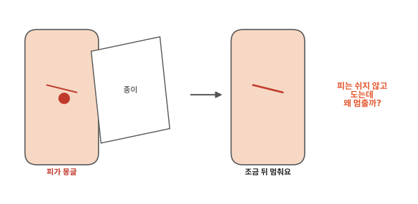
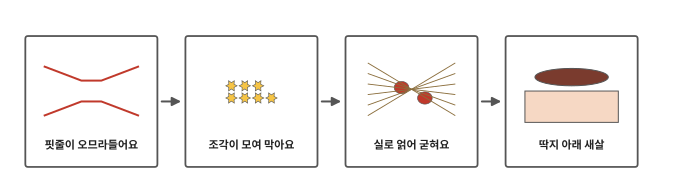
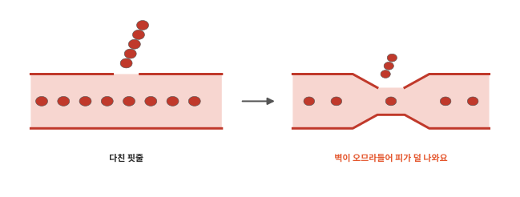
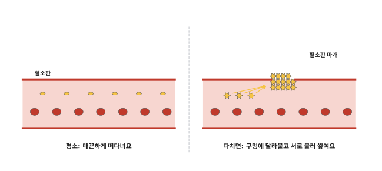
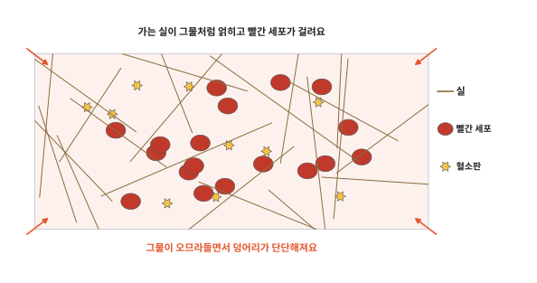
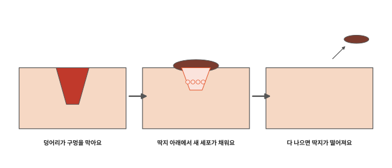

# 다치면 피는 어떻게 멈출까요?

## 종이에 베인 손가락

종이를 넘기다가 손가락이 살짝 베이면 따끔하면서 피가 몽글 맺혀요. 그런데 조금 지나면 피가 더 나오지 않아요.

[4편](04-blood.md)과 [5편](05-heart.md)에서 피는 심장이 밀어서 쉬지 않고 돈다고 했어요. 그렇다면 핏줄에 구멍이 났는데 피는 왜 계속 새지 않을까요?

## 다친 곳에서 피가 멈추기까지

인체 여섯 번째 편이에요. 다친 곳에서 피가 멈추기까지 몸이 하는 일을 순서대로 봐요.

## 핏줄이 오므라들어요

조금 굵은 핏줄은 벽에 근육이 있어요. 이런 핏줄이 다치면 다친 벽이 "아야!" 하고 알려요. 그러면 벽의 근육이 오므라들어요. 길이 좁아지니 구멍으로 빠져나가는 피가 줄어요. 아주 가는 실핏줄은 벽에 근육이 없어서 이 일을 하지 못해요.

그래도 피는 아직 새어 나와요. 구멍을 막아 줄 무언가가 있어야 해요.

## 조각이 모여 막아요

[4편](04-blood.md)에서 피를 기계로 돌리면 아주 얇은 흰 층이 생긴다고 했어요. 그 안에 피가 날 때 구멍을 막는 작은 조각이 들어 있다고 했지요. 이 조각을 **혈소판**이라고 해요. 혈소판은 빨간 세포보다 작은 조각이에요.

평소에 혈소판은 핏줄 속을 매끈한 모양으로 떠다녀요. 핏줄 안쪽 벽은 혈소판이 붙지 않게 막아 줘요.

핏줄이 찢어지면 매끈한 안쪽 벽 아래에 있던 거친 부분이 드러나요. 매끈한 벽지가 찢어지면 거친 벽이 보이는 것과 비슷해요. 혈소판이 이 거친 곳에 닿으면 달라붙어요. 그리고 모양이 뾰족뾰족하게 바뀌면서 끈적해져요.

달라붙은 혈소판은 다른 혈소판이 알아채는 작은 신호를 내보내요. "여기야!" 하고 부르는 것과 같아요. 그러면 지나가던 다른 혈소판도 와서 붙어요. 붙은 혈소판이 또 다른 혈소판을 불러요. 혈소판이 수북이 쌓여 구멍을 막는 마개가 돼요. 마개는 구멍을 막는 뚜껑이에요.

둑에 구멍이 나면 사람들이 모래주머니를 날라 와 막아요. 혈소판에게는 날라 줄 사람이 없어요. 서로 불러서 모여요.

## 실로 얽어 굳혀요

혈소판 마개는 아직 무르고 약해요. 피가 세게 밀면 떨어져 나갈 수 있어요. 그래서 몸은 마개를 단단하게 굳혀요.

피 속 물에는 실의 재료가 눈에 안 보이게 녹아 있어요. 다친 곳에서는 이 재료가 아주 가는 실로 바뀌어요. 달걀흰자가 익으면 하얗게 굳는 것처럼 흐르던 것이 굳은 실로 바뀌어요. 피가 굳는 방법은 달걀과 다르지만 이 점은 비슷해요. 실들이 마개 둘레에 그물처럼 얽혀요. 그물에 빨간 세포와 혈소판이 걸리면서 붉은 덩어리가 돼요.

시간이 조금 지나면 마개의 혈소판이 실을 잡아당겨서 그물이 오므라들어요. 덩어리가 더 단단해지고 상처 가장자리도 서로 당겨져요.

몸은 피가 다친 곳에서만 굳도록 해요. 다치지 않은 핏줄에서 피가 굳으면 피가 돌지 못하니까요. 혈소판이 달라붙는 거친 곳은 다친 곳에만 드러나서 굳는 일도 거기서 시작돼요.

## 딱지 아래 새살

피가 멈춘 뒤에도 상처는 아직 그대로예요. 피부 바깥에 나온 덩어리는 공기를 만나 마르면서 딱딱해져요. 이것이 딱지예요.

딱지 아래에서는 상처를 고치는 일이 계속돼요. [1편](01-cells.md)에서 세포가 둘로 나뉘어 늘어난다고 했지요. 상처 둘레의 세포가 나뉘고 옮겨 가서 빈자리를 조금씩 채워요. 딱지는 그동안 상처를 덮어 주는 뚜껑 노릇을 해요.

새살이 다 차오르면 딱지는 저절로 떨어져요.

피부 속 다친 핏줄 안에도 덩어리가 생겨 구멍을 막고 있어요. 이 덩어리는 핏줄이 다 나으면 천천히 녹아 없어져요. 둑의 모래주머니는 사람이 치워야 하지만 몸은 상처를 고친 뒤 마개도 스스로 치워요.

상처가 낫는 동안에도 세포는 쉬지 않고 일해요. 세포가 일하면 열도 생겨요. 몸은 그 열을 어떻게 다룰까요? 다음 편에서 볼게요.

## 정리

- 혈소판: 피 속의 아주 작은 조각이에요. 다친 곳에 달라붙고 서로 불러 모여서 구멍을 막아요.
- 피가 멈추는 순서: 핏줄이 오므라들어요. 혈소판이 마개를 만들어요. 가는 실이 그물을 쳐서 덩어리를 굳혀요. 덩어리가 마르면 딱지가 돼요. 그 아래에서 새살이 차요.

## 해 보기: 딱지 일기

이미 생긴 작은 상처가 있을 때만 해요. 일부러 상처를 내지 않아요.

1. 날마다 같은 때에 딱지를 살펴보세요. 색이 어떤지, 크기가 어떤지 적어 봐요.
2. 딱지는 일부러 떼지 말고 그대로 둬요. 며칠째에 저절로 떨어지는지 적어 봐요.
3. 딱지가 떨어진 자리의 피부 색은 둘레와 같나요, 다른가요?

상처가 아프면 어른에게 말해요.

## 확인 문제

??? question "1. 혈소판이 하는 일"
    피 속의 혈소판은 다친 곳에서 무엇을 할까요?

    **풀이**: 다친 곳에 달라붙고 끈적해져요. 다른 혈소판을 불러 모아 함께 구멍을 막아요.

??? question "2. 그물의 쓰임"
    혈소판 마개 둘레에 가는 실이 그물처럼 얽히는 까닭은 무엇일까요?

    **풀이**: 혈소판 마개는 무르고 약해요. 실 그물에 빨간 세포와 혈소판이 걸리면서 덩어리가 단단해져요.

??? question "3. 다치지 않은 곳에서는"
    피가 다치지 않은 핏줄 속에서도 굳으면 어떻게 될까요?

    **풀이**: 피가 핏줄을 막아서 잘 돌지 못해요. 그래서 몸은 피가 다친 곳에서만 굳도록 해요.

!!! abstract "어른을 위한 정리 (건너뛰어도 돼요)"
    - 지혈은 세 단계로 설명돼요. 혈관 수축(혈관 벽 민무늬근이 강하게 수축), 혈소판 마개 형성, 혈액 응고예요. 실제로는 서로 겹쳐 일어나요. 혈관 수축은 벽에 민무늬근이 있는 혈관(세동맥 이상)에서 일어나고 모세혈관에는 해당하지 않아요.[^hemo]
    - 혈소판은 손상으로 드러난 콜라겐과 내피에 달라붙어 가시 돋친 모양으로 바뀌고 끈적해져요. ADP 같은 물질을 내보내 다른 혈소판을 더 붙게 해요. 본문의 "작은 신호"는 ADP 같은 물질이에요. 손상되지 않은 내피는 혈소판이 붙지 않게 하는 물질을 내요.[^hemo]
    - 응고 단계에서는 혈장 속 피브리노겐이 피브린 실로 바뀌어 그물을 만들고 혈소판과 혈구가 그 안에 갇혀요. 이어 혈병 수축으로 피브린 실이 당겨지며 덩어리가 단단해져요. 혈관이 나으면 섬유소 용해(fibrinolysis)로 덩어리가 서서히 분해돼요. 드물게 손상되지 않은 혈관 안에서도 덩어리(혈전)가 생길 수 있어요.[^hemo]
    - 혈소판은 거핵세포라는 큰 세포에서 떨어져 나온 세포질 조각이에요. 지름 2~4마이크로미터예요. 혈액 1마이크로리터에 대개 15만~16만 개쯤 있고 약 10일 동안 살아요.[^plt]
    - 피부 상처에서는 혈병이 딱지가 돼요. 섬유모세포가 콜라겐을 쌓아 육아 조직을 만들어 손상된 조직을 고쳐요. 상처가 깊으면 흉터가 남을 수 있어요.[^skin] 해 보기는 이미 생긴 상처를 지켜보는 관찰로만 두었어요.

## 더 깊이

??? info "멍은 왜 생길까"
    부딪히면 피부는 찢어지지 않아도 그 아래 가는 핏줄이 터질 수 있어요. 새어 나온 피가 피부 밖으로 나가지 못하고 아래에 고이면 멍이 돼요. 그 피도 시간이 지나면 몸이 조금씩 치워요.

??? info "혈소판은 왜 조각이라고 부를까"
    혈소판은 큰 세포에서 떨어져 나온 작은 조각이에요. 그래서 이 편에서도 세포라고 부르지 않고 조각이라고 불렀어요.

[^hemo]: OpenStax, *Anatomy and Physiology 2e*, 18.5 ["Hemostasis"](https://openstax.org/books/anatomy-and-physiology-2e/pages/18-5-hemostasis).
[^plt]: OpenStax, *Anatomy and Physiology 2e*, 18.4 ["Leukocytes and Platelets"](https://openstax.org/books/anatomy-and-physiology-2e/pages/18-4-leukocytes-and-platelets).
[^skin]: OpenStax, *Anatomy and Physiology 2e*, 5.4 ["Diseases, Disorders, and Injuries of the Integumentary System"](https://openstax.org/books/anatomy-and-physiology-2e/pages/5-4-diseases-disorders-and-injuries-of-the-integumentary-system).
