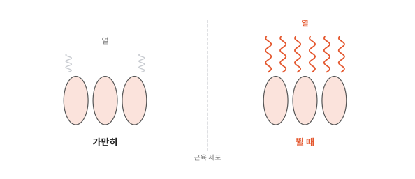
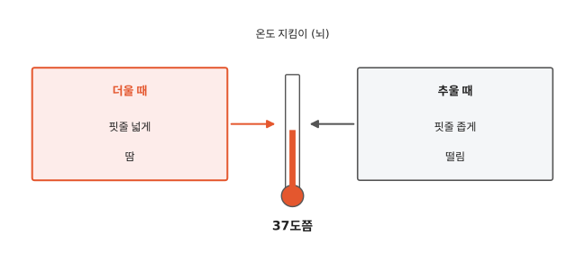
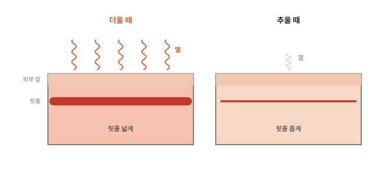
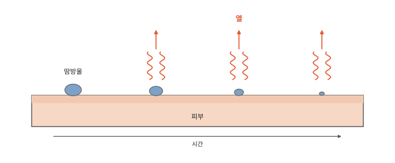
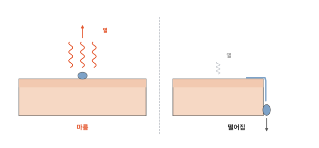
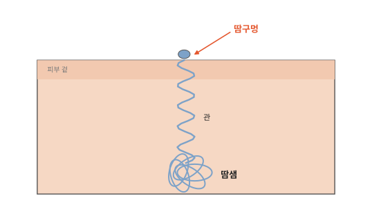
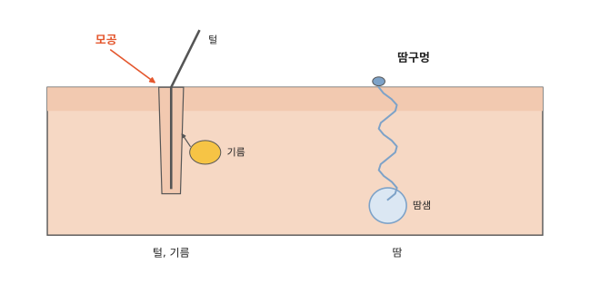

# 땀: 몸이 열을 식히는 방법

운동장을 한 바퀴 뛰고 나면 얼굴이 빨개져요. 이마에는 땀이 송골송골 맺혀요. 이 글을 읽고 나면 뛸 때 몸에서 열이 나는 까닭과 몸이 그 열을 식히는 방법을 알게 돼요. 땀이 피부 어디로 나오는지도 따라가 봐요. 이걸 알면 부채질이 시원한 까닭과 습한 날이 더 덥게 느껴지는 까닭을 스스로 설명할 수 있어요.

!!! abstract "이 글에서 알게 되는 것"
    1. 세포는 일할 힘을 만들 때 열도 함께 만들어요. 뛰면 근육 세포가 일을 많이 해서 열이 훨씬 많이 나요.
    2. 뇌가 체온을 37도쯤으로 지켜요. 더우면 피부 핏줄을 넓히고 땀을 내요. 추우면 핏줄을 좁히고 몸을 떨어요.
    3. 땀은 땀구멍으로 나와서 피부 위에서 마를 때 열을 가져가요. 털과 기름은 땀구멍과 다른 구멍인 모공으로 나와요.

## 1. 뛰면 근육 세포가 열을 많이 만들어요

[6편](06-clotting.md)에서는 다친 곳에서 피가 멈추는 과정을 봤어요. 이번에는 운동장을 뛰고 난 몸을 따라가요. 먼저 몸이 왜 후끈해지는지부터 볼게요.

[1편](01-cells.md)에서 세포는 영양과 산소로 일할 힘을 만든다고 했어요. 세포가 힘을 만들 때는 열도 함께 생겨요. 몸속 세포는 쉬지 않고 일해요. 그래서 우리 몸은 가만히 있을 때도 늘 따뜻해요.

뛸 때는 다리와 팔의 근육 세포가 일을 훨씬 많이 해요. 아래 그림에서 왼쪽과 오른쪽 세포 위로 올라가는 물결선 수를 비교해 보세요.

**그림 1.** 뛸 때는 근육 세포가 일을 많이 해서 가만히 있을 때보다 열이 훨씬 많이 나요.
{ .fig-cap }

물결선이 열이에요. 가만히 있을 때는 두 줄인데 뛸 때는 여섯 줄이에요. 뛰고 나서 몸이 후끈한 건 이 열 때문이에요.

여기서 이런 생각이 들 거예요. 열이 이렇게 자꾸 생기면 몸이 점점 뜨거워지지 않을까요? 몸은 그렇게 두지 않아요.

## 2. 뇌가 체온을 37도쯤으로 지켜요

우리 몸속 온도를 **체온**이라고 해요. 체온은 여름에도 겨울에도 37도쯤이에요.[^heat] 몸은 이 온도에서 일을 가장 잘해요.

체온을 늘 비슷하게 지키는 곳은 뇌에 있어요. 이름은 시상하부인데 이 글에서는 온도 지킴이라고 부를게요. 에어컨이 정해 둔 온도를 지키는 것처럼 온도 지킴이도 37도쯤을 정해 두고 체온을 살펴요. 아래 그림에서 온도계 양쪽 상자를 보세요.

**그림 2.** 온도 지킴이는 더울 때와 추울 때 서로 반대 일을 시켜서 체온을 37도쯤에 맞춰요.
{ .fig-cap }

몸이 더워지면 온도 지킴이는 피부 핏줄을 넓히고 땀을 내라고 시켜요. 몸이 추워지면 핏줄을 좁히고 몸을 떨게 해요. 운동장을 뛴 몸은 더운 쪽이에요. 왼쪽 상자의 두 가지가 무슨 일을 하는지 하나씩 볼게요.

## 3. 피부 핏줄이 넓어지면 열이 빠져나가요

먼저 핏줄이에요. [4편](04-blood.md)에서 피는 온몸을 돈다고 했어요. 피는 돌면서 몸속의 열도 함께 날라요. 몸속에서 데워진 피가 피부 가까이 오면 그 열이 피부 밖으로 빠져나가요.

아래 그림은 피부를 잘라 옆에서 본 모습이에요. 두 그림에서 피부 아래 핏줄 굵기와 피부 위로 나가는 물결선을 비교해 보세요.

**그림 3.** 더울 때는 핏줄이 넓어져서 열이 많이 빠져나가고 추울 때는 좁아져서 열이 덜 빠져나가요.
{ .fig-cap }

더울 때는 핏줄이 넓어져서 따뜻한 피가 피부 쪽으로 많이 와요. 그만큼 열도 많이 빠져나가요. 뛰고 나서 얼굴이 빨개지는 게 이때예요. 피부 가까이 피가 많이 와서 붉게 보이는 거예요.

추울 때는 반대로 핏줄이 좁아져요. 피부 쪽으로 오는 피가 줄어서 열이 덜 빠져나가요. 대신 손끝이 하얗고 차가워지기도 해요. 그래도 추우면 근육이 저절로 덜덜 떨려요. 떨리는 근육 세포가 일을 하니까 1절에서 본 것처럼 열이 생겨요.

다시 뛴 몸으로 돌아올게요. 얼굴이 빨개질 무렵 땀도 나기 시작해요. 땀은 열을 어떻게 덜어 낼까요?

## 4. 땀은 피부 위에서 마를 때 열을 가져가요

땀은 대부분 물이에요. 소금도 조금 들어 있어서 땀이 마른 자리에 하얀 소금기가 남기도 해요.

수영장에서 나오면 몸에 묻은 물이 마르면서 으슬으슬 추워지죠. 물은 마를 때 둘레의 열을 가져가요. 피부 위의 땀도 마찬가지예요. 아래 그림에서 땀방울이 작아지는 동안 위로 올라가는 물결선을 보세요.

**그림 4.** 땀방울이 마르면서 피부의 열을 가지고 공기로 날아가요.
{ .fig-cap }

땀방울이 마르는 동안 피부의 열이 땀과 함께 날아가요. 그래서 피부가 식고 몸이 식어요.

땀이 열을 가져가는 건 피부 위에서 마를 때예요. 이마에서 뚝뚝 흘러 바닥에 떨어진 땀은 열을 거의 가져가지 못해요. 아래 그림에서 두 땀방울을 비교해 보세요.

**그림 5.** 피부 위에서 마른 땀은 열을 가져가고 흘러 떨어진 땀은 열을 거의 가져가지 못해요.
{ .fig-cap }

그래서 땀을 빨리 말릴수록 시원해요. 바람이 불거나 부채질을 하면 땀이 더 빨리 말라요. 반대로 공기에 물기가 많은 습한 날에는 땀이 잘 마르지 않아요. 땀이 흘러내리기만 해서 열을 덜 가져가요. 그래서 더 덥고 끈적하게 느껴져요.

집에서 해 볼 수도 있어요. 두 손등에 물을 똑같이 살짝 바르고 한쪽 손등에만 부채질을 해 보세요. 어느 쪽이 더 시원한지 보고 어느 쪽 물이 먼저 마르는지도 보세요.

## 5. 땀은 땀구멍으로, 털과 기름은 모공으로 나와요

땀이 몸을 식히려면 먼저 피부 위로 나와야 해요. 땀은 어디서 만들어져서 어디로 나올까요?

땀은 피부 속 깊은 곳에 있는 작은 덩어리에서 만들어져요. 이 덩어리를 **땀샘**이라고 해요.[^acc] 땀샘에서 가는 관이 피부 겉까지 올라가요. 아래 그림에서 땀샘부터 관을 따라 피부 겉까지 올라가 보세요.

**그림 6.** 땀샘에서 만든 땀이 가는 관을 따라 올라와 땀구멍으로 나와요.
{ .fig-cap }

관이 피부 겉에 열린 아주 작은 구멍을 **땀구멍**이라고 해요. 너무 작아서 눈으로는 잘 안 보여요. 땀구멍은 손바닥, 발바닥, 이마에 특히 많아요. 운동장을 뛰고 나서 이마에 맺힌 땀도 이 땀구멍으로 나온 거예요.

피부에는 다른 구멍도 있어요. 털이 나오는 구멍이에요. 아래 그림에서 왼쪽 구멍과 오른쪽 구멍으로 무엇이 나오는지 보세요.

**그림 7.** 왼쪽 모공으로는 털과 기름이 나오고 오른쪽 땀구멍으로는 땀이 나와요.
{ .fig-cap }

털이 나오는 구멍을 **모공**이라고 해요. 몸 곳곳의 가는 털은 모두 모공에서 나와요. 모공 옆에는 기름이 나오는 곳이 붙어 있어요. 기름은 털을 따라 피부 위로 나와요. 이 기름이 피부와 털을 매끄럽게 하고 물이 잘 스미지 않게 해 줘요.

## 정리

몸속 세포는 일할 힘을 만들 때 열도 함께 만들어요. 운동장을 뛰면 근육 세포가 일을 많이 해서 열이 훨씬 많이 나요.

뇌의 온도 지킴이는 체온을 37도쯤으로 지켜요. 더우면 피부 핏줄을 넓혀서 열을 피부 밖으로 내보내요. 뛰고 나서 얼굴이 빨개지는 게 이 때문이에요. 땀도 내요. 추우면 반대로 핏줄을 좁혀 열을 지키고 몸을 떨어서 열을 만들어요.

땀은 땀샘에서 만들어져 땀구멍으로 나와요. 피부 위에서 마를 때 열을 가져가서 몸을 식혀요. 흘러 떨어진 땀은 열을 거의 가져가지 못해서 부채질로 땀을 빨리 말리면 더 시원해요. 털과 기름은 땀구멍과 다른 구멍인 모공으로 나와요.

손톱과 머리카락도 피부에서 자라요. 그런데 잘라도 아프지 않아요. 그 까닭은 [8편](08-nails-hair.md)에서 볼게요.

### 새로 나온 말

- **체온**: 몸속 온도. 사람은 여름에도 겨울에도 37도쯤을 지켜요.
- **온도 지킴이(시상하부)**: 체온을 살피는 뇌의 한 곳. 뛰어서 더워진 몸에는 핏줄을 넓히고 땀을 내라고 시켜요.
- **땀샘**: 피부 속 깊은 곳에서 땀을 만드는 작은 덩어리. 가는 관이 피부 겉까지 이어져요.
- **땀구멍**: 땀샘의 관이 피부 겉에 열린 아주 작은 구멍. 이마에 특히 많아요.
- **모공**: 털이 나오는 구멍. 피부와 털을 매끄럽게 하는 기름도 여기로 나와요.

[^heat]: OpenStax, *Anatomy and Physiology 2e*, 24.6 ["Energy and Heat Balance"](https://openstax.org/books/anatomy-and-physiology-2e/pages/24-6-energy-and-heat-balance).
[^acc]: OpenStax, *Anatomy and Physiology 2e*, 5.2 ["Accessory Structures of the Skin"](https://openstax.org/books/anatomy-and-physiology-2e/pages/5-2-accessory-structures-of-the-skin).
