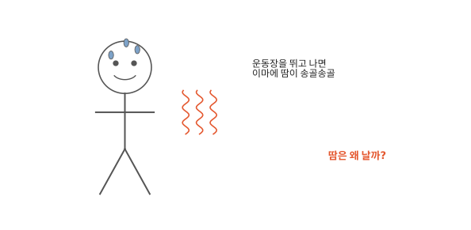
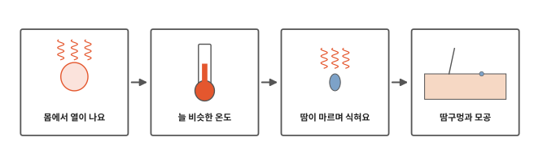
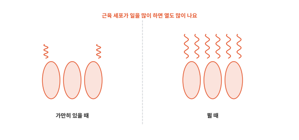
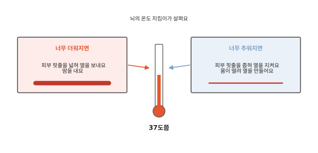
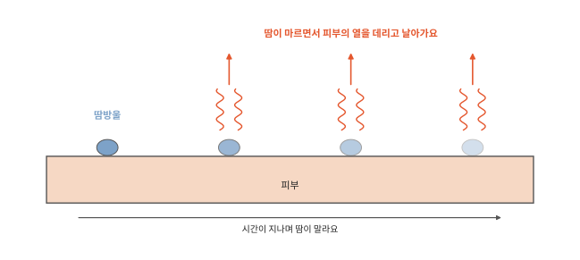
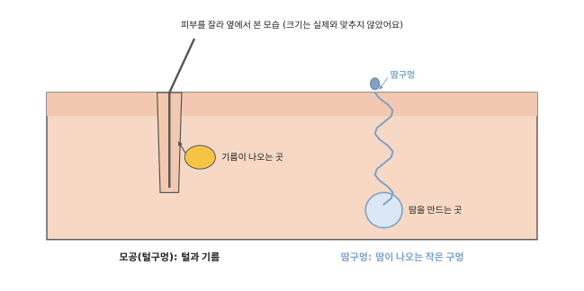

# 땀은 왜 날까요? 모공은 왜 있을까요?

## 운동장을 뛰고 나서

운동장을 신나게 뛰고 나면 이마에 땀이 송골송골 맺혀요. 얼굴도 빨개지고 몸이 후끈해요.

[6편](06-clotting.md) 끝에서 물은 질문이 이어져요. 몸은 세포가 만든 열을 어떻게 다룰까요? 땀이 그 일에서 큰 몫을 해요.

## 열에서 땀구멍까지

인체 일곱 번째 편이에요. 먼저 몸의 열이 어디서 오는지 봐요. 그다음 몸이 온도를 지키는 법과 땀이 하는 일을 봐요. 마지막으로 땀이 나오는 구멍까지 따라가 봐요.

## 몸에서 열이 나요

[1편](01-cells.md)에서 세포는 영양과 산소로 일할 힘을 만든다고 했어요. 세포가 힘을 만들 때는 열도 함께 생겨요. 몸속 세포가 쉬지 않고 일하니 우리 몸은 늘 따뜻해요.

뛰면 근육 세포가 일을 훨씬 많이 해요. 그만큼 열도 많이 생겨서 몸이 후끈해져요.

## 늘 비슷한 온도

우리 몸속 온도를 **체온**이라고 해요. 체온은 여름에도 겨울에도 늘 37도쯤이에요. 몸은 이 온도에서 일을 가장 잘해요.

뇌에는 체온을 살피는 곳이 있어요. 이 편에서는 온도 지킴이라고 부를게요. 에어컨이 정해 둔 온도를 지키는 것처럼 온도 지킴이도 체온을 지켜요. 몸이 더워지면 몸을 식히라고 시켜요. 추워지면 열을 지키라고 시켜요. 온도 지킴이는 처음부터 37도쯤에 맞춰져 있어요.

[4편](04-blood.md)에서 피는 온몸을 돈다고 했어요. 피는 몸속의 열도 함께 날라요. 몸이 더워지면 피부 가까이 있는 핏줄이 넓어져요. 따뜻한 피가 피부 쪽으로 많이 와서 열이 바깥으로 빠져나가요. 뛰고 나서 얼굴이 빨개지는 게 이때예요. 그리고 땀이 나기 시작해요.

몸이 추워지면 반대로 피부 핏줄이 좁아져요. 열이 덜 빠져나가는 대신 손끝이 하얗고 차가워지기도 해요. 그래도 추우면 근육이 저절로 덜덜 떨려요. 떨리는 근육 세포가 일을 하면서 열이 생겨요.

## 땀이 마르며 식혀요

땀은 대부분 물이에요. 소금도 조금 들어 있어서 땀이 마른 자리에 하얀 소금기가 남기도 해요.

수영장에서 나오면 몸에 묻은 물이 마르면서 으슬으슬 추워지지요. 물은 마를 때 둘레의 열을 가져가요. 땀도 피부 위에서 마르면서 피부의 열을 데리고 날아가요. 그래서 몸이 식어요.

땀은 피부 위에서 마를 때 몸을 식혀요. 흘러내려 떨어진 땀은 열을 거의 가져가지 못해요. 바람이 불거나 부채질을 하면 땀이 더 빨리 말라요.

## 땀구멍과 모공

땀은 어디로 나올까요? 땀은 피부 속 깊은 곳에서 만들어져요. 가는 관을 따라 올라와 피부 위의 아주 작은 구멍으로 나와요. 이 구멍이 땀구멍이에요. 너무 작아서 눈으로는 잘 안 보여요. 손바닥, 발바닥, 이마에 특히 많아요.

그런데 피부에는 털이 나오는 구멍도 있어요. 이 구멍이 모공이에요. 몸 곳곳의 가는 털은 모두 모공에서 나와요.

모공 옆에는 기름이 나오는 곳이 붙어 있어요. 기름은 털을 따라 피부 위로 나와요. 이 기름이 피부와 털을 매끄럽게 하고 물이 잘 묻지 않게 해 줘요.

손톱과 머리카락도 피부에서 자라요. 그런데 왜 잘라도 아프지 않을까요? 다음 편에서 볼게요.

## 정리

- 체온: 몸속 온도예요. 사람은 늘 37도쯤을 지켜요. 더우면 핏줄을 넓히고 땀을 내요. 추우면 핏줄을 좁히고 몸을 떨어요.
- 땀: 대부분 물이에요. 피부 위에서 마르면서 몸의 열을 가져가요. 땀구멍으로 나와요.
- 모공: 털이 나오는 구멍이에요. 피부와 털을 매끄럽게 하는 기름도 여기로 나와요.

## 해 보기: 물이 마르면 시원할까

1. 두 손등에 물을 똑같이 살짝 발라요.
2. 한쪽 손등에만 부채질을 해 보세요. 어느 쪽이 더 시원한가요? 어느 쪽 물이 먼저 마르나요?
3. 덤으로 해 볼 것: 제자리에서 조금 뛰기 전과 뛴 뒤에 거울로 얼굴색을 비교해 봐요. 이마를 손으로 만져 보면 땀이 났나요?

## 확인 문제

??? question "1. 몸의 열은 어디서"
    우리 몸은 왜 따뜻할까요? 뛰고 나면 왜 더 후끈해질까요?

    **풀이**: 세포가 영양과 산소로 힘을 만들 때 열도 생겨요. 뛰면 근육 세포가 일을 더 많이 해서 열도 더 많이 생겨요.

??? question "2. 땀이 몸을 식히는 방법"
    땀은 어떻게 몸을 시원하게 할까요?

    **풀이**: 땀이 피부 위에서 마르면서 피부의 열을 데리고 날아가요.

??? question "3. 추울 때"
    몸이 추워지면 몸은 어떻게 열을 지키고 만들까요?

    **풀이**: 피부 핏줄이 좁아져서 열이 덜 빠져나가요. 그래도 추우면 근육이 저절로 떨리면서 열을 만들어요.

??? question "4. 모공과 땀구멍"
    모공과 땀구멍은 어떻게 다를까요?

    **풀이**: 모공은 털이 나오는 구멍이에요. 기름도 여기로 나와요. 땀구멍은 땀이 나오는 아주 작은 구멍이에요.

!!! abstract "어른을 위한 정리 (건너뛰어도 돼요)"
    - 몸속 중심 온도는 대략 36.5~37.5도로 유지돼요. 뇌의 시상하부가 온도 조절기처럼 작동해요. 본문의 "온도 지킴이"가 시상하부예요. 대사로 만들어진 에너지의 약 60%는 열이 되어 체온을 지키는 데 쓰여요. 쉬는 동안 몸이 잃는 열은 복사가 약 60%, 대류 약 15%, 증발 약 20%, 전도 약 3%예요. 체온이 기준보다 떨어지면 시상하부가 떨림을 일으켜 열을 만들어요.[^heat]
    - 더우면 진피의 세동맥이 넓어져 피가 피부로 열을 날라요. 추우면 좁아져 열 손실을 줄여요(손가락, 발가락, 코끝에서 특히 두드러져요). 땀이 증발하면서 몸이 식어요. 눈에 띄지 않는 땀도 하루 약 500mL 나와요. 활동이 많으면 시간당 0.7~1.5L쯤 날 수 있어요.[^func] 피부 혈관 확장과 땀은 체온 조절의 음성 되먹임 예로 설명돼요.[^homeo]
    - 땀구멍으로 땀을 내는 땀샘(에크린샘)은 피부 전체에 있고 손바닥, 발바닥, 이마에 특히 많아요. 땀은 대부분 물이고 소금이 조금 들어 있어요. 털 뿌리에는 털세움근이 붙어 있어 수축하면 털이 서고 공기층을 가둬요. 사람에게는 닭살로 보여요. 피지샘은 대부분 털주머니와 함께 있고 피지를 내서 피부와 털을 매끄럽게 하고 물이 스미지 않게 해요.[^acc] 본문의 "모공"은 털주머니가 피부에 열린 곳을 말해요. 얼굴, 특히 코 둘레는 피지가 많아 모공이 눈에 띄기 쉬운 곳으로 흔히 설명돼요.

## 더 깊이

??? info "추우면 왜 닭살이 돋을까"
    털 뿌리에는 털을 세우는 아주 작은 근육이 붙어 있어요. 추우면 이 근육이 오므라들어 털이 서고 피부가 오톨도톨해져요. 털이 많은 동물은 털을 세워 털 사이에 따뜻한 공기를 가둬요. 사람은 털이 가늘고 적어서 닭살이 돋아도 큰 도움은 안 돼요.

??? info "개는 왜 혀를 내밀고 헐떡일까"
    개는 사람처럼 온몸에 땀을 내지 못해요. 대신 혀를 내밀고 헐떡이면서 입과 혀에서 물이 마르게 해 열을 버려요. 물이 마르며 열을 가져간다는 원리는 같아요.

??? info "습한 날은 왜 더 덥게 느껴질까"
    공기에 물기가 많으면 땀이 잘 마르지 않아요. 땀이 흘러내리기만 하고 열을 덜 가져가서 더 덥고 끈적하게 느껴져요.

[^heat]: OpenStax, *Anatomy and Physiology 2e*, 24.6 ["Energy and Heat Balance"](https://openstax.org/books/anatomy-and-physiology-2e/pages/24-6-energy-and-heat-balance).
[^func]: OpenStax, *Anatomy and Physiology 2e*, 5.3 ["Functions of the Integumentary System"](https://openstax.org/books/anatomy-and-physiology-2e/pages/5-3-functions-of-the-integumentary-system).
[^homeo]: OpenStax, *Anatomy and Physiology 2e*, 1.5 ["Homeostasis"](https://openstax.org/books/anatomy-and-physiology-2e/pages/1-5-homeostasis).
[^acc]: OpenStax, *Anatomy and Physiology 2e*, 5.2 ["Accessory Structures of the Skin"](https://openstax.org/books/anatomy-and-physiology-2e/pages/5-2-accessory-structures-of-the-skin).
