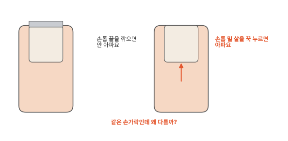
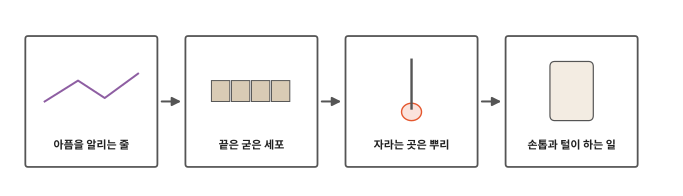
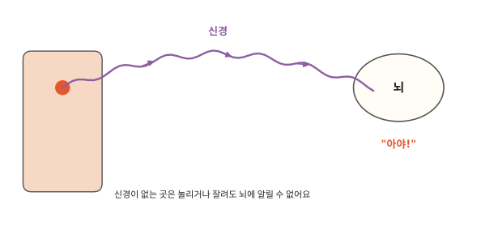
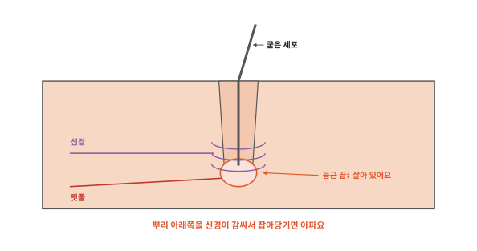
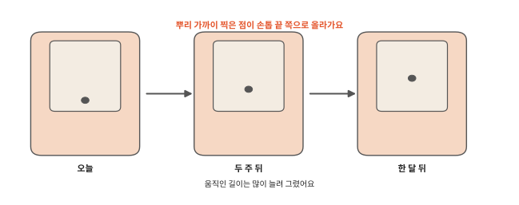

# 손톱과 머리카락은 왜 잘라도 안 아플까요?

## 손톱을 깎을 때

손톱깎이로 손톱 끝을 깎아도 하나도 안 아파요. 미용실에서 머리카락을 잘라도 아프지 않아요. 피도 나지 않아요.

그런데 손톱 밑 살을 꾹 누르면 아파요. 머리카락을 한 가닥 잡아 뽑아도 따끔해요. [7편](07-sweat.md) 끝에서 남긴 질문이 여기 있어요. 같은 손가락, 같은 머리인데 왜 어떤 때는 아프고 어떤 때는 안 아플까요?

## 아픔을 알리는 줄에서 손톱과 털이 하는 일까지

인체 여덟 번째 편이에요. 먼저 아픔을 어떻게 느끼는지 봐요. 그다음 손톱과 머리카락이 무엇으로 되어 있고 어디에서 자라는지, 왜 있는지 알아봐요.

## 아픔을 알리는 줄

몸이 아픔을 느끼려면 알림이 뇌까지 가야 해요. 손가락이 뾰족한 것에 찔리면 그 자리에서 뇌까지 알림이 전해져요. 그러면 뇌가 "아야!" 하고 느껴요.

알림이 다니는 가는 줄을 **신경**이라고 해요. [1편](01-cells.md)에서 본 신경 세포는 알림을 보내는 세포였어요. 이 세포가 길게 이어져 신경이 돼요. 신경은 피부, 근육, 뼈 둘레처럼 몸 거의 모든 곳에 뻗어 있어요.

그럼 신경이 없는 곳은 어떨까요? 눌리거나 잘려도 뇌에 알릴 수 없어요.

## 끝은 굳은 세포

손톱과 머리카락도 세포로 만들어졌어요. 그런데 우리 눈에 보이는 손톱과 머리카락의 세포는 할 일을 다 마쳤어요. 세포 속이 단단한 물질로 꽉 차서 굳어 버렸어요. 이 물질 덕분에 손톱은 단단하고 머리카락은 질겨요. 이렇게 굳은 세포는 더는 살아 있지 않아요. 목욕할 때 밀려 나오는 때처럼 몸이 다 쓰고 내보내는 부분이라 걱정할 것은 없어요.

굳은 세포 사이에는 신경도 핏줄도 들어 있지 않아요. 손톱 끝과 머리카락을 잘라도 뇌로 가는 알림이 없고 피도 나지 않아요.

손톱 밑의 살은 달라요. 손톱 아래에는 살아 있는 피부가 있어요. 거기에는 신경과 핏줄이 많아요. 손톱을 너무 짧게 깎거나 손톱 밑 살을 누르면 이 살의 신경이 뇌에 알려서 아파요. 손톱이 분홍빛으로 보이는 건 그 아래 핏줄 색이 비친 거예요.

## 자라는 곳은 뿌리

손톱과 머리카락은 피부 속에 숨은 뿌리 쪽에서 자라요. 눈에 보이는 끝은 뿌리에서 밀려 나온 거예요.

손톱의 뿌리는 손톱 뒤쪽 피부 아래에 있어요. 여기에는 살아 있는 세포가 있어요. 이 세포가 둘로 나뉘어 새 세포가 생겨요.

새 세포가 생기면 앞에 있던 세포가 앞으로 밀려나요. 밀려 나간 세포는 점점 굳어서 손톱이 돼요. 치약 튜브를 뒤에서 누르면 앞으로 치약이 나오는 것과 비슷해요. 치약과 달리 손톱은 뿌리에서 새로 만들어져요.

손톱이 자라는 속도는 아주 느려요. 손가락 손톱은 한 달에 3밀리미터쯤 자라요.[^nailrate] 자에 있는 가장 작은 눈금 세 칸만큼이에요.

머리카락도 같은 방법으로 자라요. 피부 속에 묻힌 머리카락 뿌리의 맨 아래 끝은 둥글게 부풀어 있어요. 살아 있는 세포는 이 둥근 끝에 있어요. 여기서 새 세포가 생겨 머리카락을 위로 밀어 올려요. 둥근 끝에는 핏줄이 와서 영양, 곧 세포가 쓸 힘의 재료를 줘요.

머리카락 뿌리 아래쪽은 신경이 감싸고 있어요. 그래서 머리카락을 잡아당기면 뿌리가 흔들려 따끔해요.

## 손톱과 털이 하는 일

그런데 신경도 핏줄도 없는 손톱과 털은 왜 있을까요? 손끝은 몸 끝에 있어서 자주 부딪혀요. 단단한 손톱이 손끝을 덮어 지켜 줘요. 바닥에 떨어진 작은 구슬을 집을 때도 손톱이 손끝 살을 뒤에서 받쳐 줘서 꼭 집을 수 있어요.

털도 하는 일이 있어요. 운동장을 뛰어 이마에 땀이 흐를 때 눈썹이 땀방울을 옆으로 흘려보내서 눈이 따갑지 않아요. 속눈썹과 콧속의 털은 먼지를 걸러 줘요. 피부의 가는 털은 무언가 살짝 스치면 뿌리의 신경을 건드려 그걸 느끼게 해 줘요.

손톱보다 훨씬 크고 단단해서 온몸을 받치는 것이 있어요. 바로 뼈예요. 다음 편에서는 뼈와 그 뼈를 움직이는 근육을 볼게요.

## 정리

- 신경: 아픔 같은 알림을 뇌로 전하는 가는 줄이에요. 신경이 없는 곳은 잘라도 아프지 않아요.
- 손톱과 머리카락의 보이는 부분은 굳은 세포라서 신경도 핏줄도 없어요. 자라는 곳은 피부 속 뿌리 쪽이에요. 거기 있는 살아 있는 세포가 새 세포를 만들어 앞으로 밀어내요.

## 해 보기: 손톱 점 일기

1. 어른에게 유성펜으로 손톱 뿌리 가까이에 작은 점을 찍어 달라고 하세요. 피부 말고 손톱 위에만 찍어요.
2. 자로 손톱 뿌리 쪽 피부 끝에서 점까지 길이를 재고 적어 둬요.
3. 한 달 동안 손톱을 깎지 말고 두었다가 다시 재 보세요. 점이 손톱 끝 쪽으로 올라갔나요? 잰 길이를 적어 두세요. 점이 흐려지면 같은 자리를 어른에게 덧칠해 달라고 해요.
4. 빗에 빠진 머리카락을 한 가닥 찾아 양쪽 끝을 비교해 봐요. 한쪽 끝이 조금 둥글게 부푼 것이 보이나요? 거기가 피부 속에 있던 쪽이에요. 잘 안 보이면 못 찾아도 괜찮아요.

## 확인 문제

??? question "1. 잘라도 안 아픈 까닭"
    손톱 끝을 잘라도 아프지 않은 까닭은 무엇일까요?

    **풀이**: 손톱 끝은 일을 마친 세포가 굳은 것이라 신경이 없어요. 신경이 없으면 뇌에 아픔을 알릴 수 없어요.

??? question "2. 자라는 곳"
    손톱과 머리카락은 어디에서 자랄까요?

    **풀이**: 피부 속 뿌리 쪽에서 자라요. 거기 있는 살아 있는 세포가 새 세포를 만들어 앞으로 밀어내요.

??? question "3. 머리카락을 뽑으면"
    머리카락은 잘라도 안 아픈데 뽑으면 왜 따끔할까요?

    **풀이**: 머리카락을 뽑으면 피부 속 뿌리가 당겨져요. 뿌리 아래쪽은 신경이 감싸고 있어서 아픔이 뇌로 전해져요.

??? question "4. 너무 짧게 깎으면"
    손톱을 너무 짧게 깎으면 왜 아플까요?

    **풀이**: 손톱 아래에는 살아 있는 살이 있고 거기에는 신경이 많아요. 너무 짧게 깎으면 이 살이 드러나거나 눌려서 신경이 뇌에 알려요.

!!! abstract "어른을 위한 정리 (건너뛰어도 돼요)"
    - 머리카락은 주로 죽은 각질화 세포(케라틴)로 되어 있어요. 피부 속 뿌리 부분도 대부분 그래요. 분열하는 살아 있는 세포는 털망울에 있어요. 본문의 "둥근 끝"이 털망울이에요. 털뿌리 아래 털망울의 털모세포층(hair matrix)에서 세포가 분열해 바깥으로 밀어내요. 털유두에는 모세혈관과 신경 말단이 있어요. 털주머니 바닥은 털뿌리신경얼기가 감싸요. 성장기에 머리카락은 하루 약 0.3mm 자라요. 하루 평균 50가닥쯤 빠지고 새로 나요. 털은 보호, 감각, 체온 조절, 의사 표현에 쓰여요. 눈썹은 땀이 눈에 흘러드는 것을 막고 코·귀 털과 속눈썹은 먼지를 막아요.[^acc]
    - 손톱 몸통은 촘촘히 쌓인 죽은 각질세포예요. 손톱 뿌리의 분열하는 세포층(조모)이 손톱을 계속 자라게 해요. 반달(lunula)은 조모 위 두꺼운 상피가 보이는 곳이에요. 손톱은 가장 많이 부딪히는 손끝·발끝을 보호하고 작은 물건을 집을 때 뒤에서 받쳐 줘요.[^acc]
    - 미국 젊은 성인 연구에서 손톱은 한 달 평균 3.47mm, 발톱은 1.62mm 자랐어요. 본문의 "3밀리미터쯤"은 이를 줄인 값이에요. 일주일이면 1mm에 못 미쳐서 해 보기는 한 달로 잡았어요.[^nailrate] 본문의 "자의 가장 작은 눈금 세 칸"은 1mm 눈금 기준이에요.
    - 손톱 아래 손톱바닥(조상)은 혈관이 많아 분홍빛으로 보여요.

## 더 깊이

??? info "머리카락은 왜 끝없이 길어지지 않을까"
    머리카락은 한동안 자라다가 멈춰요. 쉬었다가 빠져요. 그 자리에서 새 머리카락이 다시 자라요. 하루에도 머리카락이 몇십 가닥씩 빠져요.

??? info "발톱은 왜 손톱보다 느리게 자랄까"
    발톱은 손톱의 절반쯤 되는 속도로 자라요. 왜 느린지는 여러 가지 설명이 있지만 아직 확실하지 않아요.

[^acc]: OpenStax, *Anatomy and Physiology 2e*, 5.2 ["Accessory Structures of the Skin"](https://openstax.org/books/anatomy-and-physiology-2e/pages/5-2-accessory-structures-of-the-skin).
[^nailrate]: S. Yaemsiri, N. Hou, M. M. Slining, K. He, "Growth rate of human fingernails and toenails in healthy American young adults", *Journal of the European Academy of Dermatology and Venereology* 24(4): 420–423, 2010. [doi:10.1111/j.1468-3083.2009.03426.x](https://doi.org/10.1111/j.1468-3083.2009.03426.x).
