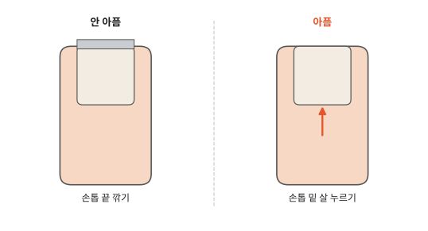
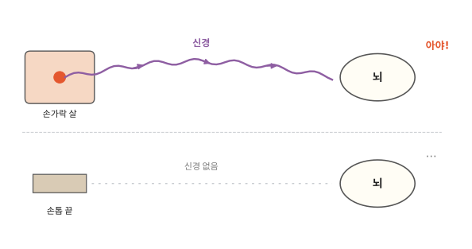
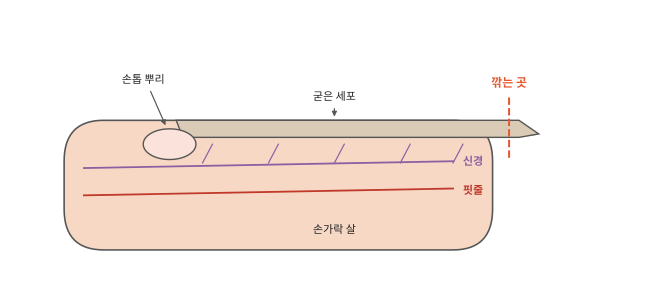
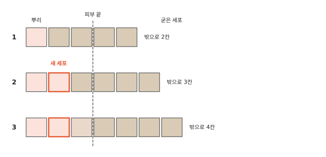
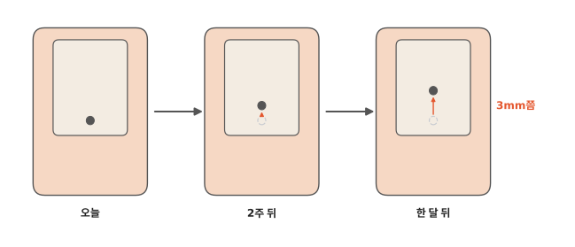
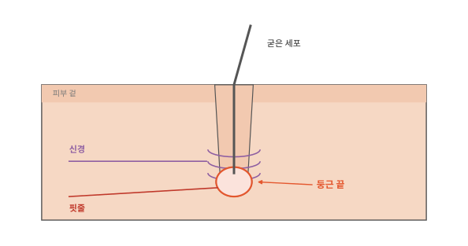
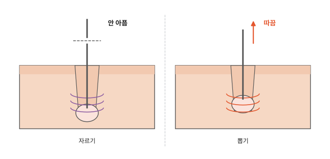

# 손톱과 머리카락: 잘라도 아프지 않은 까닭

손톱깎이로 손톱 끝을 깎아도 하나도 아프지 않아요. 그런데 손톱 밑 살을 꾹 누르면 아파요. 이 글을 읽고 나면 같은 손가락에서 왜 한 곳은 아프고 한 곳은 안 아픈지 알게 돼요. 손톱과 머리카락이 어디서 어떻게 자라는지도 함께 봐요. 이걸 알면 손톱을 너무 짧게 깎았을 때 아픈 까닭과 머리카락을 뽑을 때 따끔한 까닭을 설명할 수 있어요.

!!! abstract "이 글에서 알게 되는 것"
    1. 아픔은 신경이 뇌에 알려야 느껴요. 신경이 없는 곳은 잘려도 아프지 않아요.
    2. 눈에 보이는 손톱과 머리카락은 굳은 세포라서 신경도 핏줄도 없어요. 그래서 잘라도 아프지 않고 피도 나지 않아요.
    3. 손톱과 머리카락은 피부 속 뿌리에서 새 세포에 밀려 자라요. 손톱 밑 살과 머리카락 뿌리 둘레에는 신경이 있어서 누르거나 뽑으면 아파요.

## 1. 아픔은 신경이 뇌에 알려야 느껴요

[7편](07-sweat.md)에서 땀이 나오는 땀구멍과 털이 나오는 모공을 봤어요. 손톱과 머리카락도 피부에서 자라요. 그런데 피부와 달리 잘라도 아프지 않아요. 먼저 손톱을 깎을 때와 손톱 밑 살을 누를 때를 나란히 놓고 볼게요.

**그림 1.** 같은 손가락인데 손톱 끝을 깎으면 안 아프고 손톱 밑 살을 누르면 아파요.
{ .fig-cap }

두 곳은 한 손가락에 붙어 있는데 왜 한 곳만 아플까요? 답을 알려면 우리가 아픔을 어떻게 느끼는지부터 알아야 해요.

손가락이 뾰족한 것에 찔리면 그 자리에서 뇌까지 알림이 가요. 알림이 뇌에 닿으면 뇌가 "아야!" 하고 느껴요. 알림이 다니는 가는 줄을 **신경**이라고 해요. [1편](01-cells.md)에서 본 신경 세포는 알림을 보내는 세포였어요. 신경 세포의 긴 가지가 다발로 모여 신경이 돼요. 신경은 피부, 근육, 뼈 둘레처럼 몸 거의 모든 곳에 뻗어 있어요.

아래 그림에서 위 줄과 아래 줄을 비교해 보세요.

**그림 2.** 손가락 살은 신경이 뇌까지 알려서 아프고 신경이 없는 손톱 끝은 알릴 길이 없어요.
{ .fig-cap }

신경이 있는 곳은 찔리거나 눌리면 뇌에 알림이 가요. 신경이 없는 곳은 눌리거나 잘려도 뇌에 알릴 수 없어요. 손톱 끝을 깎아도 아프지 않으니 손톱 끝에는 신경이 없다는 걸 알 수 있어요. 왜 없는지는 손톱이 무엇으로 되어 있는지 보면 알 수 있어요.

## 2. 눈에 보이는 손톱은 굳은 세포예요

손톱도 세포로 만들어졌어요. 그런데 눈에 보이는 손톱의 세포는 할 일을 다 마쳤어요. 세포 속이 케라틴이라는 단단한 물질로 꽉 차서 굳어 버렸어요.[^acc] 이렇게 굳은 세포는 더는 살아 있지 않아요. 목욕할 때 밀려 나오는 때처럼 몸이 다 쓰고 내보내는 부분이라 걱정할 것은 없어요.

아래 그림은 손가락 끝을 옆에서 자른 모습이에요. 크기는 실제와 맞추지 않았어요. 빨간 점선 "깎는 곳"과 그 아래에 무엇이 있는지 보세요.

**그림 3.** 손톱은 굳은 세포라서 신경과 핏줄은 그 아래 손가락 살에만 있어요.
{ .fig-cap }

깎는 곳은 손가락 밖으로 나온 손톱 끝이에요. 거기에는 굳은 세포만 있고 신경도 핏줄도 없어요. 그래서 손톱 끝을 깎아도 뇌로 가는 알림이 없고 피도 나지 않아요.

손톱 밑의 살은 달라요. 손톱 아래에는 살아 있는 피부가 있고 거기에는 신경과 핏줄이 많아요. 그림에서 보라색 신경이 손톱 아래로 가지를 뻗은 곳이에요. 손톱 밑 살을 누르면 이 신경이 뇌에 알려서 아파요. 손톱을 너무 짧게 깎아도 이 살이 드러나거나 눌려서 아파요. 손톱이 분홍빛으로 보이는 것도 그 아래 핏줄 색이 비쳐서예요.

그런데 손톱이 살아 있지 않다면 어떻게 계속 자랄까요?

## 3. 손톱은 뿌리에서 새 세포에 밀려 자라요

그림 3에서 손톱 뒤쪽 피부 속에 "손톱 뿌리"가 있었어요. 손톱은 여기서 자라요. 손톱 뿌리에는 살아 있는 세포가 있고 이 세포가 둘로 나뉘어 새 세포가 생겨요.

아래 그림은 손톱을 세포 한 줄로 단순하게 그린 거예요. 1, 2, 3 줄로 내려가면서 점선 "피부 끝" 밖으로 나온 칸 수를 세어 보세요.

**그림 4.** 뿌리 옆에 새 세포가 하나 생길 때마다 앞의 세포가 한 칸씩 밀려서 피부 밖으로 나온 손톱이 2칸, 3칸, 4칸으로 늘어요.
{ .fig-cap }

새 세포가 생기면 앞에 있던 세포가 한 칸 앞으로 밀려나요. 밀려 나간 세포는 점점 굳어서 손톱이 돼요. 3줄에서 연하게 칠한 칸이 2줄의 새 세포가 굳어 가는 모습이에요. 치약 튜브 끝을 누르면 입구로 치약이 밀려 나오는 것과 비슷해요. 다른 점은 손톱은 뿌리에서 새로 만들어진다는 거예요.

손톱이 자라는 속도는 아주 느려요. 손가락 손톱은 한 달에 3밀리미터쯤 자라요.[^nailrate] 자에 있는 가장 작은 눈금 세 칸만큼이에요.

직접 확인해 볼 수 있어요. 어른에게 유성펜으로 손톱 뿌리 가까이에 작은 점을 찍어 달라고 하세요. 피부 말고 손톱 위에만 찍어요. 그리고 한 달 동안 손톱을 깎지 말고 지켜봐요. 아래 그림처럼 점이 손톱 끝 쪽으로 올라가요.

**그림 5.** 뿌리 가까이 찍은 점이 한 달 동안 3mm쯤 손톱 끝 쪽으로 올라가요. 움직인 길이는 크게 늘려 그렸어요.
{ .fig-cap }

점이 혼자 움직인 게 아니에요. 점을 찍은 손톱이 통째로 밀려 올라간 거예요. 점이 흐려지면 같은 자리를 어른에게 덧칠해 달라고 하세요.

## 4. 머리카락은 잘라도 괜찮지만 뽑으면 따끔해요

머리카락도 손톱과 같은 방법으로 자라요. 눈에 보이는 머리카락은 굳은 세포예요. 머리카락 뿌리는 피부 속에 묻혀 있고 맨 아래 끝이 둥글게 부풀어 있어요. 아래 그림에서 둥근 끝과 그 둘레를 보세요.

**그림 6.** 머리카락 뿌리의 둥근 끝에는 살아 있는 세포가 있고 뿌리 아래쪽은 신경이 감싸고 있어요.
{ .fig-cap }

살아 있는 세포는 이 둥근 끝에 있어요. 여기서 새 세포가 생겨 머리카락을 위로 밀어 올려요. 둥근 끝에는 핏줄이 와서 세포가 쓸 영양을 줘요. 그리고 뿌리 아래쪽은 보라색 신경이 감싸고 있어요.

이제 머리카락을 자를 때와 뽑을 때를 비교해 볼게요. 아래 그림에서 신경 색이 어떻게 다른지 보세요.

**그림 7.** 피부 밖에서 자르면 뿌리가 그대로라서 안 아파요. 뽑으면 뿌리가 당겨져서 둘레의 신경이 뇌에 알려요.
{ .fig-cap }

미용실에서 자르는 곳은 피부 밖의 굳은 세포예요. 뿌리와 신경은 건드리지 않아서 아프지 않아요. 머리카락을 잡아 뽑으면 피부 속 뿌리가 당겨져요. 뿌리를 감싼 신경이 그 움직임을 뇌에 알려서 따끔해요.

## 5. 손톱과 털은 몸을 지켜요

여기서 이런 생각이 들 거예요. 신경도 핏줄도 없는 손톱과 털은 왜 있을까요?

손끝은 몸 끝에 있어서 자주 부딪혀요. 단단한 손톱이 손끝을 덮어 지켜 줘요. 바닥에 떨어진 작은 구슬을 집을 때도 손톱이 손끝 살을 받쳐 줘서 꼭 집을 수 있어요.

털도 하는 일이 있어요. 운동장을 뛰어 이마에 땀이 흐를 때 눈썹이 땀방울을 옆으로 흘려보내서 눈이 따갑지 않아요. 속눈썹과 콧속의 털은 먼지를 걸러 줘요. 피부의 가는 털은 무언가 살짝 스치면 뿌리의 신경을 건드려서 그걸 느끼게 해 줘요. 그림 6에서 뿌리를 감싼 신경이 이 일도 해요.

## 정리

아픔은 신경이 뇌에 알려야 느껴요. 손가락 살에는 신경이 있어서 찔리거나 눌리면 뇌가 "아야!" 하고 느껴요. 신경이 없는 곳은 잘려도 알릴 길이 없어요.

눈에 보이는 손톱과 머리카락은 케라틴으로 꽉 차서 굳은 세포예요. 신경도 핏줄도 없어서 손톱 끝을 깎거나 머리카락을 잘라도 아프지 않고 피도 나지 않아요. 손톱 밑 살에는 신경과 핏줄이 많아서 누르거나 너무 짧게 깎으면 아파요.

손톱과 머리카락은 피부 속 뿌리에서 자라요. 뿌리의 살아 있는 세포가 나뉘어 새 세포를 만들고 앞의 세포를 밀어내요. 손톱은 한 달에 3mm쯤 자라요. 머리카락 뿌리 아래쪽은 신경이 감싸고 있어서 뽑으면 따끔해요.

손톱보다 훨씬 크고 단단해서 온몸을 받치는 것이 있어요. 뼈예요. [9편](09-bones-muscles.md)에서는 뼈와 그 뼈를 움직이는 근육을 볼게요.

### 새로 나온 말

- **신경**: 몸과 뇌 사이에 알림이 오가는 줄. 손톱 밑 살에는 있고 손톱 끝에는 없어요.
- **케라틴**: 손톱과 머리카락의 세포 속을 꽉 채운 단단한 물질. 이 물질로 차서 굳은 세포는 더는 살아 있지 않아요.
- **손톱 뿌리**: 손톱 뒤쪽 피부 속에서 살아 있는 세포가 나뉘어 손톱을 만드는 곳. 새 세포가 생길 때마다 손톱이 앞으로 밀려 나와요.
- **둥근 끝**: 피부 속 머리카락 뿌리의 맨 아래 부푼 곳. 살아 있는 세포가 있어서 머리카락이 여기서 자라요.

[^acc]: OpenStax, *Anatomy and Physiology 2e*, 5.2 ["Accessory Structures of the Skin"](https://openstax.org/books/anatomy-and-physiology-2e/pages/5-2-accessory-structures-of-the-skin).
[^nailrate]: S. Yaemsiri, N. Hou, M. M. Slining, K. He, "Growth rate of human fingernails and toenails in healthy American young adults", *Journal of the European Academy of Dermatology and Venereology* 24(4): 420–423, 2010. [doi:10.1111/j.1468-3083.2009.03426.x](https://doi.org/10.1111/j.1468-3083.2009.03426.x).
