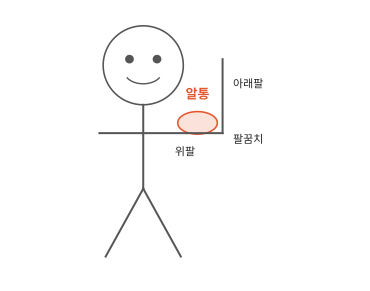
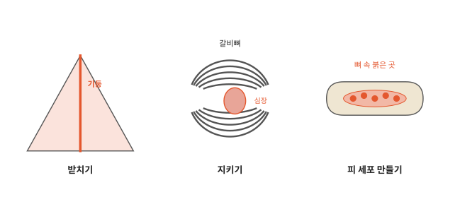
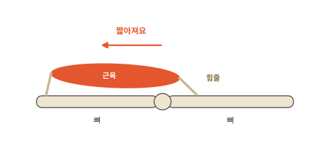
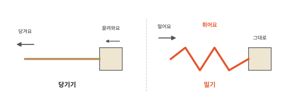
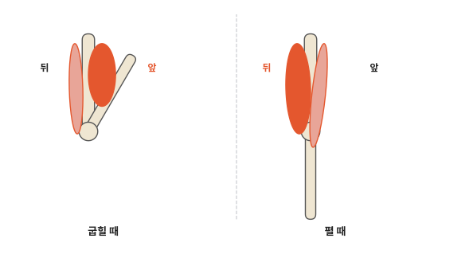
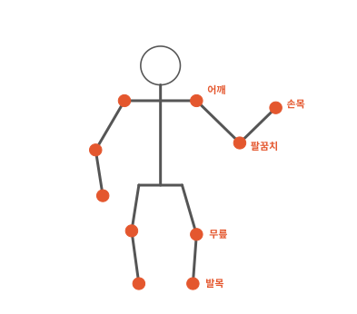
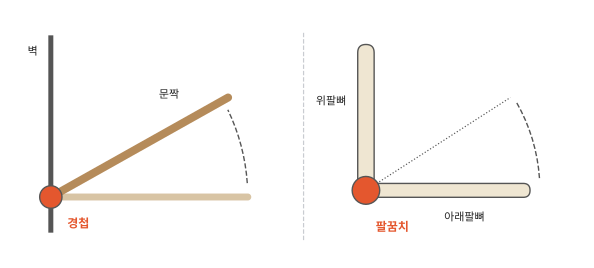
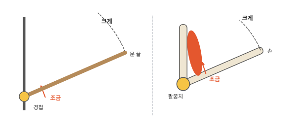

# 뼈와 근육: 팔을 굽히고 펴는 방법

주먹을 쥐고 팔을 힘껏 굽혀 보세요. 다른 손으로 위팔 앞쪽을 만지면 불룩하고 단단해요. 알통이에요. 이 글을 읽고 나면 팔이 굽고 펴질 때 뼈와 근육이 저마다 무슨 일을 하는지 알게 돼요. 걷기도 글씨 쓰기도 같은 방법으로 움직이니까 팔 하나만 알면 몸 전체가 움직이는 방법이 보여요.

!!! abstract "이 글에서 알게 되는 것"
    1. 뼈는 몸을 받치고 머리뼈나 갈비뼈처럼 몸속을 지켜요. 뼈 속 붉은 곳에서는 피 속 세포가 만들어져요.
    2. 근육은 짧아지면서 힘줄로 뼈를 당기기만 해요. 밀지는 못해서 굽히는 근육과 펴는 근육이 짝을 이뤄 반대로 당겨요.
    3. 뼈와 뼈가 만나 움직이는 곳을 관절이라고 해요. 팔 근육은 팔꿈치 가까이 붙어 있어서 조금만 짧아져도 손이 크게 움직여요. 대신 힘이 많이 들어요.

## 1. 팔 속에는 뼈와 근육이 있어요

팔꿈치 위쪽을 위팔, 아래쪽을 아래팔이라고 해요. 팔을 굽히면 아래팔이 팔꿈치에서 접혀 올라가요. 그때 위팔 앞쪽이 불룩해지죠.

아래 그림에서 빨갛게 칠한 곳을 보세요.

**그림 1.** 팔을 굽히면 위팔 앞쪽이 알통으로 불룩해져요.
{ .fig-cap }

이번에는 손바닥으로 벽을 밀면서 팔을 펴 보세요. 위팔 앞은 말랑해지고 뒤쪽이 단단해져요. 팔을 굽힐 때와 펼 때 단단해지는 곳이 달라요.

위팔을 꾹 쥐면 말랑한 살 안쪽에 아주 단단한 것이 만져져요. 이게 뼈예요. 불룩해지거나 말랑해지는 쪽은 근육이고요. 근육이 어떻게 팔을 움직이는지 보기 전에 뼈가 하는 일부터 볼게요.

## 2. 뼈는 몸을 받치고 속을 지켜요

뼈가 없으면 우리 몸은 어떻게 될까요? 텐트를 떠올려 보세요. 가운데 기둥을 빼면 텐트는 털썩 주저앉아요. 뼈는 텐트 기둥처럼 몸을 받쳐서 모양을 지켜 줘요.

뼈는 몸속에 있는 것도 지켜요. 머리뼈는 뇌를 단단하게 감싸요. 가슴의 갈비뼈는 새장처럼 둘러서 심장과 폐를 지켜요.

어떤 뼈 속에는 붉고 말랑한 곳이 있어요. 여기서 [4편](04-blood.md)의 빨간 세포와 [6편](06-clotting.md)의 혈소판 같은 피 속 세포와 조각이 만들어져요.

아래 그림에서 빨간 곳을 왼쪽부터 차례로 보세요.

**그림 2.** 뼈는 몸을 받치고 심장 같은 것을 지키고 속에서 피 세포를 만들어요.
{ .fig-cap }

그런데 뼈는 혼자서는 움직이지 못해요. 위팔뼈와 아래팔뼈를 움직이는 건 근육이에요.

## 3. 근육은 짧아지면서 뼈를 당기기만 해요

[1편](01-cells.md)에서 근육 세포는 길쭉하다고 했어요. 근육은 이런 길쭉한 세포가 다발로 모인 거예요. 근육 끝은 질긴 줄로 뼈에 붙어 있어요. 이 줄을 **힘줄**이라고 해요.

아래 그림에서 빨간 근육과 그 양 끝의 힘줄을 보세요.

**그림 3.** 근육이 짧아지면 힘줄로 붙은 뼈가 당겨져요.
{ .fig-cap }

일을 마친 근육은 힘이 풀려 말랑해져요. 하지만 힘을 풀어도 스스로 길어지지는 못해요. 뼈를 밀지도 못하고요.

줄다리기 줄을 떠올리면 쉬워요. 아래 그림의 왼쪽과 오른쪽을 비교해 보세요.

**그림 4.** 줄로 당기면 상자가 끌려오지만 줄로 밀면 줄만 휘고 상자는 그대로예요.
{ .fig-cap }

근육도 줄처럼 당길 수만 있어요. 다른 점은 근육은 스스로 줄어든다는 거예요. 줄은 사람이 잡아당겨야 하지만 근육은 [8편](08-nails-hair.md)에서 본 신경으로 뇌의 알림이 오면 줄어들면서 당겨요.

근육이 짧아지려면 힘이 들어요. 그 힘은 근육 세포가 [2편](02-breathing.md)의 산소와 [3편](03-digestion.md)의 영양으로 만들어요.

## 4. 굽히는 근육과 펴는 근육이 짝을 이뤄요

여기서 이런 생각이 들 거예요. 근육이 당기기만 한다면 굽힌 팔은 어떻게 다시 펼까요?

근육이 하나 더 있어요. 위팔 앞쪽에는 팔을 굽히는 큰 근육이 있고 뒤쪽에는 팔을 펴는 큰 근육이 있어요. 아래 그림에서 어느 쪽 근육이 빨간지 보세요. 빨간 근육이 짧아지면서 당기는 근육이에요.

**그림 5.** 굽힐 때는 앞 근육이 당기고 펼 때는 뒤 근육이 당겨요.
{ .fig-cap }

팔을 굽힐 때는 앞 근육이 짧아지면서 아래팔을 당겨요. 근육은 짧아지면 두꺼워져요. 알통이 불룩한 게 그 모습이에요. 그동안 뒤 근육은 힘을 풀고 늘어나요.

팔을 펼 때는 거꾸로예요. 뒤 근육이 짧아지면서 아래팔을 반대쪽으로 당기고 앞 근육은 힘을 풀고 늘어나요. 1절에서 벽을 밀며 팔을 펼 때 위팔 뒤가 단단해진 까닭이 이거예요.

줄다리기에서 두 편이 줄을 반대로 당기는 것과 같아요. 이렇게 서로 반대로 당기는 두 근육을 이 글에서는 **짝 근육**이라고 부를게요.

짝 근육은 책상 하나로 느껴 볼 수 있어요. 팔꿈치를 굽혀 아래팔을 책상 밑에 넣고 손바닥으로 책상 밑면을 위로 꾹 밀어 보세요. 다른 손으로 위팔을 잡아 보면 보통 앞쪽이 단단해져요. 이번에는 같은 자세로 책상 위에 손바닥을 얹고 아래로 꾹 눌러 보세요. 이번에는 뒤쪽이 단단해져요. 팔 모양은 그대로인데 미는 방향만 바꿨더니 짝 근육이 번갈아 일해요.

다리에도 손가락에도 이런 짝이 있어요. 의자에 앉아 다리를 앞으로 쭉 들어 올릴 때와 발을 의자 밑으로 끌어당길 때 허벅지 앞과 뒤를 만져 보세요.

## 5. 뼈는 관절에서 문짝처럼 돌아요

알통을 만들 때 팔은 아무 데서나 접히지 않아요. 늘 팔꿈치에서 접혀요. 위팔뼈와 아래팔뼈가 팔꿈치에서 만나기 때문이에요. 이렇게 뼈와 뼈가 만나 움직이는 곳을 **관절**이라고 해요.

관절은 몸 곳곳에 있어요. 아래 그림에서 빨간 점을 세어 보세요.

**그림 6.** 어깨, 팔꿈치, 손목, 무릎, 발목이 모두 관절이에요.
{ .fig-cap }

빨간 점은 열 개예요. 손가락 마디도 관절이니까 실제로는 훨씬 많아요.

팔꿈치는 문의 경첩과 닮았어요. 문은 벽에 붙은 경첩을 중심으로 돌아요. 아래 그림의 왼쪽 문과 오른쪽 팔을 나란히 보세요.

**그림 7.** 문짝이 경첩을 중심으로 돌듯 아래팔뼈는 팔꿈치를 중심으로 돌아요.
{ .fig-cap }

위팔뼈는 벽이고 아래팔뼈는 문짝이에요. 팔꿈치가 경첩이고요. 앞 근육이 아래팔을 당기면 아래팔뼈는 팔꿈치를 중심으로 돌면서 올라가요.

## 6. 근육은 팔꿈치 가까이를 조금만 당겨요

그럼 앞 근육은 아래팔 어디를 당길까요? 위팔 앞 근육은 팔꿈치 바로 가까이에서 아래팔뼈에 붙어 있어요.

문으로 먼저 해 볼게요. 문을 열 때 손잡이 쪽 대신 경첩 바로 옆을 밀어 보세요. 조금만 밀어도 문 끝은 크게 움직여요. 대신 손잡이 쪽을 밀 때보다 힘이 훨씬 많이 들어요.

아래 그림에서 빨간 "조금"과 검은 "크게"를 비교해 보세요.

**그림 8.** 경첩이나 팔꿈치 가까이를 조금 움직이면 문 끝과 손은 크게 움직여요.
{ .fig-cap }

팔도 문과 똑같아요. 근육이 팔꿈치 가까이를 당기니까 근육이 조금만 짧아져도 손은 크게 움직여요. 그 대신 근육은 힘을 많이 내야 해요.

??? info "더 알아보기: 어른이 쓰는 이름과 몇 가지 사실"
    - 위팔 앞의 굽히는 근육은 위팔두갈래근(이두근), 뒤의 펴는 근육은 위팔세갈래근(삼두근)이에요. 한 동작을 하는 근육을 주동근, 반대 동작을 하는 근육을 길항근이라고 해요. 이 글의 짝 근육이 이 둘의 짝이에요.[^lever]
    - 이 글의 근육은 뼈에 붙어 뼈를 움직이는 근육이에요. [5편](05-heart.md)의 심장도 근육으로 되어 있는데 우리가 생각하지 않아도 스스로 박자에 맞춰 짜요.
    - 어른 뼈대는 206개 뼈로 되어 있어요.[^div] 아기 때는 머리뼈처럼 나중에 하나로 붙을 뼈들이 아직 따로 있어서 뼈 조각 수가 어른보다 많아요.

## 정리

뼈는 텐트 기둥처럼 몸을 받치고 머리뼈와 갈비뼈처럼 뇌와 심장을 지켜요. 뼈 속 붉은 곳에서는 피 속 세포가 만들어져요.

근육은 길쭉한 세포 다발이고 끝은 힘줄로 뼈에 붙어 있어요. 근육은 짧아지면서 뼈를 당기기만 하고 밀지는 못해요. 그래서 팔에는 굽히는 앞 근육과 펴는 뒤 근육이 짝으로 있어요. 알통은 앞 근육이 짧아지면서 두꺼워진 모습이에요.

뼈와 뼈가 만나 움직이는 곳이 관절이에요. 아래팔뼈는 팔꿈치를 중심으로 문짝처럼 돌아요. 근육은 팔꿈치 가까이를 당겨서 조금만 짧아져도 손을 크게 움직이고 그 대신 힘을 많이 내요.

근육은 신경으로 뇌의 알림이 와야 당겨요. 뇌는 언제 알림을 보낼지 정하려고 바깥 소식을 받아요. 그 소식을 가장 많이 보내는 곳이 눈이에요. [10편](10-eyes.md)에서 눈이 어떻게 보는지 알아볼게요.

### 새로 나온 말

- **힘줄**: 근육 끝을 뼈에 붙이는 질긴 줄. 위팔 앞 근육은 힘줄로 아래팔뼈를 당겨요.
- **짝 근육**: 서로 반대쪽으로 당기는 두 근육. 위팔 앞 근육은 팔을 굽히고 뒤 근육은 팔을 펴요.
- **관절**: 뼈와 뼈가 만나 움직이는 곳. 팔꿈치, 무릎, 손가락 마디가 모두 관절이에요.

[^div]: OpenStax, *Anatomy and Physiology 2e*, 7.1 ["Divisions of the Skeletal System"](https://openstax.org/books/anatomy-and-physiology-2e/pages/7-1-divisions-of-the-skeletal-system).
[^lever]: OpenStax, *Anatomy and Physiology 2e*, 11.1 ["Interactions of Skeletal Muscles, Their Fascicle Arrangement, and Their Lever Systems"](https://openstax.org/books/anatomy-and-physiology-2e/pages/11-1-interactions-of-skeletal-muscles-their-fascicle-arrangement-and-their-lever-systems).
